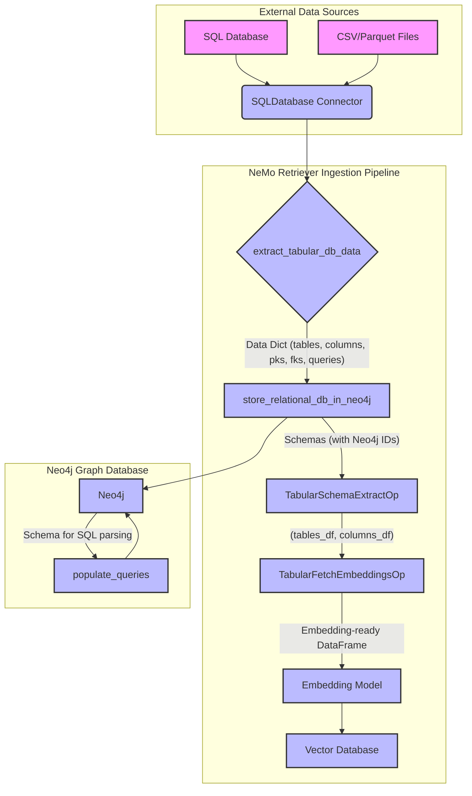
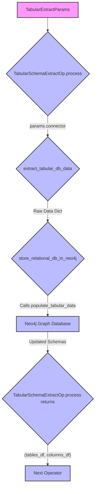
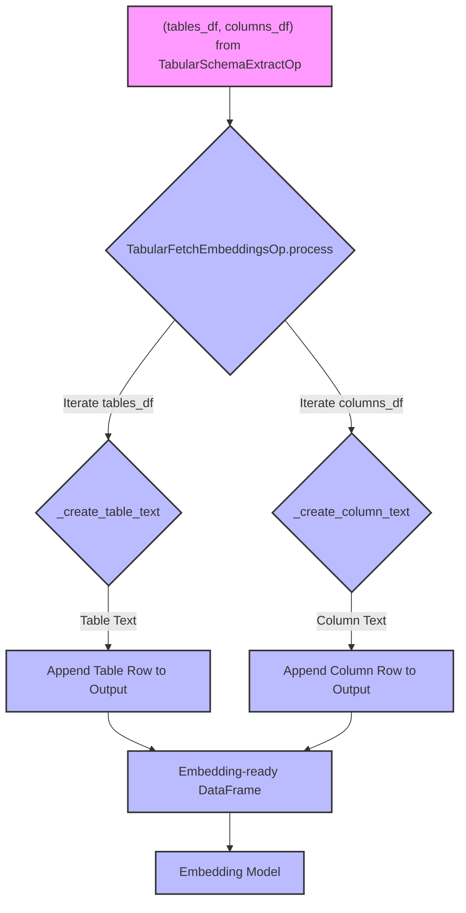
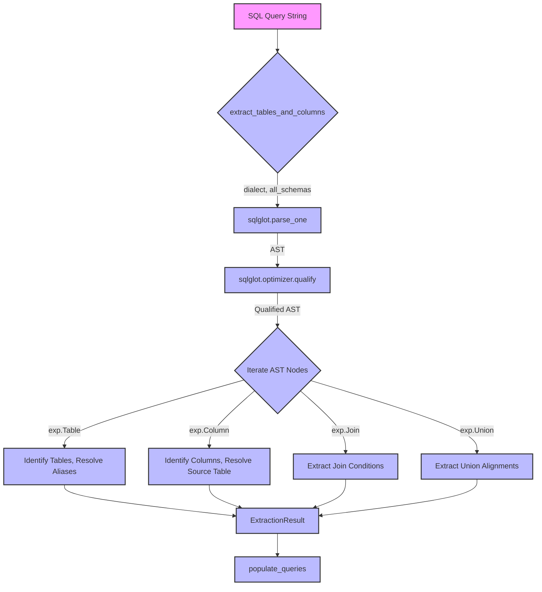

<!-- source: DeepWiki mcp.deepwiki.com · repo NVIDIA/NeMo-Retriever · extra page Tabular Data Ingestion · fetched 2026-10-26 -->

# Tabular Data Ingestion

<details>
<summary>Relevant source files</summary>

The following files were used as context for generating this wiki page:

- [nemo_retriever/src/nemo_retriever/graph/tabular_fetch_embeddings_operator.py](nemo_retriever/src/nemo_retriever/graph/tabular_fetch_embeddings_operator.py)
- [nemo_retriever/src/nemo_retriever/graph/tabular_schema_extract_operator.py](nemo_retriever/src/nemo_retriever/graph/tabular_schema_extract_operator.py)
- [nemo_retriever/src/nemo_retriever/tabular_data/ingestion/dal/queries_dal.py](nemo_retriever/src/nemo_retriever/tabular_data/ingestion/dal/queries_dal.py)
- [nemo_retriever/src/nemo_retriever/tabular_data/ingestion/dal/utils_dal.py](nemo_retriever/src/nemo_retriever/tabular_data/ingestion/dal/utils_dal.py)
- [nemo_retriever/src/nemo_retriever/tabular_data/ingestion/extract_data.py](nemo_retriever/src/nemo_retriever/tabular_data/ingestion/extract_data.py)
- [nemo_retriever/src/nemo_retriever/tabular_data/ingestion/model/query.py](nemo_retriever/src/nemo_retriever/tabular_data/ingestion/model/query.py)
- [nemo_retriever/src/nemo_retriever/tabular_data/ingestion/model/reserved_words.py](nemo_retriever/src/nemo_retriever/tabular_data/ingestion/model/reserved_words.py)
- [nemo_retriever/src/nemo_retriever/tabular_data/ingestion/model/schema.py](nemo_retriever/src/nemo_retriever/tabular_data/ingestion/model/schema.py)
- [nemo_retriever/src/nemo_retriever/tabular_data/ingestion/parsers/sqlglot_extractor.py](nemo_retriever/src/nemo_retriever/tabular_data/ingestion/parsers/sqlglot_extractor.py)
- [nemo_retriever/src/nemo_retriever/tabular_data/ingestion/services/queries.py](nemo_retriever/src/nemo_retriever/tabular_data/ingestion/services/queries.py)
- [nemo_retriever/src/nemo_retriever/tabular_data/ingestion/write_to_graph.py](nemo_retriever/src/nemo_retriever/tabular_data/ingestion/write_to_graph.py)
- [nemo_retriever/tests/test_sqlglot_extractor.py](nemo_retriever/tests/test_sqlglot_extractor.py)

</details>


This page details the process of ingesting structured data from various sources (SQL databases, CSV, Parquet files) into the NeMo Retriever graph pipeline. It covers the components responsible for extracting schema information, parsing SQL queries, and writing this data to the Neo4j graph database. The goal is to enable semantic search and Text-to-SQL capabilities over tabular data.

## Overview of Tabular Data Ingestion

The ingestion of tabular data involves several key steps:
1.  **Data Extraction**: Connecting to a relational database (or processing structured files) to extract metadata such as table names, column names, data types, primary keys (PKs), and foreign keys (FKs).
2.  **Schema Parsing**: Organizing the extracted metadata into a structured format suitable for graph representation.
3.  **SQL Query Analysis**: Parsing example SQL queries to identify referenced tables, columns, and join/union relationships. This is crucial for understanding how different parts of the schema are used together.
4.  **Graph Population**: Writing the parsed schema and query information as nodes and relationships into the Neo4j graph database.
5.  **Embedding Preparation**: Generating embedding-ready text representations for tables and columns, which are then used by downstream embedding models.

### Data Flow Diagram


Title: Tabular Data Ingestion Data Flow
Sources:
- [nemo_retriever/src/nemo_retriever/tabular_data/ingestion/extract_data.py:41-70]()
- [nemo_retriever/src/nemo_retriever/graph/tabular_schema_extract_operator.py:18-36]()
- [nemo_retriever/src/nemo_retriever/graph/tabular_fetch_embeddings_operator.py:21-40]()

## Schema Extraction Operators

The ingestion process is orchestrated by two primary graph operators: `TabularSchemaExtractOp` and `TabularFetchEmbeddingsOp`.

### `TabularSchemaExtractOp`

The `TabularSchemaExtractOp` is responsible for extracting schema metadata from a relational database and writing it to Neo4j.

**Purpose**:
-   Connects to a relational database using a `SQLDatabase` connector.
-   Extracts tables, columns, views, primary keys (PKs), and foreign keys (FKs).
-   Populates the Neo4j graph with these schema entities as nodes and relationships.

**Implementation Details**:
-   It takes `TabularExtractParams` as input, which contains the `SQLDatabase` connector.
-   The `process` method [nemo_retriever/src/nemo_retriever/graph/tabular_schema_extract_operator.py:52-72]() calls `extract_tabular_db_data` to get the raw schema information and then `store_relational_db_in_neo4j` to persist it in Neo4j.
-   `extract_tabular_db_data` [nemo_retriever/src/nemo_retriever/tabular_data/ingestion/extract_data.py:41-54]() uses the `SQLDatabase` connector to fetch tables, columns, views, PKs, and FKs.
-   `store_relational_db_in_neo4j` [nemo_retriever/src/nemo_retriever/tabular_data/ingestion/extract_data.py:57-70]() then calls `populate_tabular_data` [nemo_retriever/src/nemo_retriever/tabular_data/ingestion/write_to_graph.py:31-57]() to handle the actual Neo4j write operations.
-   The operator returns a tuple of `(tables_df, columns_df)` [nemo_retriever/src/nemo_retriever/graph/tabular_schema_extract_operator.py:67-71]() containing the ingested tables and columns, including their newly assigned Neo4j UUIDs. This allows downstream operators to use this data without another round-trip to Neo4j.


Title: TabularSchemaExtractOp Workflow
Sources:
- [nemo_retriever/src/nemo_retriever/graph/tabular_schema_extract_operator.py:18-75]()
- [nemo_retriever/src/nemo_retriever/tabular_data/ingestion/extract_data.py:41-70]()
- [nemo_retriever/src/nemo_retriever/tabular_data/ingestion/write_to_graph.py:31-57]()

### `TabularFetchEmbeddingsOp`

The `TabularFetchEmbeddingsOp` transforms the extracted schema DataFrames into a format suitable for embedding generation.

**Purpose**:
-   Takes the `(tables_df, columns_df)` output from `TabularSchemaExtractOp`.
-   Constructs embedding-ready text for each table and column.
-   Generates a DataFrame with `text`, `_embed_modality`, `path`, `page_number`, and `metadata` columns, aligning with the expected input for embedding models.

**Implementation Details**:
-   The `process` method [nemo_retriever/src/nemo_retriever/graph/tabular_fetch_embeddings_operator.py:57-68]() receives the `(tables_df, columns_df)` tuple.
-   It iterates through `tables_df` and `columns_df` to build text representations using `_create_table_text` [nemo_retriever/src/nemo_retriever/graph/tabular_fetch_embeddings_operator.py:142-173]() and `_create_column_text` [nemo_retriever/src/nemo_retriever/graph/tabular_fetch_embeddings_operator.py:176-190]().
-   Each row in the output DataFrame represents either a table or a column, with its corresponding text and metadata.
-   The `_create_table_text` function combines the table name, description, and a compact list of its columns.
-   The `_create_column_text` function combines the column name, description, data type, and sample values.
-   The `metadata` field includes `node_id`, `label` (e.g., `Labels.TABLE`, `Labels.COLUMN`), `name`, `schema_name`, and `database_name` [nemo_retriever/src/nemo_retriever/graph/tabular_fetch_embeddings_operator.py:102-109]().


Title: TabularFetchEmbeddingsOp Workflow
Sources:
- [nemo_retriever/src/nemo_retriever/graph/tabular_fetch_embeddings_operator.py:21-190]()

## `sqlglot_extractor`

The `sqlglot_extractor` module [nemo_retriever/src/nemo_retriever/tabular_data/ingestion/parsers/sqlglot_extractor.py:1-23]() is a core component for parsing SQL queries and extracting referenced tables, columns, and relationships. It leverages the `sqlglot` library for SQL parsing and qualification.

**Purpose**:
-   Parses SQL queries into an Abstract Syntax Tree (AST).
-   Identifies all tables and columns referenced in the query.
-   Resolves table aliases and schema prefixes.
-   Extracts join conditions and union alignments.
-   Uses provided schema information (`all_schemas`) to assist in resolving ambiguous column references.

**Key Classes and Functions**:
-   `SQLSyntaxError` [nemo_retriever/src/nemo_retriever/tabular_data/ingestion/parsers/sqlglot_extractor.py:35-43](): Custom exception for SQL parsing errors.
-   `TableMatch` [nemo_retriever/src/nemo_retriever/tabular_data/ingestion/parsers/sqlglot_extractor.py:46-61](): Stores extracted columns for a single table and its owning schema name.
-   `JoinPair` [nemo_retriever/src/nemo_retriever/tabular_data/ingestion/parsers/sqlglot_extractor.py:64-75](): Represents a join condition between two columns.
-   `UnionPair` [nemo_retriever/src/nemo_retriever/tabular_data/ingestion/parsers/sqlglot_extractor.py:78-89](): Represents two columns aligned in a UNION/UNION ALL operation.
-   `ExtractionResult` [nemo_retriever/src/nemo_retriever/tabular_data/ingestion/parsers/sqlglot_extractor.py:92-114](): A dataclass holding the complete output of the extraction, including tables, AST node count, joins, and unions.
-   `extract_tables_and_columns(sql, dialect, all_schemas)`: The main function that performs the SQL parsing and extraction.
    -   It uses `sqlglot.parse_one` to parse the SQL.
    -   The `qualify` optimizer pass [nemo_retriever/src/nemo_retriever/tabular_data/ingestion/parsers/sqlglot_extractor.py:240]() annotates `Column` nodes with their source tables.
    -   `_alias_to_table_map` [nemo_retriever/src/nemo_retriever/tabular_data/ingestion/parsers/sqlglot_extractor.py:128-144]() builds a mapping from aliases to qualified table names.
    -   `_build_schema_dict` [nemo_retriever/src/nemo_retriever/tabular_data/ingestion/parsers/sqlglot_extractor.py:147-166]() prepares a flat schema dictionary for `sqlglot`'s `qualify` pass.
    -   It iterates through the qualified AST to identify `Table`, `Column`, `Join`, and `Union` expressions.

**Integration with `populate_queries`**:
The `populate_queries` function [nemo_retriever/src/nemo_retriever/tabular_data/ingestion/services/queries.py:56-57]() uses `extract_tables_and_columns` to parse example SQL queries. The `ExtractionResult` is then used to populate `Query` objects with referenced tables, columns, and relationships, which are subsequently written to Neo4j.


Title: sqlglot_extractor Workflow
Sources:
- [nemo_retriever/src/nemo_retriever/tabular_data/ingestion/parsers/sqlglot_extractor.py:1-23]()
- [nemo_retriever/src/nemo_retriever/tabular_data/ingestion/parsers/sqlglot_extractor.py:35-114]()
- [nemo_retriever/src/nemo_retriever/tabular_data/ingestion/parsers/sqlglot_extractor.py:128-166]()
- [nemo_retriever/src/nemo_retriever/tabular_data/ingestion/services/queries.py:56-57]()

## `write_to_graph`

The `write_to_graph` module [nemo_retriever/src/nemo_retriever/tabular_data/ingestion/write_to_graph.py:1-143]() is responsible for orchestrating the population of the Neo4j graph database with tabular schema information and SQL query metadata.

**Purpose**:
-   Receives extracted tabular data (tables, columns, PKs, FKs, queries) as DataFrames.
-   Parses these DataFrames into `Schema` objects.
-   Adds or updates database, schema, table, and column nodes in Neo4j.
-   Adds primary key (PK) and foreign key (FK) relationships.
-   Processes example SQL queries, extracting their structure and linking them to relevant schema entities in Neo4j.

**Key Functions**:
-   `populate_tabular_data(data, num_workers, dialect)` [nemo_retriever/src/nemo_retriever/tabular_data/ingestion/write_to_graph.py:31-57]():
    -   The main entry point for writing tabular data to the graph.
    -   Calls `add_indices()` to ensure necessary Neo4j indices exist.
    -   Extracts `tables_df` and `columns_df` from the input `data` dictionary.
    -   Calls `populate_db` to handle database, schema, table, and column ingestion.
    -   If `fks` are present, calls `populate_fks` [nemo_retriever/src/nemo_retriever/tabular_data/ingestion/write_to_graph.py:48-49]() to add foreign key relationships.
    -   If `pks` are present, calls `populate_pks` [nemo_retriever/src/nemo_retriever/tabular_data/ingestion/write_to_graph.py:51-52]() to add primary key relationships.
    -   If `queries` are present, calls `populate_queries` [nemo_retriever/src/nemo_retriever/tabular_data/ingestion/write_to_graph.py:54-55]() to process and ingest SQL query metadata.
-   `populate_db(tables_df, columns_df, database, num_workers)` [nemo_retriever/src/nemo_retriever/tabular_data/ingestion/write_to_graph.py:60-125]():
    -   Parses `tables_df` and `columns_df` into `Schema` objects using `schemas_parser.parse_df`.
    -   Checks if the database already exists in Neo4j using `db_exists`.
    -   Handles both initial creation and updates of schemas, tables, and columns, including adding new schemas, updating existing ones, and deleting removed schemas.
    -   Uses `ThreadPoolExecutor` for concurrent schema updates [nemo_retriever/src/nemo_retriever/tabular_data/ingestion/write_to_graph.py:99-103]().
-   `populate_fks(fks, database_name)` [nemo_retriever/src/nemo_retriever/tabular_data/ingestion/write_to_graph.py:128-132](): Adds foreign key relationships to Neo4j.
-   `populate_pks(pks, database_name)` [nemo_retriever/src/nemo_retriever/tabular_data/ingestion/write_to_graph.py:135-138](): Adds primary key relationships to Neo4j.

**Graph Structure**:
-   **Nodes**: `Database`, `Schema`, `Table`, `Column`, `Sql` [nemo_retriever/src/nemo_retriever/tabular_data/ingestion/model/reserved_words.py:7-10]().
-   **Relationships**:
    -   `CONTAINS`: `Database` -> `Schema`, `Schema` -> `Table`, `Table` -> `Column` [nemo_retriever/src/nemo_retriever/tabular_data/ingestion/model/reserved_words.py:26]().
    -   `FOREIGN_KEY`: Between `Column` nodes [nemo_retriever/src/nemo_retriever/tabular_data/ingestion/model/reserved_words.py:27]().
    -   `SQL`: `Sql` -> `Table`, `Sql` -> `Column` [nemo_retriever/src/nemo_retriever/tabular_data/ingestion/model/reserved_words.py:29]().
    -   `JOIN`: Between `Column` nodes involved in a join [nemo_retriever/src/nemo_retriever/tabular_data/ingestion/model/reserved_words.py:28]().
    -   `UNION`: Between `Column` nodes involved in a union [nemo_retriever/src/nemo_retriever/tabular_data/ingestion/model/reserved_words.py:29]().

```mermaid
graph TD
    A[Input Data Dict] --> B{populate_tabular_data};
    B -- "tables_df, columns_df" --> C{populate_db};
    C -- "Schema Objects" --> D[Neo4jNode (Database, Schema, Table, Column)];
    D --> E[Neo4j Graph Database];
    B -- "fks" --> F{populate_fks};
    F --> E;
    B -- "pks" --> G{populate_pks};
    G --> E;
    B -- "queries" --> H{populate_queries};
    H -- "Query Objects, Edges" --> I[Neo4jNode (Sql)];
    I --> E;

    style A fill:#f9f,stroke:#333,stroke-width:2px
    style B fill:#bbf,stroke:#333,stroke-width:2px
    style C fill:#bbf,stroke:#333,stroke-width:2px
    style D fill:#bbf,stroke:#333,stroke-width:2px
    style E fill:#bbf,stroke:#333,stroke-width:2px
    style F fill:#bbf,stroke:#333,stroke-width:2px
    style G fill:#bbf,stroke:#333,stroke-width:2px
    style H fill:#bbf,stroke:#333,stroke-width:2px
    style I fill:#bbf,stroke:#333,stroke-width:2px
```
Title: write_to_graph Workflow
Sources:
- [nemo_retriever/src/nemo_retriever/tabular_data/ingestion/write_to_graph.py:1-143]()
- [nemo_retriever/src/nemo_retriever/tabular_data/ingestion/model/reserved_words.py:7-31]()
- [nemo_retriever/src/nemo_retriever/tabular_data/ingestion/services/queries.py:14-16]()

## SQL Query Ingestion (`populate_queries`)

The `populate_queries` function [nemo_retriever/src/nemo_retriever/tabular_data/ingestion/services/queries.py:38-161]() is responsible for processing example SQL queries and integrating their metadata into the Neo4j graph. This process helps in understanding query patterns and relationships between schema entities.

**Purpose**:
-   Parses each SQL query to identify referenced tables, columns, and structural properties (AST node count, join count, union count).
-   Compares new queries against existing ones in the graph to avoid duplicates and update usage statistics.
-   Creates `Sql` nodes and `SQL` relationships to `Table` and `Column` nodes.
-   Creates `JOIN` and `UNION` relationships between `Column` nodes when detected in the SQL.

**Implementation Details**:
-   It takes a list of SQL queries, the `all_schemas` dictionary (containing `Schema` objects with Neo4j IDs), and `num_workers`.
-   It first loads existing SQLs from the graph using `load_sqls_to_tables` [nemo_retriever/src/nemo_retriever/tabular_data/ingestion/services/queries.py:192]().
-   For each new SQL query:
    -   It calls `parse_query_single` [nemo_retriever/src/nemo_retriever/tabular_data/ingestion/services/queries.py:165-188]() which in turn uses `parse_query_slim` [nemo_retriever/src/nemo_retriever/tabular_data/ingestion/services/queries.py:38-161]() to extract tables, columns, joins, and unions using `sqlglot_extractor.extract_tables_and_columns`.
    -   `parse_query_slim` populates a `Query` object [nemo_retriever/src/nemo_retriever/tabular_data/ingestion/model/query.py:9-36]() with the extracted information, including `ast_node_count`, `join_count`, `union_count`, and a list of edges to be created.
    -   It then attempts to find identical SQLs already in the graph using `get_candidate_sql_ids` [nemo_retriever/src/nemo_retriever/tabular_data/ingestion/services/queries.py:130-136]() (which pre-filters based on tables, columns, and structural counts) and `compare_queries` (for deep structural comparison).
    -   If an identical SQL is found, its counters and timestamps are updated using `update_counters_and_timestamps_for_query_and_affected_data` [nemo_retriever/src/nemo_retriever/tabular_data/ingestion/dal/queries_dal.py:41-95]().
    -   If it's a new SQL, a new `Sql` node and its associated `SQL`, `JOIN`, and `UNION` edges are added to the graph using `add_query` [nemo_retriever/src/nemo_retriever/tabular_data/ingestion/dal/queries_dal.py:14-18]().

```mermaid
graph TD
    A[List of SQL Queries] --> B{populate_queries};
    B -- "all_schemas" --> C[load_sqls_to_tables];
    C -- "Existing SQLs (DataFrame)" --> D{For Each New SQL};
    D -- "SQL String" --> E{parse_query_single};
    E -- "Calls sqlglot_extractor" --> F[Query Object (with tables, columns, joins, unions, AST counts)];
    F --> G{get_candidate_sql_ids};
    G -- "Candidate SQLs" --> H{compare_queries};
    H -- "Identical SQL Found?" --> I{Update Counters and Timestamps};
    I --> J[Neo4j Graph Database];
    H -- "New SQL" --> K{add_query};
    K -- "Sql Node, SQL/JOIN/UNION Edges" --> J;

    style A fill:#f9f,stroke:#333,stroke-width:2px
    style B fill:#bbf,stroke:#333,stroke-width:2px
    style C fill:#bbf,stroke:#333,stroke-width:2px
    style D fill:#bbf,stroke:#333,stroke-width:2px
    style E fill:#bbf,stroke:#333,stroke-width:2px
    style F fill:#bbf,stroke:#333,stroke-width:2px
    style G fill:#bbf,stroke:#333,stroke-width:2px
    style H fill:#bbf,stroke:#333,stroke-width:2px
    style I fill:#bbf,stroke:#333,stroke-width:2px
    style J fill:#bbf,stroke:#333,stroke-width:2px
    style K fill:#bbf,stroke:#333,stroke-width:2px
```
Title: populate_queries Workflow
Sources:
- [nemo_retriever/src/nemo_retriever/tabular_data/ingestion/services/queries.py:14-20]()
- [nemo_retriever/src/nemo_retriever/tabular_data/ingestion/services/queries.py:38-161]()
- [nemo_retriever/src/nemo_retriever/tabular_data/ingestion/services/queries.py:165-188]()
- [nemo_retriever/src/nemo_retriever/tabular_data/ingestion/dal/queries_dal.py:41-95]()
- [nemo_retriever/src/nemo_retriever/tabular_data/ingestion/dal/queries_dal.py:14-18]()
- [nemo_retriever/src/nemo_retriever/tabular_data/ingestion/model/query.py:9-36]()

---

