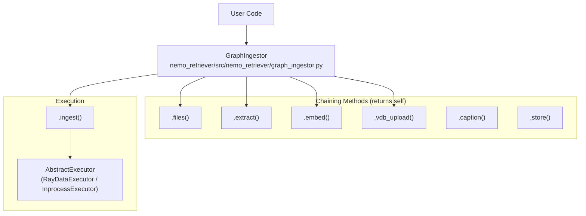
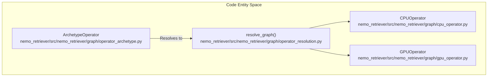

<!-- source: DeepWiki mcp.deepwiki.com · repo NVIDIA/NeMo-Retriever · extra page Task Chaining and Pipeline Building · fetched 2026-10-26 -->

# Task Chaining and Pipeline Building

<details>
<summary>Relevant source files</summary>

The following files were used as context for generating this wiki page:

- [nemo_retriever/src/nemo_retriever/adapters/cli/main.py](nemo_retriever/src/nemo_retriever/adapters/cli/main.py)
- [nemo_retriever/src/nemo_retriever/adapters/cli/sdk_workflow.py](nemo_retriever/src/nemo_retriever/adapters/cli/sdk_workflow.py)
- [nemo_retriever/src/nemo_retriever/graph/executor.py](nemo_retriever/src/nemo_retriever/graph/executor.py)
- [nemo_retriever/src/nemo_retriever/graph/ingestor_runtime.py](nemo_retriever/src/nemo_retriever/graph/ingestor_runtime.py)
- [nemo_retriever/src/nemo_retriever/graph/multi_type_extract_operator.py](nemo_retriever/src/nemo_retriever/graph/multi_type_extract_operator.py)
- [nemo_retriever/src/nemo_retriever/graph_ingestor.py](nemo_retriever/src/nemo_retriever/graph_ingestor.py)
- [nemo_retriever/src/nemo_retriever/params/utils.py](nemo_retriever/src/nemo_retriever/params/utils.py)
- [nemo_retriever/src/nemo_retriever/utils/input_files.py](nemo_retriever/src/nemo_retriever/utils/input_files.py)
- [nemo_retriever/tests/test_ingest_interface.py](nemo_retriever/tests/test_ingest_interface.py)
- [nemo_retriever/tests/test_ingest_plans.py](nemo_retriever/tests/test_ingest_plans.py)
- [nemo_retriever/tests/test_params_utils.py](nemo_retriever/tests/test_params_utils.py)
- [nemo_retriever/tests/test_pipeline_graph.py](nemo_retriever/tests/test_pipeline_graph.py)
- [nemo_retriever/tests/test_root_cli_workflow.py](nemo_retriever/tests/test_root_cli_workflow.py)

</details>


This page explains how to use the `GraphIngestor` fluent API to build document processing pipelines by chaining tasks together. It covers the underlying graph operator model, execution modes, and the use of custom operators.

## Purpose and Scope

The NeMo Retriever Library (specifically within the NVIDIA Ingest framework) provides a declarative, chainable interface for building document ingestion pipelines. Rather than manually constructing complex execution graphs, you use the `GraphIngestor` class to build pipelines by chaining method calls like `.files().extract().embed().vdb_upload()`. This page documents:

- The `GraphIngestor` fluent API and task methods.
- The Graph operator model (CPU, GPU, and Archetype operators).
- Execution modes: Batch (Ray-based) and Inprocess (Pandas-based).
- Task expansion and resource heuristics.
- Using `UDFOperator` for custom processing stages.

## The GraphIngestor Interface

The `GraphIngestor` class provides a fluent interface where each method returns `self`, enabling continuous chaining. It serves as a builder that eventually materializes a `Graph` object composed of `Node` entities.



**Sources:**
- [nemo_retriever/src/nemo_retriever/graph_ingestor.py:15-25]()
- [nemo_retriever/src/nemo_retriever/graph_ingestor.py:94-138]()

## Task Method Reference

The following table lists the primary task methods available on the `GraphIngestor` class.

| Method | Purpose | Key Parameters |
|--------|---------|----------------|
| `.files(paths)` | Defines input file patterns/globs | `paths`: list of strings |
| `.extract(params)` | Configures document extraction | `ExtractParams` (method, extract_text, etc.) |
| `.embed(params)` | Configures embedding generation | `EmbedParams` (model_name, invoke_url) |
| `.vdb_upload(params)`| Configures vector database sink | `VdbUploadParams` (uri, table_name) |
| `.caption(params)` | Configures image captioning | `CaptionParams` |
| `.store(params)` | Configures object storage (MinIO) | `StoreParams` |
| `.udf(op_class, **kwargs)`| Adds a custom operator | `op_class`: Class deriving from `AbstractOperator` |

**Sources:**
- [nemo_retriever/src/nemo_retriever/graph_ingestor.py:18-24]()
- [nemo_retriever/src/nemo_retriever/graph_ingestor.py:48-65]()

## Pipeline Graph Model

When `.ingest()` is called, the `GraphIngestor` builds a `Graph` consisting of `Node` objects. Each `Node` wraps an `operator_class` and its `operator_kwargs`.

### Operator Types
The system uses three main operator archetypes to handle different hardware requirements:

1.  **CPUOperator**: Optimized for CPU-bound tasks (e.g., text splitting).
2.  **GPUOperator**: Designed for local GPU inference, requesting a specific GPU fraction.
3.  **ArchetypeOperator**: A "meta-operator" that resolves to either a `CPUOperator` or `GPUOperator` at runtime based on the presence of a remote NIM endpoint or local GPU availability.



**Sources:**
- [nemo_retriever/src/nemo_retriever/graph/operator_archetype.py:1-20]()
- [nemo_retriever/src/nemo_retriever/graph/operator_resolution.py:17-30]()
- [nemo_retriever/src/nemo_retriever/graph/pipeline_graph.py:28-45]()

## Execution Modes

Pipelines can be executed in two primary modes via `AbstractExecutor` implementations:

### 1. Batch Mode (`RayDataExecutor`)
The default for production. It builds a Ray Data pipeline where each `Node` becomes a `map_batches` stage. Heavy GPU models are loaded on Ray workers using deferred construction (`fn_constructor_kwargs`) to prevent serialization issues.

### 2. Inprocess Mode (`InprocessExecutor`)
Used for local debugging and CI. It runs the graph sequentially on Pandas DataFrames without Ray. It only supports linear (single-root) graphs.

**Sources:**
- [nemo_retriever/src/nemo_retriever/graph/executor.py:42-58]()
- [nemo_retriever/src/nemo_retriever/graph/executor.py:60-141]()
- [nemo_retriever/src/nemo_retriever/graph/executor.py:161-195]()

## Automatic Task Expansion and Resource Heuristics

The `MultiTypeExtractOperator` is a key component that handles mixed file types (PDF, Images, Audio, Video, HTML, Text). It automatically routes files to the appropriate sub-actors (e.g., `PDFExtractionActor`, `ASRActor`).

### Resource Overrides
The `batch_tuning_to_node_overrides` function calculates optimal Ray resource allocations (CPUs/GPUs) for each stage based on:
- `BatchTuningParams` provided in the task parameters.
- Cluster resource heuristics (available GPUs/CPUs).
- Whether remote NIM endpoints are configured (which offloads GPU requirements).


**Sources:**
- [nemo_retriever/src/nemo_retriever/graph/ingestor_runtime.py:75-120]()
- [nemo_retriever/src/nemo_retriever/graph/multi_type_extract_operator.py:149-175]()

## Custom Stages with UDFOperator

To extend the pipeline with custom logic, use the `UDFOperator`. This allows you to wrap a Python function or a class and insert it into the graph.

```python
from nemo_retriever.graph import UDFOperator
from nemo_retriever.graph_ingestor import GraphIngestor

def custom_logic(df):
    df["custom_field"] = df["text"].apply(lambda x: x.upper())
    return df

ingestor = (
    GraphIngestor(run_mode="batch")
    .files(["/data/*.txt"])
    .extract()
    .udf(UDFOperator, func=custom_logic) # Insert custom stage
    .ingest()
)
```

**Sources:**
- [nemo_retriever/src/nemo_retriever/graph/ingestor_runtime.py:19-25]()
- [nemo_retriever/tests/test_pipeline_graph.py:15-28]()

## Error Handling: GraphIngestionError

When a pipeline is executed with `error_policy='collect'`, row-level errors from remote NIMs or local operators are captured. If significant failures occur, `GraphIngestor` raises a `GraphIngestionError` which includes:
- Structured row-level error records.
- Diagnostic info mapping columns to specific NIM endpoints.
- A troubleshooting footer with HTTP status codes and suggested actions.

**Sources:**
- [nemo_retriever/src/nemo_retriever/graph_ingestor.py:114-138]()
- [nemo_retriever/src/nemo_retriever/graph_ingestor.py:151-193]()

---

