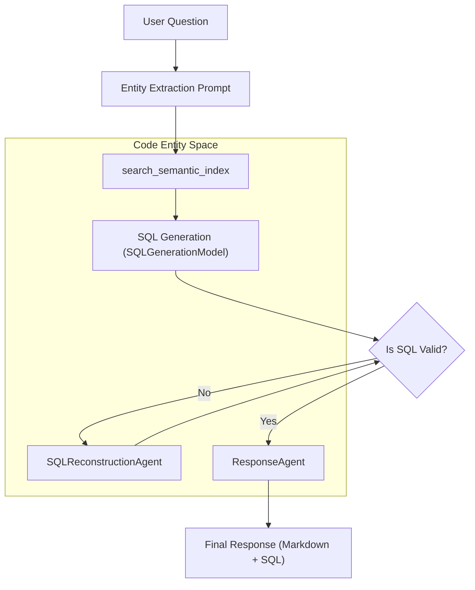
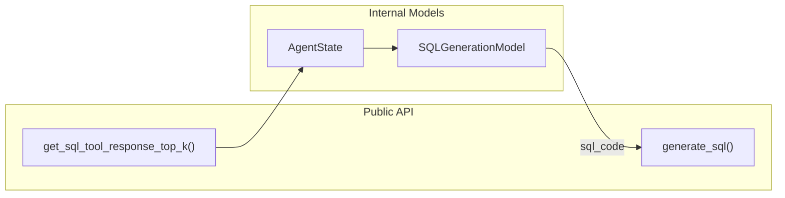

<!-- source: DeepWiki mcp.deepwiki.com · repo NVIDIA/NeMo-Retriever · extra page Text-to-SQL Agent · fetched 2026-10-26 -->

# Text-to-SQL Agent

Relevant source files

The following files were used as context for generating this wiki page:

- [nemo_retriever/src/nemo_retriever/tabular_data/retrieval/__init__.py](nemo_retriever/src/nemo_retriever/tabular_data/retrieval/__init__.py)
- [nemo_retriever/src/nemo_retriever/tabular_data/retrieval/data_access/semantic_search.py](nemo_retriever/src/nemo_retriever/tabular_data/retrieval/data_access/semantic_search.py)
- [nemo_retriever/src/nemo_retriever/tabular_data/retrieval/generate_sql.py](nemo_retriever/src/nemo_retriever/tabular_data/retrieval/generate_sql.py)
- [nemo_retriever/src/nemo_retriever/tabular_data/retrieval/text_to_sql/agents/response.py](nemo_retriever/src/nemo_retriever/tabular_data/retrieval/text_to_sql/agents/response.py)
- [nemo_retriever/src/nemo_retriever/tabular_data/retrieval/text_to_sql/agents/sql_reconstruction.py](nemo_retriever/src/nemo_retriever/tabular_data/retrieval/text_to_sql/agents/sql_reconstruction.py)
- [nemo_retriever/src/nemo_retriever/tabular_data/retrieval/text_to_sql/models.py](nemo_retriever/src/nemo_retriever/tabular_data/retrieval/text_to_sql/models.py)
- [nemo_retriever/src/nemo_retriever/tabular_data/retrieval/text_to_sql/prompts.py](nemo_retriever/src/nemo_retriever/tabular_data/retrieval/text_to_sql/prompts.py)
- [nemo_retriever/tests/test_semantic_search_metadata_filter_format.py](nemo_retriever/tests/test_semantic_search_metadata_filter_format.py)

The Text-to-SQL Agent is a LangGraph-based orchestration system designed to transform natural language questions into executable SQL queries by leveraging semantic search over database schemas and specialized LLM reasoning. It provides a robust interface for querying structured data without requiring users to understand the underlying schema or SQL syntax [nemo_retriever/src/nemo_retriever/tabular_data/retrieval/generate_sql.py:1-10]().

## Overview and Architecture

The agent operates by retrieving relevant database entities (tables, columns, and custom analyses) from a vector database and then using an LLM to construct a valid SQL query. It features a self-correction loop where queries that fail validation or execution are sent to a reconstruction agent for fixing [nemo_retriever/src/nemo_retriever/tabular_data/retrieval/text_to_sql/agents/sql_reconstruction.py:5-22]().

### Data Flow and Execution Graph

The system follows a structured flow from natural language input to a formatted markdown response containing the SQL and its explanation.

1.  **Semantic Retrieval**: The system identifies relevant schema elements using vector similarity search [nemo_retriever/src/nemo_retriever/tabular_data/retrieval/data_access/semantic_search.py:5-11]().
2.  **SQL Generation**: An LLM generates a structured response including reasoning, the SQL code, and a human-readable explanation [nemo_retriever/src/nemo_retriever/tabular_data/retrieval/text_to_sql/models.py:78-86]().
3.  **Validation and Reconstruction**: If the generated SQL is invalid, the `SQLReconstructionAgent` uses error feedback to repair the query [nemo_retriever/src/nemo_retriever/tabular_data/retrieval/text_to_sql/agents/sql_reconstruction.py:41-59]().
4.  **Response Formatting**: The `ResponseAgent` assembles the final output for the user [nemo_retriever/src/nemo_retriever/tabular_data/retrieval/text_to_sql/agents/response.py:27-41]().

**Text-to-SQL Execution Logic**

**Sources:** [nemo_retriever/src/nemo_retriever/tabular_data/retrieval/text_to_sql/agents/sql_reconstruction.py:41-59](), [nemo_retriever/src/nemo_retriever/tabular_data/retrieval/text_to_sql/agents/response.py:27-41](), [nemo_retriever/src/nemo_retriever/tabular_data/retrieval/data_access/semantic_search.py:143-146]().

## Key Components

### Semantic Search and Metadata Filtering
The `search_semantic_index` function is responsible for finding the most relevant database schema elements. It uses a `Retriever` to query a vector database (VDB) with specific metadata filters [nemo_retriever/src/nemo_retriever/tabular_data/retrieval/data_access/semantic_search.py:143-146]().

*   **Metadata Formats**: Supports `sql` (for LanceDB `LIKE` predicates) and `dict` (for flat mapping backends like pgvector) [nemo_retriever/src/nemo_retriever/tabular_data/retrieval/data_access/semantic_search.py:116-138]().
*   **Label Limits**: To prevent LLM confusion, retrieval is capped per label (e.g., 10 columns, 3 custom analyses) [nemo_retriever/src/nemo_retriever/tabular_data/retrieval/data_access/semantic_search.py:46-52]().

### SQL Reconstruction Agent
Defined in `SQLReconstructionAgent`, this component is triggered when initial SQL generation fails. It takes the previous incorrect SQL and the specific error message to generate a corrected version [nemo_retriever/src/nemo_retriever/tabular_data/retrieval/text_to_sql/agents/sql_reconstruction.py:41-59]().

*   **Input**: `path_state["error"]`, `path_state["sql_generation_result"]`, and the original question [nemo_retriever/src/nemo_retriever/tabular_data/retrieval/text_to_sql/agents/sql_reconstruction.py:64-73]().
*   **Prompting**: It uses the `error_prompt` which instructs the LLM to correct the SQL without explaining the previous error, maintaining a seamless user experience [nemo_retriever/src/nemo_retriever/tabular_data/retrieval/text_to_sql/agents/sql_reconstruction.py:111-121]().

### Response Agent
The `ResponseAgent` serves as the final node in the graph. It formats the raw SQL and LLM explanation into a user-friendly markdown format using `format_response` [nemo_retriever/src/nemo_retriever/tabular_data/retrieval/text_to_sql/agents/response.py:27-41]().

**Sources:** [nemo_retriever/src/nemo_retriever/tabular_data/retrieval/text_to_sql/agents/sql_reconstruction.py:111-121](), [nemo_retriever/src/nemo_retriever/tabular_data/retrieval/text_to_sql/agents/response.py:66-69](), [nemo_retriever/src/nemo_retriever/tabular_data/retrieval/data_access/semantic_search.py:116-138]().

## Programming Interface

The primary entry points for interacting with the Text-to-SQL system are found in the retrieval module.

| Function | Return Type | Description |
| :--- | :--- | :--- |
| `generate_sql` | `str` | High-level wrapper that returns only the raw SQL code string [nemo_retriever/src/nemo_retriever/tabular_data/retrieval/__init__.py:15-20](). |
| `get_sql_tool_response_top_k` | `dict` | Returns the full response dictionary including SQL, explanation, and DB results [nemo_retriever/src/nemo_retriever/tabular_data/retrieval/__init__.py:10-12](). |

### SQL Generation Model
The system uses a `StrictModel` (Pydantic) called `SQLGenerationModel` to ensure the LLM output follows a precise structure [nemo_retriever/src/nemo_retriever/tabular_data/retrieval/text_to_sql/models.py:78-86]().

*   `thought`: Internal reasoning (not shown to user) [nemo_retriever/src/nemo_retriever/tabular_data/retrieval/text_to_sql/models.py:88-93]().
*   `sql_code`: The executable SQL statement [nemo_retriever/src/nemo_retriever/tabular_data/retrieval/text_to_sql/models.py:95-98]().
*   `response`: A plain-English summary of what the query does [nemo_retriever/src/nemo_retriever/tabular_data/retrieval/text_to_sql/models.py:99-110]().

**Interface and Model Mapping**

**Sources:** [nemo_retriever/src/nemo_retriever/tabular_data/retrieval/__init__.py:15-20](), [nemo_retriever/src/nemo_retriever/tabular_data/retrieval/text_to_sql/models.py:78-110]().

## Prompt Engineering

The agent utilizes several specialized prompts to guide the LLM through the SQL construction process:

*   **`create_sql_user_prompt`**: Defines the dialect, available tables/columns, and critical rules (e.g., "Do NOT invent tables", "No vendor-specific syntax") [nemo_retriever/src/nemo_retriever/tabular_data/retrieval/text_to_sql/prompts.py:13-47]().
*   **`INTENT_VALIDATION_SYSTEM_PROMPT`**: Used by the validator to check for "Seriously Wrong Joins" or "Clearly Wrong Aggregations" while remaining lenient on minor variations [nemo_retriever/src/nemo_retriever/tabular_data/retrieval/text_to_sql/prompts.py:118-138]().
*   **`create_sql_from_candidates_prompt`**: Instructions for the expert SQL builder to produce qualified table names and avoid copying aliases from snippets [nemo_retriever/src/nemo_retriever/tabular_data/retrieval/text_to_sql/prompts.py:50-94]().

**Sources:** [nemo_retriever/src/nemo_retriever/tabular_data/retrieval/text_to_sql/prompts.py:13-47](), [nemo_retriever/src/nemo_retriever/tabular_data/retrieval/text_to_sql/prompts.py:118-138]().

---

