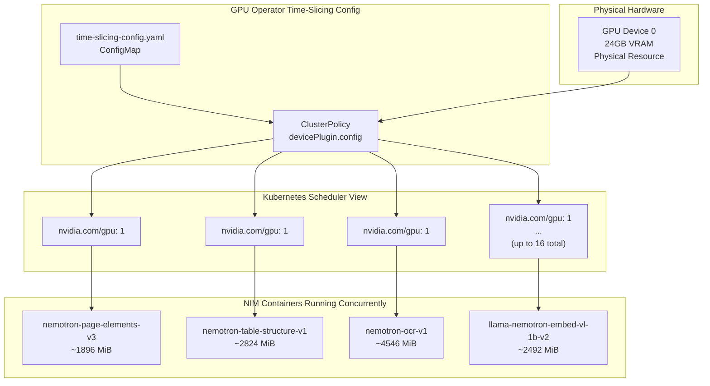
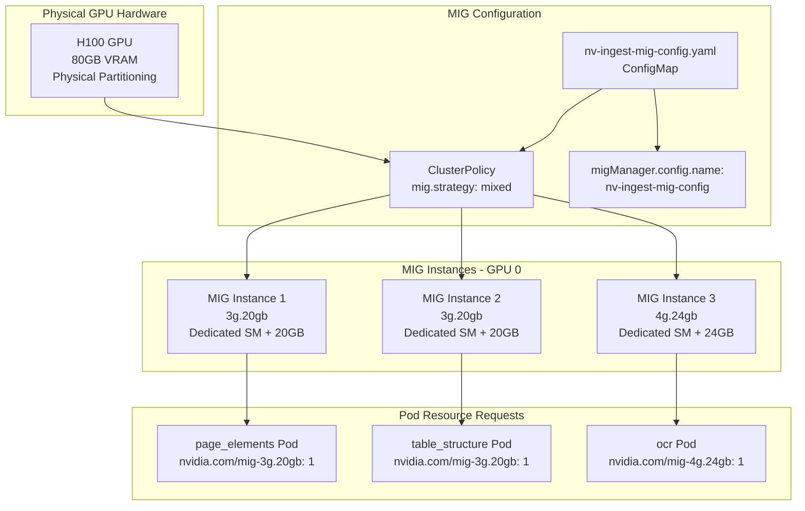
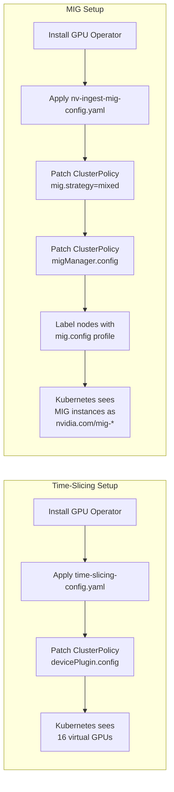

<!-- source: DeepWiki mcp.deepwiki.com · repo NVIDIA/NeMo-Retriever · extra page Time-Slicing vs MIG · fetched 2026-10-26 -->

# Time-Slicing vs MIG

Relevant source files

The following files were used as context for generating this wiki page:

- [docs/docs/extraction/deployment-options.md](docs/docs/extraction/deployment-options.md)
- [docs/docs/extraction/faq.md](docs/docs/extraction/faq.md)
- [docs/docs/extraction/multimodal-extraction.md](docs/docs/extraction/multimodal-extraction.md)
- [docs/docs/extraction/prerequisites-support-matrix.md](docs/docs/extraction/prerequisites-support-matrix.md)
- [docs/docs/extraction/troubleshoot.md](docs/docs/extraction/troubleshoot.md)
- [nemo_retriever/docs/cli/benchmarking.md](nemo_retriever/docs/cli/benchmarking.md)
- [nemo_retriever/helm/Chart.yaml](nemo_retriever/helm/Chart.yaml)
- [nemo_retriever/helm/README.md](nemo_retriever/helm/README.md)
- [nemo_retriever/helm/templates/NOTES.txt](nemo_retriever/helm/templates/NOTES.txt)
- [nemo_retriever/helm/templates/_helpers.tpl](nemo_retriever/helm/templates/_helpers.tpl)
- [nemo_retriever/helm/templates/configmap.yaml](nemo_retriever/helm/templates/configmap.yaml)
- [nemo_retriever/helm/values.yaml](nemo_retriever/helm/values.yaml)
- [nemo_retriever/src/nemo_retriever/service/client.py](nemo_retriever/src/nemo_retriever/service/client.py)
- [nemo_retriever/src/nemo_retriever/service/config.py](nemo_retriever/src/nemo_retriever/service/config.py)
- [nemo_retriever/src/nemo_retriever/service/retriever-service.yaml](nemo_retriever/src/nemo_retriever/service/retriever-service.yaml)
- [nemo_retriever/src/nemo_retriever/service/routers/ingest.py](nemo_retriever/src/nemo_retriever/service/routers/ingest.py)
- [nemo_retriever/src/nemo_retriever/service/services/pipeline_executor.py](nemo_retriever/src/nemo_retriever/service/services/pipeline_executor.py)
- [nemo_retriever/src/nemo_retriever/service_ingestor.py](nemo_retriever/src/nemo_retriever/service_ingestor.py)

## Purpose and Scope

This document explains the two GPU virtualization strategies available for deploying NeMo Retriever Library: **Time-Slicing** and **Multi-Instance GPU (MIG)**. It covers the technical differences, configuration procedures, and decision criteria for choosing between them.

For general GPU resource management concepts and hardware-specific optimizations, see [GPU Resource Management](#5.2). For tuning specific GPU models, see [GPU-Specific Optimizations](#5.2.2).

---

## Overview

NeMo Retriever Library requires multiple NVIDIA NIM microservices to run concurrently on GPU hardware. Two strategies enable sharing GPU resources across these services:

- **Time-Slicing**: Software-based virtual GPU sharing where containers execute sequentially on the same physical GPU.
- **MIG (Multi-Instance GPU)**: Hardware-based partitioning that creates isolated GPU instances with dedicated compute and memory.

**Sources:** [nemo_retriever/helm/README.md:144-260](), [docs/docs/extraction/deployment-options.md:64-74]()

---

## Time-Slicing

### Concept

Time-slicing allows multiple processes to share a single physical GPU by rapidly switching between them. The NVIDIA GPU Operator exposes a single GPU as multiple virtual GPU resources (typically 16) that Kubernetes can schedule independently.

#### Time-Slicing Architecture

**Sources:** [nemo_retriever/helm/README.md:144-195](), [docs/docs/extraction/prerequisites-support-matrix.md:67-77]()

### Configuration for Kubernetes

The time-slicing setup requires three steps:

1. **Install NVIDIA GPU Operator**
   The operator is a prerequisite for managing GPU resources in the cluster. [nemo_retriever/helm/README.md:24-32]()

2. **Apply Time-Slicing ConfigMap**
   Define the virtual GPU count (typically 16).

3. **Patch ClusterPolicy**
   Instruct the GPU Operator to use the time-slicing configuration.

**Sources:** [nemo_retriever/helm/README.md:146-195]()

### Configuration for Docker Compose

Docker Compose deployments typically use environment variables to select physical GPUs. All core NIM services default to the first available GPU. [docs/docs/extraction/prerequisites-support-matrix.md:63-65]()

### Limitations

- **No Memory Isolation**: All processes share the same VRAM pool. One service can cause OOM errors for others. [docs/docs/extraction/troubleshoot.md:77-85]()
- **No Performance Guarantees**: Execution is serialized. Concurrent requests compete for GPU cycles.
- **Development-Oriented**: Best suited for development and testing where hardware might be limited (e.g., single A10G). [docs/docs/extraction/prerequisites-support-matrix.md:63-65]()

---

## MIG (Multi-Instance GPU)

### Concept

MIG is a hardware feature on supported NVIDIA GPUs (A100, H100, etc.) that partitions a single GPU into multiple isolated instances. Each instance has dedicated compute resources, memory, and fault isolation.

#### MIG Architecture

**Sources:** [nemo_retriever/helm/README.md:196-260](), [docs/docs/extraction/deployment-options.md:64-74]()

### Supported GPUs

Only certain NVIDIA GPUs support MIG. High-end datacenter GPUs like the A100 and H100 are required for hardware-level partitioning. [docs/docs/extraction/deployment-options.md:64-74]()

### Configuration for Kubernetes

MIG setup involves applying a ConfigMap to the GPU Operator and labeling nodes to trigger the `nvidia-mig-manager`.

1. **Create MIG ConfigMap**: Defines the desired partitions (e.g., `3g.20gb`).
2. **Set MIG Strategy**: Set to `mixed` for heterogeneous partitions.
3. **Configure MIG Manager**: Link the ConfigMap to the operator.
4. **Label Nodes**: Trigger the re-partitioning of the physical GPU.

**Sources:** [nemo_retriever/helm/README.md:219-260]()

### Resource Requests in Helm Values

When using MIG, pods must request specific MIG profiles instead of generic GPUs. This is configured in the `resources` section of the Helm values for each NIM.

**Sources:** [nemo_retriever/helm/README.md:257-260](), [nemo_retriever/helm/values.yaml:126-133]()

---

## Comparison

### Time-Slicing vs MIG Configuration Flow

**Sources:** [nemo_retriever/helm/README.md:144-260]()

### Feature Comparison Table

| Feature | Time-Slicing | MIG |
|---------|-------------|-----|
| **Hardware Requirements** | Any NVIDIA GPU | A100, H100, H200 only |
| **Isolation** | Software-based, no isolation | Hardware-based, complete isolation |
| **Memory Allocation** | Shared VRAM pool | Dedicated VRAM per instance |
| **Performance** | Sequential execution | Parallel execution |
| **Configuration Complexity** | Simple | Complex |
| **Fault Isolation** | One OOM affects all containers | Faults isolated to individual instances |
| **Use Case** | Development, single-GPU testing | Production, multi-tenant |
| **Kubernetes Scheduling** | `nvidia.com/gpu: 1` | `nvidia.com/mig-*: 1` |

**Sources:** [nemo_retriever/helm/README.md:144-260](), [docs/docs/extraction/deployment-options.md:64-74](), [docs/docs/extraction/prerequisites-support-matrix.md:34-39]()

---

## Decision Criteria

### When to Use Time-Slicing

**Recommended for:**
- Development and testing environments. [docs/docs/extraction/prerequisites-support-matrix.md:63-65]()
- Single-GPU deployments on models like A10G or L40S. [docs/docs/extraction/prerequisites-support-matrix.md:34-39]()
- Running the full pipeline where hardware does not support MIG.
- Scenarios where simplicity is more important than strict resource isolation.

### When to Use MIG

**Recommended for:**
- Production Kubernetes deployments on A100/H100 hardware. [docs/docs/extraction/deployment-options.md:64-74]()
- Multi-tenant environments requiring fault isolation.
- High-throughput scenarios with concurrent workloads.
- Environments where predictable performance is critical.

### Advanced Features and Dedicated GPUs

Certain NIMs or extraction methods require **dedicated GPUs** or specific resource allocations regardless of the virtualization strategy:

| NIM / Feature | Requirement | Reason |
|---------------|-------------|--------|
| `nemotron-parse` | Dedicated/Large GPU | Complex PDF parsing logic. [docs/docs/extraction/prerequisites-support-matrix.md:102]() |
| `audio` (Parakeet) | Dedicated/Large GPU | High VRAM requirement for ASR. [docs/docs/extraction/prerequisites-support-matrix.md:104]() |
| `nemotron-3-nano-omni` | Dedicated/Large GPU | Large reasoning model. [docs/docs/extraction/prerequisites-support-matrix.md:103]() |

**Sources:** [docs/docs/extraction/prerequisites-support-matrix.md:95-104](), [nemo_retriever/helm/templates/configmap.yaml:18-22]()

---

## Troubleshooting

### OOM Errors on Shared GPU
When running multiple NIMs on a single GPU via time-slicing, memory contention is common.
- **Symptom**: `ValueError: Configured max_batch_size is larger than the model's supported max_batch_size`.
- **Solution**: Adjust `EMBEDDER_BATCH_SIZE` or similar environment variables in the service configuration. [docs/docs/extraction/troubleshoot.md:88-99]()

### Service Connection Failures
In Kubernetes, ensuring the retriever service is co-located with the NIMs can reduce latency.
- **Optimization**: Use `podAffinity` to schedule the `nemo-retriever` pod on nodes with NIM labels. [nemo_retriever/helm/values.yaml:88-103]()

**Sources:** [docs/docs/extraction/troubleshoot.md:88-99](), [nemo_retriever/helm/values.yaml:88-103](), [nemo_retriever/helm/README.md:144-260]()

---

