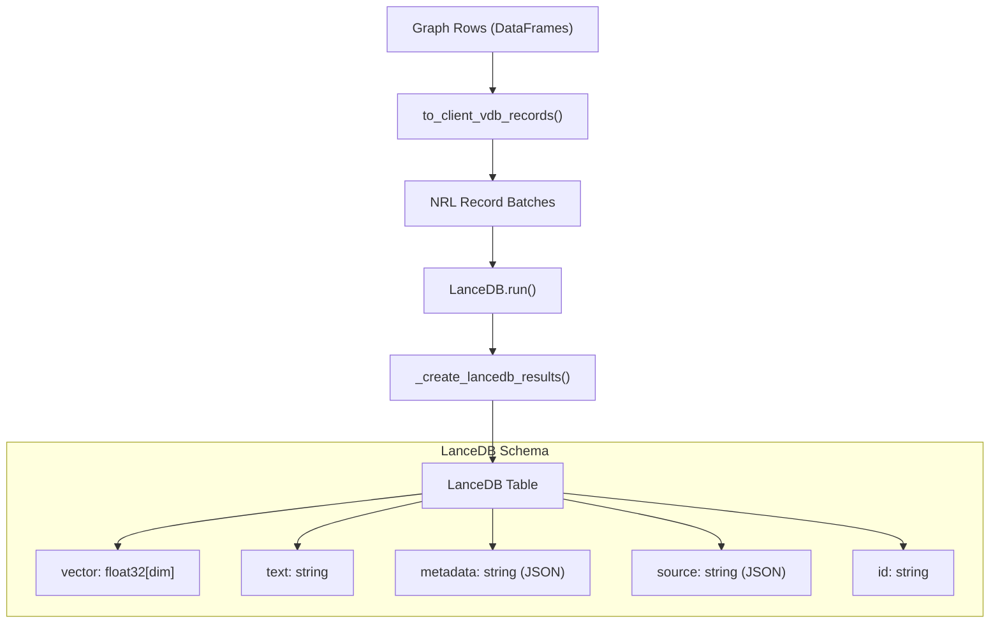
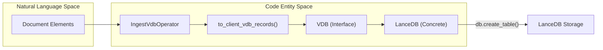
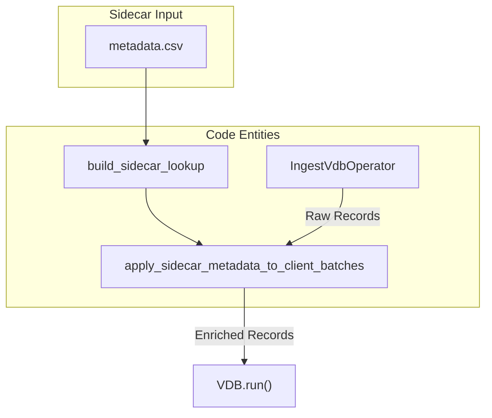

<!-- source: DeepWiki mcp.deepwiki.com · repo NVIDIA/NeMo-Retriever · extra page Collection Management · fetched 2026-10-26 -->

# Collection Management

Relevant source files

The following files were used as context for generating this wiki page:

- [nemo_retriever/src/nemo_retriever/local/stages/stage6_vdb_upload.py](nemo_retriever/src/nemo_retriever/local/stages/stage6_vdb_upload.py)
- [nemo_retriever/src/nemo_retriever/vdb/README.md](nemo_retriever/src/nemo_retriever/vdb/README.md)
- [nemo_retriever/src/nemo_retriever/vdb/__init__.py](nemo_retriever/src/nemo_retriever/vdb/__init__.py)
- [nemo_retriever/src/nemo_retriever/vdb/adt_vdb.py](nemo_retriever/src/nemo_retriever/vdb/adt_vdb.py)
- [nemo_retriever/src/nemo_retriever/vdb/lancedb.py](nemo_retriever/src/nemo_retriever/vdb/lancedb.py)
- [nemo_retriever/src/nemo_retriever/vdb/lancedb_bulk.py](nemo_retriever/src/nemo_retriever/vdb/lancedb_bulk.py)
- [nemo_retriever/src/nemo_retriever/vdb/operators.py](nemo_retriever/src/nemo_retriever/vdb/operators.py)
- [nemo_retriever/src/nemo_retriever/vdb/records.py](nemo_retriever/src/nemo_retriever/vdb/records.py)
- [nemo_retriever/src/nemo_retriever/vdb/stage.py](nemo_retriever/src/nemo_retriever/vdb/stage.py)
- [nemo_retriever/tests/test_nv_ingest_vdb_operator.py](nemo_retriever/tests/test_nv_ingest_vdb_operator.py)
- [nemo_retriever/tests/test_sidecar_metadata.py](nemo_retriever/tests/test_sidecar_metadata.py)

This page documents the management of LanceDB collections within NeMo Retriever, including collection creation, schema definitions, metadata tracking, and bulk ingestion operations. LanceDB serves as the default vector database for the multimodal document ingestion system, providing efficient storage for embeddings and document metadata.

For details on retrieval logic, see [Hybrid Search and Filtered Retrieval](#4.2.2). For attaching external metadata, see [Custom Metadata and Filtering](#4.2.3).

## LanceDB Collection Lifecycle

Collections in LanceDB are managed through the `LanceDB` wrapper class, which implements the abstract `VDB` interface. The lifecycle typically involves connecting to a URI, defining a schema, creating a table, and building indices.

### Table Creation and Schema

LanceDB tables are created with a standardized schema designed to accommodate multimodal elements (text, tables, images, audio) and their associated metadata. The schema is defined in `nemo_retriever/vdb/lancedb.py`.

[nemo_retriever/src/nemo_retriever/vdb/lancedb.py:117-126]()

The standard schema consists of the following fields:

| Field | Type | Description |
| :--- | :--- | :--- |
| `vector` | `FixedSizeList(float32)` | The embedding vector (default dimension 2048). |
| `text` | `string` | Searchable content (text, table content, or image captions). |
| `metadata` | `string` | JSON-serialized content metadata (page numbers, bounding boxes). |
| `source` | `string` | JSON-serialized source metadata (filenames, source IDs). |
| `id` | `string` | Unique identifier for the row. |

**Diagram: Data Flow from Pipeline to LanceDB Schema**

Sources: [nemo_retriever/src/nemo_retriever/vdb/lancedb.py:117-126](), [nemo_retriever/src/nemo_retriever/vdb/records.py:69-118]()

### Ingestion Operators

The system uses specialized operators to bridge the gap between the ingestion pipeline's flat DataFrames and the nested records expected by the VDB backends.

1.  **`IngestVdbOperator`**: The primary operator for bulk ingestion. It converts pipeline rows into record batches and calls `VDB.run()`.
    [nemo_retriever/src/nemo_retriever/vdb/operators.py:86-135]()
2.  **`PutVdbOperator`**: A specialized operator for in-place updates of existing rows based on a stable key (e.g., `id`). It ensures that existing rows are replaced rather than appended.
    [nemo_retriever/src/nemo_retriever/vdb/operators.py:137-184]()

**Diagram: System Name to Code Entity Mapping (Ingestion)**

Sources: [nemo_retriever/src/nemo_retriever/vdb/operators.py:86-184](), [nemo_retriever/src/nemo_retriever/vdb/README.md:12-36]()

## Indexing and Performance

LanceDB supports both vector indices for similarity search and Full-Text Search (FTS) indices for lexical search.

### Vector Indexing (IVF_HNSW_SQ)

By default, the system builds an `IVF_HNSW_SQ` index for dense vectors. This combines Inverted File Indexing (IVF) for partitioning, Hierarchical Navigable Small Worlds (HNSW) for graph-based search, and Scalar Quantization (SQ) for memory efficiency.

[nemo_retriever/src/nemo_retriever/vdb/lancedb.py:257-285]()

Key parameters for index tuning include:
*   **`num_partitions`**: Number of IVF partitions (K-means centroids).
*   **`num_sub_vectors`**: Number of sub-vectors for Product Quantization.
*   **`metric`**: Distance metric (default: `l2`).

### Full-Text Search (FTS)

When `hybrid=True` is passed to the LanceDB configuration, an FTS index is built over the `text` column using Tantivy. This enables BM25-based keyword search alongside vector search.

[nemo_retriever/src/nemo_retriever/vdb/lancedb_bulk.py:120-128]()

Sources: [nemo_retriever/src/nemo_retriever/vdb/lancedb.py:257-285](), [nemo_retriever/src/nemo_retriever/vdb/lancedb_bulk.py:107-132]()

## Metadata Tracking and Sidecar Merging

NeMo Retriever implements a "sidecar" metadata pattern that allows users to attach external metadata (e.g., from a CSV or Parquet file) to document elements during the ingestion process without modifying the original extraction logic.

### Sidecar Metadata Merging

The `IngestVdbOperator` uses `sidecar_metadata.py` to join external data onto the records before they hit the database.

[nemo_retriever/src/nemo_retriever/vdb/operators.py:100-112]()

1.  **`materialize_sidecar_dataframe`**: Loads the metadata from a file path or DataFrame.
2.  **`build_sidecar_lookup`**: Creates a hash map keyed by a join field (e.g., `source_id`).
3.  **`apply_sidecar_metadata_to_client_batches`**: Iterates through ingestion batches and merges the metadata into the `content_metadata` field of each record.

**Diagram: Sidecar Metadata Join Flow**

Sources: [nemo_retriever/src/nemo_retriever/vdb/sidecar_metadata.py:18-23](), [nemo_retriever/src/nemo_retriever/vdb/operators.py:122-131]()

## Bulk Ingestion and Reindexing

For large-scale data loading, the `lancedb_bulk` module provides utilities to ingest directories of pre-computed embeddings.

### Directory Ingestion

The `write_text_embeddings_dir_to_lancedb` function scans a directory for `*.text_embeddings.json` files and uploads them in bulk. This is often used in "Library Mode" or multi-stage local pipelines.

[nemo_retriever/src/nemo_retriever/vdb/lancedb_bulk.py:165-215]()

### Text Reconstruction

During reindexing or bulk writes, the system must extract searchable text from various document types. The `_get_text_for_element` function handles this logic:

[nemo_retriever/src/nemo_retriever/vdb/lancedb.py:176-205]()

*   **Text**: Uses `metadata.content`.
*   **Structured (Tables)**: Uses `table_metadata.table_content`.
*   **Images**: Uses `image_metadata.caption` or `image_metadata.text` (for page images).
*   **Audio**: Uses `audio_metadata.audio_transcript`.

Sources: [nemo_retriever/src/nemo_retriever/vdb/lancedb_bulk.py:165-215](), [nemo_retriever/src/nemo_retriever/vdb/lancedb.py:176-205]()

---

