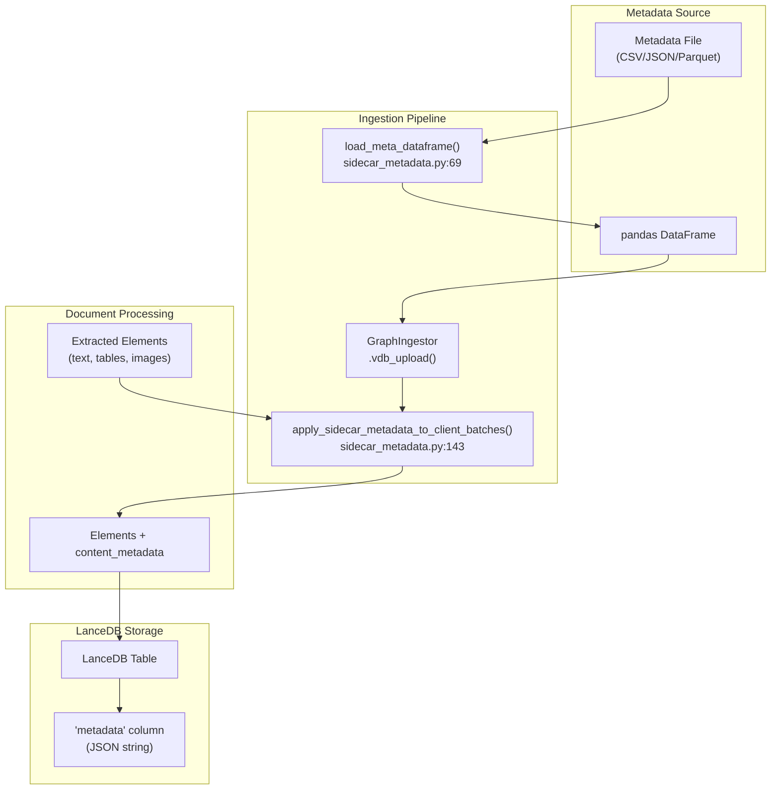
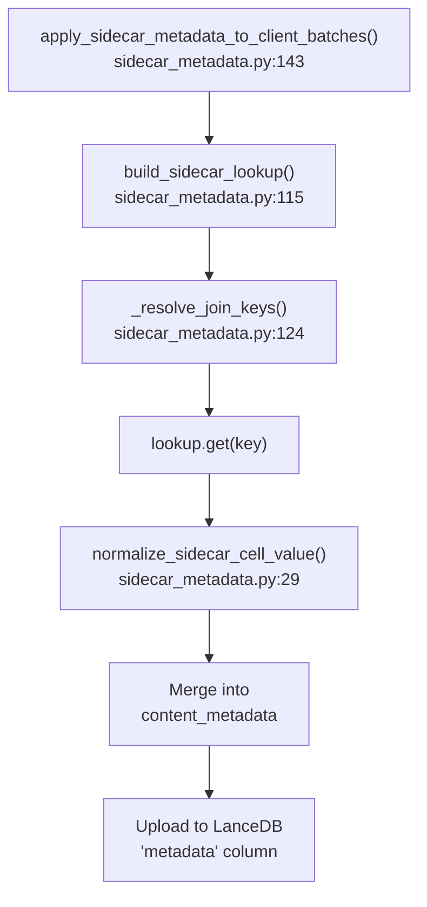
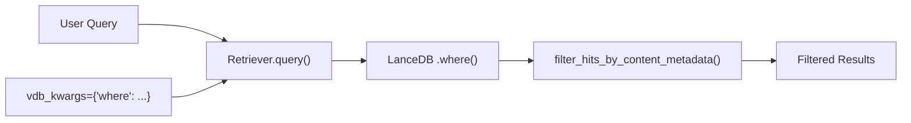

<!-- source: DeepWiki mcp.deepwiki.com · repo NVIDIA/NeMo-Retriever · extra page Custom Metadata and Filtering · fetched 2026-10-26 -->

# Custom Metadata and Filtering

<details>
<summary>Relevant source files</summary>

The following files were used as context for generating this wiki page:

- [docs/docs/extraction/agentic-retrieval-concept.md](docs/docs/extraction/agentic-retrieval-concept.md)
- [docs/docs/extraction/custom-metadata.md](docs/docs/extraction/custom-metadata.md)
- [docs/docs/extraction/releasenotes.md](docs/docs/extraction/releasenotes.md)
- [docs/docs/extraction/vdbs.md](docs/docs/extraction/vdbs.md)
- [docs/docs/extraction/workflow-agentic-retrieval.md](docs/docs/extraction/workflow-agentic-retrieval.md)
- [docs/docs/extraction/workflow-document-ingestion.md](docs/docs/extraction/workflow-document-ingestion.md)
- [examples/nemo_retriever_retriever_query_metadata_filter.ipynb](examples/nemo_retriever_retriever_query_metadata_filter.ipynb)
- [nemo_retriever/src/nemo_retriever/api/internal/transform/embed_text.py](nemo_retriever/src/nemo_retriever/api/internal/transform/embed_text.py)
- [nemo_retriever/src/nemo_retriever/evaluation/README.md](nemo_retriever/src/nemo_retriever/evaluation/README.md)
- [nemo_retriever/src/nemo_retriever/params/chunk_bundle.py](nemo_retriever/src/nemo_retriever/params/chunk_bundle.py)
- [nemo_retriever/src/nemo_retriever/vdb/sidecar_metadata.py](nemo_retriever/src/nemo_retriever/vdb/sidecar_metadata.py)
- [nemo_retriever/tests/test_src_documentation_snippets.py](nemo_retriever/tests/test_src_documentation_snippets.py)

</details>


This page describes how to attach custom metadata to documents during ingestion and use that metadata to filter retrieval results. Custom metadata allows you to enrich ingested content with domain-specific attributes (e.g., document classification, access control flags, business units) that can later be used to narrow search results.

For general RAG integration patterns, see [RAG Integration Examples](#3.6). For vector database configuration and schema details, see [LanceDB Vector Database](#4.2) and [Collection Management](#4.2.1).

---

## Overview

The NeMo Retriever ingestion pipeline supports attaching arbitrary custom metadata fields to documents before they are embedded and uploaded to the vector database. This metadata is stored alongside the document content and embeddings, and can be used in filtered searches to retrieve only documents matching specific criteria.

**Key capabilities:**
- Attach metadata from external sources (CSV, JSON, Parquet files or pandas DataFrames) [[nemo_retriever/src/nemo_retriever/vdb/sidecar_metadata.py:69-83]()]
- Metadata is stored in LanceDB's `metadata` column as a compact JSON string [[docs/docs/extraction/custom-metadata.md:125-129]()]
- Filter searches using SQL predicates (predicate pushdown) on metadata fields [[docs/docs/extraction/custom-metadata.md:75-79]()]
- Supports multiple data types: strings, numbers, booleans, and lists [[nemo_retriever/src/nemo_retriever/vdb/sidecar_metadata.py:29-56]()]

**Sources:** [docs/docs/extraction/custom-metadata.md:1-13](), [nemo_retriever/src/nemo_retriever/vdb/sidecar_metadata.py:5-10]()

---

## Metadata Attachment Architecture

The following diagram shows how custom metadata flows through the ingestion pipeline into LanceDB:



**Sources:** [nemo_retriever/src/nemo_retriever/vdb/sidecar_metadata.py:69-83](), [nemo_retriever/src/nemo_retriever/vdb/sidecar_metadata.py:143-187](), [docs/docs/extraction/custom-metadata.md:16-26]()

---

## Attaching Metadata During Ingestion

### Metadata File Format

Custom metadata must be provided as a pandas DataFrame or a file that can be read into a DataFrame. Supported file formats:

| Format | Extension | Reader Function |
|--------|-----------|-----------------|
| JSON | `.json`, `.ndjson` | `pd.read_json` |
| CSV | `.csv` | `pd.read_csv` |
| Parquet | `.parquet`, `.pq` | `pd.read_parquet` |

The metadata file/DataFrame must include a **source field** that identifies each document and one or more **metadata fields** containing the custom attributes.

**Example metadata DataFrame:**

```python
import pandas as pd

meta_df = pd.DataFrame({
    "source": ["data/woods_frost.pdf", "data/multimodal_test.pdf"],
    "meta_a": ["alpha", "bravo"],
    "meta_b": [10, 20],
    "department": ["Engineering", "Sales"]
})
```

**Sources:** [nemo_retriever/src/nemo_retriever/vdb/sidecar_metadata.py:69-83](), [docs/docs/extraction/custom-metadata.md:28-38]()

---

### Required Parameters for Metadata Upload

When calling `.vdb_upload()`, three parameters are required to enable metadata attachment:

| Parameter | Type | Description |
|-----------|------|-------------|
| `meta_dataframe` | `str` or `pd.DataFrame` | Path to metadata file or DataFrame object |
| `meta_source_field` | `str` | Column name used to match documents to metadata rows |
| `meta_fields` | `list[str]` | List of column names to attach to `content_metadata` |

**Optional Parameter:**
- `meta_join_key`: Controls matching logic. Options: `auto` (default: try full path then basename), `source_id` (full path), or `source_name` (basename only). [[docs/docs/extraction/custom-metadata.md:26-26]()]

**Example usage (Python API):**

```python
from nemo_retriever import create_ingestor

ingestor = (
    create_ingestor(run_mode="batch")
    .files(["data/woods_frost.pdf"])
    .extract(extract_text=True)
    .embed()
    .vdb_upload(
        vdb_op="lancedb",
        uri="./lancedb_data",
        table_name="nemo-retriever",
        meta_dataframe=meta_df,
        meta_source_field="source",
        meta_fields=["meta_a", "meta_b", "department"]
    )
)
```

**Service Mode Ingestion:**
When using the Retriever Service, use the `/v1/ingest/sidecar` endpoint to upload the metadata file first, then pass the resulting `sidecar_id` as `meta_dataframe_id` in the ingestion request. [[docs/docs/extraction/custom-metadata.md:123-123]()]

**Sources:** [docs/docs/extraction/custom-metadata.md:16-58](), [nemo_retriever/src/nemo_retriever/vdb/sidecar_metadata.py:124-140]()

---

## Metadata Processing Pipeline

The following diagram shows the code flow for metadata attachment within `apply_sidecar_metadata_to_client_batches`:



**Key implementation details:**

1. **Canonical Lookup:** Document paths are normalized via `_canonical_lookup_key` (absolute paths and normalized slashes) to ensure consistent matching between the metadata table and extracted element sources. [[nemo_retriever/src/nemo_retriever/vdb/sidecar_metadata.py:59-67]()]
2. **Type Normalization:** `normalize_sidecar_cell_value` converts numpy types to native Python types and parses string-encoded lists using `ast.literal_eval`. [[nemo_retriever/src/nemo_retriever/vdb/sidecar_metadata.py:29-56]()]
3. **Join Strategy:** The `meta_join_key` strategy determines if the lookup uses the full `source_id` or the file's `source_name`. [[nemo_retriever/src/nemo_retriever/vdb/sidecar_metadata.py:124-140]()]

**Sources:** [nemo_retriever/src/nemo_retriever/vdb/sidecar_metadata.py:143-187](), [nemo_retriever/src/nemo_retriever/vdb/sidecar_metadata.py:29-56]()

---

## Filtered Retrieval

### Filter Expression Syntax (SQL Pushdown)

LanceDB supports **predicate pushdown** using SQL-like syntax. Filters are applied on the `metadata` column, which contains the serialized JSON of `content_metadata`.

| Operator | Description | Example |
|----------|-------------|---------|
| `LIKE` | String matching | `metadata LIKE '%"department":"Engineering"%'` |
| `=` | Equality | `metadata = '{"category":"alpha"}'` (Requires exact match) |
| `AND`, `OR` | Logical operators | `metadata LIKE '%"meta_b":10%' AND metadata LIKE '%"alpha"%'` |

**Sources:** [docs/docs/extraction/custom-metadata.md:104-118](), [examples/nemo_retriever_retriever_query_metadata_filter.ipynb:12-15]()

---

### Using Filters in Retrieval

Filters can be applied server-side (database pushdown) or client-side (post-retrieval).



**Example: Server-Side Filter (Pushdown)**
This is the most efficient method as it narrows results inside the database.

```python
from nemo_retriever.retriever import Retriever

retriever = Retriever(
    vdb_kwargs={"uri": "./lancedb_data", "table_name": "nemo-retriever"},
    embed_kwargs={"model_name": "nvidia/llama-nemotron-embed-1b-v2"}
)

hits = retriever.query(
    "What are the project requirements?",
    top_k=5,
    vdb_kwargs={"where": "metadata LIKE '%\"department\":\"Engineering\"%'"}
)
```

**Example: Client-Side Filter**
Useful for complex Python logic that cannot be expressed in SQL.

```python
from nemo_retriever.vdb import filter_hits_by_content_metadata

# Post-process hits in Python
filtered_hits = filter_hits_by_content_metadata(
    hits, 
    lambda meta: meta.get("meta_b", 0) > 15
)
```

**Sources:** [docs/docs/extraction/custom-metadata.md:104-118](), [examples/nemo_retriever_retriever_query_metadata_filter.ipynb:12-15](), [nemo_retriever/src/nemo_retriever/vdb/sidecar_metadata.py:143-187]()

---

## Data Type Support and Conversions

The `normalize_sidecar_cell_value` function handles type conversions to ensure compatibility with JSON serialization and vector DB storage:

| Input Type | Output Type | Conversion Logic |
|------------|-------------|------------------|
| `np.int32`, `np.int64` | `int` | Native Python cast |
| `np.float32`, `np.float64` | `float` | Native Python cast |
| `np.bool_` | `bool` | Native Python cast |
| `pd.isna()`, `None`, `""` | `None` | Nullified for JSON |
| `"[1, 2, 3]"` (string) | `list` | `ast.literal_eval()` |

**Sources:** [nemo_retriever/src/nemo_retriever/vdb/sidecar_metadata.py:29-56]()

---

## Best Practices

- **Plan Metadata Schema:** Ensure the columns you intend to filter on are included in `meta_fields` during ingestion. [[docs/docs/extraction/custom-metadata.md:62-66]()]
- **Use Canonical Paths:** When using `meta_join_key="source_id"`, ensure the `meta_source_field` in your DataFrame contains absolute paths that match the system environment. [[nemo_retriever/src/nemo_retriever/vdb/sidecar_metadata.py:59-67]()]
- **Predicate Performance:** For large collections, use `where` clauses (server-side) rather than client-side filtering to maintain low latency. [[docs/docs/extraction/custom-metadata.md:68-68]()]
- **Validate Joins:** If metadata is missing from chunks, verify that the `source` column in your metadata table matches the paths provided to `.files()`. [[docs/docs/extraction/custom-metadata.md:69-70]()]

**Sources:** [docs/docs/extraction/custom-metadata.md:62-72](), [nemo_retriever/src/nemo_retriever/vdb/sidecar_metadata.py:171-180]()

---

