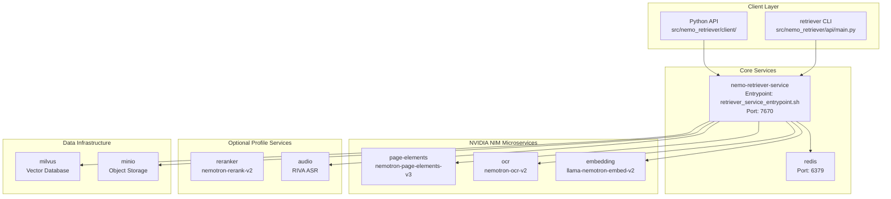
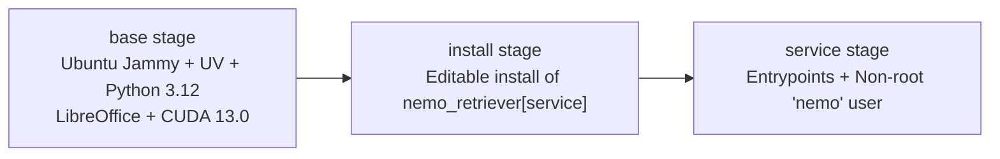

<!-- source: DeepWiki mcp.deepwiki.com · repo NVIDIA/NeMo-Retriever · extra page Docker Compose Deployment · fetched 2026-10-26 -->

# Docker Compose Deployment

Relevant source files

The following files were used as context for generating this wiki page:

- [.github/workflows/docker-build-arm.yml](.github/workflows/docker-build-arm.yml)
- [.github/workflows/docker-nightly-publish.yml](.github/workflows/docker-nightly-publish.yml)
- [.github/workflows/docker-release-publish.yml](.github/workflows/docker-release-publish.yml)
- [.github/workflows/release-docker.yml](.github/workflows/release-docker.yml)
- [.github/workflows/reusable-docker-build-and-test.yml](.github/workflows/reusable-docker-build-and-test.yml)
- [.github/workflows/reusable-docker-build.yml](.github/workflows/reusable-docker-build.yml)
- [.github/workflows/scheduled-nightly.yml](.github/workflows/scheduled-nightly.yml)
- [Dockerfile](Dockerfile)
- [docker/scripts/entrypoint.sh](docker/scripts/entrypoint.sh)
- [docker/scripts/entrypoint_devcontainer.sh](docker/scripts/entrypoint_devcontainer.sh)
- [docker/scripts/entrypoint_source_ext.sh](docker/scripts/entrypoint_source_ext.sh)

This page provides detailed technical documentation for deploying NeMo Retriever Library using Docker Compose. This deployment mode offers a self-hosted, production-ready setup with all NIM microservices running locally in containers.

For information about alternative deployment methods, see [Helm/Kubernetes Deployment](#2.1.2) and [Library Mode](#2.1.3). For general guidance on choosing a deployment option, see [Deployment Options](#2.1).

## Overview

The Docker Compose deployment orchestrates multiple containerized services to create a complete document ingestion pipeline. The architecture is centered around a Ray-based runtime that manages document processing tasks and communicates with specialized NVIDIA NIMs.

- **Core runtime**: Container running the Ray-based pipeline orchestrator and the FastAPI service.
- **NVIDIA NIMs**: Specialized AI microservices for document processing (page-elements, table-structure, ocr, embedding).
- **Data services**: Redis message queue, Milvus vector database, and MinIO object storage.
- **Observability**: OpenTelemetry collector, Zipkin, Prometheus, and Grafana.

This deployment mode is recommended for production workloads requiring full control over infrastructure and the ability to run entirely on-premises.

**Sources:** [Dockerfile:123-140](), [docker/scripts/retriever_service_entrypoint.sh:1-20]()

## Service Architecture

The following diagram shows the containerized services and their communication patterns, associating system components with their code-level entrypoints and configurations.

**Sources:** [Dockerfile:140-170](), [docker/scripts/entrypoint.sh:78-98](), [docker/scripts/retriever_service_entrypoint.sh:1-20]()

## Dockerfile and Build Stages

The NeMo Retriever Library uses a multi-stage Dockerfile to optimize image size and security.

### Multi-Stage Build Flow

### Key Stages Implementation

| Stage | Purpose | Key Operations |
|-------|---------|----------------|
| `base` | Foundation | Installs system deps: `bzip2`, `curl`, `libreoffice`, and `cuda-toolkit-13-0`. Sets up `uv` for fast Python management. [Dockerfile:15-89]() |
| `install` | Package Setup | Performs an editable install of `nemo_retriever[service]` into `/opt/retriever_runtime`. [Dockerfile:101-118]() |
| `service` | Runtime | Configures the `nemo` user, sets the `NEMO_RETRIEVER_SERVICE_CONFIG` path, and copies entrypoint scripts. [Dockerfile:140-170]() |

**Sources:** [Dockerfile:15-170]()

## Profile System

Docker Compose profiles allow selective activation of optional features. While the base configuration provides core extraction and embedding, additional profiles enable retrieval and multimedia capabilities.

### Profile Activation

| Profile | Purpose | Services Enabled |
|---------|---------|------------------|
| Core (Default) | Document extraction and embedding | `nemo-retriever-service`, `redis`, `ocr`, `embedding` |
| `retrieval` | Persistent vector storage | `milvus`, `minio`, `etcd` |
| `audio` | Multimedia support | `riva-asr`, `audio-processing-worker` |

**Sources:** [Dockerfile:123-140](), [docker/scripts/entrypoint_source_ext.sh:20-24]()

## GPU Configuration

The deployment relies on NVIDIA Container Toolkit to expose GPUs to the services.

### Resource Allocation

All GPU-enabled NIM services and the Milvus vector database require GPU reservations. The `GPU_ID` environment variable is typically used to assign services to specific hardware.

- **NIM Services**: Require dedicated VRAM for model weights and inference buffers.
- **Milvus**: Uses GPU for IVF_HNSW_SQ index acceleration.
- **Runtime**: Generally runs on CPU (`CUDA_VISIBLE_DEVICES=-1`) but can leverage GPU if `RETRIEVER_ENABLE_TORCH_TRT` is enabled for local model optimization.

**Sources:** [Dockerfile:84-88](), [docker/scripts/entrypoint.sh:91-97]()

## Entrypoints and Container Lifecycle

The container lifecycle is managed by specialized shell scripts that handle environment preparation and service orchestration.

### `retriever-service-entrypoint`
Located at `/usr/local/bin/retriever-service-entrypoint` [Dockerfile:146](), this script is the primary entrypoint for the service image. It ensures the environment is correctly initialized before starting the FastAPI app via `retriever service start`.

### `entrypoint.sh`
This script handles the dual-launch of the API and the worker process [docker/scripts/entrypoint.sh:78-98]():
1. **Gunicorn Launch**: Starts the FastAPI app at `nv_ingest.api.main:app` with 32 workers [docker/scripts/entrypoint.sh:80-88]().
2. **Microservice Entrypoint**: Launches `microservice_entrypoint.py` which initializes the Ray runtime [docker/scripts/entrypoint.sh:93-96]().

### Dynamic Dependency Installation
The system supports just-in-time installation of optional dependencies via `entrypoint_source_ext.sh` [docker/scripts/entrypoint_source_ext.sh:1-31]():
- **Adobe SDK**: Installed if `INSTALL_ADOBE_SDK=true` [docker/scripts/entrypoint_source_ext.sh:10-18]().
- **Audio Deps**: `librosa` is installed via `uv pip` if missing [docker/scripts/entrypoint_source_ext.sh:20-24]().
- **Memory Tracing**: `memray` is installed if `MEM_TRACE` is set [docker/scripts/entrypoint_source_ext.sh:27-30]().

**Sources:** [docker/scripts/entrypoint.sh:1-98](), [docker/scripts/entrypoint_source_ext.sh:1-31](), [Dockerfile:146-169]()

## Environment Variables

Key variables for Docker Compose deployment:

| Variable | Default | Purpose |
|----------|---------|---------|
| `NEMO_RETRIEVER_SERVICE_CONFIG` | `/etc/nemo-retriever/retriever-service.yaml` | Path to the service configuration file. [Dockerfile:142]() |
| `INGEST_LOG_LEVEL` | `info` | Controls logging verbosity. [docker/scripts/entrypoint.sh:50]() |
| `INGEST_MEM_TRACE` | `false` | Enables memory profiling with `memray`. [docker/scripts/entrypoint.sh:35-43]() |
| `INSTALL_FFMPEG` | `false` | Triggers runtime installation of ffmpeg. [Dockerfile:7]() |

**Sources:** [Dockerfile:142](), [docker/scripts/entrypoint.sh:35-65]()

## Override Files

To adapt the deployment to different hardware or use cases, Docker Compose override files are used. These typically modify:
- **Replica Counts**: Increasing workers for high-throughput nodes.
- **GPU IDs**: Mapping services to specific GPUs on multi-GPU systems.
- **Volume Mounts**: Mapping local document directories to `/workspace/data` in the container [Dockerfile:9-10]().

**Sources:** [Dockerfile:6-10](), [Dockerfile:97-100]()

---

