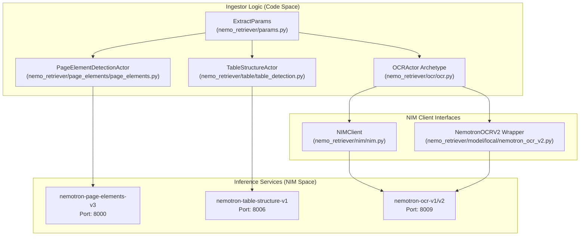
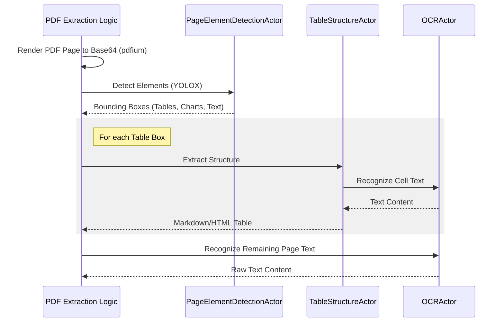

<!-- source: DeepWiki mcp.deepwiki.com · repo NVIDIA/NeMo-Retriever · extra page Document Processing NIMs · fetched 2026-10-26 -->

# Document Processing NIMs

Relevant source files

The following files were used as context for generating this wiki page:

- [.github/workflows/huggingface-nightly.yml](.github/workflows/huggingface-nightly.yml)
- [.gitignore](.gitignore)
- [ci/scripts/nightly_build_publish.py](ci/scripts/nightly_build_publish.py)
- [ci/tests/test_huggingface_release_workflow.py](ci/tests/test_huggingface_release_workflow.py)
- [nemo_retriever/pyproject.toml](nemo_retriever/pyproject.toml)
- [nemo_retriever/src/nemo_retriever/chart/chart_detection.py](nemo_retriever/src/nemo_retriever/chart/chart_detection.py)
- [nemo_retriever/src/nemo_retriever/harness/runner.py](nemo_retriever/src/nemo_retriever/harness/runner.py)
- [nemo_retriever/src/nemo_retriever/model/local/nemotron_graphic_elements_v1.py](nemo_retriever/src/nemo_retriever/model/local/nemotron_graphic_elements_v1.py)
- [nemo_retriever/src/nemo_retriever/model/local/nemotron_ocr_v1.py](nemo_retriever/src/nemo_retriever/model/local/nemotron_ocr_v1.py)
- [nemo_retriever/src/nemo_retriever/model/local/nemotron_ocr_v2.py](nemo_retriever/src/nemo_retriever/model/local/nemotron_ocr_v2.py)
- [nemo_retriever/src/nemo_retriever/model/local/nemotron_page_elements_v3.py](nemo_retriever/src/nemo_retriever/model/local/nemotron_page_elements_v3.py)
- [nemo_retriever/src/nemo_retriever/model/local/nemotron_rerank_v2.py](nemo_retriever/src/nemo_retriever/model/local/nemotron_rerank_v2.py)
- [nemo_retriever/src/nemo_retriever/model/local/nemotron_table_structure_v1.py](nemo_retriever/src/nemo_retriever/model/local/nemotron_table_structure_v1.py)
- [nemo_retriever/src/nemo_retriever/ocr/ocr.py](nemo_retriever/src/nemo_retriever/ocr/ocr.py)
- [nemo_retriever/src/nemo_retriever/pdf/extract.py](nemo_retriever/src/nemo_retriever/pdf/extract.py)
- [nemo_retriever/src/nemo_retriever/pdf/split.py](nemo_retriever/src/nemo_retriever/pdf/split.py)
- [nemo_retriever/src/nemo_retriever/table/__init__.py](nemo_retriever/src/nemo_retriever/table/__init__.py)
- [nemo_retriever/src/nemo_retriever/table/commands.py](nemo_retriever/src/nemo_retriever/table/commands.py)
- [nemo_retriever/src/nemo_retriever/table/config.py](nemo_retriever/src/nemo_retriever/table/config.py)
- [nemo_retriever/src/nemo_retriever/table/cpu_actor.py](nemo_retriever/src/nemo_retriever/table/cpu_actor.py)
- [nemo_retriever/src/nemo_retriever/table/table_detection.py](nemo_retriever/src/nemo_retriever/table/table_detection.py)
- [nemo_retriever/src/nemo_retriever/utils/convert/to_pdf.py](nemo_retriever/src/nemo_retriever/utils/convert/to_pdf.py)
- [nemo_retriever/src/nemo_retriever/utils/table_and_chart.py](nemo_retriever/src/nemo_retriever/utils/table_and_chart.py)
- [nemo_retriever/tests/test_doc_to_pdf_actor.py](nemo_retriever/tests/test_doc_to_pdf_actor.py)
- [nemo_retriever/tests/test_nemotron_ocr_v2_nightly.py](nemo_retriever/tests/test_nemotron_ocr_v2_nightly.py)
- [nemo_retriever/tests/test_operator_flags_and_cpu_actors.py](nemo_retriever/tests/test_operator_flags_and_cpu_actors.py)
- [nemo_retriever/tests/test_pdf_render_scale.py](nemo_retriever/tests/test_pdf_render_scale.py)
- [nemo_retriever/tests/test_table_structure.py](nemo_retriever/tests/test_table_structure.py)
- [nemo_retriever/uv.lock](nemo_retriever/uv.lock)

## Purpose and Scope

This page documents the NVIDIA Inference Microservices (NIMs) used for document content extraction and processing in NeMo Retriever. These specialized AI models handle detecting, extracting, and understanding various document elements including text, tables, charts, images, and audio.

The document processing NIMs are containerized microservices that expose HTTP and gRPC APIs for inference. They can be deployed locally via Docker Compose, on Kubernetes via Helm charts, or accessed as cloud-hosted endpoints on `build.nvidia.com`. For local development and low-latency on-box inference, the library provides Python wrappers that interact directly with these models or their remote endpoints.

---

## Document Processing NIM Architecture

The following diagram bridges the high-level document processing components with their corresponding code entities and NIM endpoints:

### System Component to Code Entity Mapping

**Sources:** [nemo_retriever/src/nemo_retriever/ocr/ocr.py:61-142](), [nemo_retriever/src/nemo_retriever/table/cpu_actor.py:23-65](), [nemo_retriever/src/nemo_retriever/model/local/nemotron_ocr_v2.py:21-37]()

---

## Core Detection NIMs

The core detection NIMs form the primary extraction pipeline. In the NeMo Retriever library, these are accessed via `ArchetypeOperator` classes which dynamically select between `GPUVariant` (local model) and `CPUVariant` (remote NIM) based on configuration [nemo_retriever/src/nemo_retriever/ocr/ocr.py:72-88]().

### page-elements (nemotron-page-elements-v3)

**Purpose:** Detects and classifies page elements as text, tables, charts, or infographics using YOLOX object detection.

**Implementation:**
- **Archetype:** `PageElementDetectionActor` [nemo_retriever/src/nemo_retriever/page_elements/page_elements.py:93]().
- **Local Model Wrapper:** `NemotronPageElementsV3` [nemo_retriever/src/nemo_retriever/model/local/nemotron_page_elements_v3.py:16]().
- **Default Remote URL:** `https://ai.api.nvidia.com/v1/cv/nvidia/nemotron-page-elements-v3` [nemo_retriever/src/nemo_retriever/page_elements/cpu_actor.py:31]().

**Key Configuration:**
- **Batch Size:** 32 (default).
- **VRAM Usage:** ~1896 MiB.
- **Protocol:** Supports both HTTP and gRPC.

### table-structure (nemotron-table-structure-v1)

**Purpose:** Detects table structure including rows, columns, and cells to preserve table formatting and convert to Markdown or HTML.

**Implementation:**
- **Archetype:** `TableStructureActor` [nemo_retriever/src/nemo_retriever/table/table_detection.py:94]().
- **Local Model Wrapper:** `NemotronTableStructureV1` [nemo_retriever/src/nemo_retriever/model/local/nemotron_table_structure_v1.py:16]().
- **CPU Actor:** `TableStructureCPUActor` handles remote NIM calls via `NIMClient` [nemo_retriever/src/nemo_retriever/table/cpu_actor.py:23-65]().

**Output Formats:**
- Markdown (default), HTML, or CSV.

### ocr (nemotron-ocr-v1/v2)

**Purpose:** Performs optical character recognition (OCR) to extract text from images. NeMo Retriever now supports **Nemotron OCR v2**, which integrates text detection, transcription, and layout analysis [nemo_retriever/src/nemo_retriever/model/local/nemotron_ocr_v2.py:25-28]().

**Implementation:**
- **Archetype:** `OCRActor` [nemo_retriever/src/nemo_retriever/ocr/ocr.py:67]().
- **Local Model Wrapper (v2):** `NemotronOCRV2` [nemo_retriever/src/nemo_retriever/model/local/nemotron_ocr_v2.py:21]().
- **TensorRT Optimization:** Supports best-effort TensorRT compilation for the detector submodule if `RETRIEVER_ENABLE_TORCH_TRT` is set [nemo_retriever/src/nemo_retriever/model/local/nemotron_ocr_v2.py:74-82]().

**Sources:** [nemo_retriever/src/nemo_retriever/ocr/ocr.py:101-112](), [nemo_retriever/src/nemo_retriever/model/local/nemotron_ocr_v2.py:39-52](), [nemo_retriever/src/nemo_retriever/table/cpu_actor.py:31-46]()

---

## Advanced Processing NIMs

### nemotron-parse

**Purpose:** Provides state-of-the-art text and table extraction for scanned documents and complex layouts using advanced visual parsing. It can operate in a `pdfium_hybrid` mode where it combines standard PDF text extraction with visual layout analysis [nemo_retriever/src/nemo_retriever/pdf/extract.py:209-211]().

**Implementation:**
- **Archetype:** `NemotronParseActor` [nemo_retriever/src/nemo_retriever/ocr/ocr.py:139-141]().
- **Extraction Logic:** Triggered when `extract_method="nemotron_parse"` is specified in `ExtractParams`.

### Audio Transcription (parakeet-1-1b-ctc-en-us)

**Purpose:** Transcribes speech from audio files (MP3, WAV) to text using NVIDIA RIVA ASR.

**Implementation:**
- **Archetype:** `ASRActor` [nemo_retriever/tests/test_operator_flags_and_cpu_actors.py:89]().
- **CPU Actor:** `ASRCPUActor` targets the public NVCF Parakeet endpoint by default [nemo_retriever/pyproject.toml:73-75]().

**Sources:** [nemo_retriever/src/nemo_retriever/pdf/extract.py:198-212](), [nemo_retriever/tests/test_operator_flags_and_cpu_actors.py:65-81]()

---

## Data Flow: Document to Extracted Elements

The following diagram illustrates the data flow through the `pdf_extraction` function and its interaction with various actors:

**Sources:** [nemo_retriever/src/nemo_retriever/pdf/extract.py:77-147](), [nemo_retriever/src/nemo_retriever/ocr/ocr.py:51-58](), [nemo_retriever/src/nemo_retriever/table/cpu_actor.py:93-107]()

---

## Local Model Wrapper Implementation Details

The library provides local wrappers (e.g., `NemotronOCRV2`) that allow running these models directly on a GPU without a full NIM container deployment.

### NemotronOCRV2 Local Wrapper
- **Language Support:** Supports `en`, `multi`, and `v1` (legacy) modes [nemo_retriever/src/nemo_retriever/model/local/nemotron_ocr_v2.py:39-40]().
- **Inference:** Uses the `nemotron_ocr.inference.pipeline_v2` module [nemo_retriever/src/nemo_retriever/model/local/nemotron_ocr_v2.py:56]().
- **Preprocessing:** Handles `torch.Tensor`, `np.ndarray`, `base64` strings, and file paths [nemo_retriever/src/nemo_retriever/model/local/nemotron_ocr_v2.py:177-191]().
- **TensorRT:** If `RETRIEVER_ENABLE_TORCH_TRT` is enabled, it attempts to compile the detector backbone (RegNetX-8GF) for optimized performance [nemo_retriever/src/nemo_retriever/model/local/nemotron_ocr_v2.py:74-110]().

### Dependency Management
Local model support is provided via the `[local]` extra in `pyproject.toml`, which includes:
- `nemotron-page-elements-v3`
- `nemotron-graphic-elements-v1`
- `nemotron-table-structure-v1`
- `nemotron-ocr` (v2.0.0+)

**Sources:** [nemo_retriever/src/nemo_retriever/model/local/nemotron_ocr_v2.py:21-77](), [nemo_retriever/pyproject.toml:106-131](), [nemo_retriever/tests/test_nemotron_ocr_v2_nightly.py:75-81]()

---

## Deployment and Configuration Reference

### Common NIM Environment Variables

| Variable | Purpose | Default Value |
|----------|---------|---------------|
| `NVIDIA_API_KEY` | Authentication for hosted endpoints | Required for Cloud |
| `RETRIEVER_ENABLE_TORCH_TRT` | Enable TensorRT compilation for local models | `false` |
| `OCR_INVOKE_URL` | Endpoint for remote OCR NIM | Cloud URL |
| `TABLE_STRUCTURE_INVOKE_URL`| Endpoint for remote Table Structure NIM | Cloud URL |

### Error Handling in Actors
The actors are designed to be resilient. For example, `TableStructureCPUActor` catches `BaseException` during its call and returns a payload containing error metadata instead of crashing the pipeline [nemo_retriever/src/nemo_retriever/table/cpu_actor.py:112-143](). Similarly, `pdf_extraction` uses `_error_record` to capture per-page failures [nemo_retriever/src/nemo_retriever/pdf/extract.py:150-186]().

**Sources:** [nemo_retriever/src/nemo_retriever/table/cpu_actor.py:31-60](), [nemo_retriever/src/nemo_retriever/pdf/extract.py:150-186](), [nemo_retriever/src/nemo_retriever/model/local/nemotron_ocr_v2.py:74-77]()

---

