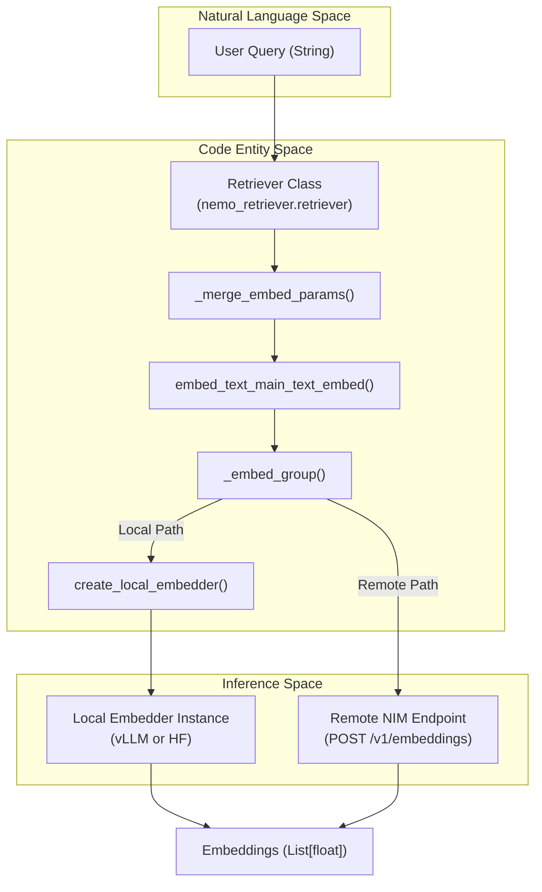
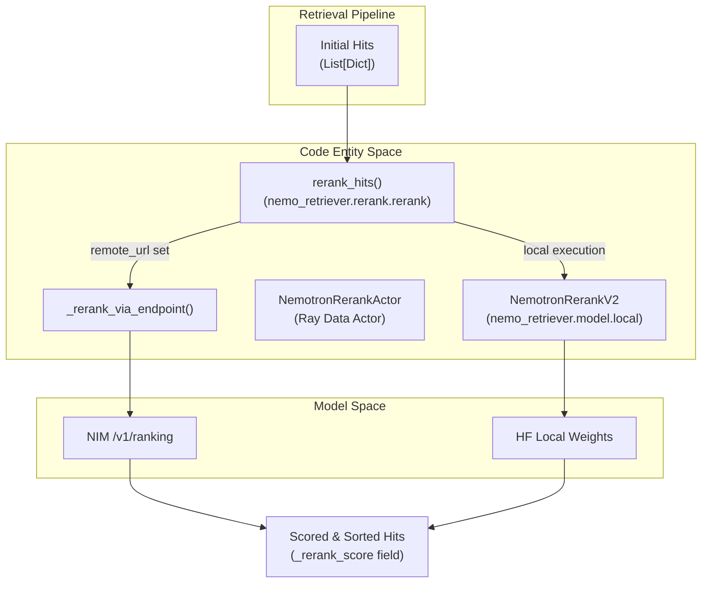

<!-- source: DeepWiki mcp.deepwiki.com · repo NVIDIA/NeMo-Retriever · extra page Embedding and Reranking NIMs · fetched 2026-10-26 -->

# Embedding and Reranking NIMs

Relevant source files

The following files were used as context for generating this wiki page:

- [nemo_retriever/src/nemo_retriever/model/__init__.py](nemo_retriever/src/nemo_retriever/model/__init__.py)
- [nemo_retriever/src/nemo_retriever/model/local/__init__.py](nemo_retriever/src/nemo_retriever/model/local/__init__.py)
- [nemo_retriever/src/nemo_retriever/model/local/llama_nemotron_embed_1b_v2_hf_embedder.py](nemo_retriever/src/nemo_retriever/model/local/llama_nemotron_embed_1b_v2_hf_embedder.py)
- [nemo_retriever/src/nemo_retriever/model/local/nemotron_rerank_vl_v2.py](nemo_retriever/src/nemo_retriever/model/local/nemotron_rerank_vl_v2.py)
- [nemo_retriever/src/nemo_retriever/model/local/nemotron_rerank_vl_v2_hf.py](nemo_retriever/src/nemo_retriever/model/local/nemotron_rerank_vl_v2_hf.py)
- [nemo_retriever/src/nemo_retriever/pdf/stage.py](nemo_retriever/src/nemo_retriever/pdf/stage.py)
- [nemo_retriever/src/nemo_retriever/recall/beir.py](nemo_retriever/src/nemo_retriever/recall/beir.py)
- [nemo_retriever/src/nemo_retriever/recall/core.py](nemo_retriever/src/nemo_retriever/recall/core.py)
- [nemo_retriever/src/nemo_retriever/rerank/__init__.py](nemo_retriever/src/nemo_retriever/rerank/__init__.py)
- [nemo_retriever/src/nemo_retriever/rerank/rerank.py](nemo_retriever/src/nemo_retriever/rerank/rerank.py)
- [nemo_retriever/src/nemo_retriever/retriever.py](nemo_retriever/src/nemo_retriever/retriever.py)
- [nemo_retriever/src/nemo_retriever/text_embed/gpu_operator.py](nemo_retriever/src/nemo_retriever/text_embed/gpu_operator.py)
- [nemo_retriever/src/nemo_retriever/text_embed/processor.py](nemo_retriever/src/nemo_retriever/text_embed/processor.py)
- [nemo_retriever/src/nemo_retriever/text_embed/runtime.py](nemo_retriever/src/nemo_retriever/text_embed/runtime.py)
- [nemo_retriever/src/nemo_retriever/utils/benchmark/audio_extract_actor.py](nemo_retriever/src/nemo_retriever/utils/benchmark/audio_extract_actor.py)
- [nemo_retriever/src/nemo_retriever/utils/hf_model_registry.py](nemo_retriever/src/nemo_retriever/utils/hf_model_registry.py)
- [nemo_retriever/tests/test_beir_evaluation.py](nemo_retriever/tests/test_beir_evaluation.py)
- [nemo_retriever/tests/test_create_local_embedder.py](nemo_retriever/tests/test_create_local_embedder.py)
- [nemo_retriever/tests/test_hf_model_registry.py](nemo_retriever/tests/test_hf_model_registry.py)
- [nemo_retriever/tests/test_nemotron_rerank_v2.py](nemo_retriever/tests/test_nemotron_rerank_v2.py)
- [nemo_retriever/tests/test_nemotron_rerank_vl_v2.py](nemo_retriever/tests/test_nemotron_rerank_vl_v2.py)
- [nemo_retriever/tests/test_retriever_queries.py](nemo_retriever/tests/test_retriever_queries.py)

This page documents the embedding and reranking NVIDIA Inference Microservices (NIMs) used by NeMo Retriever for generating vector representations and re-ranking search results. It covers the `llama-nemotron-embed` models, reranker NIMs, the Hugging Face model registry, and the `text_embed` runtime.

## Overview

NeMo Retriever utilizes specialized models for the semantic representation and refinement of document content:

*   **Embedding NIMs**: Generate dense vector representations (embeddings) of text, images, and multimodal content. These are used for initial retrieval from vector databases like LanceDB.
*   **Reranking NIMs**: Refine initial retrieval results by re-scoring candidate documents against a query, significantly improving precision for RAG applications.

The system supports both remote NIM execution via HTTP/gRPC endpoints and local execution using Hugging Face or vLLM backends.

---

## Supported Models and Registry

NeMo Retriever maintains a central registry of pinned Hugging Face model revisions to ensure reproducibility and immutable snapshots.

| Model ID | Purpose | Modalities |
| :--- | :--- | :--- |
| `nvidia/llama-nemotron-embed-1b-v2` | Text Embedding | Text |
| `nvidia/llama-nemotron-embed-vl-1b-v2` | Multimodal Embedding | Text, Image |
| `nvidia/llama-nemotron-rerank-1b-v2` | Text Reranking | Text |
| `nvidia/llama-nemotron-rerank-vl-1b-v2` | Multimodal Reranking | Text, Image |

**Sources:** [nemo_retriever/src/nemo_retriever/utils/hf_model_registry.py:26-47](), [nemo_retriever/src/nemo_retriever/model/__init__.py:12-29]()

---

## Embedding Configuration and Runtime

The embedding process is managed by the `text_embed` runtime, which handles modality grouping, batching, and inference execution.

### Embedding Data Flow

The following diagram illustrates how the `Retriever` class interacts with the embedding runtime and models.

**Diagram: Embedding Execution Flow**

**Sources:** [nemo_retriever/src/nemo_retriever/retriever.py:161-210](), [nemo_retriever/src/nemo_retriever/text_embed/runtime.py:99-154]()

### Local vs. Remote Execution
The system can resolve embedding requests in two ways:
1.  **Remote NIM**: Calls an external microservice via `endpoint_url`. The `_embed_group` function configures a `TextEmbeddingConfig` to point to this service [nemo_retriever/src/nemo_retriever/text_embed/runtime.py:67-81]().
2.  **Local Model**: If no endpoint is provided, `create_local_embedder` is invoked to load models using either the `vllm` or `hf` (Hugging Face) backend [nemo_retriever/src/nemo_retriever/model/__init__.py:62-95]().

### Multimodal Embedding
The `llama-nemotron-embed-vl-1b-v2` model supports text, image, and `text_image` modalities. The runtime groups input data by modality using the `_embed_modality` column in the input DataFrame to ensure correct processing [nemo_retriever/src/nemo_retriever/text_embed/runtime.py:133-154]().

---

## Reranking NIMs

Reranking is the second stage of the retrieval pipeline. It re-evaluates the top-K results from the vector database to provide a more accurate ranking.

### Reranker Implementation

The `NemotronRerankActor` and `rerank_hits` function facilitate this process.

**Diagram: Reranking Logic and Entity Mapping**

**Sources:** [nemo_retriever/src/nemo_retriever/rerank/rerank.py:172-207](), [nemo_retriever/src/nemo_retriever/model/local/nemotron_rerank_v2.py:115-136]()

### Key Functions and Classes

*   **`rerank_hits`**: The primary interface for reranking a list of dictionary "hits". It sorts results by the calculated `logit` score [nemo_retriever/src/nemo_retriever/rerank/rerank.py:172-185]().
*   **`_rerank_via_endpoint`**: Formats a POST request to the NIM `/v1/ranking` endpoint. It supports multimodal inputs by including `image` base64 strings in the passages payload [nemo_retriever/src/nemo_retriever/rerank/rerank.py:92-154]().
*   **`NemotronRerankV2` / `NemotronRerankVLV2`**: Local implementations that use `transformers` or `vLLM` to score query-passage pairs [nemo_retriever/src/nemo_retriever/model/local/__init__.py:53-60]().

### Prompt Templating
For local text reranking, the model uses a specific prompt template to format the input:
`"question:{query} passage:{passage}"`
This ensures the cross-attention mechanism correctly identifies the relationship between the user query and the retrieved document [nemo_retriever/src/nemo_retriever/model/local/nemotron_rerank_v2.py:103-108]().

---

## Integration with Retriever

The `Retriever` class orchestrates the entire flow. When `rerank=True` is passed to the `Retriever` constructor, it automatically inflates the initial retrieval `top_k` (often by a `refine_factor`) to ensure the reranker has a sufficient candidate pool to re-score [nemo_retriever/src/nemo_retriever/retriever.py:161-176]().

### Hit Shaping
After reranking or retrieval, the `_shape_query_hits` function applies final filters:
*   **Page Deduplication**: Ensures only the most relevant hit from a specific page is returned [nemo_retriever/src/nemo_retriever/retriever.py:127-132]().
*   **Content Type Filtering**: Filters hits based on an allowlist (e.g., only "text" or "table") [nemo_retriever/src/nemo_retriever/retriever.py:123-126]().

**Sources:** [nemo_retriever/src/nemo_retriever/retriever.py:106-136](), [nemo_retriever/tests/test_retriever_queries.py:90-96]()

---

