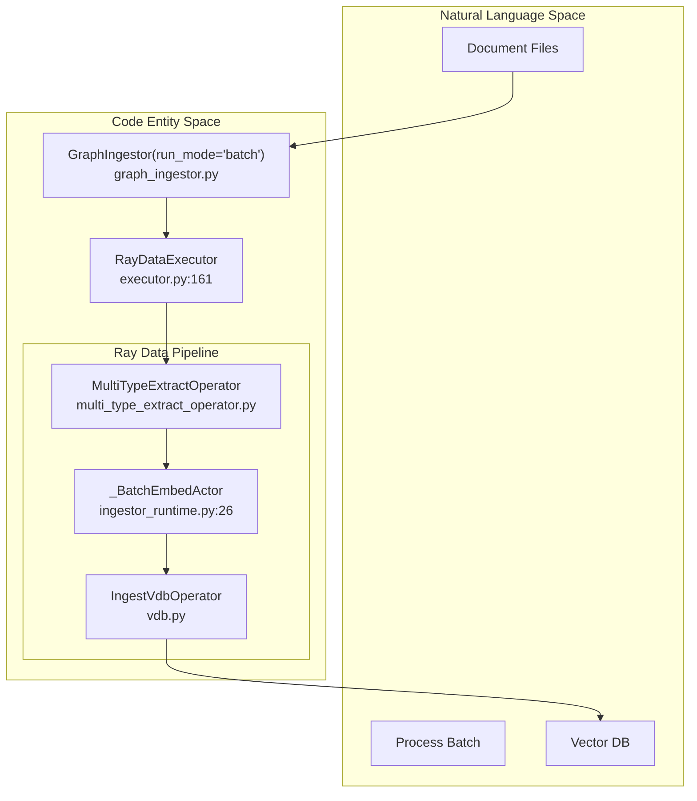
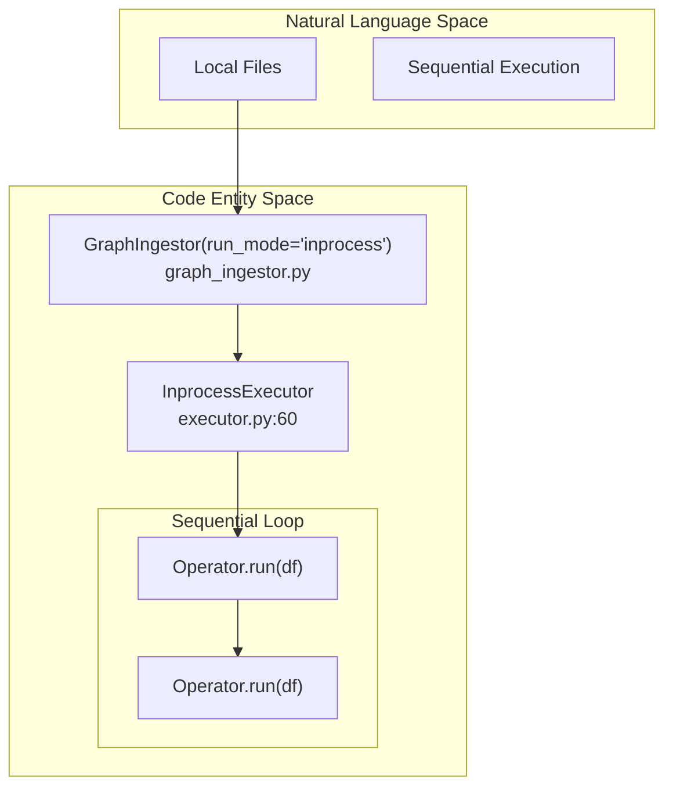
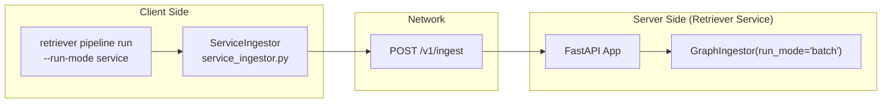

<!-- source: DeepWiki mcp.deepwiki.com · repo NVIDIA/NeMo-Retriever · extra page Execution Modes (Batch/Inprocess/Fused) · fetched 2026-10-26 -->

# Execution Modes (Batch/Inprocess/Fused)

<details>
<summary>Relevant source files</summary>

The following files were used as context for generating this wiki page:

- [nemo_retriever/src/nemo_retriever/graph/executor.py](nemo_retriever/src/nemo_retriever/graph/executor.py)
- [nemo_retriever/src/nemo_retriever/graph/ingestor_runtime.py](nemo_retriever/src/nemo_retriever/graph/ingestor_runtime.py)
- [nemo_retriever/src/nemo_retriever/graph/multi_type_extract_operator.py](nemo_retriever/src/nemo_retriever/graph/multi_type_extract_operator.py)
- [nemo_retriever/src/nemo_retriever/graph_ingestor.py](nemo_retriever/src/nemo_retriever/graph_ingestor.py)
- [nemo_retriever/src/nemo_retriever/params/models.py](nemo_retriever/src/nemo_retriever/params/models.py)
- [nemo_retriever/src/nemo_retriever/pipeline/__main__.py](nemo_retriever/src/nemo_retriever/pipeline/__main__.py)
- [nemo_retriever/src/nemo_retriever/utils/input_files.py](nemo_retriever/src/nemo_retriever/utils/input_files.py)
- [nemo_retriever/tests/test_graph_pipeline_cli.py](nemo_retriever/tests/test_graph_pipeline_cli.py)
- [nemo_retriever/tests/test_ingest_interface.py](nemo_retriever/tests/test_ingest_interface.py)
- [nemo_retriever/tests/test_ingest_plans.py](nemo_retriever/tests/test_ingest_plans.py)
- [nemo_retriever/tests/test_pipeline_graph.py](nemo_retriever/tests/test_pipeline_graph.py)
- [nemo_retriever/tests/test_pipeline_helpers.py](nemo_retriever/tests/test_pipeline_helpers.py)

</details>


## Purpose and Scope

This page documents the three execution modes available in the `nemo-retriever` library: **batch**, **inprocess**, and **service**. These modes determine how the document ingestion pipeline executes—whether distributed across a Ray cluster, running locally in a single Python process, or delegating execution to a remote service. Understanding these modes helps you choose the right deployment strategy based on workload size, infrastructure availability, and performance requirements.

The core of this execution logic resides in the `GraphIngestor` class [nemo_retriever/src/nemo_retriever/graph_ingestor.py:60](), which uses different `AbstractExecutor` implementations to run processing graphs.

---

## Execution Mode Overview

The library defines execution modes via the `IngestorRunMode` type in [nemo_retriever/src/nemo_retriever/params/models.py:20]():

```python
IngestorRunMode = Literal["inprocess", "batch", "service"]
```

Each mode implements the same fluent API but uses different execution strategies internally. The mode is selected when creating an ingestor:

```python
from nemo_retriever import create_ingestor

# Batch mode (Ray Data pipeline, distributed execution)
ingestor = create_ingestor(run_mode="batch")

# In-process mode (Local Python, pandas-based)
ingestor = create_ingestor(run_mode="inprocess")

# Service mode (Delegate to a remote retriever-service)
ingestor = create_ingestor(run_mode="service")
```

**Sources:**
[nemo_retriever/src/nemo_retriever/params/models.py:20]()
[nemo_retriever/src/nemo_retriever/graph_ingestor.py:19]()

---

## Batch Mode (Ray Data)

### Overview
Batch mode uses **Ray Data** to orchestrate a multi-stage distributed pipeline. It is designed for **large-scale production workloads** (thousands of documents) and multi-GPU clusters. It uses the `RayDataExecutor` [nemo_retriever/src/nemo_retriever/graph/executor.py:161]() to build a pipeline where each node in the graph becomes a `map_batches` stage.

### Pipeline Architecture (Batch Mode)

The following diagram shows how the `GraphIngestor` maps to `RayDataExecutor` and the underlying Ray actors.



**Sources:**
[nemo_retriever/src/nemo_retriever/graph/executor.py:161-195]()
[nemo_retriever/src/nemo_retriever/graph/multi_type_extract_operator.py:149]()
[nemo_retriever/src/nemo_retriever/graph/ingestor_runtime.py:38-40]()

### Key Characteristics
| Aspect | Batch Mode Behavior |
|--------|-------------------|
| **Execution Framework** | Ray Data (`ray.data.Dataset`) |
| **Parallelism** | Distributed across Ray cluster; Actor/Task pools |
| **Resource Planning** | Automatic heuristics in `batch_tuning_to_node_overrides` [nemo_retriever/src/nemo_retriever/graph/ingestor_runtime.py:75]() |
| **Best For** | Production, large datasets, multi-GPU clusters |

---

## In-process Mode (Pandas)

### Overview
In-process mode runs the entire pipeline in a **single Python process** using pandas DataFrames. It uses the `InprocessExecutor` [nemo_retriever/src/nemo_retriever/graph/executor.py:60](). This mode avoids Ray entirely, making it suitable for development and debugging.

### Pipeline Architecture (In-process Mode)



**Sources:**
[nemo_retriever/src/nemo_retriever/graph/executor.py:60-125]()
[nemo_retriever/src/nemo_retriever/graph_ingestor.py:36]()

### Key Characteristics
| Aspect | In-process Mode Behavior |
|--------|------------------------|
| **Execution Framework** | Local Python, sequential pandas operations |
| **Parallelism** | None (Single-threaded execution of operators) |
| **Linearity** | Supports single-root, no fan-out graphs only [nemo_retriever/src/nemo_retriever/graph/executor.py:67]() |
| **Best For** | Local testing, unit tests, small datasets (< 10 docs) |

---

## Service Mode (Remote API)

### Overview
Service mode delegates execution to a running `retriever-service` instance via REST APIs. Instead of running operators locally, it serializes the pipeline request into a `PipelineSpec` and submits it to the service's `/v1/ingest` endpoint.

### Data Flow (Service Mode)



**Sources:**
[nemo_retriever/src/nemo_retriever/pipeline/__main__.py:101-111]()
[nemo_retriever/src/nemo_retriever/params/models.py:106]()

### Key Characteristics
| Aspect | Service Mode Behavior |
|--------|----------------------|
| **Execution Framework** | Client-Server (REST) |
| **Local Resources** | Minimal (only file reading and upload) |
| **Incompatible Flags** | Many local-tuning flags (e.g., `--ocr-actors`) are ignored [nemo_retriever/src/nemo_retriever/pipeline/__main__.py:112-161]() |
| **Best For** | Thin clients, Kubernetes deployments, shared infrastructure |

---

## Comparison Summary

| Feature | Inprocess | Batch | Service |
| :--- | :--- | :--- | :--- |
| **Executor Class** | `InprocessExecutor` | `RayDataExecutor` | N/A (Remote Delegation) |
| **Infrastructure** | Local machine | Ray Cluster | Remote Service |
| **Data Format** | `pandas.DataFrame` | `ray.data.Dataset` | JSON/Multipart API |
| **GPU Usage** | Local (sequential) | Distributed (parallel) | Remote |
| **Complexity** | Low | High | Medium |

### Execution Parameters
Execution is controlled by `IngestExecuteParams` [nemo_retriever/src/nemo_retriever/params/models.py:116](), which includes:
* `parallel`: Whether to run in parallel (mostly for batch/service) [nemo_retriever/src/nemo_retriever/params/models.py:122]().
* `save_to_disk`: Whether to persist intermediate results [nemo_retriever/src/nemo_retriever/params/models.py:119]().
* `max_workers`: Limit for concurrency [nemo_retriever/src/nemo_retriever/params/models.py:123]().

**Sources:**
[nemo_retriever/src/nemo_retriever/params/models.py:116-128]()
[nemo_retriever/src/nemo_retriever/graph/executor.py:42-58]()

---

