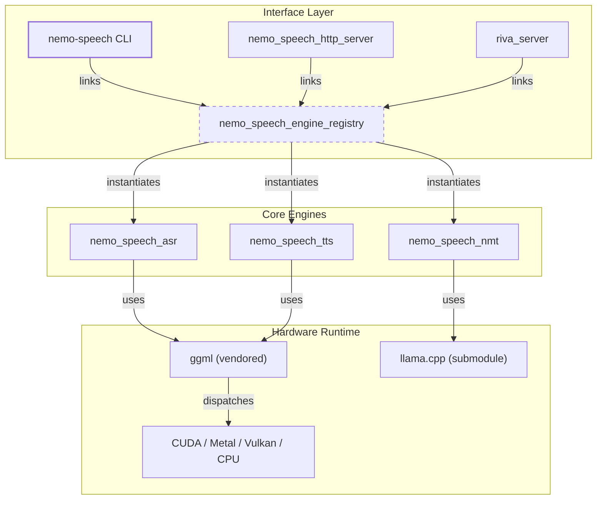
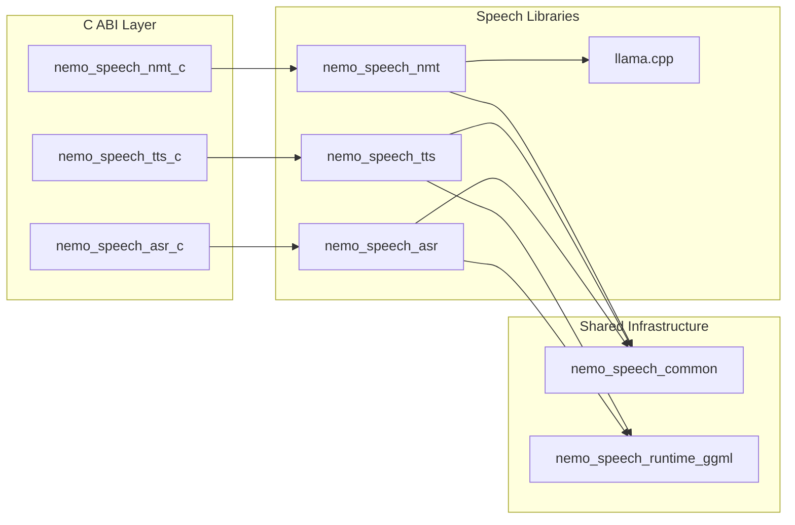

<!-- source: DeepWiki mcp.deepwiki.com · repo NVIDIA/NeMo-Speech.cpp · page 1 NeMo-Speech.cpp Overview · fetched 2026-10-26 -->

# NeMo-Speech.cpp Overview

Relevant source files

The following files were used as context for generating this wiki page:

- [CMakeLists.txt](CMakeLists.txt)
- [README.md](README.md)
- [app/CMakeLists.txt](app/CMakeLists.txt)
- [cmake/NeMoSpeechConfig.cmake.in](cmake/NeMoSpeechConfig.cmake.in)
- [docker/Dockerfile](docker/Dockerfile)
- [docs/build.md](docs/build.md)
- [docs/install.md](docs/install.md)
- [docs/sdk.md](docs/sdk.md)
- [ggml-patches/README.md](ggml-patches/README.md)
- [scripts/windows/build.ps1](scripts/windows/build.ps1)
- [src/nmt/CMakeLists.txt](src/nmt/CMakeLists.txt)
- [src/runtime/ggml/CMakeLists.txt](src/runtime/ggml/CMakeLists.txt)
- [src/tts/magpietts/CMakeLists.txt](src/tts/magpietts/CMakeLists.txt)
- [src/tts/nanocodec/CMakeLists.txt](src/tts/nanocodec/CMakeLists.txt)
- [tools/CMakeLists.txt](tools/CMakeLists.txt)

NeMo-Speech.cpp is a high-performance, lightweight native C++ runtime designed to execute NVIDIA Nemotron Speech models. Built on the `ggml` tensor library, it enables realtime and batch speech processing across multiple platforms (Linux, macOS, Windows) and hardware backends (CUDA, Metal, Vulkan, CPU) [README.md:1-4]().

The project provides a unified stack for Automatic Speech Recognition (ASR), Text-to-Speech (TTS), Neural Machine Translation (NMT), and Speaker Diarization. It is designed for both CLI-based workflows and deep integration into existing applications via a stable C ABI [docs/sdk.md:7-10]().

## Key Capabilities

NeMo-Speech.cpp organizes its features into modular subsystems, which can be enabled or disabled at compile-time via CMake options [CMakeLists.txt:87-94]().

| Capability | Subsystem | Description |
| :--- | :--- | :--- |
| **ASR** | `nemo_speech_asr` | Offline and streaming recognition using FastConformer and Nemotron architectures [docs/sdk.md:38](). |
| **TTS** | `nemo_speech_tts` | High-fidelity synthesis via MagpieTTS and NanoCodec vocoders [docs/sdk.md:41](). |
| **NMT** | `nemo_speech_nmt` | Batched text translation using Riva-Translate models via `llama.cpp` integration [docs/sdk.md:40](). |
| **Diarization** | `nemo_speech_diar` | Standalone or ASR-integrated speaker diarization using Sortformer [docs/sdk.md:39](). |
| **Serving** | `nemo_speech_http` | OpenAI-compatible REST API, WebSockets, and a browser-based Playground [README.md:69-70](). |

## System Architecture

The architecture is layered to separate high-level speech logic from low-level hardware acceleration. The `ggml` runtime serves as the foundation, while the `EngineRegistry` manages the lifecycle of specific speech engines.

### Logic to Code Mapping
The following diagram illustrates how high-level system components map to specific libraries and executable targets within the codebase.

**System Component to Code Entity Mapping**

Sources: [app/CMakeLists.txt:4-17](), [src/tts/magpietts/CMakeLists.txt:11-18](), [src/nmt/CMakeLists.txt:13-23](), [CMakeLists.txt:100-104]()

### Library Relationships
The project uses a modular library structure. Most capabilities are exposed through both a C++ implementation library and a stable C ABI wrapper for SDK users.

**Internal Library Dependency Graph**

Sources: [src/tts/magpietts/CMakeLists.txt:36-42](), [src/nmt/CMakeLists.txt:39-43](), [app/CMakeLists.txt:23-27]()

## Supported Backends

NeMo-Speech.cpp supports a wide range of hardware through its `ggml` backend manager:
*   **CUDA:** Optimized for NVIDIA GPUs (sm_80+) with custom fused kernels for FastConformer and MagpieTTS [ggml-patches/README.md:57-68]().
*   **Metal:** Native acceleration for Apple Silicon [CMakeLists.txt:101]().
*   **Vulkan:** Cross-vendor GPU acceleration [CMakeLists.txt:100]().
*   **CPU:** Fallback for all platforms, including optimized ARM kernels [scripts/windows/build.ps1:108-111]().

## Next Steps

For detailed information on specific areas of the project, refer to the following child pages:

*   **[Getting Started: Installation and Build](#1.1)**: Step-by-step guide for setting up the environment, initializing submodules, and building for your specific platform.
*   **[CLI Reference](#1.2)**: Comprehensive guide to the `nemo-speech` command-line tool subcommands and flags.
*   **[SDK and C ABI Reference](#1.3)**: Technical details on integrating the runtime into your own applications using the stable C ABI.
*   **[SDK Usage Examples](#1.4)**: Walkthrough of provided example code for common tasks like file transcription and live synthesis.

Sources: [CMakeLists.txt:1-104](), [README.md:1-118](), [docs/sdk.md:1-60](), [docs/build.md:1-114]()

---

