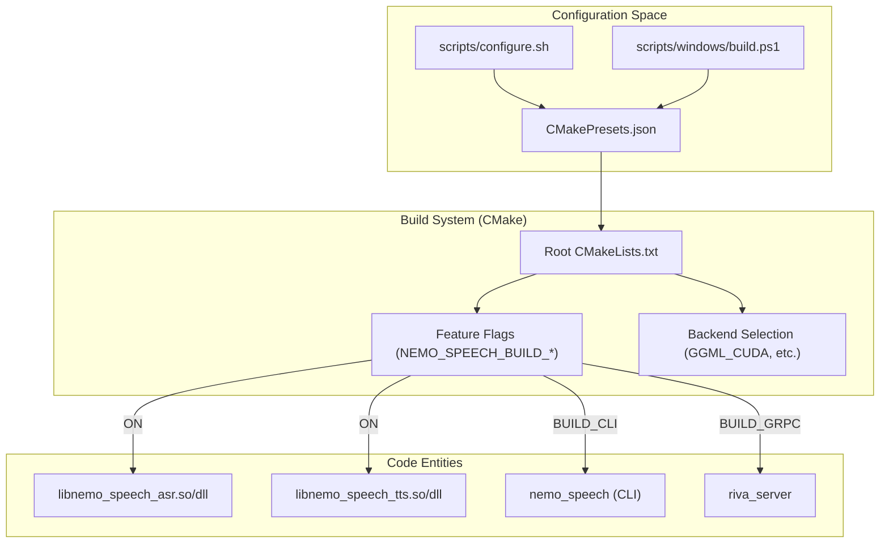

<!-- source: DeepWiki mcp.deepwiki.com · repo NVIDIA/NeMo-Speech.cpp · page 1.1 Getting Started: Installation and Build · fetched 2026-10-26 -->

# Getting Started: Installation and Build

<details>
<summary>Relevant source files</summary>

The following files were used as context for generating this wiki page:

- [.dockerignore](.dockerignore)
- [.pre-commit-config.yaml](.pre-commit-config.yaml)
- [CMakeLists.txt](CMakeLists.txt)
- [CMakePresets.json](CMakePresets.json)
- [README.md](README.md)
- [cmake/NeMoSpeechConfig.cmake.in](cmake/NeMoSpeechConfig.cmake.in)
- [docker/Dockerfile](docker/Dockerfile)
- [docs/build.md](docs/build.md)
- [docs/install.md](docs/install.md)
- [docs/sdk.md](docs/sdk.md)
- [ggml-patches/README.md](ggml-patches/README.md)
- [scripts/install.ps1](scripts/install.ps1)
- [scripts/install.sh](scripts/install.sh)
- [tests/install/install_ps1_test.py](tests/install/install_ps1_test.py)
- [tests/install/install_sh_test.py](tests/install/install_sh_test.py)
- [tools/CMakeLists.txt](tools/CMakeLists.txt)

</details>


This page provides a comprehensive technical guide for installing and building NeMo-Speech.cpp. The project supports multiple platforms (Linux, macOS, Windows) and backends (CUDA, Metal, Vulkan, CPU). It can be deployed via pre-built binaries, a unified installer script, or a manual CMake-based build process.

## Installation Overview

NeMo-Speech.cpp offers three primary paths for installation:
1.  **Unified Installer Scripts**: `scripts/install.sh` (Linux/macOS) and `scripts/install.ps1` (Windows) which automate backend detection and source/binary fetching [scripts/install.sh:1-15]() [scripts/install.ps1:1-13]().
2.  **Manual CMake Build**: For developers requiring specific feature flags (e.g., gRPC, NMT, or custom sanitizers) [CMakeLists.txt:74-100]().
3.  **Docker Deployment**: Containerized builds using multi-stage Dockerfiles for reproducible environments [docker/Dockerfile:3-13]().

### Platform and Backend Compatibility

| Backend | Platform Support | Requirement |
| :--- | :--- | :--- |
| **CUDA** | Linux, Windows | CUDA Toolkit 12/13, NVIDIA Driver [docs/build.md:14-16]() |
| **Metal** | macOS (Apple Silicon) | Xcode Command Line Tools [docs/build.md:36-38]() |
| **Vulkan** | Linux, Windows | Vulkan SDK (glslc, SPIR-V headers) [scripts/install.ps1:64-73]() |
| **CPU** | All | C++17 Compiler (GCC 13+, Clang, MSVC 2022) [docs/build.md:11-12]() |

---

## Automated Installation

The installer scripts prefer pre-built binaries if a release URL is configured via `NEMO_SPEECH_RELEASE_BASE_URL`. If no binary is found, they fall back to a source build [scripts/install.sh:127-152]() [scripts/install.ps1:99-123]().

### Linux and macOS
```bash
# Automated install with backend auto-detection
scripts/install.sh --source
export PATH="$HOME/.local/bin:$PATH"
```
Sources: [docs/install.md:17-23](), [scripts/install.sh:111-119]()

### Windows (PowerShell)
```powershell
# Automated install for Windows
.\scripts\install.ps1 -Source -Backend cuda
```
Sources: [docs/install.md:46-58](), [scripts/install.ps1:92-94]()

---

## Manual Build from Source

Manual builds allow for fine-grained control over components and optimizations via CMake options.

### 1. Submodule Initialization
The project relies on several submodules. You must initialize only those required for your build targets:
*   `ggml`: Required for all builds [docs/build.md:56]().
*   `third_party/cpp-httplib`: Required for the HTTP server (`NEMO_SPEECH_BUILD_HTTP`) [docs/build.md:57]().
*   `llama.cpp`: Required for NMT support (`NEMO_SPEECH_BUILD_NMT`) [docs/build.md:58]().
*   `proto/riva-common`: Required for gRPC adapters (`NEMO_SPEECH_BUILD_GRPC`) [docs/build.md:59]().

### 2. CMake Presets
The project uses `CMakePresets.json` to manage common configurations. Presets are named following the pattern `<backend>-<component>` [docs/build.md:74-76]().

**Common Presets:**
*   `cuda-asr`: CUDA-accelerated ASR and Diarization [CMakePresets.json:82-89]().
*   `metal-server`: Metal-accelerated ASR, TTS, and HTTP Server [CMakePresets.json:231-241]().
*   `cpu-speech`: CPU-only build with ASR, TTS, and NMT [CMakePresets.json:70-80]().

### 3. Build Procedure
```bash
# 1. Apply GGML patches (Required for CUDA performance)
scripts/apply-ggml-patches.sh

# 2. Configure using a preset
scripts/configure.sh cuda-server

# 3. Build
cmake --build --preset cuda-server
```
Sources: [docs/build.md:67-72](), [ggml-patches/README.md:7-10]()

### Installation Build Logic and Data Flow

The following diagram illustrates the relationship between the configuration scripts, the CMake build system, and the resulting artifacts.

**Build System Entity Map**

Sources: [CMakeLists.txt:81-99](), [CMakePresets.json:14-20](), [docs/build.md:117-132]()

---

## GGML Patching

For CUDA backends, applying the patches in `ggml-patches/` is critical for performance. These patches introduce fused kernels specifically for the FastConformer architecture used in NeMo models [ggml-patches/README.md:22-26]().

*   **`NEMO_SPEECH_GGML_PATCHED`**: A CMake option (default ON) that enables the use of patched GGML ops [ggml-patches/README.md:22-25]().
*   **Key Patches**:
    *   `0001`: Fused relative-position attention [ggml-patches/README.md:57-77]().
    *   `0005`: Skinny-Q8 GEMM for low-latency streaming [ggml-patches/README.md:100-124]().
    *   `0006`: Dispatch wiring for the custom ops into `ggml-cuda` [ggml-patches/README.md:126-128]().

Sources: [ggml-patches/README.md:1-130]()

---

## Docker Deployment

The `docker/Dockerfile` supports multi-stage builds to produce minimal runtime images [docker/Dockerfile:3-13]().

**Docker Build Targets:**
*   `builder`: Contains the full development toolchain, headers, and source code [docker/Dockerfile:54]().
*   `runtime`: A minimal "from scratch" image containing only the compiled binaries and necessary shared libraries [docker/Dockerfile:12]().

**Build Example:**
```bash
docker build -f docker/Dockerfile --target runtime -t nemo-speech:latest .
```
Sources: [docker/Dockerfile:14-19]()

---

## SDK Installation and Integration

The SDK can be installed into a specific prefix for use in external C++ projects.

### Exporting the SDK
```bash
cmake --install build/cuda-asr --prefix ./nemo_sdk
```
Sources: [docs/build.md:168-172]()

### Consuming the SDK
External projects use `find_package(NeMoSpeech)` to import the libraries. The SDK provides component-based targets [docs/sdk.md:18-26]().

| Component | Target | Header |
| :--- | :--- | :--- |
| **ASR** | `NeMoSpeech::ASR` | `nemo_speech/asr.h` |
| **TTS** | `NeMoSpeech::TTS` | `nemo_speech/tts.h` |
| **NMT** | `NeMoSpeech::NMT` | `nemo_speech/nmt.h` |
| **Diarization** | `NeMoSpeech::Diarization` | `nemo_speech/diar.h` |

Sources: [docs/sdk.md:36-42]()

### SDK Integration Data Flow

The following diagram shows how the C ABI headers and compiled libraries bridge the gap between user code and the internal engine.

**SDK Architecture Bridge**

```mermaid
graph LR
    subgraph "User Application Space"
        APP["main.cpp"]
        INC["#include <nemo_speech/asr.h>"]
    end

    subgraph "SDK Boundary (C ABI)"
        HANDLE["nemo_speech_asr_recognizer*"]
        CONFIG["nemo_speech_asr_recognizer_config"]
        FUNC["nemo_speech_asr_recognize_f32()"]
    end

    subgraph "NeMo-Speech.cpp Internal"
        ENGINE["src/asr/asr_engine.cpp"]
        RUNTIME["src/runtime/ggml/"]
        BACKEND["ggml-cuda.so / Metal / CPU"]
    end

    APP --> INC
    INC --> CONFIG
    CONFIG --> FUNC
    FUNC --> HANDLE
    HANDLE --> ENGINE
    ENGINE --> RUNTIME
    RUNTIME --> BACKEND
```

Sources: [docs/sdk.md:7-11](), [docs/sdk.md:87-126](), [include/nemo_speech/asr.h](), [src/asr/asr_engine.cpp]() (referenced conceptually from [docs/sdk.md:133-137]())

---

