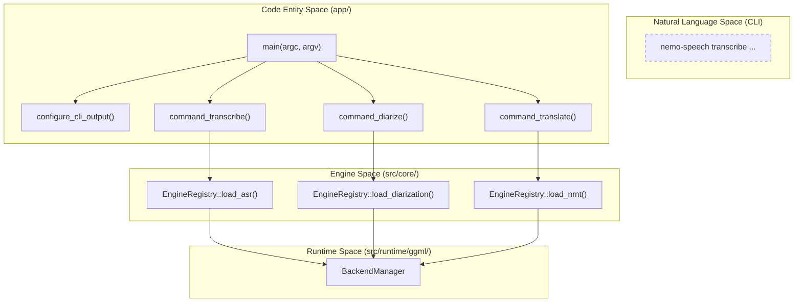
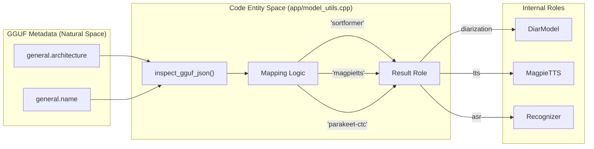

<!-- source: DeepWiki mcp.deepwiki.com · repo NVIDIA/NeMo-Speech.cpp · page 1.2 CLI Reference · fetched 2026-10-26 -->

# CLI Reference

<details>
<summary>Relevant source files</summary>

The following files were used as context for generating this wiki page:

- [app/bench.cpp](app/bench.cpp)
- [app/cli_util.cpp](app/cli_util.cpp)
- [app/cli_util.h](app/cli_util.h)
- [app/diarize.cpp](app/diarize.cpp)
- [app/doctor.cpp](app/doctor.cpp)
- [app/main.cpp](app/main.cpp)
- [app/model.cpp](app/model.cpp)
- [app/model_utils.cpp](app/model_utils.cpp)
- [app/model_utils.h](app/model_utils.h)
- [app/transcribe.cpp](app/transcribe.cpp)
- [app/translate.cpp](app/translate.cpp)
- [docs/cli.md](docs/cli.md)
- [src/common/json.cpp](src/common/json.cpp)
- [src/common/json.h](src/common/json.h)
- [src/runtime/ggml/backend.cpp](src/runtime/ggml/backend.cpp)
- [tests/cli/cli_contract_test.py](tests/cli/cli_contract_test.py)
- [tests/cpp/asr/test_diar_streaming.cpp](tests/cpp/asr/test_diar_streaming.cpp)

</details>


The `nemo-speech` binary is the primary unified interface for local inference, benchmarking, and diagnostics within the NeMo-Speech.cpp ecosystem. It provides a subcommand-based interface similar to `git` or `docker`, allowing users to perform complex speech tasks like transcription, diarization, and synthesis without writing C++ code [app/main.cpp:55-89]().

## Global Flags and Output Control

Global options modify the behavior of all subcommands. They are parsed early in the `main` function before dispatching to specific command handlers [app/main.cpp:106-116]().

| Flag | Purpose | Implementation Detail |
| :--- | :--- | :--- |
| `--json` | Emits results and errors as machine-readable JSON to `stdout` and `stderr`. | Triggers `configure_cli_output(true, ...)` [app/main.cpp:117](). |
| `--quiet` | Suppresses progress bars and non-essential diagnostic messages. | Sets internal `output_state.quiet = true` [app/cli_util.cpp:22](). |
| `--verbose` | Emits detailed runtime diagnostics, including backend initialization and tensor remapping. | Used by engine loaders to enable verbose logging [app/transcribe.cpp:132-133](). |

### Exit Codes
The CLI uses standardized exit codes to facilitate automation:
*   `0`: Success.
*   `1`: General failure (e.g., runtime exception).
*   `2`: `kCliExitInvalidArgument` - Invalid command-line arguments or incompatible flags [app/cli_util.h:20]().
*   `3`: `kCliExitMissingModel` - Required GGUF model file or directory not found [app/cli_util.h:21]().
*   `4`: `kCliExitUnsupportedFeature` - Command requires a component not included in the current build [app/main.cpp:178-181]().

## Subcommand Reference

### transcribe
Performs Automatic Speech Recognition (ASR). It can be configured for offline batching or simulated streaming.
*   **Key Flags**: `--model`, `--vad-model`, `--diar-model`, `--pnc-model`, `--itn-model-dir`.
*   **Data Flow**: Audio is loaded via `nemo_speech::audio::load_wav_file` [app/transcribe.cpp:112](), passed to a `Recognizer` instance [app/transcribe.cpp:22](), and results are formatted into Text, JSON, SRT, or VTT [app/transcribe.cpp:49]().

### synthesize
Performs Text-to-Speech (TTS) synthesis.
*   **Key Flags**: `--magpie-model`, `--codec-model`, `--tokenizer-dir`.
*   **Implementation**: Utilizes `nemo_speech::tts::TtsEngine` to convert text strings into PCM audio, which is then written to a WAV file [docs/cli.md:90-96]().

### translate
Translates text between languages using NMT models.
*   **Key Flags**: `--from`, `--to`, `--input` (file path).
*   **Implementation**: Reads lines from `stdin` or a file, then calls `translator->translate(texts, source, target)` [app/translate.cpp:136]().

### diarize
Identifies speaker segments in audio without necessarily performing ASR.
*   **Key Flags**: `--model` (Sortformer GGUF), `--offline` (full-attention), `--format` (rttm/json/text).
*   **Logic**: Uses `nemo_speech::asr::DiarStream` for streaming geometry or `diarize_offline` for short clips [tests/cpp/asr/test_diar_streaming.cpp:146-168]().

### serve
Starts the HTTP/gRPC server and the browser-based Playground.
*   **Key Flags**: `--config` (YAML), `--port`, `--no-ui`.
*   **Implementation**: Initializes the `server/http/` or `riva_server` components [app/main.cpp:46-50]().

### model
Inspects GGUF metadata to verify architecture compatibility.
*   **Key Functions**: `inspect_gguf_json` [app/model_utils.cpp:47]() parses the GGUF header to determine the model's `role` (asr, tts, etc.) and `runtime_compatible` status based on the current build flags [app/model_utils.cpp:120-158]().

### doctor
Performs a diagnostic check of the environment.
*   **Logic**: Reports the version, detected hardware backends (CUDA, Metal, Vulkan), and available devices [app/main.cpp:76]().

## Device Selection

Device selection is handled by `parse_device` [app/cli_util.cpp:70](), which maps string identifiers to integer GPU indices or `-1` for CPU.

| Device String | Resulting Backend |
| :--- | :--- |
| `auto` | Selects the first available GPU, falling back to CPU [app/cli_util.cpp:71](). |
| `cpu` | Forces `ggml_backend_init_by_type(GGML_BACKEND_DEVICE_TYPE_CPU)` [src/runtime/ggml/backend.cpp:97](). |
| `cuda:N` | Selects the Nth NVIDIA GPU [app/cli_util.cpp:80](). |
| `metal` | Selects the Apple Silicon GPU [app/cli_util.cpp:87](). |
| `vulkan:N` | Selects the Nth Vulkan-compatible device [app/cli_util.cpp:95](). |

## Architectural Diagrams

### Command Dispatch and Logic Flow
This diagram shows how the `main` entry point delegates work to specific command handlers and shared utilities.


**Sources:** [app/main.cpp:94-210](), [app/cli_util.cpp:18-28](), [app/transcribe.cpp:127-200](), [src/runtime/ggml/backend.cpp:15-18]()

### Model Inspection and Architecture Mapping
This diagram bridges GGUF metadata keys to internal runtime roles.


**Sources:** [app/model_utils.cpp:47-96](), [app/model_utils.cpp:120-155]()

## JSON Output Schema

When `--json` is enabled, all errors are emitted to `stderr` in the following format:

```json
{
  "error": {
    "exit_code": 3,
    "type": "missing_model",
    "message": "asr model file does not exist: asr.gguf"
  }
}
```
**Sources:** [app/cli_util.cpp:208-220](), [tests/cli/cli_contract_test.py:25-32]()

Success outputs for subcommands like `transcribe` or `translate` follow a similar structure, wrapping the engine's result in a top-level JSON object [app/transcribe.cpp:49-61](), [app/translate.cpp:138-148]().

`Sources: app/main.cpp:1-210, app/cli_util.cpp:1-205, app/transcribe.cpp:1-200, app/diarize.cpp:1-168, app/translate.cpp:1-168, app/model_utils.cpp:1-158, src/runtime/ggml/backend.cpp:1-122, tests/cli/cli_contract_test.py:1-167`

---

