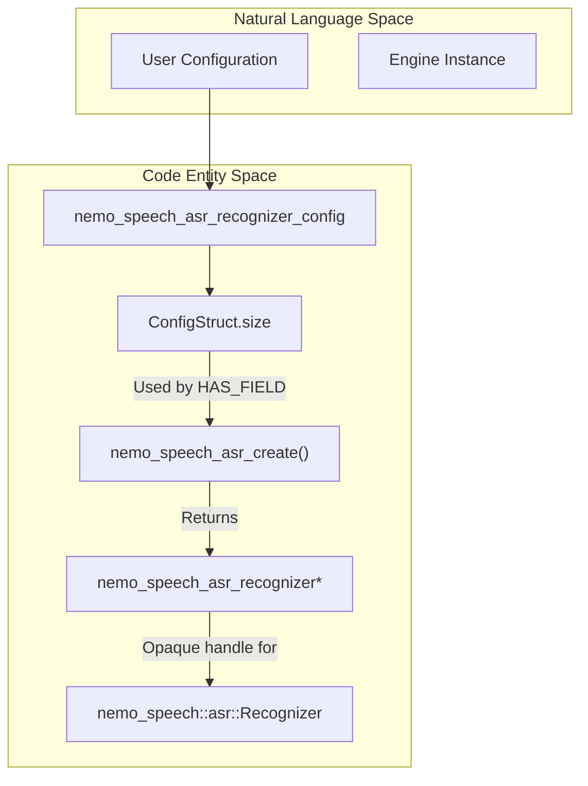
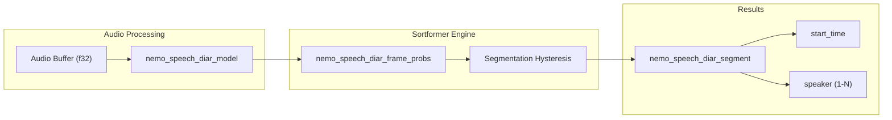

<!-- source: DeepWiki mcp.deepwiki.com · repo NVIDIA/NeMo-Speech.cpp · page 1.4 SDK Usage Examples · fetched 2026-10-26 -->

# SDK Usage Examples

Relevant source files

The following files were used as context for generating this wiki page:

- [docs/clients.md](docs/clients.md)
- [include/nemo_speech/asr.h](include/nemo_speech/asr.h)
- [include/nemo_speech/diar.h](include/nemo_speech/diar.h)
- [include/nemo_speech/nmt.h](include/nemo_speech/nmt.h)
- [include/nemo_speech/tts.h](include/nemo_speech/tts.h)
- [src/asr/c_api.cpp](src/asr/c_api.cpp)
- [src/nmt/c_api.cpp](src/nmt/c_api.cpp)
- [src/tts/c_api.cpp](src/tts/c_api.cpp)
- [tests/c/tts_c_smoke.c](tests/c/tts_c_smoke.c)
- [tests/integration/clients/openai_client.mjs](tests/integration/clients/openai_client.mjs)

This page provides a technical walkthrough of the C++ examples found in the `examples/` directory. These examples demonstrate how to integrate the NeMo-Speech.cpp runtime into applications using the stable C ABI. The C ABI is designed for binary compatibility across different compiler versions and languages, utilizing opaque handles and size-prefixed POD (Plain Old Data) structs.

## Core Integration Pattern

All SDK examples follow a consistent lifecycle pattern for managing NeMo-Speech.cpp engines. This pattern ensures that C++ exceptions do not cross the binary boundary and that memory ownership is explicitly managed.

### The Handle Pattern
The SDK uses opaque pointers to represent engine instances and request states:
*   `nemo_speech_asr_recognizer*`: Owns the ASR model and compute resources [include/nemo_speech/asr.h:39]().
*   `nemo_speech_tts_synthesizer*`: Owns the MagpieTTS and NanoCodec models [include/nemo_speech/tts.h:36]().
*   `nemo_speech_nmt_translator*`: Owns the NMT translation engine [include/nemo_speech/nmt.h:37]().

### Configuration and ABI Safety
To maintain forward compatibility, configuration structs include a `size` field. The implementation uses a `HAS_FIELD` macro to check if the caller-provided struct is large enough to contain a specific member before accessing it [src/asr/c_api.cpp:54-55]().

**Sources:** [src/asr/c_api.cpp:54-55](), [include/nemo_speech/asr.h:145-156](), [include/nemo_speech/tts.h:107-113]()

---

## ASR Examples

### File Transcription (`transcribe_file.cpp`)
Demonstrates offline batch transcription of an audio file. It utilizes the `nemo_speech_asr_recognizer` to process a complete audio buffer.

**Data Flow:**
1.  Initialize `nemo_speech_asr_recognizer_config` with model paths.
2.  Call `nemo_speech_asr_create()` to instantiate the engine [src/asr/c_api.cpp:180]().
3.  Load audio into a `float` buffer.
4.  Call `nemo_speech_asr_recognize_f32()` to perform inference.
5.  Iterate through `nemo_speech_asr_result` to extract text and timestamps.

### Live Transcription (`transcribe_live.cpp`)
Demonstrates the streaming API where audio is pushed in small chunks, and partial results are returned as they become available.

**Key Functions:**
*   `nemo_speech_asr_stream_open()`: Creates a stateful stream handle [src/asr/c_api.cpp:218]().
*   `nemo_speech_asr_stream_push_f32()`: Buffers audio and triggers incremental inference [src/asr/c_api.cpp:234]().
*   `nemo_speech_asr_stream_get_next_result()`: Polls for interim or final transcripts [src/asr/c_api.cpp:273]().

**Sources:** [include/nemo_speech/asr.h:203-240](), [src/asr/c_api.cpp:21-29]()

---

## TTS Examples

### Text Synthesis (`synthesize_text.cpp`)
Shows how to convert raw text into PCM audio using the MagpieTTS architecture.

**Implementation Detail:**
The example provides a `nemo_speech_tts_pcm_callback` function. As the engine generates audio chunks (via the NanoCodec vocoder), it invokes this callback with raw 16-bit PCM data [include/nemo_speech/tts.h:136]().

**Sources:** [include/nemo_speech/tts.h:203-207](), [tests/c/tts_c_smoke.c:27-35]()

---

## Diarization Examples

### Standalone Diarization (`diarize_file.cpp`)
Demonstrates the use of the Sortformer model to identify "who spoke when" without performing ASR.

**Data Flow:**
1.  Configure `nemo_speech_diar_model_config` with a Sortformer GGUF [include/nemo_speech/diar.h:30-49]().
2.  Perform offline diarization via `nemo_speech_diar_offline_f32()` [include/nemo_speech/diar.h:109-111]().
3.  Retrieve segments using `nemo_speech_diar_segments()`, which applies onset/offset hysteresis post-processing [include/nemo_speech/diar.h:134-137]().

**Sources:** [include/nemo_speech/diar.h:56-70](), [include/nemo_speech/diar.h:127-137]()

---

## Translation Examples

### Text Translation (`translate_text.cpp`)
Demonstrates NMT (Neural Machine Translation) using the `nemo_speech_nmt_translator`. It maps source text to a target language using Riva-Translate models.

**Key Functions:**
*   `nemo_speech_nmt_translate()`: Takes an array of strings and returns a result handle [src/nmt/c_api.cpp:130-146]().
*   `nemo_speech_nmt_result_text()`: Accesses individual translated strings from the result handle [src/nmt/c_api.cpp:154-158]().

### Speech Translation (`speech_translate_file.cpp`)
A composite example that chains ASR and NMT. It transcribes audio in the source language and immediately passes the resulting text to the NMT engine for translation.

**Sources:** [include/nemo_speech/nmt.h:80-92](), [src/nmt/c_api.cpp:21-26]()

---

## Error Handling Pattern

Every example uses a `guard` pattern implemented in the C ABI layer. If a C++ exception occurs within the engine, it is caught, and the error message is stored in a thread-local string [src/asr/c_api.cpp:45-49]().

| Function | Purpose |
| :--- | :--- |
| `nemo_speech_asr_last_error()` | Returns the last ASR error on the current thread [include/nemo_speech/asr.h:323](). |
| `nemo_speech_tts_last_error()` | Returns the last TTS error on the current thread [include/nemo_speech/tts.h:218](). |
| `nemo_speech_nmt_last_error()` | Returns the last NMT error on the current thread [include/nemo_speech/nmt.h:107](). |

**Sources:** [src/asr/c_api.cpp:45-49](), [src/nmt/c_api.cpp:30-34](), [src/tts/c_api.cpp:30-35]()

---

