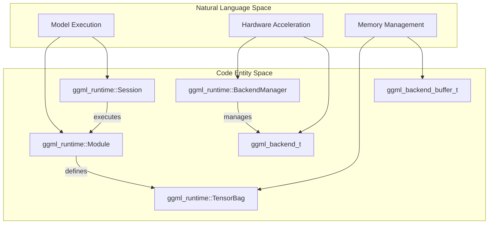
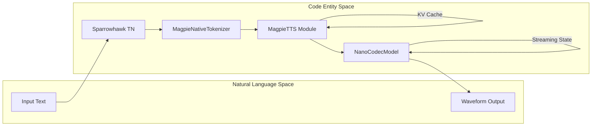

<!-- source: DeepWiki mcp.deepwiki.com · repo NVIDIA/NeMo-Speech.cpp · page 10 Glossary · fetched 2026-10-26 -->

# Glossary

Relevant source files

The following files were used as context for generating this wiki page:

- [README.md](README.md)
- [app/serve.cpp](app/serve.cpp)
- [cmake/NeMoSpeechConfig.cmake.in](cmake/NeMoSpeechConfig.cmake.in)
- [config/README.md](config/README.md)
- [config/asr.example.yaml](config/asr.example.yaml)
- [config/diar.example.yaml](config/diar.example.yaml)
- [config/server.example.yaml](config/server.example.yaml)
- [config/tts.example.yaml](config/tts.example.yaml)
- [conversion/__init__.py](conversion/__init__.py)
- [conversion/asr.py](conversion/asr.py)
- [conversion/registry.py](conversion/registry.py)
- [docker/Dockerfile](docker/Dockerfile)
- [docs/api.md](docs/api.md)
- [docs/asr/configuration.md](docs/asr/configuration.md)
- [docs/asr/customization.md](docs/asr/customization.md)
- [docs/build.md](docs/build.md)
- [docs/install.md](docs/install.md)
- [docs/model-conversion.md](docs/model-conversion.md)
- [docs/sdk.md](docs/sdk.md)
- [docs/server.md](docs/server.md)
- [docs/tts/configuration.md](docs/tts/configuration.md)
- [docs/tts/models.md](docs/tts/models.md)
- [include/nemo_speech/asr.h](include/nemo_speech/asr.h)
- [include/nemo_speech/diar.h](include/nemo_speech/diar.h)
- [include/nemo_speech/nmt.h](include/nemo_speech/nmt.h)
- [include/nemo_speech/tts.h](include/nemo_speech/tts.h)
- [src/asr/c_api.cpp](src/asr/c_api.cpp)
- [src/asr/diar/diar_pipeline.h](src/asr/diar/diar_pipeline.h)
- [src/asr/diar/diarizer.cpp](src/asr/diar/diarizer.cpp)
- [src/asr/diar/diarizer.h](src/asr/diar/diarizer.h)
- [src/asr/runner.cpp](src/asr/runner.cpp)
- [src/nmt/c_api.cpp](src/nmt/c_api.cpp)
- [src/runtime/ggml/loader.cpp](src/runtime/ggml/loader.cpp)
- [src/runtime/ggml/logging.cpp](src/runtime/ggml/logging.cpp)
- [src/runtime/ggml/runtime.h](src/runtime/ggml/runtime.h)
- [src/runtime/ggml/session.cpp](src/runtime/ggml/session.cpp)
- [src/tts/c_api.cpp](src/tts/c_api.cpp)
- [src/tts/magpietts/README.md](src/tts/magpietts/README.md)
- [src/tts/magpietts/magpietts.cpp](src/tts/magpietts/magpietts.cpp)
- [src/tts/magpietts/model.cpp](src/tts/magpietts/model.cpp)
- [src/tts/magpietts/runtime.cpp](src/tts/magpietts/runtime.cpp)
- [src/tts/magpietts/runtime.h](src/tts/magpietts/runtime.h)
- [src/tts/tokenizer/tokenizer.cpp](src/tts/tokenizer/tokenizer.cpp)
- [tests/c/tts_c_smoke.c](tests/c/tts_c_smoke.c)
- [tests/conversion/converter_contract_test.py](tests/conversion/converter_contract_test.py)
- [tools/CMakeLists.txt](tools/CMakeLists.txt)

This glossary provides technical definitions for domain-specific terms, model architectures, and implementation concepts used throughout the NeMo-Speech.cpp codebase.

## Core Runtime Concepts

### GGML Runtime Layer
The foundational tensor library and runtime used for model execution. NeMo-Speech.cpp extends GGML with a high-level C++ abstraction layer located in `src/runtime/ggml/`.

*   **Session**: A thread-local execution context that manages the lifecycle of a model's forward pass. It handles memory allocation for temporary tensors and graph construction [src/runtime/ggml/runtime.h:146-146]().
*   **Module**: The abstract interface for neural network components (e.g., Encoder, Decoder). Modules define their persistent tensors and implement the `build_graph` method [src/runtime/ggml/runtime.h:149-162]().
*   **BackendManager**: Orchestrates hardware acceleration (CUDA, Metal, Vulkan, CPU). It manages the `ggml_backend_t` handles and provides shared access to GPU resources [src/runtime/ggml/runtime.h:171-200]().
*   **GGUFLoader**: Handles the parsing of `.gguf` files, including metadata retrieval and lazy loading of tensor data into backend-specific buffers [src/runtime/ggml/runtime.h:62-95]().

### Natural Language to Code Entity Space: Runtime

**Sources:** [src/runtime/ggml/runtime.h:60-200]()

---

## Automatic Speech Recognition (ASR)

### Model Families
*   **FastConformer**: The primary encoder architecture used for ASR. It utilizes depthwise convolutions and relative-position attention. Implementation details are found in `src/asr/encoder/`.
*   **Parakeet CTC**: A Connectionist Temporal Classification model that predicts character or subword probabilities directly from encoder frames.
*   **Nemotron-Speech RNNT**: A Recurrent Neural Network Transducer model consisting of an encoder, prediction network, and joint network.

### ASR Components
*   **VAD (Voice Activity Detection)**: A subsystem that identifies segments of speech versus silence to trigger end-pointing or masking. Configured via `nemo_speech_asr_vad_config` [include/nemo_speech/asr.h:95-101]().
*   **ITN (Inverse Text Normalization)**: Converts spoken-form text (e.g., "three hundred dollars") into written-form (e.g., "$300"). Implemented using Sparrowhawk WFST grammars [include/nemo_speech/asr.h:110-116]().
*   **Flashlight Decoder**: A beam-search decoder that supports integration with KenLM language models for improved accuracy [include/nemo_speech/asr.h:78-93]().
*   **Diarization (Sortformer)**: The process of partitioning an audio stream into segments according to speaker identity. Managed by the `Diarizer` and `DiarStream` classes [src/asr/diar/diarizer.h:4-196]().

**Sources:** [include/nemo_speech/asr.h:51-156](), [src/asr/diar/diarizer.cpp:4-196]()

---

## Text-to-Speech (TTS)

### MagpieTTS
A multi-lingual, multi-speaker transformer-based TTS architecture. It generates acoustic tokens (codes) from input text.

*   **Local Transformer (LT)**: A component within MagpieTTS that processes local context. It can be executed on either CPU or GPU (CUDA) depending on `lt_backend` settings [include/nemo_speech/tts.h:100-100]().
*   **Classifier-Free Guidance (CFG)**: A technique used during sampling to improve the alignment and quality of generated speech by contrasting conditional and unconditional outputs [src/tts/magpietts/magpietts.cpp:160-162]().
*   **Longform Mode**: A synthesis strategy for long texts that utilizes an attention prior and KV cache management to maintain consistency across chunks [src/tts/magpietts/magpietts.cpp:125-132]().

### NanoCodec
A neural vocoder that converts the discrete tokens produced by MagpieTTS into high-fidelity audio waveforms.

*   **Stateful Decoding**: An optimization where the internal states of the NanoCodec layers are preserved between chunks, enabling low-latency streaming [include/nemo_speech/tts.h:96-96]().
*   **Overlap-Add**: A technique used during streaming to smooth transitions between synthesized audio chunks, controlled by `window_ms` [include/nemo_speech/tts.h:88-88]().

### Natural Language to Code Entity Space: TTS Pipeline

**Sources:** [src/tts/magpietts/magpietts.cpp:140-205](), [src/tts/tokenizer/tokenizer.cpp:139-190](), [include/nemo_speech/tts.h:66-136]()

---

## Common Infrastructure

### C ABI (Application Binary Interface)
The stable interface exposed to external callers (C, C++, Python, Rust). It uses opaque handles and size-prefixed POD structs to ensure binary compatibility.

*   **HAS_FIELD**: A macro used in the C ABI implementation to check if a struct field is present based on the `size` member provided by the caller [src/asr/c_api.cpp:54-55]().
*   **nemo_speech_asr_recognizer**: Opaque handle for the ASR engine [include/nemo_speech/asr.h:39-39]().
*   **nemo_speech_tts_synthesizer**: Opaque handle for the TTS engine [include/nemo_speech/tts.h:36-36]().

### Parameter Management
*   **ParameterParser**: A utility in `src/common/` that handles configuration ingestion from YAML files, environment variables, and CLI flags [app/serve.cpp:146-200]().
*   **UMA (Unified Memory Architecture)**: A mode for handling memory on systems where CPU and GPU share physical RAM (e.g., NVIDIA Grace Hopper, Apple Silicon). Controlled via `nemo_speech_tts_uma_mode` [include/nemo_speech/tts.h:52-56]().

**Sources:** [src/asr/c_api.cpp:22-156](), [src/tts/c_api.cpp:22-132](), [app/serve.cpp:115-200]()

---

## Technical Abbreviations

| Abbreviation | Full Term | Context |
| :--- | :--- | :--- |
| **ASR** | Automatic Speech Recognition | Speech-to-Text conversion. |
| **TTS** | Text-to-Speech | Speech synthesis. |
| **NMT** | Neural Machine Translation | Text-to-Text or Speech-to-Text translation. |
| **GGUF** | GGML Universal Format | The binary file format for model weights and metadata. |
| **RTF** | Real Time Factor | `Elapsed Time / Audio Duration`. Lower is better. |
| **RTFX** | Real Time Factor X | `Audio Duration / Elapsed Time`. Higher is better. |
| **TTFA** | Time to First Audio | Latency from request to the first byte of audio (TTS). |
| **TTFT** | Time to First Token | Latency to the first generated token (ASR/LLM). |
| **ITL** | Inter-Token Latency | The time between subsequent tokens/chunks. |
| **WFST** | Weighted Finite State Transducer | Technology used for ITN and Text Normalization. |

**Sources:** [include/nemo_speech/asr.h:3-19](), [include/nemo_speech/tts.h:138-180](), [docs/tts/configuration.md:124-161]()