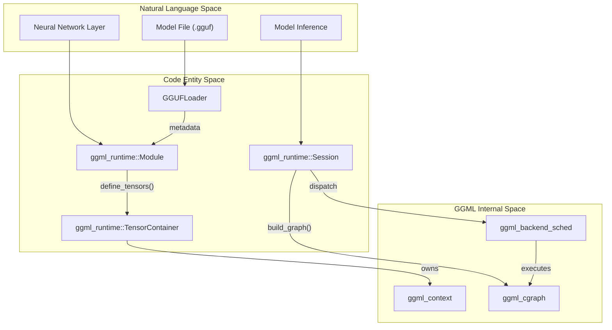
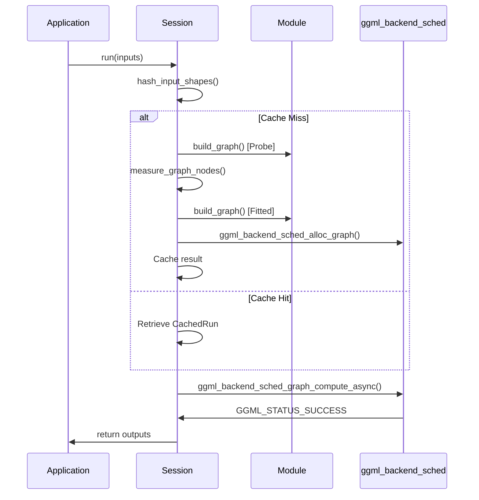

<!-- source: DeepWiki mcp.deepwiki.com · repo NVIDIA/NeMo-Speech.cpp · page 2.1 GGML Runtime Layer · fetched 2026-10-26 -->

# GGML Runtime Layer

Relevant source files

The following files were used as context for generating this wiki page:

- [src/asr/decoders/rnnt_greedy_decoder.cpp](src/asr/decoders/rnnt_greedy_decoder.cpp)
- [src/asr/encoder/fastconformer.h](src/asr/encoder/fastconformer.h)
- [src/asr/encoder/rel_pos_attention.cpp](src/asr/encoder/rel_pos_attention.cpp)
- [src/runtime/ggml/loader.cpp](src/runtime/ggml/loader.cpp)
- [src/runtime/ggml/logging.cpp](src/runtime/ggml/logging.cpp)
- [src/runtime/ggml/nn.cpp](src/runtime/ggml/nn.cpp)
- [src/runtime/ggml/nn.h](src/runtime/ggml/nn.h)
- [src/runtime/ggml/runtime.h](src/runtime/ggml/runtime.h)
- [src/runtime/ggml/session.cpp](src/runtime/ggml/session.cpp)
- [src/runtime/ggml/tensor_container.cpp](src/runtime/ggml/tensor_container.cpp)

The GGML Runtime Layer (`src/runtime/ggml/`) provides a high-level C++ abstraction over the `ggml` and `ggml-backend` libraries. It manages model loading, graph construction, memory allocation, and hardware dispatch across multiple backends (CUDA, CPU, Metal, Vulkan).

## Core Abstractions

The runtime is built around four primary entities that manage the lifecycle of a model from disk to execution.

### BackendManager
The `BackendManager` owns the physical hardware handles. It initializes the requested backends (e.g., `ggml_backend_cuda_init`) and manages a shared `compute_mutex` to serialize access to hardware for sessions sharing the same manager [src/runtime/ggml/runtime.h:171-203]().

### GGUFLoader
A wrapper around the GGUF file format. It provides type-safe access to metadata (KV pairs) and tensor data. It supports lazy loading, allowing file-backed resources to be released while retaining metadata [src/runtime/ggml/runtime.h:62-95]().

### TensorContainer
Manages `ggml_context` handles and tensor allocation. It separates tensors into two categories:
1.  **Persistent Tensors**: Created via `model_tensor_container`, these hold weights that stay resident in device memory [src/runtime/ggml/session.h:188-190]().
2.  **Transient Tensors**: Created during graph construction for intermediates.

### Session
The `Session` is the primary execution context. it orchestrates the `Module` graph construction and manages the `ggml_backend_sched` (scheduler) which assigns nodes to backends [src/runtime/ggml/runtime.h:206-258]().

| Entity | Role | File |
| :--- | :--- | :--- |
| `BackendManager` | Hardware initialization and synchronization | [src/runtime/ggml/runtime.h:171]() |
| `GGUFLoader` | Metadata and weight loading from `.gguf` | [src/runtime/ggml/runtime.h:62]() |
| `TensorContainer` | Arena-based memory management | [src/runtime/ggml/runtime.h:147]() |
| `Session` | Graph scheduling and execution | [src/runtime/ggml/runtime.h:206]() |

**Sources:** [src/runtime/ggml/runtime.h:62-258](), [src/runtime/ggml/session.h:188-190]()

---

## Data Flow: From Code to Execution

The following diagram illustrates how high-level code entities map to the underlying GGML execution flow.

### System Mapping: Code to GGML Entity

**Sources:** [src/runtime/ggml/runtime.h:149-162](), [src/runtime/ggml/session.cpp:60-74]()

---

## Graph Construction and Caching

The runtime uses a **two-pass construction** strategy to handle the `ggml-alloc` requirement of knowing tensor sizes before allocation.

### Two-Pass Strategy
1.  **Probe Pass**: The `Module::build_graph` function is called to create a `ggml_cgraph`. The runtime measures the number of nodes and the required metadata memory [src/runtime/ggml/session.cpp:109-117]().
2.  **Allocation Pass**: A fitted `ggml_context` is created based on the probe. The graph is expanded into this context, and the scheduler (`ggml_backend_sched`) allocates physical memory buffers for intermediates [src/runtime/ggml/tensor_container.cpp:195-215]().

### LRU Graph Caching
To avoid the overhead of rebuilding graphs (which involves thousands of `ggml_add`, `ggml_mul_mat`, etc. calls), `Session` maintains a cache of `CachedRun` objects.
*   **Cache Key**: A hash of input tensor shapes and types [src/runtime/ggml/session.cpp:133-145]().
*   **Eviction**: An LRU (Least Recently Used) policy manages the cache, clearing the oldest graphs when capacity is reached [src/runtime/ggml/session.cpp:67-70]().

### Execution Sequence

**Sources:** [src/runtime/ggml/session.cpp:109-145](), [src/runtime/ggml/session.cpp:28-43](), [src/runtime/ggml/tensor_container.cpp:195-215]()

---

## Streaming and State Binding

For streaming models (like FastConformer ASR or MagpieTTS), the runtime must maintain state (KV caches, convolution buffers) across multiple `run()` calls.

### LayerCacheIO
The `LayerCacheIO` struct is used by modules to bind persistent state tensors into the active computation graph.
*   **K/V Caches**: `k_cache_cur` and `v_cache_cur` represent past context [src/asr/encoder/fastconformer.h:123-124]().
*   **Conv State**: `conv_cache_cur` stores the `kernel-1` past frames required for causal convolution [src/asr/encoder/fastconformer.h:132]().
*   **Binding**: During `build_graph`, the `Module` retrieves these tensors from a `StreamState` and uses `ggml_view` or `ggml_concat` to link them with new input data [src/asr/encoder/fastconformer.h:111-121]().

**Sources:** [src/asr/encoder/fastconformer.h:111-153](), [src/runtime/ggml/nn.cpp:114-138]()

---

## Backend Dispatch and Optimization

The runtime abstracts hardware-specific optimizations behind standard `Module` implementations.

### Quantized Pointwise Convolutions
In `Conv1D::build_graph`, the runtime detects if a 1D convolution is pointwise (kernel size 1). If so, it uses `ggml_mul_mat` instead of `ggml_conv_1d`. This allows the use of highly optimized quantized kernels (Q8_0, Q4_K, etc.) which are not typically available for standard convolution ops [src/runtime/ggml/nn.cpp:82-95]().

### Skinny-Q8 Optimization
The runtime supports a "Skinny-Q8" mode for CUDA backends. If the `GGML_SKINNY_Q8_CUBLAS_F16` environment variable is set, the runtime casts `F32` inputs to `F16` before performing matrix multiplication against `Q8_0` weights, leveraging specialized CUDA kernels for better performance on narrow (low batch size) GEMMs [src/runtime/ggml/nn.cpp:21-39]().

### Direct Depthwise Convolution
For CUDA backends, `Conv1D` can utilize `ggml_conv_2d_dw_direct` (via Patch 0004), which implements a fused depthwise convolution kernel that avoids the memory overhead of the `im2col` transformation used in the portable CPU/Metal paths [src/runtime/ggml/nn.cpp:97-113]().

**Sources:** [src/runtime/ggml/nn.cpp:21-39](), [src/runtime/ggml/nn.cpp:82-113](), [src/runtime/ggml/nn.h:54-58]()

---

