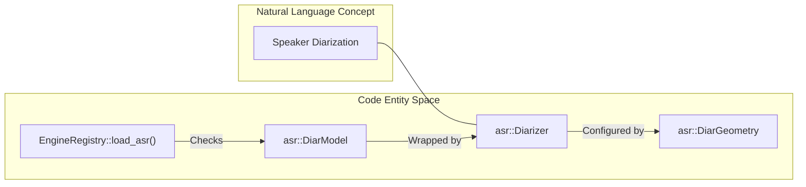

<!-- source: DeepWiki mcp.deepwiki.com · repo NVIDIA/NeMo-Speech.cpp · page 2.2 Engine Registry and Service Composition · fetched 2026-10-26 -->

# Engine Registry and Service Composition

<details>
<summary>Relevant source files</summary>

The following files were used as context for generating this wiki page:

- [src/common/CMakeLists.txt](src/common/CMakeLists.txt)
- [src/core/CMakeLists.txt](src/core/CMakeLists.txt)
- [src/core/engine_registry.cpp](src/core/engine_registry.cpp)
- [src/core/engine_registry.h](src/core/engine_registry.h)
- [src/services/CMakeLists.txt](src/services/CMakeLists.txt)
- [src/speech/CMakeLists.txt](src/speech/CMakeLists.txt)
- [src/speech/speech_translator.cpp](src/speech/speech_translator.cpp)
- [src/speech/speech_translator.h](src/speech/speech_translator.h)
- [src/tts/preproc/CMakeLists.txt](src/tts/preproc/CMakeLists.txt)

</details>


The `EngineRegistry` serves as the central process-level owner for all loaded speech engines within NeMo-Speech.cpp. It manages the lifecycle of ASR, TTS, NMT, and Diarization engines, handles their instantiation based on compile-time feature flags, and facilitates the composition of these individual services into higher-level pipelines, such as the `SpeechTranslator` [src/core/engine_registry.h:3-5]().

## EngineRegistry Architecture

The `EngineRegistry` class [src/core/engine_registry.h:43-99]() acts as a factory and repository. Frontends (such as the gRPC or HTTP servers) borrow typed engine handles from the registry to fulfill requests. It ensures that complex dependencies—such as a Diarizer sharing a model with an ASR Recognizer—are handled transparently [src/core/engine_registry.cpp:69-76]().

### Feature Flags and Discovery
The registry uses preprocessor definitions to conditionally include and enable engine types. These flags are set during the CMake configuration phase based on which subsystems are built [src/core/CMakeLists.txt:11-28]().

| Feature Flag | Subsystem | Code Entity |
| :--- | :--- | :--- |
| `NEMO_SPEECH_REGISTRY_ASR` | Automatic Speech Recognition | `asr::Recognizer` |
| `NEMO_SPEECH_REGISTRY_TTS` | Text-to-Speech | `tts::Synthesizer` |
| `NEMO_SPEECH_REGISTRY_NMT` | Neural Machine Translation | `nmt::Translator` |
| `NEMO_SPEECH_REGISTRY_DIAR` | Speaker Diarization | `asr::Diarizer` |
| `NEMO_SPEECH_REGISTRY_SPEECH` | Speech-to-Speech/Translation | `speech::SpeechTranslator` |

### Engine Lifecycle and Initialization
Engines are instantiated via `load_*` methods (e.g., `load_asr`, `load_tts`). These methods are thread-safe, protected by a `mutable std::mutex mutex_` [src/core/engine_registry.h:81]().

A key responsibility of the registry is managing global environment state required by the underlying `ggml` backends. For example, when NMT is loaded alongside ASR, the registry sets `GGML_SKINNY_Q8_INPLACE` to `0` to ensure compatibility between different quantization layouts [src/core/engine_registry.cpp:113-123](). Similarly, it manages `GGML_CUDA_GRAPH_EVICT_AFTER_MS` for TTS workloads [src/core/engine_registry.cpp:93]().

**Sources:** [src/core/engine_registry.h:43-99](), [src/core/engine_registry.cpp:30-138](), [src/core/CMakeLists.txt:1-29]()

## Composite Service: SpeechTranslator

The `nemo_speech_speech` library provides the `SpeechTranslator` class, which composes ASR, NMT, and TTS into a unified streaming pipeline [src/speech/speech_translator.h:65-85](). This enables "Speech-to-Text Translation" and "Speech-to-Speech Translation" (S2S) workflows.

### Data Flow and Callbacks
The `SpeechTranslationStream` handles the coordination of data between engines. When audio samples are pushed, the following sequence occurs:
1. **ASR**: `asr::RecognitionStream` processes audio and produces final transcripts [src/speech/speech_translator.cpp:150-157]().
2. **NMT**: The `translate_text` internal function is called using the ASR transcript and requested language pairs [src/speech/speech_translator.cpp:83-86]().
3. **TTS (Optional)**: If `synthesize_speech` is enabled in `SpeechTranslationOptions`, the translated text is passed to the `tts::Synthesizer` [src/speech/speech_translator.cpp:91-109]().

### Implementation Mapping: Pipeline Composition
This diagram illustrates how the `EngineRegistry` associates specific code entities to form the composite `SpeechTranslator`.

**Registry Composition Logic**
```mermaid
graph TD
    subgraph "EngineRegistry Space"
        ER["EngineRegistry"]
        ASR_H["std::shared_ptr<asr::Recognizer> asr_"]
        NMT_H["std::shared_ptr<nmt::Translator> nmt_"]
        TTS_H["std::shared_ptr<tts::Synthesizer> tts_"]
        COMP["rebuild_compositions_locked()"]
    end

    subgraph "Speech Pipeline Space"
        ST["speech::SpeechTranslator"]
        STS["speech::SpeechTranslationStream"]
    end

    ER --> COMP
    COMP -->|Instantiates| ST
    ASR_H -.->|Injected| ST
    NMT_H -.->|Injected| ST
    TTS_H -.->|Injected| ST
    ST -->|streaming_translate()| STS
```
**Sources:** [src/speech/speech_translator.h:18-85](), [src/speech/speech_translator.cpp:67-142](), [src/core/engine_registry.cpp:150-162]()

## Diarization Integration

Diarization can exist as a standalone engine or be derived from an ASR engine if the ASR model supports diarization outputs. The `EngineRegistry` manages this relationship via the `diar_from_asr_` boolean [src/core/engine_registry.h:85]().

When `load_asr` is called, the registry checks if the model contains a diarization component. If it does, it automatically instantiates a `asr::Diarizer` using the ASR engine's internal `DiarModel` [src/core/engine_registry.cpp:69-76]().

### Code Entity Association: Diarization Flow
This diagram bridges the conceptual "Speaker Diarization" feature to the specific classes and methods that implement it.

**Diarization Discovery and Instantiation**

**Sources:** [src/core/engine_registry.cpp:39-57](), [src/core/engine_registry.cpp:69-76](), [src/core/engine_registry.h:50-57]()

## Service Warmup

The registry provides a unified `warmup` function to trigger model-specific initialization (such as CUDA graph capturing or KV cache pre-allocation) before the first request arrives [src/core/engine_registry.cpp:165-187]().

- **ASR Warmup**: Triggers `recognizer->warmup()`, which typically runs a dummy inference pass to initialize buffers [src/core/engine_registry.cpp:176]().
- **TTS Warmup**: Triggers `synthesizer->warmup()` using provided `tts_text` and `tts_steps` to stabilize RTFX (Real-Time Factor) [src/core/engine_registry.cpp:185]().

**Sources:** [src/core/engine_registry.h:31-36](), [src/core/engine_registry.cpp:165-187]()

---

