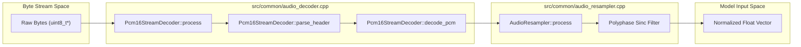
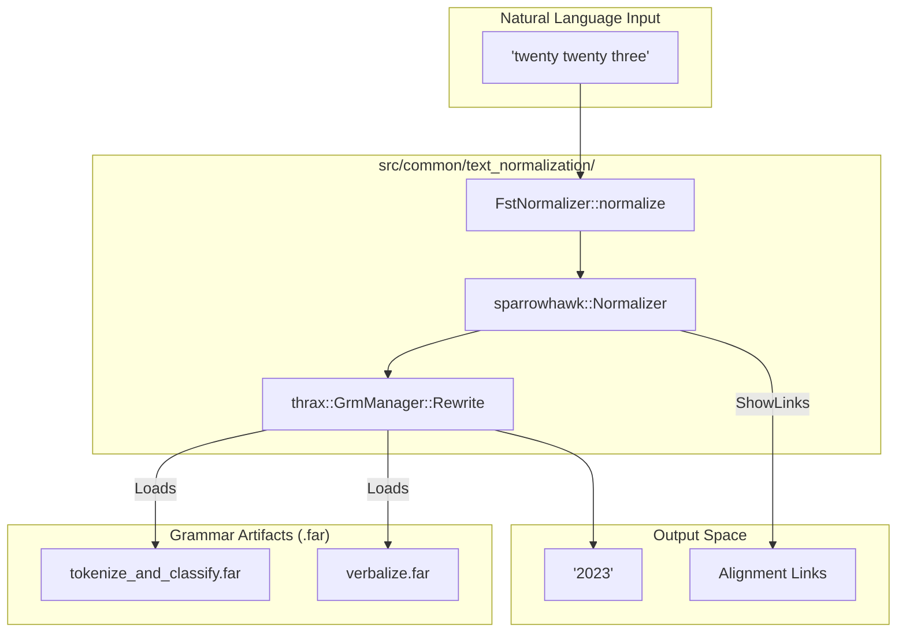

<!-- source: DeepWiki mcp.deepwiki.com · repo NVIDIA/NeMo-Speech.cpp · page 2.3 Common Utilities · fetched 2026-10-26 -->

# Common Utilities

Relevant source files

The following files were used as context for generating this wiki page:

- [app/cli_util.cpp](app/cli_util.cpp)
- [app/cli_util.h](app/cli_util.h)
- [app/main.cpp](app/main.cpp)
- [src/asr/postproc/itn.cpp](src/asr/postproc/itn.cpp)
- [src/asr/postproc/itn.h](src/asr/postproc/itn.h)
- [src/common/audio_decoder.cpp](src/common/audio_decoder.cpp)
- [src/common/audio_decoder.h](src/common/audio_decoder.h)
- [src/common/audio_file.h](src/common/audio_file.h)
- [src/common/audio_resampler.h](src/common/audio_resampler.h)
- [src/common/json.cpp](src/common/json.cpp)
- [src/common/json.h](src/common/json.h)
- [src/common/text_normalization/compat/sparrowhawk_compat.h](src/common/text_normalization/compat/sparrowhawk_compat.h)
- [src/common/text_normalization/compat/thrax/grm-manager.h](src/common/text_normalization/compat/thrax/grm-manager.h)
- [src/common/text_normalization/compat/thrax/thrax.h](src/common/text_normalization/compat/thrax/thrax.h)
- [src/common/text_normalization/fst_normalizer.cpp](src/common/text_normalization/fst_normalizer.cpp)
- [src/common/text_normalization/fst_normalizer.h](src/common/text_normalization/fst_normalizer.h)
- [src/tts/preproc/text_normalizer.h](src/tts/preproc/text_normalizer.h)
- [tests/cli/cli_contract_test.py](tests/cli/cli_contract_test.py)
- [tests/cpp/asr/test_audio_resampler.cpp](tests/cpp/asr/test_audio_resampler.cpp)
- [tests/cpp/common/test_shared_utilities.cpp](tests/cpp/common/test_shared_utilities.cpp)

The `src/common/` directory provides the shared infrastructure used across the ASR, TTS, and NMT subsystems. This includes robust configuration parsing, audio processing (decoding and resampling), JSON serialization, and a Weighted Finite State Transducer (WFST) text normalization engine based on Sparrowhawk.

## Configuration and CLI Utilities

The codebase employs a unified approach to configuration through `ParameterParser` (via `cli_util.h`) and JSON-based messaging.

### CLI Argument Parsing
The CLI utilities handle standard global flags such as `--json`, `--quiet`, and `--verbose`, ensuring consistent output across all subcommands [app/main.cpp:100-117](). It includes specialized parsers for:
*   **Integers and Doubles**: Validates ranges and finiteness [app/cli_util.cpp:37-57]().
*   **Device Selection**: Resolves strings like `cuda:0`, `metal`, `vulkan`, or `cpu` into internal device indices [app/cli_util.cpp:69-110]().
*   **File I/O**: Helpers for reading and writing text files with atomic rename semantics to prevent partial writes [app/cli_util.cpp:150-192]().

### JSON Utilities
A custom, lightweight JSON parser and emitter is implemented in `src/common/json.cpp` to avoid heavy external dependencies while maintaining strict standards compliance.
*   **Parser**: A recursive descent parser that handles standard JSON types, Unicode escape sequences (`\uXXXX`), and surrogate pairs [src/common/json.cpp:41-196](). It enforces a maximum nesting depth of 128 to prevent stack exhaustion [src/common/json.cpp:15-105]().
*   **Value Object**: Uses a `std::variant` based approach (via `Value` class) to represent `null`, `bool`, `number` (double), `string`, `array`, and `object` [src/common/json.h]().

## Audio Infrastructure

NeMo-Speech.cpp includes a high-performance audio pipeline designed for both batch and streaming workloads.

### Audio Decoding
The `Pcm16StreamDecoder` provides a streaming interface for processing audio bytes.
*   **Format Detection**: It automatically detects between raw signed 16-bit PCM and RIFF/WAV containers by inspecting the first 12 bytes of the stream [src/common/audio_decoder.cpp:55-87]().
*   **WAV Parsing**: Parses `fmt` chunks to ensure compatibility (must be mono, 16-bit PCM) and `data` chunks to extract raw samples [src/common/audio_decoder.cpp:95-156]().
*   **Streaming Stability**: Handles "carry" bytes when a 16-bit sample is split across two input buffers [src/common/audio_decoder.cpp:171-187]().

### Polyphase Sinc Resampler
The `AudioResampler` implements a high-quality polyphase sinc filter for sample rate conversion.
*   **Implementation**: It supports arbitrary fractional ratios (e.g., 44.1 kHz to 16 kHz) without temporal drift [tests/cpp/asr/test_audio_resampler.cpp:86-91]().
*   **Streaming**: The resampler maintains internal state (delay lines) to ensure that output is identical regardless of how the input is chunked [tests/cpp/asr/test_audio_resampler.cpp:112-125]().
*   **Anti-Aliasing**: Automatically suppresses frequencies above the destination Nyquist frequency [tests/cpp/asr/test_audio_resampler.cpp:107-110]().

### Audio Data Flow
The following diagram illustrates how raw bytes from a file or network stream are transformed into floating-point tensors for model consumption.

**Audio Processing Pipeline**

**Sources:** [src/common/audio_decoder.cpp:44-87](), [src/common/audio_resampler.h](), [tests/cpp/asr/test_audio_resampler.cpp:112-125]()

---

## Text Normalization (Sparrowhawk / OpenFST)

Text normalization is used for both **Inverse Text Normalization (ITN)** in ASR (spoken-to-written) and **Text Normalization** in TTS (written-to-spoken).

### Sparrowhawk Integration
The system integrates Google's Sparrowhawk via a compatibility layer that bridges it to OpenFST 1.8 [src/common/text_normalization/fst_normalizer.cpp:10-14]().
*   **Grammar Loading**: It loads precompiled Finite State Archive (`.far`) files: `tokenize_and_classify.far` and `verbalize.far` [src/common/text_normalization/fst_normalizer.cpp:54-59]().
*   **Thrax Compatibility**: A minimal `GrmManager` implementation allows loading and composing rules from STTable archives without requiring the full Thrax library [src/common/text_normalization/compat/thrax/grm-manager.h:5-10]().

### Normalization Logic
1.  **Input Preparation**: Escapes quotes and handles trailing whitespace to match Riva-style grammar expectations [src/common/text_normalization/fst_normalizer.cpp:24-34]().
2.  **WFST Rewrite**: Executes the `Normalize` method of the Sparrowhawk engine [src/common/text_normalization/fst_normalizer.cpp:83-87]().
3.  **Alignment Tracking**: Uses Sparrowhawk's `ShowLinks` feature to generate metadata linking source tokens to normalized words, which is essential for projecting word-level timestamps in ASR [src/common/text_normalization/fst_normalizer.cpp:88-91]().

### Text Normalization Architecture
This diagram bridges the natural language processing concepts to the specific C++ classes and FST archives used.

**WFST Normalization Data Flow**

**Sources:** [src/common/text_normalization/fst_normalizer.cpp:45-67](), [src/common/text_normalization/compat/thrax/grm-manager.h:69-93](), [src/asr/postproc/itn.cpp:41-52]()

---

## Technical Reference Table

| Component | Key Class / File | Purpose |
| :--- | :--- | :--- |
| **JSON** | `nemo_speech::json::Parser` | Strict, dependency-free JSON parsing [src/common/json.cpp:41](). |
| **Audio Decoder** | `Pcm16StreamDecoder` | Streaming WAV/PCM to float conversion [src/common/audio_decoder.cpp:36](). |
| **Resampler** | `AudioResampler` | Sinc-based rate conversion with delay state [src/common/audio_resampler.h](). |
| **ITN / TN** | `FstNormalizer` | WFST-based text transformation via Sparrowhawk [src/common/text_normalization/fst_normalizer.h:12](). |
| **CLI Output** | `configure_cli_output` | Global singleton for JSON vs Plaintext CLI output [app/cli_util.cpp:117](). |
| **Thrax Bridge** | `thrax::GrmManager` | Minimal FAR archive loader and rewriter [src/common/text_normalization/compat/thrax/grm-manager.h:32](). |

**Sources:** [src/common/json.cpp:41](), [src/common/audio_decoder.cpp:36](), [src/common/text_normalization/fst_normalizer.h:12](), [app/cli_util.cpp:117](), [src/common/text_normalization/compat/thrax/grm-manager.h:32]()

---

