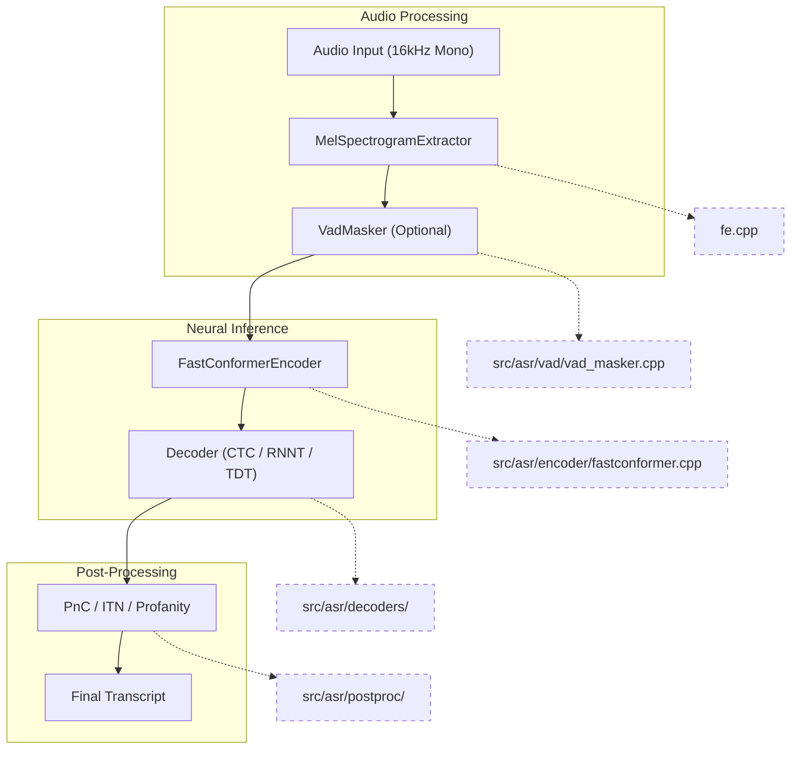
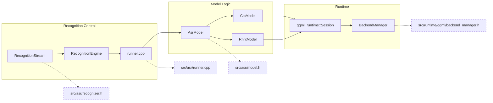

<!-- source: DeepWiki mcp.deepwiki.com · repo NVIDIA/NeMo-Speech.cpp · page 3 Automatic Speech Recognition (ASR) · fetched 2026-10-26 -->

# Automatic Speech Recognition (ASR)

Relevant source files

The following files were used as context for generating this wiki page:

- [conversion/vad.py](conversion/vad.py)
- [docs/asr/configuration.md](docs/asr/configuration.md)
- [docs/asr/customization.md](docs/asr/customization.md)
- [docs/asr/models.md](docs/asr/models.md)
- [src/asr/CMakeLists.txt](src/asr/CMakeLists.txt)
- [src/asr/decoders/greedy_ctc_decoder.cpp](src/asr/decoders/greedy_ctc_decoder.cpp)
- [src/asr/decoders/greedy_ctc_decoder.h](src/asr/decoders/greedy_ctc_decoder.h)
- [src/asr/model.cpp](src/asr/model.cpp)
- [src/asr/model.h](src/asr/model.h)
- [src/asr/runner.cpp](src/asr/runner.cpp)
- [src/asr/vad/silero_vad.cpp](src/asr/vad/silero_vad.cpp)

The ASR subsystem in `NeMo-Speech.cpp` provides a high-performance C++ implementation of NVIDIA NeMo ASR models. It supports multiple model families, including **FastConformer** encoders paired with **CTC**, **RNNT**, or **TDT** decoders. The pipeline is designed for both low-latency streaming and high-throughput offline transcription, featuring integrated Voice Activity Detection (VAD), speaker diarization, and text post-processing.

### ASR Pipeline Architecture

The ASR pipeline transforms raw audio into formatted text through a series of modular stages. The `AsrModel` class [src/asr/model.h:48-126]() serves as the base for concrete model implementations like `CtcModel` [src/asr/model.h:129-174]() and `RnntModel` [src/asr/model.h:177-228]().

#### Natural Language Space to Code Entity Space: ASR Pipeline

**Sources:** [src/asr/model.h:48-228](), [src/asr/runner.cpp:126-152](), [docs/asr/configuration.md:22-76]()

---

### Key Components

#### 1. ASR Models and Configuration
The system supports several model families optimized for different use cases:
*   **Parakeet CTC**: Optimized for buffered streaming and offline use.
*   **Nemotron-Speech RNNT**: Cache-aware streaming models for ultra-low latency.
*   **Nemotron 3.5**: Multilingual models with prompt-conditioning for Language ID.
*   **Parakeet TDT**: Token-and-Duration Transducer for high-accuracy offline transcription.

For details on model selection, GGUF conversion, and the `asr.*` configuration schema, see **[ASR Models and Configuration](#3.1)**.

**Sources:** [docs/asr/models.md:1-76](), [docs/asr/configuration.md:22-40]()

#### 2. Encoder: FastConformer
The core of the ASR system is the **FastConformer** encoder [src/asr/model.h:19-20](). It utilizes a depthwise-separable convolutional architecture and self-attention. In streaming mode, the encoder uses a **Cache-Aware** mechanism to maintain state across audio chunks, ensuring that look-ahead and history context are handled efficiently without re-computing full sequences.

For details on encoder architecture and streaming strategies, see **[ASR Encoder: FastConformer](#3.2)**.

**Sources:** [src/asr/model.h:17-19](), [src/asr/model.cpp:59-85]()

#### 3. Decoders
Decoders translate encoder hidden states into tokens. `NeMo-Speech.cpp` supports:
*   **Greedy CTC**: Efficient argmax decoding [src/asr/decoders/greedy_ctc_decoder.h:55-120]().
*   **Flashlight (Beam Search)**: Integrated with **KenLM** for n-gram language model fusion [src/asr/runner.cpp:154-171]().
*   **RNNT/TDT**: Transducer-based decoding with internal state management.
*   **Context Biasing**: Support for word boosting via Aho-Corasick shallow fusion to improve recognition of specific terms.

For details on decoding algorithms and word boosting, see **[ASR Decoders](#3.3)**.

**Sources:** [src/asr/decoders/greedy_ctc_decoder.cpp:125-182](), [docs/asr/configuration.md:96-113]()

#### 4. Post-Processing
Raw transcripts are refined through a post-processing pipeline:
*   **Inverse Text Normalization (ITN)**: Converts spoken forms (e.g., "three hundred dollars") to written forms ("$300") using Sparrowhawk WFST grammars [src/asr/CMakeLists.txt:55-58]().
*   **PnC**: Adds punctuation and capitalization using a BERT-based model.
*   **Profanity Filtering**: Masks sensitive terms based on configurable word lists.

For details on the post-processing pipeline, see **[ASR Post-Processing: ITN, PnC, and Profanity](#3.4)**.

**Sources:** [docs/asr/configuration.md:72-76](), [src/asr/runner.cpp:97-120]()

#### 5. Speaker Diarization
The system integrates a **Sortformer**-based diarization engine [src/asr/diar/]. This allows the system to identify "who spoke when" by assigning speaker tags to ASR word outputs. It supports both streaming and offline modes through a shared AOSC (Active Overlapping Speaker Correlation) state.

For details on diarization geometry and ASR alignment, see **[Speaker Diarization](#3.5)**.

**Sources:** [docs/asr/models.md:158-178](), [docs/asr/configuration.md:61-68]()

---

### Execution Flow
The `AsrModel` uses a `ggml_runtime::Session` to build and execute computational graphs [src/asr/model.cpp:64-80](). 

#### Natural Language Space to Code Entity Space: Inference Control

**Sources:** [src/asr/model.h:48-60](), [src/asr/runner.cpp:91-120](), [src/asr/recognizer.h]()

### VAD and Endpointing
The system includes **Silero VAD** [src/asr/vad/silero_vad.cpp:24-63]() for detecting speech activity. This is used for:
1.  **Feature Masking**: Zeroing out non-speech Mel frames to reduce encoder noise [docs/asr/configuration.md:51-60]().
2.  **Endpointing**: Triggering "End of Utterance" (EOU) events based on silence duration to finalize transcripts mid-stream [src/asr/runner.cpp:126-152]().

**Sources:** [src/asr/runner.cpp:126-152](), [docs/asr/configuration.md:69-71]()

---

