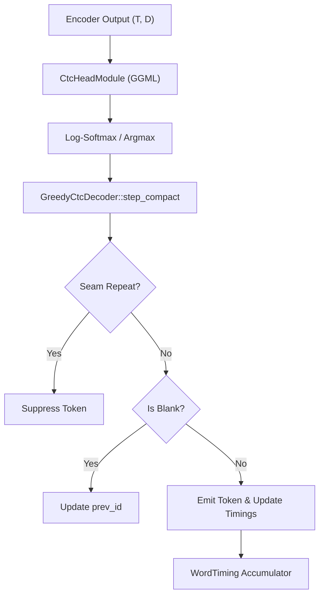
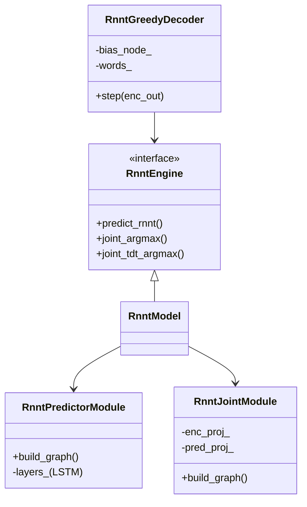
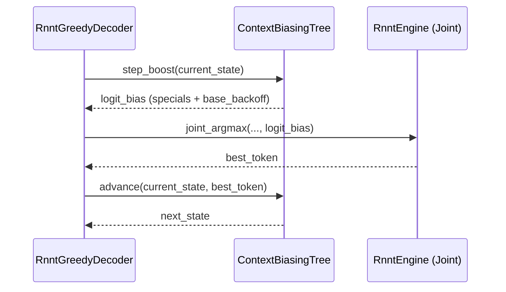

<!-- source: DeepWiki mcp.deepwiki.com · repo NVIDIA/NeMo-Speech.cpp · page 3.3 ASR Decoders · fetched 2026-10-26 -->

# ASR Decoders

Relevant source files

The following files were used as context for generating this wiki page:

- [src/asr/decoders/context_biasing.cpp](src/asr/decoders/context_biasing.cpp)
- [src/asr/decoders/decoder.h](src/asr/decoders/decoder.h)
- [src/asr/decoders/flashlight_decoder.cpp](src/asr/decoders/flashlight_decoder.cpp)
- [src/asr/decoders/flashlight_decoder.h](src/asr/decoders/flashlight_decoder.h)
- [src/asr/decoders/greedy_ctc_decoder.cpp](src/asr/decoders/greedy_ctc_decoder.cpp)
- [src/asr/decoders/greedy_ctc_decoder.h](src/asr/decoders/greedy_ctc_decoder.h)
- [src/asr/decoders/rnnt_greedy_decoder.h](src/asr/decoders/rnnt_greedy_decoder.h)
- [src/asr/decoders/rnnt_modules.cpp](src/asr/decoders/rnnt_modules.cpp)
- [src/asr/decoders/rnnt_modules.h](src/asr/decoders/rnnt_modules.h)
- [src/asr/diar/sortformer_model.cpp](src/asr/diar/sortformer_model.cpp)
- [src/asr/diar/sortformer_model.h](src/asr/diar/sortformer_model.h)
- [src/asr/model.cpp](src/asr/model.cpp)
- [src/asr/model.h](src/asr/model.h)
- [src/asr/recognizer.h](src/asr/recognizer.h)
- [tests/cpp/asr/test_ctc_offline.cpp](tests/cpp/asr/test_ctc_offline.cpp)
- [tests/cpp/asr/test_decoders.cpp](tests/cpp/asr/test_decoders.cpp)

The ASR Decoder layer is responsible for transforming the high-level acoustic features produced by the encoder into discrete token sequences and, ultimately, human-readable text. NeMo-Speech.cpp supports several decoding strategies tailored for different model architectures (CTC, RNNT, TDT) and use cases (greedy vs. beam-search with language models).

## Decoder Architecture Overview

All decoders implement the `Decoder` interface [src/asr/decoders/decoder.h:16-48](), which provides a unified API for stepping through audio chunks, handling utterance resets, and retrieving transcripts and word timings.

### Supported Decoder Types

| Decoder | Architecture | Key Features |
| :--- | :--- | :--- |
| **GreedyCTC** | CTC | Frame-level argmax with collapse rule and seam deduplication. |
| **RNNT Greedy** | RNNT | Two-layer LSTM predictor with joint network; supports word boosting. |
| **TDT Decoder** | TDT | Token-and-Duration Transducer; predicts tokens and skip-durations. |
| **Flashlight** | CTC | Beam-search with KenLM fusion and lexicon-based decoding. |

---

## CTC Decoders

### Greedy CTC Decoder
The `GreedyCtcDecoder` [src/asr/decoders/greedy_ctc_decoder.h:55-120]() implements the standard CTC collapse rule: repeating tokens are collapsed into one, and the `blank_id` acts as a separator.

#### Seam Deduplication
In streaming scenarios, overlapping audio windows can cause a single acoustic event to appear at the end of one chunk and the start of the next. The `GreedyCtcDecoder` implements a "seam merge" logic [src/asr/decoders/greedy_ctc_decoder.h:97-104]() that suppresses a window-leading repeat of the last committed token if it occurs within a small frame gap (`kSeamMergeMaxGap = 2`).

**Data Flow: CTC Greedy Decoding**

*Sources: [src/asr/decoders/greedy_ctc_decoder.cpp:145-185](), [src/asr/decoders/greedy_ctc_decoder.h:97-104]()*

### Flashlight Beam-Search Decoder
When `NEMO_SPEECH_WITH_FLASHLIGHT` is enabled, the system supports beam-search decoding with N-gram language models (KenLM). The `FlashlightDecoder` [src/asr/decoders/flashlight_decoder.h:107-160]() integrates the Flashlight `LexiconDecoder`.

*   **KenLM Fusion:** Uses a `.bin` KenLM file for shallow fusion during the beam search.
*   **Lexicon:** Maps words to their SentencePiece token sequences.
*   **Resources:** `FlashlightResources` [src/asr/decoders/flashlight_decoder.h:72-105]() manages the shared, immutable KenLM and Trie structures to minimize memory overhead across multiple streams.

---

## Transducer Decoders (RNNT and TDT)

### RNNT Greedy Decoder
The `RnntGreedyDecoder` [src/asr/decoders/rnnt_greedy_decoder.h:138-160]() manages the interaction between the encoder projections and the recurrent predictor.

1.  **Predictor Stage:** A 2-layer LSTM [src/asr/decoders/rnnt_modules.cpp:79-94]() that processes the previously emitted token.
2.  **Joint Stage:** A joint network [src/asr/decoders/rnnt_modules.cpp:170-176]() that combines encoder and predictor outputs to produce logits.
3.  **Emit Loop:** For each encoder frame, the decoder emits symbols until a `blank_id` is predicted or `max_symbols_per_step` (default 10) is reached [src/asr/decoders/rnnt_greedy_decoder.h:41]().

### Token-and-Duration Transducer (TDT)
TDT models extend RNNT by predicting both a token and a duration (number of encoder frames to skip). The `RnntEngine` interface provides `joint_tdt_argmax` [src/asr/decoders/rnnt_greedy_decoder.h:118-121]() to handle these dual outputs. This significantly accelerates inference by allowing the decoder to skip redundant acoustic frames.

**Code Entity Space: RNNT Decoder Components**

*Sources: [src/asr/decoders/rnnt_greedy_decoder.h:68-135](), [src/asr/decoders/rnnt_modules.h:15-60]()*

---

## Context Biasing (Word Boosting)

NeMo-Speech.cpp implements context biasing via **Aho-Corasick shallow fusion**. This allows the user to "boost" specific phrases (e.g., proper nouns) by increasing their likelihood during decoding.

### Implementation: ContextBiasingTree
The `ContextBiasingTree` [src/asr/decoders/context_biasing.h:20-70]() builds an Aho-Corasick automaton from a list of phrases.

*   **Scoring:** Phrases are assigned scores. As the decoder matches subword tokens against the trie, it applies a `token_score` to the logits [src/asr/decoders/context_biasing.cpp:14-50]().
*   **Backoff:** If a token does not match the next node in the trie, the state machine follows a "fail" link to the longest possible suffix that is still a prefix of another boosted phrase [src/asr/decoders/context_biasing.cpp:67-97]().
*   **Integration:** In `RnntGreedyDecoder`, the `step` function calls `tree.step_boost(state)` to retrieve a logit bias vector applied to the joint network output [src/asr/decoders/rnnt_greedy_decoder.cpp:154-165]().

**Sequence: RNNT Context Biasing**

*Sources: [src/asr/decoders/context_biasing.cpp:99-130](), [src/asr/decoders/rnnt_greedy_decoder.h:147-155]()*

---

## Implementation Details

### Key Classes and Functions

| Symbol | Location | Description |
| :--- | :--- | :--- |
| `CtcHeadModule` | [src/asr/decoders/greedy_ctc_decoder.h:31]() | GGML Module wrapping the $1 \times 1$ convolution and log-softmax for CTC. |
| `build_lstm_cell_graph` | [src/asr/decoders/rnnt_modules.cpp:29-75]() | Constructs the GGML compute graph for a single LSTM step (i, f, g, o gates). |
| `detokenize_sentencepiece` | [src/asr/decoders/decoder.h:54]() | Utility to convert token IDs back to UTF-8 strings, handling SentencePiece `▁` markers. |
| `extract_timings` | [src/asr/decoders/flashlight_decoder.cpp:320]() | Maps Flashlight `DecodeResult` frame indices to `WordTiming` structs. |

### Word Timings
Word timestamps are calculated differently depending on the decoder:
*   **CTC:** A word starts when a token piece beginning with the SentencePiece boundary marker (`▁`) is emitted [src/asr/decoders/greedy_ctc_decoder.cpp:178-185]().
*   **RNNT:** The `WordTiming` is recorded when the first non-blank token of a word is emitted by the joint network.
*   **Flashlight:** Timings are extracted directly from the beam's `DecodeResult` which tracks token-to-frame alignment [src/asr/decoders/flashlight_decoder.h:142-147]().

Sources:
- [src/asr/decoders/decoder.h:16-54]()
- [src/asr/decoders/greedy_ctc_decoder.h:22-121]()
- [src/asr/decoders/greedy_ctc_decoder.cpp:14-185]()
- [src/asr/decoders/rnnt_greedy_decoder.h:33-160]()
- [src/asr/decoders/rnnt_modules.h:15-85]()
- [src/asr/decoders/rnnt_modules.cpp:29-176]()
- [src/asr/decoders/context_biasing.h:20-70]()
- [src/asr/decoders/context_biasing.cpp:14-130]()
- [src/asr/decoders/flashlight_decoder.h:35-160]()

---

