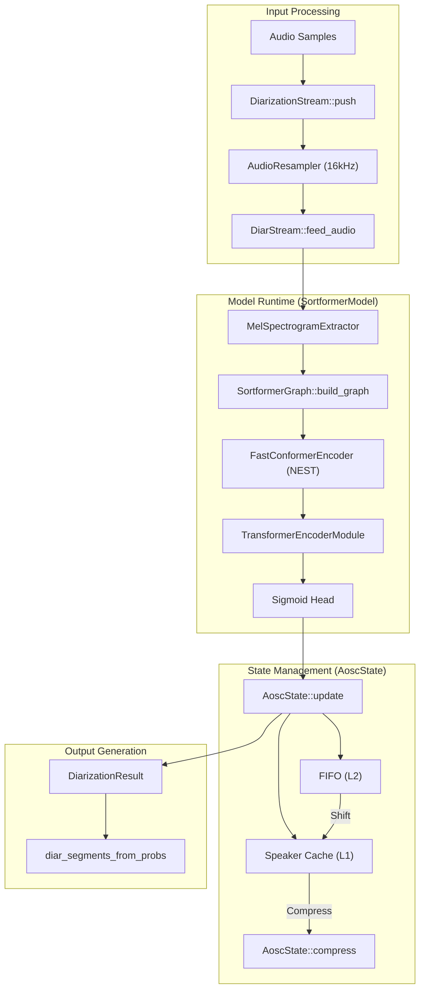
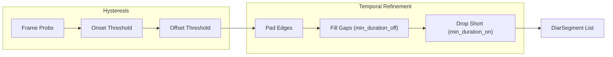

<!-- source: DeepWiki mcp.deepwiki.com · repo NVIDIA/NeMo-Speech.cpp · page 3.5 Speaker Diarization · fetched 2026-10-26 -->

# Speaker Diarization

Relevant source files

The following files were used as context for generating this wiki page:

- [config/diar.example.yaml](config/diar.example.yaml)
- [include/nemo_speech/diar.h](include/nemo_speech/diar.h)
- [src/asr/c_api.cpp](src/asr/c_api.cpp)
- [src/asr/decoders/rnnt_greedy_decoder.h](src/asr/decoders/rnnt_greedy_decoder.h)
- [src/asr/diar/aosc_state.cpp](src/asr/diar/aosc_state.cpp)
- [src/asr/diar/aosc_state.h](src/asr/diar/aosc_state.h)
- [src/asr/diar/diar_pipeline.h](src/asr/diar/diar_pipeline.h)
- [src/asr/diar/diarizer.cpp](src/asr/diar/diarizer.cpp)
- [src/asr/diar/diarizer.h](src/asr/diar/diarizer.h)
- [src/asr/diar/sortformer_model.cpp](src/asr/diar/sortformer_model.cpp)
- [src/asr/diar/sortformer_model.h](src/asr/diar/sortformer_model.h)
- [src/tts/c_api.cpp](src/tts/c_api.cpp)
- [tests/c/tts_c_smoke.c](tests/c/tts_c_smoke.c)
- [tests/cpp/asr/test_sortformer_parity.cpp](tests/cpp/asr/test_sortformer_parity.cpp)

The speaker diarization subsystem in `NeMo-Speech.cpp` provides high-performance speaker labeling ("who spoke when") using the **Sortformer v2** architecture. It supports both offline (full-attention) and streaming modes, featuring a stateful **AOSC (Active-Only Speaker Cache)** to maintain speaker identity over long-duration audio streams.

## Subsystem Architecture

The diarization engine is implemented in `src/asr/diar/` and is designed to run either as a standalone component or as a sidecar to the ASR pipeline for word-level speaker attribution.

### Core Components

| Class | Responsibility |
| :--- | :--- |
| `Diarizer` | High-level interface for loading models and managing execution modes. |
| `DiarStream` | Manages the streaming state machine, including audio buffering and timeline compaction. |
| `AoscState` | Implements the Active-Only Speaker Cache logic, handling speaker embedding compression and silence profiling. |
| `SortformerModel` | Encapsulates the GGML runtime, graph construction, and session management. |
| `DiarGeometry` | Defines the windowing parameters (chunk, left/right context, FIFO, and cache lengths). |

**Sources:** `[src/asr/diar/diarizer.h:50-71]()`, `[src/asr/diar/diar_pipeline.h:118-164]()`, `[src/asr/diar/sortformer_model.h:95-136]()`.

### Data Flow and Code Entity Mapping

The following diagram bridges the natural language concepts of the diarization pipeline to their specific code implementations.

**Diarization Execution Flow**

**Sources:** `[src/asr/diar/diarizer.cpp:41-66]()`, `[src/asr/diar/sortformer_model.cpp:107-149]()`, `[src/asr/diar/aosc_state.cpp:110-172]()`.

---

## Sortformer Model Implementation

The `SortformerGraph` builds a GGML compute graph that mirrors the NeMo `SortformerEncLabelModel` export logic.

1.  **Pre-encode**: The Mel window `(n_mels, T_mel)` is processed by an 8x downstriding convolution stem (NEST) to produce chunk embeddings `(512, T3)` `[src/asr/diar/sortformer_model.cpp:111-117]()`.
2.  **Concatenation**: The graph concatenates the `spkcache` (L1), `fifo` (L2), and current `chunk` embeddings along the time dimension `[src/asr/diar/sortformer_model.cpp:125-130]()`.
3.  **Conformer/Transformer Stack**: A 17-layer FastConformer stack (with relative position embeddings) followed by an 18-layer post-LN transformer processes the sequence `[src/asr/diar/sortformer_model.cpp:132-140]()`.
4.  **Head**: A two-layer MLP with ReLU activations and a Sigmoid tail outputs speaker probabilities for the entire sequence `[src/asr/diar/sortformer_model.cpp:141-149]()`.

**Sources:** `[src/asr/diar/sortformer_model.h:6-23]()`, `[src/asr/diar/sortformer_model.cpp:69-89]()`.

---

## Streaming and Windowing Geometry

The `DiarGeometry` struct controls how audio is sliced into overlapping windows for the model. The engine supports two primary presets:

*   **Streaming**: Optimized for low latency (1.6s chunks).
*   **Offline**: Optimized for throughput and long-range context (8s chunks).

| Parameter | Code Symbol | Description |
| :--- | :--- | :--- |
| Chunk Length | `chunk_len` | The number of 80ms frames processed in one forward pass. |
| Left Context | `chunk_left_context` | Historical context frames provided to the encoder. |
| Right Context | `chunk_right_context` | Look-ahead frames required before a chunk can be emitted. |
| FIFO Length | `fifo_len` | Size of the intermediate buffer between the chunk and the cache. |
| Cache Length | `spkcache_len` | Total size of the compressed speaker history. |

**Sources:** `[src/asr/diar/diar_pipeline.h:35-61]()`, `[src/asr/diar/aosc_state.cpp:41-75]()`.

---

## Active-Only Speaker Cache (AOSC)

To handle long streams without exceeding the model's positional embedding limit (`pos_emb_max_len`), the `AoscState` implements a compression mechanism:

1.  **Silence Profiling**: `AoscState::accumulate_silence` maintains a running mean of "silence embeddings" for frames where total speaker activity is below a threshold `[src/asr/diar/aosc_state.cpp:86-107]()`.
2.  **Compression**: When the speaker cache exceeds `spkcache_len`, `AoscState::compress` reduces the history. It selects the `k` most representative frames per speaker (defined by `sil_frames_per_spk`) based on model scores, effectively discarding redundant information while preserving speaker identity `[src/asr/diar/aosc_state.cpp:175-220]()`.

**Sources:** `[src/asr/diar/aosc_state.h:20-55]()`, `[src/asr/diar/sortformer_model.h:38-46]()`.

---

## Segmentation and Post-Processing

Raw frame probabilities are converted into discrete `DiarSegment` objects using a hysteresis-based approach in `diar_segments_from_probs`.

**Segmentation Logic Mapping**

The configuration is managed by `DiarSegmentationCfg`, which includes parameters for `onset`, `offset`, `pad_onset`, `pad_offset`, `min_duration_on`, and `min_duration_off`.

**Sources:** `[src/asr/diar/diar_pipeline.h:98-115]()`, `[include/nemo_speech/diar.h:56-64]()`.

---

## Long-Stream Compaction

For streams lasting hours, the raw probability timeline `probs_` is compacted to prevent unbounded memory growth.

*   **Trigger**: Compaction occurs once the retained timeline exceeds a `trigger_frames` threshold `[src/asr/diar/diar_pipeline.h:147-152]()`.
*   **Gap Detection**: The system searches for a silent gap across all speakers that is longer than the post-processing reach.
*   **Finalization**: Probabilities older than the gap are converted into permanent segments, and the raw floats are dropped from memory. `probs_base_` is incremented to track the global frame offset `[src/asr/diar/diar_pipeline.h:139-144]()`.

**Sources:** `[src/asr/diar/diar_pipeline.h:147-160]()`.

---

## C ABI Integration

The diarization functionality is exposed via the stable C ABI in `include/nemo_speech/diar.h`.

*   **`nemo_speech_diar_create`**: Instantiates the model and runtime `[src/asr/c_api.cpp:1134-1145]()`.
*   **`nemo_speech_diar_stream_push_f32`**: Feeds audio into a stateful stream `[src/asr/c_api.cpp:1210-1223]()`.
*   **`nemo_speech_diar_segments`**: Retrieves the processed speaker segments `[src/asr/c_api.cpp:1290-1320]()`.

For ASR-aligned diarization, the `nemo_speech_asr_recognizer` uses the `Diarizer` internally to tag `WordInfo` structures with `speaker_tag` values.

**Sources:** `[include/nemo_speech/diar.h:74-135]()`, `[src/asr/c_api.cpp:147-160]()`.

---

