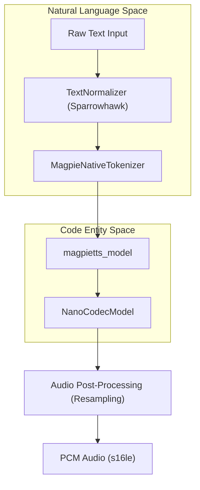
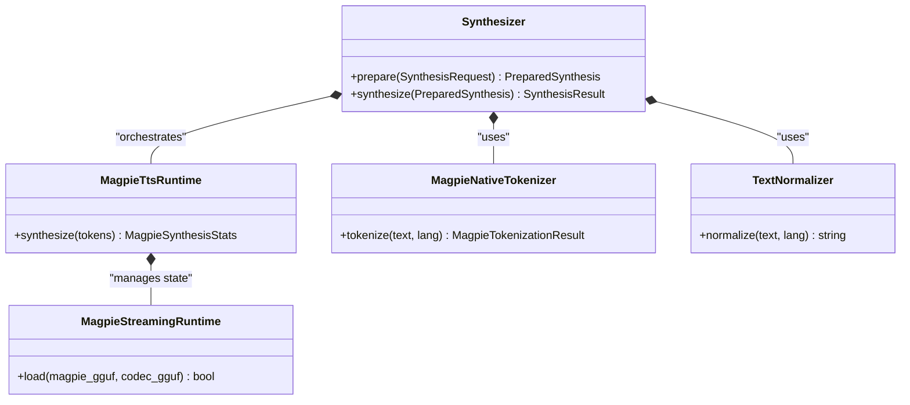

<!-- source: DeepWiki mcp.deepwiki.com · repo NVIDIA/NeMo-Speech.cpp · page 4 Text-to-Speech (TTS) · fetched 2026-10-26 -->

# Text-to-Speech (TTS)

Relevant source files

The following files were used as context for generating this wiki page:

- [docs/tts/configuration.md](docs/tts/configuration.md)
- [docs/tts/models.md](docs/tts/models.md)
- [src/tts/magpietts/README.md](src/tts/magpietts/README.md)
- [src/tts/magpietts/magpietts.cpp](src/tts/magpietts/magpietts.cpp)
- [src/tts/magpietts/model.cpp](src/tts/magpietts/model.cpp)
- [src/tts/magpietts/runtime.cpp](src/tts/magpietts/runtime.cpp)
- [src/tts/magpietts/runtime.h](src/tts/magpietts/runtime.h)
- [src/tts/synthesizer.cpp](src/tts/synthesizer.cpp)
- [src/tts/synthesizer.h](src/tts/synthesizer.h)
- [src/tts/tokenizer/tokenizer.cpp](src/tts/tokenizer/tokenizer.cpp)

The Text-to-Speech (TTS) subsystem in NeMo-Speech.cpp provides a high-performance, streaming-first pipeline for generating high-fidelity speech from text. It utilizes a two-stage architecture: **MagpieTTS** for autoregressive token generation and **NeMo NanoCodec** for neural vocoding [src/tts/magpietts/README.md:9-12]().

The subsystem is designed for low-latency applications, supporting features like CUDA Graph optimization, Classifier-Free Guidance (CFG), and a multi-threaded producer-consumer streaming architecture [src/tts/magpietts/magpietts.cpp:149-163]().

### System Architecture

The TTS pipeline orchestrates text normalization, tokenization, autoregressive inference, and audio decoding. The `Synthesizer` class serves as the primary entry point, managing the lifecycle of requests from raw text to PCM audio [src/tts/synthesizer.h:62-74]().

#### TTS Data Flow

**Sources:** [src/tts/synthesizer.cpp:122-166](), [src/tts/magpietts/magpietts.cpp:140-147](), [src/tts/magpietts/README.md:9-13]()

### Core Components

#### MagpieTTS Token Generator
MagpieTTS is the autoregressive backbone of the system. It consumes phoneme or character tokens and generates discrete audio tokens. It supports multiple languages and speakers through a shared embedding space [src/tts/magpietts/runtime.cpp:115-120]().
*   **Key Features:** Local Transformer (LT) for long-context stability, KV cache management, and Classifier-Free Guidance (CFG) [src/tts/magpietts/runtime.h:49-52]().
*   **For details, see [MagpieTTS Model and Runtime](#4.1).**

#### NanoCodec Neural Vocoder
The NanoCodec decoder converts the discrete tokens produced by MagpieTTS into high-quality 22kHz audio [src/tts/magpietts/README.md:9-12](). It is optimized for streaming, using a stateful decoding approach that minimizes redundant computation across audio chunks [src/tts/magpietts/runtime.h:53]().
*   **Key Features:** Overlap-add windowing, streaming chunking, and CUDA/CPU backend support [src/tts/magpietts/runtime.h:40-44]().
*   **For details, see [NanoCodec Neural Vocoder](#4.2).**

#### Tokenization and Normalization
Before synthesis, text must be converted into a format the model understands. This involves:
1.  **Text Normalization:** Converting written forms (e.g., "$10") to spoken forms ("ten dollars") using Sparrowhawk [docs/tts/configuration.md:33-40]().
2.  **Tokenization:** Mapping spoken text to phoneme or character IDs using language-specific logic (IPA for European languages, MeCab for Japanese, etc.) [src/tts/tokenizer/tokenizer.cpp:193-202]().
*   **For details, see [TTS Tokenizer and Text Normalization](#4.3).**

### Class Relationship Diagram

The following diagram bridges the high-level synthesis concepts to the specific C++ entities implementing them.

**Sources:** [src/tts/synthesizer.h:62-96](), [src/tts/magpietts/runtime.cpp:102-120](), [src/tts/tokenizer/tokenizer.h:139-140]()

### Configuration and Models

The TTS system requires two specific GGUF models and an extracted directory of tokenizer assets from a `.nemo` checkpoint [docs/tts/models.md:3-5]().

| Component | Required File / Directory | Description |
|---|---|---|
| **Magpie Model** | `*.magpie.f16.gguf` | Autoregressive token generator [docs/tts/configuration.md:20]() |
| **Codec Model** | `*.codec.f16.gguf` | Neural vocoder (NanoCodec) [docs/tts/configuration.md:21]() |
| **Tokenizer** | `extracted/` | Extracted `.nemo` directory containing phoneme maps [docs/tts/configuration.md:22]() |

*   **For details on configuration keys and model downloads, see [TTS Models and Configuration](#4.4).**

### Performance Metrics
The system tracks several key performance indicators (KPIs) during synthesis:
*   **TTFT (Time to First Token):** Latency until the first codec token is generated.
*   **TTFA (Time to First Audio):** Latency until the first PCM audio chunk is emitted [src/tts/magpietts/runtime.h:103]().
*   **RTFX (Real-Time Factor):** The ratio of generated audio duration to processing time [src/tts/magpietts/runtime.h:86]().

**Sources:** [src/tts/magpietts/runtime.h:75-116](), [docs/tts/configuration.md:138-160]()

---

