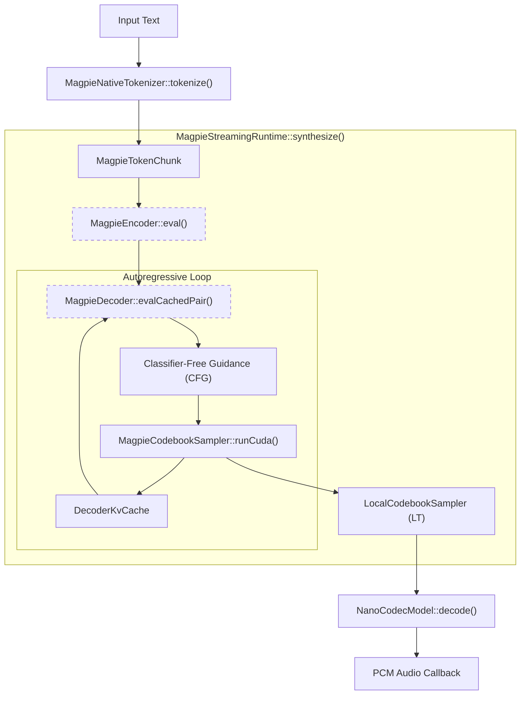

<!-- source: DeepWiki mcp.deepwiki.com · repo NVIDIA/NeMo-Speech.cpp · page 4.1 MagpieTTS Model and Runtime · fetched 2026-10-26 -->

# MagpieTTS Model and Runtime

Relevant source files

The following files were used as context for generating this wiki page:

- [src/tts/magpietts/config.cpp](src/tts/magpietts/config.cpp)
- [src/tts/magpietts/config.h](src/tts/magpietts/config.h)
- [src/tts/magpietts/decoder.cpp](src/tts/magpietts/decoder.cpp)
- [src/tts/magpietts/decoder.h](src/tts/magpietts/decoder.h)
- [src/tts/magpietts/encoder.h](src/tts/magpietts/encoder.h)
- [src/tts/magpietts/graph.h](src/tts/magpietts/graph.h)
- [src/tts/magpietts/lt.cpp](src/tts/magpietts/lt.cpp)
- [src/tts/magpietts/lt.h](src/tts/magpietts/lt.h)
- [src/tts/magpietts/magpietts.cpp](src/tts/magpietts/magpietts.cpp)
- [src/tts/magpietts/magpietts_cuda_sampling.cu](src/tts/magpietts/magpietts_cuda_sampling.cu)
- [src/tts/magpietts/magpietts_cuda_sampling.h](src/tts/magpietts/magpietts_cuda_sampling.h)
- [src/tts/magpietts/model.cpp](src/tts/magpietts/model.cpp)
- [src/tts/magpietts/runtime.cpp](src/tts/magpietts/runtime.cpp)
- [src/tts/magpietts/runtime.h](src/tts/magpietts/runtime.h)
- [src/tts/tokenizer/tokenizer.cpp](src/tts/tokenizer/tokenizer.cpp)
- [src/tts/tokenizer/tokenizer.h](src/tts/tokenizer/tokenizer.h)
- [tests/cpp/tts/test_grpc_tts_config.cpp](tests/cpp/tts/test_grpc_tts_config.cpp)

MagpieTTS is a multi-speaker, multi-lingual neural text-to-speech system integrated into NeMo-Speech.cpp. It utilizes a Transformer-based architecture to generate discrete audio tokens which are subsequently decoded into waveforms by the NanoCodec vocoder. The runtime is designed for high-performance streaming synthesis, featuring KV cache management, CUDA graph optimizations, and a tiered sampling approach.

## 1. Architecture Overview

The MagpieTTS architecture consists of three primary components: a text encoder, a token decoder, and a Local Transformer (LT) for fine-grained audio codebook modeling.

### 1.1 Model Components
*   **Encoder**: Processes input text tokens (phonemes/IPA) into a continuous latent representation.
*   **Decoder**: An autoregressive Transformer that generates the first level of audio codebooks conditioned on the encoder output and previous audio tokens.
*   **Local Transformer (LT)**: A specialized module that predicts higher-level codebooks (residual quantizers) based on the first codebook level. This can be executed in FP32 for higher precision [src/tts/magpietts/magpietts.cpp:184-199]().
*   **NanoCodec**: The neural vocoder that transforms discrete audio codes into 22kHz/44kHz PCM audio [src/tts/magpietts/magpietts.cpp:145-147]().

### 1.2 Data Flow Diagram
This diagram maps the logical flow of synthesis to the internal C++ classes and functions.

**MagpieTTS Synthesis Pipeline**

**Sources:** [src/tts/magpietts/runtime.cpp:131-155](), [src/tts/magpietts/magpietts.cpp:140-148](), [src/tts/tokenizer/tokenizer.h:72-79]()

---

## 2. Execution Runtime and Optimizations

The runtime is built on top of `ggml` and provides several optimization strategies to achieve low Time-to-First-Audio (TTFA) and high Real-Time Factor (RTFX).

### 2.1 KV Cache Management
To avoid recomputing the full prefix for every generated audio frame, MagpieTTS employs two types of KV caches:
*   **DecoderKvCache**: Stores Key and Value tensors for the self-attention layers in the decoder [src/tts/magpietts/decoder.h:9-35]().
*   **DecoderCrossKvCache**: Stores Key and Value tensors for the cross-attention layers (attending to the encoder's text representations). Since text is static during a single synthesis request, this cache is initialized once per chunk [src/tts/magpietts/decoder.h:37-61]().

### 2.2 Classifier-Free Guidance (CFG)
MagpieTTS uses CFG to improve prosody and voice quality. The runtime performs a "pair" evaluation where it computes both a conditional and an unconditional (null-text) pass simultaneously [src/tts/magpietts/decoder.cpp:23-29]().
*   **Implementation**: `MagpieDecoder::evalCachedPair` handles the dual-stream execution and manages separate `cond_kv` and `uncond_kv` caches [src/tts/magpietts/decoder.h:114-123]().
*   **Scale**: The guidance scale is configurable via `MagpieRuntimeConfig::cfg_scale` [src/tts/magpietts/runtime.h:46-49]().

### 2.3 CUDA Sampling and UMA
For systems with NVIDIA GPUs, MagpieTTS implements a fused CUDA sampling kernel to minimize host-device synchronization overhead.
*   **Fused Kernel**: `magpietts_sample_codebooks_kernel` performs top-k sampling, temperature scaling, and CFG logic directly on the GPU [src/tts/magpietts/magpietts_cuda_sampling.cu:106-112]().
*   **UMA Mode**: On integrated GPUs (like NVIDIA Jetson or Grace-Hopper), the runtime can detect and utilize Unified Memory Architecture (UMA) to eliminate redundant copies [src/tts/magpietts/magpietts_cuda_sampling.cu:23-46]().

---

## 3. Longform Synthesis and Attention Prior

For long sequences, MagpieTTS supports a "longform" mode that prevents attention degradation over time.

### 3.1 Attention Prior State
The `MagpieLongformAttentionPriorState` manages an attention bias that encourages the model to focus on text tokens near the current synthesis position [src/tts/magpietts/magpietts.cpp:65-72](). This is critical for maintaining stability in synthesis sessions lasting several minutes.

### 3.2 Context Splicing
When processing long text in chunks, the runtime uses `splice_longform_history_context` to maintain a sliding window of text embeddings, ensuring the transition between chunks is seamless [src/tts/magpietts/magpietts.cpp:84-108]().

---

## 4. Streaming Pipeline

The `MagpieTtsRuntime` implements a producer-consumer model where the Magpie decoder produces audio codes that are immediately queued for the NanoCodec vocoder.

| Component | Responsibility | Class/Entity |
| :--- | :--- | :--- |
| **Producer** | Autoregressive token generation | `MagpieStreamingRuntime` |
| **Consumer** | Neural Vocoding (Codes to PCM) | `nc::NanoCodecModel` |
| **Workspace** | Thread-local buffers and samplers | `MagpieStreamingWorkspace` |
| **Stats** | Latency and RTF tracking | `MagpieSynthesisStats` |

**Sources:** [src/tts/magpietts/magpietts.cpp:140-148](), [src/tts/magpietts/runtime.h:75-116]()

### 4.1 Implementation Detail: `MagpieStreamingWorkspace`
The workspace encapsulates all stateful objects required for a single synthesis request, including the encoder, decoder, and local transformer samplers [src/tts/magpietts/magpietts.cpp:140-148](). It manages the initialization of persistent tensors on the backend (CPU or CUDA) via `BackendTensor::alloc2d` [src/tts/model.cpp:132-162]().

**Sources:**
* `src/tts/magpietts/magpietts.cpp:140-205` (Workspace and sampler management)
* `src/tts/magpietts/decoder.cpp:46-147` (KV Cache implementation)
* `src/tts/magpietts/magpietts_cuda_sampling.cu:106-210` (CUDA Sampling kernel)
* `src/tts/magpietts/runtime.h:31-62` (Runtime configuration schema)

---

## 5. Configuration Reference

MagpieTTS behavior is controlled via the `tts.*` configuration keys, parsed by the `common::ParameterParser` [src/tts/magpietts/config.cpp:131-185]().

| Key | Type | Default | Description |
| :--- | :--- | :--- | :--- |
| `tts.magpie-model` | String | Required | Path to MagpieTTS GGUF |
| `tts.use-kv-cache` | Bool | `true` | Enables incremental decoding |
| `tts.use-cfg` | Bool | `true` | Enables Classifier-Free Guidance |
| `tts.lt-fp32` | Bool | `false` | Run Local Transformer in FP32 |
| `tts.longform-mode` | String | `auto` | `off`, `on`, or `auto` longform support |
| `tts.sampling-backend`| String | `auto` | `cpu` or `cuda` for token sampling |

**Sources:** [src/tts/magpietts/config.cpp:131-185](), [src/tts/magpietts/runtime.h:31-62]()

---

