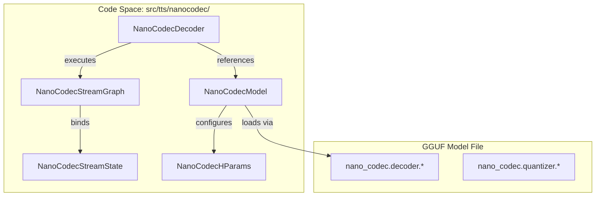
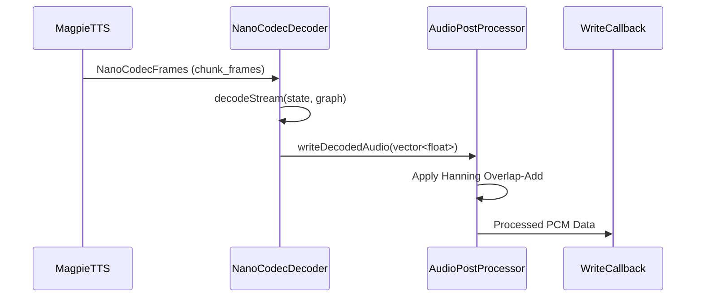

<!-- source: DeepWiki mcp.deepwiki.com · repo NVIDIA/NeMo-Speech.cpp · page 4.2 NanoCodec Neural Vocoder · fetched 2026-10-26 -->

# NanoCodec Neural Vocoder

<details>
<summary>Relevant source files</summary>

The following files were used as context for generating this wiki page:

- [app/synthesize.cpp](app/synthesize.cpp)
- [src/asr/postproc/itn_align.cpp](src/asr/postproc/itn_align.cpp)
- [src/common/audio_file.cpp](src/common/audio_file.cpp)
- [src/server/riva_server.cc](src/server/riva_server.cc)
- [src/tts/magpietts/audio_pp.cpp](src/tts/magpietts/audio_pp.cpp)
- [src/tts/nanocodec/model.cpp](src/tts/nanocodec/model.cpp)
- [src/tts/nanocodec/model.h](src/tts/nanocodec/model.h)
- [tests/cpp/tts/test_magpietts_asr.cpp](tests/cpp/tts/test_magpietts_asr.cpp)
- [tests/cpp/tts/test_magpietts_file.cpp](tests/cpp/tts/test_magpietts_file.cpp)
- [tools/nanocodec.cpp](tools/nanocodec.cpp)

</details>


The NanoCodec neural vocoder is a high-performance audio decoder used in the Text-to-Speech (TTS) pipeline to convert discrete latent codes into high-fidelity waveforms. It is specifically optimized for low-latency streaming and efficient execution on both CPU and GPU backends using `ggml`.

## Architecture and Implementation

NanoCodec implements a convolutional decoder architecture with multiple upsampling stages and residual blocks. The model parameters and structure are defined by `NanoCodecHParams` [src/tts/nanocodec/model.h:13-28]().

### Model Components
*   **Quantizer Decoder**: Maps input indices from multiple codebooks (default 8) back to the latent space [src/tts/nanocodec/model.cpp:216-223]().
*   **Upsampling Layers**: A series of transposed convolutions or upsampling stages defined by `up_rates` (default: 8, 8, 4, 2, 2) [src/tts/nanocodec/model.h:25]().
*   **Residual Blocks**: Multi-scale residual layers with varying kernel sizes and dilations to capture diverse temporal features [src/tts/nanocodec/model.h:26-27]().
*   **Activations**: Custom activation functions (Alpha-based) loaded from GGUF tensors [src/tts/nanocodec/model.cpp:57-60]().

### Code Entity Map: Architecture
The following diagram illustrates the relationship between the GGUF model structure and the C++ classes.

"NanoCodec Architecture"

Sources: [src/tts/nanocodec/model.h:35-123](), [src/tts/nanocodec/model.cpp:199-230]()

## Offline vs. Stateful Streaming Decode

NanoCodec supports two primary execution modes: offline (batch) decoding and stateful streaming decoding.

### 1. Offline Decode
The `decode` function [src/tts/nanocodec/model.h:111]() processes an entire sequence of `NanoCodecFrames` in a single pass. This is suitable for non-realtime applications or short utterances where latency is not the primary concern.

### 2. Stateful Streaming Decode
For realtime TTS, the `NanoCodecDecoder` utilizes `NanoCodecStreamGraph` and `NanoCodecStreamState` [src/tts/nanocodec/model.h:65-105]().
*   **NanoCodecStreamGraph**: Encapsulates the `ggml` computation graph for a fixed `chunk_frames` size. This allows for graph reuse and optimization (e.g., CUDA graphs) [src/tts/nanocodec/model.h:85-105]().
*   **NanoCodecStreamState**: Manages the internal recurrent/convolutional state (buffers) across consecutive chunks, ensuring audio continuity [src/tts/nanocodec/model.h:65-83]().
*   **chunk_frames**: The number of codec frames processed per execution step. A smaller `chunk_frames` (e.g., 3) reduces Time-to-First-Audio (TTFA) but increases overhead [tests/cpp/tts/test_magpietts_asr.cpp:49]().

Sources: [src/tts/nanocodec/model.h:107-123](), [src/tts/nanocodec/model.cpp:1030-1080]()

## Audio Post-Processing

The `AudioPostProcessor` class handles the transition between synthesized audio chunks to prevent audible clicks and artifacts.

### Windowing and Overlap-Add
To ensure smooth transitions, NanoCodec output often employs a Hanning window for overlap-add [src/tts/magpietts/audio_pp.cpp:19-26]().
*   **Leading/Trailing Overlap**: The processor maintains a `pending_audio_` buffer [src/tts/magpietts/audio_pp.cpp:104-107]().
*   **Blending**: When a new chunk arrives, the `writeDecodedAudio` function blends the end of the previous chunk with the beginning of the current one using the `hanningOverlapWeight` [src/tts/magpietts/audio_pp.cpp:80-88]().

### Data Flow: Streaming Synthesis
"Streaming Audio Flow"

Sources: [src/tts/magpietts/audio_pp.cpp:29-109](), [src/tts/nanocodec/model.h:114-116]()

## Standalone Tool: `nanocodec`

A standalone utility is provided in `tools/nanocodec.cpp` for testing and validating the vocoder independently of the full TTS pipeline.

### Key Capabilities
*   **Offline Decoding**: Decodes a text file of codec tokens into a WAV file [tools/nanocodec.cpp:152-157]().
*   **Streaming Simulation**: Uses the `--stream` flag to simulate the stateful chunk-based decoding used in the Riva-compatible server [tools/nanocodec.cpp:159-160]().
*   **Backend Selection**: Supports forcing execution on CPU via `--cpu` [tools/nanocodec.cpp:161]().

### Usage Example
```bash
./nanocodec -m nanocodec.gguf --codes tokens.txt -o output.wav --threads 4 --stream --chunk-frames 3
```
Sources: [tools/nanocodec.cpp:149-164](), [tools/nanocodec.cpp:209-230]()

## Integration in Riva Server

The `riva_server` integrates NanoCodec through the `MagpieTtsServerConfig` [src/server/riva_server.cc:69-80]().
*   **CUDA Graph Optimization**: The server defaults `GGML_CUDA_GRAPH_EVICT_AFTER_MS=0` to keep NanoCodec graphs resident in GPU memory, significantly improving performance for subsequent streaming chunks [src/server/riva_server.cc:114-124]().
*   **Thread Management**: Separate thread counts can be configured for the Magpie token generator and the NanoCodec decoder [tests/cpp/tts/test_magpietts_asr.cpp:100]().

Sources: [src/server/riva_server.cc:132-135](), [tests/cpp/tts/test_magpietts_asr.cpp:48-49]()

---

