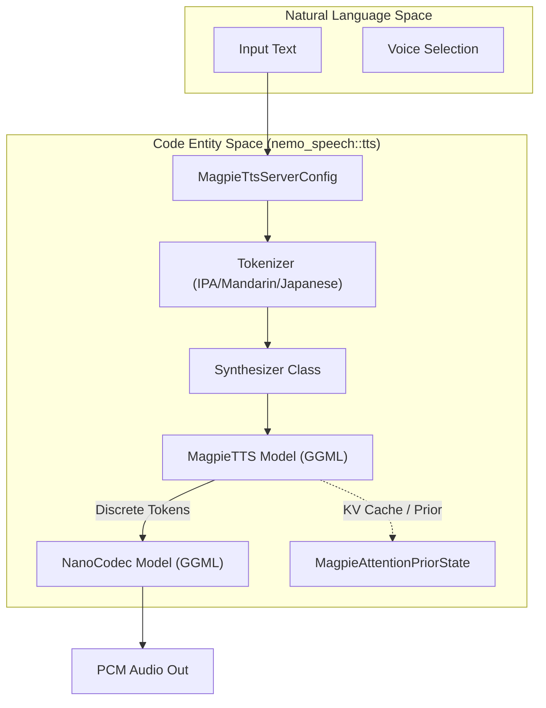

<!-- source: DeepWiki mcp.deepwiki.com · repo NVIDIA/NeMo-Speech.cpp · page 4.4 TTS Models and Configuration · fetched 2026-10-26 -->

# TTS Models and Configuration

<details>
<summary>Relevant source files</summary>

The following files were used as context for generating this wiki page:

- [app/synthesize.cpp](app/synthesize.cpp)
- [docs/tts/configuration.md](docs/tts/configuration.md)
- [docs/tts/models.md](docs/tts/models.md)
- [src/server/riva_server.cc](src/server/riva_server.cc)
- [src/tts/magpietts/README.md](src/tts/magpietts/README.md)
- [tests/cpp/tts/test_magpietts_asr.cpp](tests/cpp/tts/test_magpietts_asr.cpp)
- [tests/cpp/tts/test_magpietts_attention_prior.cpp](tests/cpp/tts/test_magpietts_attention_prior.cpp)
- [tests/cpp/tts/test_magpietts_file.cpp](tests/cpp/tts/test_magpietts_file.cpp)
- [tools/nanocodec.cpp](tools/nanocodec.cpp)

</details>


The Text-to-Speech (TTS) subsystem in NeMo-Speech.cpp provides high-quality, low-latency neural speech synthesis. It utilizes an autoregressive token generator (**MagpieTTS**) and a neural vocoder (**NanoCodec**) to transform text into 22050 Hz mono PCM audio. This page details the model requirements, GGUF conversion, and the extensive configuration schema available via CLI, environment variables, and YAML.

## Model Overview

The TTS pipeline requires three distinct components to function:
1.  **MagpieTTS GGUF**: An autoregressive model (e.g., 357M parameters) that predicts discrete codec tokens from input text/phonemes [docs/tts/models.md:11-13]().
2.  **NanoCodec GGUF**: A neural vocoder that decodes MagpieTTS tokens into raw audio waveforms [docs/tts/models.md:54-56]().
3.  **Tokenizer Assets**: Extracted from the original `.nemo` archive, these files handle the mapping of text to IPA phonemes and subsequently to model-specific IDs [docs/tts/models.md:28-32]().

### Model Acquisition and Extraction

Ready-to-run F16 GGUFs are available on Hugging Face. The tokenizer must be manually extracted from the `.nemo` archive because it contains non-tensor assets (like lookup tables) not stored in GGUF [docs/tts/models.md:28-29]().

```bash
# Download MagpieTTS and NanoCodec
hf download nvidia/magpie_tts_multilingual_357m \
    --include magpie_tts_multilingual_357m.v2602.f16.gguf \
    --include magpie_tts_multilingual_357m.nemo \
    --local-dir models/magpie-tts

hf download nvidia/nemo-nano-codec-22khz-1.89kbps-21.5fps \
    nemo_nano_codec_22khz_1.89kbps_21.5fps.decoder.f16.gguf \
    --local-dir models/nano-codec

# Extract tokenizer
mkdir -p models/magpie-tts/extracted
tar -xf models/magpie-tts/magpie_tts_multilingual_357m.nemo -C models/magpie-tts/extracted
```
*Sources: [docs/tts/models.md:15-26](), [docs/tts/models.md:59-63]()*

## Configuration Schema

TTS configuration is nested under the `tts.*` key. The system follows a precedence order: Defaults < YAML Config < Environment Variables < CLI Flags [docs/tts/configuration.md:5-7]().

### Identity and Tokenization
| Key | CLI Alias | Default | Description |
|---|---|---|---|
| `tts.magpie-model` | `--magpie-model` | - | Path to MagpieTTS GGUF [docs/tts/configuration.md:127](). |
| `tts.codec-model` | `--codec-model` | - | Path to NanoCodec GGUF [docs/tts/configuration.md:128](). |
| `tts.tokenizer-model-dir` | `--tokenizer-dir` | - | Path to extracted `.nemo` assets [docs/tts/configuration.md:129](). |
| `tts.tn-model-dir` | `--tn-model-dir` | - | Sparrowhawk TN grammar directory [docs/tts/configuration.md:131](). |
| `tts.language-code` | `--language` | `en-US` | Default language for synthesis [docs/tts/configuration.md:132](). |
| `tts.voice-name` | `--voice` | - | Voice name (e.g., `John`, `Sofia`) [docs/tts/configuration.md:133](). |

### Synthesis Controls
| Key | Default | Description |
|---|---|---|
| `tts.steps` | `-1` | Max decoder frames; `-1` uses model default [docs/tts/configuration.md:141](). |
| `tts.temperature` | Model Default | Sampling temperature for token generation [docs/tts/configuration.md:143](). |
| `tts.cfg-scale` | Model Default | Classifier-Free Guidance (CFG) scale [docs/tts/configuration.md:144](). |
| `tts.use-kv-cache` | `true` | Enables KV caching for autoregressive speedup [docs/tts/configuration.md:147](). |
| `tts.uma-mode` | `false` | Unified Memory Architecture optimization [src/tts/magpietts/README.md:145](). |

*Sources: [docs/tts/configuration.md:120-160](), [src/server/riva_server.cc:69-80]()*

## System Data Flow and Entities

The following diagram bridges the high-level synthesis request to the internal C++ classes and runtime structures.

**TTS Synthesis Execution Flow**

*Sources: [src/tts/magpietts/magpietts.h:20-25](), [src/server/riva_server.cc:99-111](), [tests/cpp/tts/test_magpietts_attention_prior.cpp:56-60]()*

## Performance and Metrics

The TTS engine tracks several key performance metrics, visible when `--benchmark` is enabled [docs/tts/configuration.md:138]():

*   **TTFT (Time to First Token)**: Latency from request to the first generated codec token.
*   **TTFA (Time to First Audio)**: Latency until the first PCM audio chunk is produced by NanoCodec.
*   **RTFX (Real-Time Factor X)**: The ratio of synthesized audio duration to the processing time. An RTFX of 10.0 means 10 seconds of audio are generated in 1 second.

### Warmup and CUDA Graphs
To minimize cold-start latency, the system performs a startup warmup by default. This initializes the tokenizer, runtime state, and captures CUDA graphs for the Local Transformer [src/tts/magpietts/README.md:126-127]().

In production environments, `GGML_CUDA_GRAPH_EVICT_AFTER_MS` is defaulted to `0` to keep CUDA graphs resident across idle gaps between requests [src/server/riva_server.cc:114-124]().

**Runtime Graph Management**
```mermaid
graph LR
    [riva_server] --> |"init"| Warmup["Warmup Request"]
    Warmup --> |"capture"| CudaGraph["CUDA Graphs"]
    CudaGraph --> |"resident"| Idle["Idle State"]
    Idle --> |"reuse"| NextReq["Next Synthesis Request"]
    
    subgraph "Memory Management"
        Evict["GGML_CUDA_GRAPH_EVICT_AFTER_MS"]
    end
    
    Evict -.-> |"Default: 0"| Idle
```
*Sources: [src/server/riva_server.cc:114-124](), [src/tts/magpietts/README.md:126-135]()*

## Advanced Features

### Longform Synthesis and Attention Prior
For long sequences, MagpieTTS uses an **Attention Prior** to prevent the model from "looping" or losing focus. The `MagpieAttentionPriorState` monitors attention scores and restricts the lookahead window to ensure monotonic progress [tests/cpp/tts/test_magpietts_attention_prior.cpp:56-70]().
*   `attention_prior_lookahead_window`: Controls how many future tokens the model can attend to [tests/cpp/tts/test_magpietts_attention_prior.cpp:42]().
*   `attention_prior_advance_threshold`: Number of frames to wait before forcing the attention window to advance [tests/cpp/tts/test_magpietts_attention_prior.cpp:82]().

### NanoCodec Streaming
NanoCodec supports stateful streaming via `NanoCodecStreamGraph`. It processes audio in chunks defined by `tts.chunk-frames` (default 3) and utilizes overlap-add windowing to prevent clicks between chunks [docs/tts/configuration.md:151-160](), [tools/nanocodec.cpp:25]().

*Sources: [tests/cpp/tts/test_magpietts_attention_prior.cpp:39-47](), [docs/tts/configuration.md:153-157](), [tools/nanocodec.cpp:159-160]()*

---

