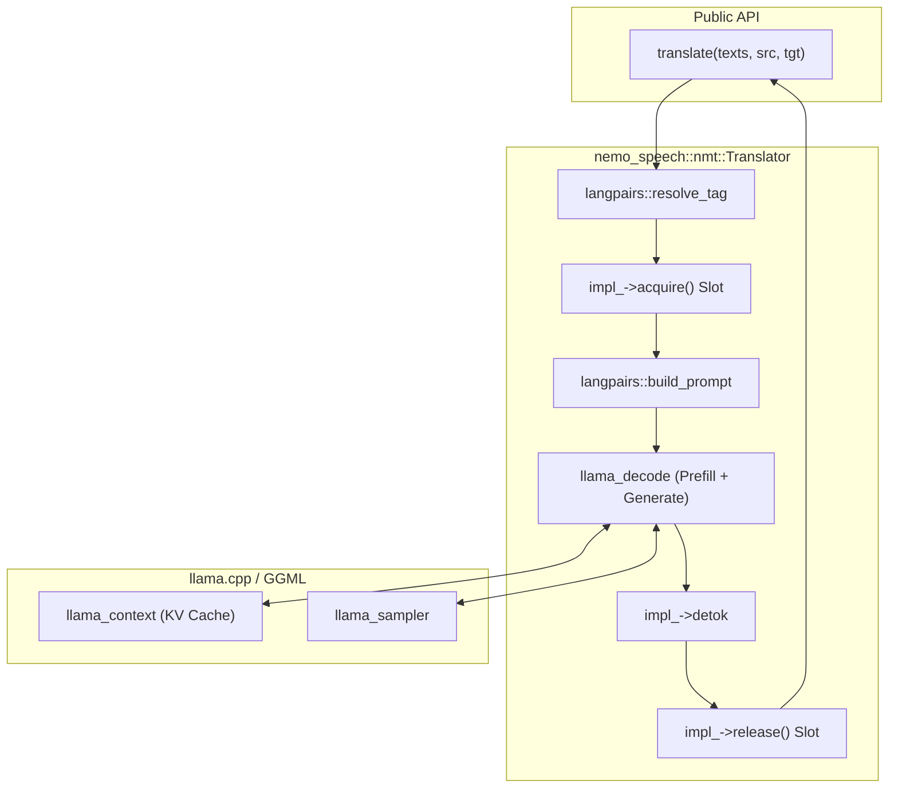
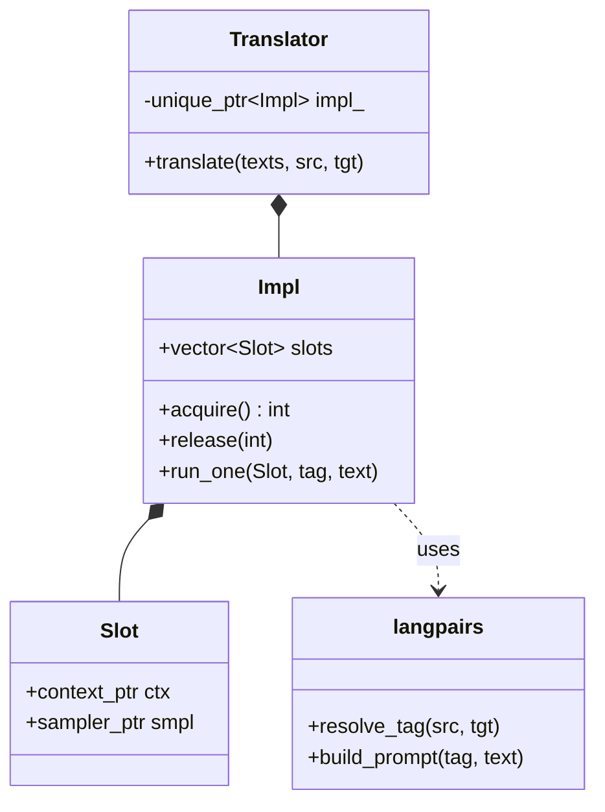

<!-- source: DeepWiki mcp.deepwiki.com · repo NVIDIA/NeMo-Speech.cpp · page 5.1 NMT Configuration and Models · fetched 2026-10-26 -->

# NMT Configuration and Models

<details>
<summary>Relevant source files</summary>

The following files were used as context for generating this wiki page:

- [config/nmt.example.yaml](config/nmt.example.yaml)
- [docs/nmt/configuration.md](docs/nmt/configuration.md)
- [docs/nmt/models.md](docs/nmt/models.md)
- [src/asr/pnc/pnc_runner.cpp](src/asr/pnc/pnc_runner.cpp)
- [src/nmt/langpairs.cc](src/nmt/langpairs.cc)
- [src/nmt/langpairs.h](src/nmt/langpairs.h)
- [src/nmt/translator.cpp](src/nmt/translator.cpp)
- [src/nmt/translator.h](src/nmt/translator.h)
- [src/tts/magpietts/encoder.cpp](src/tts/magpietts/encoder.cpp)
- [tests/cpp/nmt/test_langpairs.cpp](tests/cpp/nmt/test_langpairs.cpp)
- [tests/cpp/nmt/test_nmt.cpp](tests/cpp/nmt/test_nmt.cpp)
- [tests/cpp/tts/test_tts_terminal_punctuation.cpp](tests/cpp/tts/test_tts_terminal_punctuation.cpp)

</details>


The Neural Machine Translation (NMT) subsystem in NeMo-Speech.cpp provides high-performance text translation using the **Riva-Translate** model family. It leverages a pinned `llama.cpp` integration to execute Mistral/Llama-style architectures within the unified `ggml` runtime used by the ASR and TTS engines.

## Riva-Translate Models

The primary supported model is **Riva-Translate-4B-Instruct-v2**, a transformer-based decoder optimized for multilingual translation tasks [docs/nmt/models.md:8-8]().

### Conversion to GGUF
Unlike ASR or TTS models which use custom NeMo-to-GGUF scripts, NMT models are standard Hugging Face checkpoints. The conversion process delegates to the `llama.cpp` converter [docs/nmt/models.md:3-6]().

To convert the model, ensure the `llama.cpp` submodule is initialized and its Python dependencies are installed:
```bash
git submodule update --init llama.cpp
pip install -r llama.cpp/requirements/requirements-convert_hf_to_gguf.txt
python3 convert_model.py nvidia/Riva-Translate-4B-Instruct-v2 \
    --outfile riva-translate-4b-instruct-v2.q8_0.gguf --outtype q8_0
```
*Sources: [docs/nmt/models.md:13-18]()*

### Precision and Performance
Supported precisions include `f32`, `f16`, `bf16`, and `q8_0` [docs/nmt/models.md:32-35](). The `q8_0` quantization is recommended for a balance of speed and memory efficiency on both CPU and GPU backends [docs/nmt/models.md:35-35]().

## NMT Configuration Schema

The NMT engine is configured via the `nmt.*` key space in YAML files, environment variables, or CLI flags. The configuration is managed by the `TranslatorConfig` struct [src/nmt/translator.h:59-72]().

| Key | Default | Description |
|---|---|---|
| `nmt.enabled` | `auto` | Explicitly enable/disable NMT. Auto-enables if `path` is set [docs/nmt/configuration.md:33-33](). |
| `nmt.backend.gpu` | `0` | GPU device index; `-1` for CPU [src/nmt/translator.h:20-23](). |
| `nmt.model.path` | (none) | Path to the `.gguf` model file [src/nmt/translator.h:35-35](). |
| `nmt.model.n_ctx` | `1024` | KV cache context length in tokens (Model max: 8192) [src/nmt/translator.h:36-36](). |
| `nmt.generation.max_new_tokens` | `256` | Maximum tokens generated per input text [src/nmt/translator.h:41-44](). |
| `nmt.pool.contexts` | `1` | Number of parallel decode slots in the pool [src/nmt/translator.h:53-57](). |
| `nmt.verbose` | `false` | Enable verbose `llama.cpp` runtime logging [src/nmt/translator.h:70-70](). |

*Sources: [src/nmt/translator.h:19-72](), [docs/nmt/configuration.md:37-45]()*

## Implementation and Data Flow

The core of the NMT subsystem is the `Translator` class [src/nmt/translator.h:74-91](). It manages a pool of `llama_context` handles to allow concurrent translation requests without reallocating memory.

### Concurrency Model: nmt.pool.contexts
The `nmt.pool.contexts` setting defines a fixed-size pool of `Slot` objects, each containing a `llama_context` and a `llama_sampler` [src/nmt/translator.cpp:104-107]().
1.  **Acquisition:** When `translate()` is called, the thread calls `impl_->acquire()`, which blocks on a condition variable until a slot is available [src/nmt/translator.cpp:119-125]().
2.  **Execution:** The translation runs using the acquired `llama_context` [src/nmt/translator.cpp:145-186]().
3.  **Release:** Upon completion, the slot is returned to the pool via `impl_->release()` [src/nmt/translator.cpp:127-133]().

### Prompt Construction
The Riva-Translate model uses a specific chat-style template to define the translation task. The `nemo_speech::nmt::langpairs::build_prompt` function constructs this system and user turn sequence [src/nmt/langpairs.cc:176-186]().

**Example Prompt Structure:**
```text
<s>System
You are an expert at translating text from English to German.</s>
<s>User
What is the German translation of the sentence: Hello world.</s>
<s>Assistant
```
*Sources: [src/nmt/langpairs.cc:183-185](), [tests/cpp/nmt/test_langpairs.cpp:37-41]()*

### Language Pair Resolution
The `langpairs` utility resolves BCP-47 language codes or region tags (e.g., `en-US`, `zh-CN`) to the model's internal supported tags [src/nmt/langpairs.h:18-26](). It supports 1-to-N and N-to-1 mappings relative to English [src/nmt/langpairs.cc:131-137]().

### Data Flow Diagram
The following diagram illustrates the flow from a translation request to the `llama.cpp` execution.

**NMT Execution Pipeline**

*Sources: [src/nmt/translator.cpp:119-186](), [src/nmt/langpairs.cc:145-186]()*

## Code Entity Mapping

This section maps logical NMT concepts to specific C++ entities in the codebase.

| System Concept | Code Entity | File |
|---|---|---|
| Model Entry Point | `nemo_speech::nmt::Translator` | [src/nmt/translator.h:74-91]() |
| Context Pooling | `nemo_speech::nmt::Translator::Impl::Slot` | [src/nmt/translator.cpp:104-107]() |
| Prompt Template | `nemo_speech::nmt::langpairs::build_prompt` | [src/nmt/langpairs.cc:176-186]() |
| Code Normalization | `nemo_speech::nmt::langpairs::normalize_language_code` | [src/nmt/langpairs.cc:102-125]() |
| Llama Logging | `llama_log_callback` | [src/nmt/translator.cpp:24-35]() |

**NMT Entity Relationship**

*Sources: [src/nmt/translator.h:74-91](), [src/nmt/translator.cpp:103-113](), [src/nmt/langpairs.h:13-40]()*

## Memory and Optimization Notes

*   **KV Cache Size:** Each decode context holds a KV cache sized by `n_ctx`. At the default `1024` tokens, this consumes approximately `136 MiB` per context [docs/nmt/configuration.md:48-49]().
*   **Skinny-Q8 Safety:** The NMT engine explicitly disables `GGML_SKINNY_Q8` optimizations (via `force_skinny_q8_safe_for_nmt`) because the in-place repacking used for ASR is unsafe for decoder architectures and slower for single-token generation [src/nmt/translator.cpp:59-66]().
*   **Input Limits:** Inputs exceeding `nmt.model.n_ctx` are rejected with a `std::runtime_error` to prevent cryptic decode failures [src/nmt/translator.cpp:159-162]().

*Sources: [src/nmt/translator.cpp:59-66](), [docs/nmt/configuration.md:48-59]()*

---

