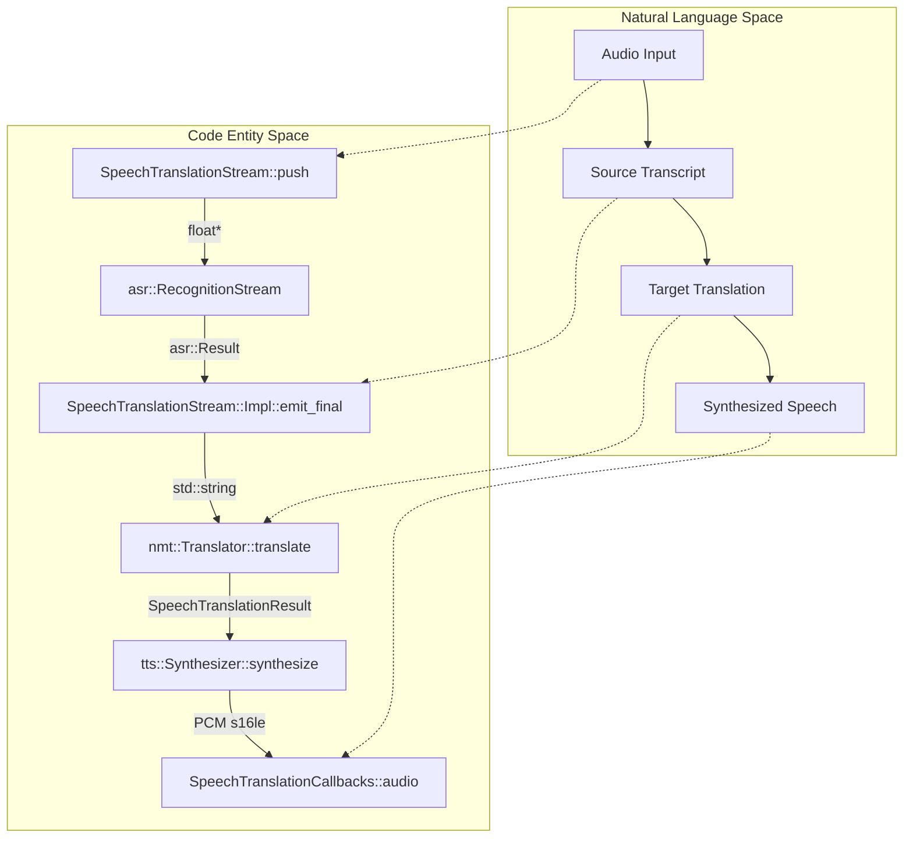
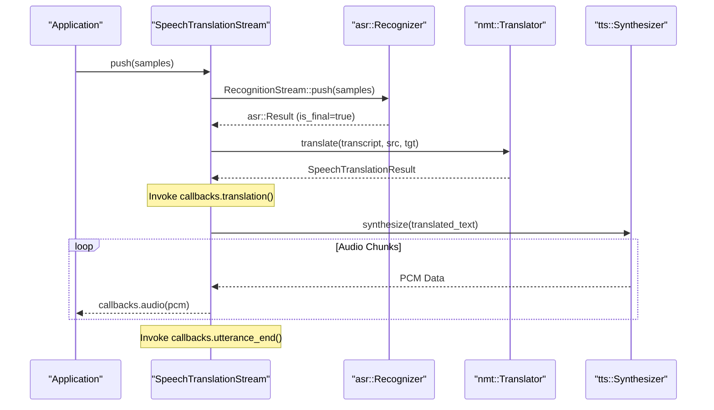

<!-- source: DeepWiki mcp.deepwiki.com · repo NVIDIA/NeMo-Speech.cpp · page 5.2 Speech Translation Pipeline · fetched 2026-10-26 -->

# Speech Translation Pipeline

Relevant source files

The following files were used as context for generating this wiki page:

- [src/common/CMakeLists.txt](src/common/CMakeLists.txt)
- [src/common/audio_resampler.cpp](src/common/audio_resampler.cpp)
- [src/core/CMakeLists.txt](src/core/CMakeLists.txt)
- [src/services/CMakeLists.txt](src/services/CMakeLists.txt)
- [src/services/grpc_nmt.cc](src/services/grpc_nmt.cc)
- [src/services/grpc_tts.cc](src/services/grpc_tts.cc)
- [src/speech/CMakeLists.txt](src/speech/CMakeLists.txt)
- [src/speech/speech_translator.cpp](src/speech/speech_translator.cpp)
- [src/speech/speech_translator.h](src/speech/speech_translator.h)
- [src/tts/preproc/CMakeLists.txt](src/tts/preproc/CMakeLists.txt)

The Speech Translation pipeline in NeMo-Speech.cpp provides a transport-neutral, end-to-end streaming solution that orchestrates Automatic Speech Recognition (ASR), Neural Machine Translation (NMT), and optional Text-to-Speech (TTS). It is implemented primarily in `src/speech/speech_translator.cpp` and exposed via the `nemo_speech_speech` library.

## Pipeline Architecture

The pipeline follows a sequential data flow where audio is first transcribed, the resulting text is translated, and the translation is optionally synthesized into audio. The `SpeechTranslator` class acts as the orchestrator for these three subsystems [src/speech/speech_translator.h:65-85]().

### Component Interaction Diagram

The following diagram illustrates how the `SpeechTranslator` bridges the natural language processing steps with specific code entities.

**Speech Translation Data Flow**

**Sources:** [src/speech/speech_translator.cpp:77-123](), [src/speech/speech_translator.h:18-44]()

## Key Classes and Data Structures

### SpeechTranslator
The `SpeechTranslator` class is the primary entry point. It requires a `Recognizer` and a `Translator` at construction, with an optional `Synthesizer` for Speech-to-Speech (S2S) workflows [src/speech/speech_translator.cpp:184-188]().

### SpeechTranslationOptions
Configures the behavior of the pipeline per request [src/speech/speech_translator.h:18-24]():
* `recognition`: An `asr::AsrRequestOptions` struct for configuring VAD, diarization, and boosting.
* `source_language` / `target_language`: ISO language codes for translation.
* `synthesize_speech`: Boolean flag to enable the TTS stage.
* `synthesis`: A `tts::SynthesisRequest` struct for voice and prosody control.

### SpeechTranslationCallbacks
Because the pipeline is streaming, it uses asynchronous callbacks to return results to the caller [src/speech/speech_translator.h:32-44]():
* `translation`: Invoked when a new ASR final is translated.
* `audio`: Invoked for every chunk of synthesized PCM audio.
* `utterance_end`: Invoked at semantic boundaries (e.g., end of a sentence synthesis).

## Implementation Details

### Execution Flow
1. **Audio Ingestion**: Audio samples are pushed via `SpeechTranslationStream::push` [src/speech/speech_translator.cpp:150-157]().
2. **ASR Processing**: The samples are forwarded to an internal `asr::RecognitionStream`.
3. **Draining Finals**: The pipeline calls `drain_finals()`, which polls the ASR stream for "final" results [src/speech/speech_translator.cpp:125-132]().
4. **Translation**: For each final transcript, `translate_text` is called. It resolves the source language (handling "auto" detection) and invokes the NMT engine [src/speech/speech_translator.cpp:43-63]().
5. **TTS Synthesis**: If `synthesize_speech` is enabled, the translated text is passed to `synthesizer->synthesize`. This uses a lambda to bridge the TTS engine's output to the `SpeechTranslationCallbacks::audio` callback [src/speech/speech_translator.cpp:94-114]().

**Pipeline Logic Sequence**

**Sources:** [src/speech/speech_translator.cpp:77-132](), [src/speech/speech_translator.h:46-63]()

## Subsystem Integration

The `nemo_speech_speech` library serves as the composite layer, linking the specialized subsystems together.

| Subsystem | Library Target | Role in Pipeline |
| :--- | :--- | :--- |
| **ASR** | `nemo_speech_asr` | Converts input audio to source text and detects language [src/speech/CMakeLists.txt:11](). |
| **NMT** | `nemo_speech_nmt` | Translates source text to target language [src/speech/CMakeLists.txt:12](). |
| **TTS** | `nemo_speech_tts` | (Optional) Synthesizes translated text into audio [src/speech/CMakeLists.txt:16](). |

### gRPC Integration
The `GrpcNmtService` in `src/services/grpc_nmt.cc` provides a Riva-compatible interface for this pipeline. It uses `map_options` to convert Protobuf `RecognitionConfig` and `TranslationConfig` into the internal `SpeechTranslationOptions` [src/services/grpc_nmt.cc:20-48](). It also handles audio decoding via `audio::Pcm16StreamDecoder` before pushing to the translator [src/services/grpc_nmt.cc:80-108]().

**Sources:** [src/speech/CMakeLists.txt:1-17](), [src/services/grpc_nmt.cc:112-118](), [src/services/CMakeLists.txt:19-27]()

---

