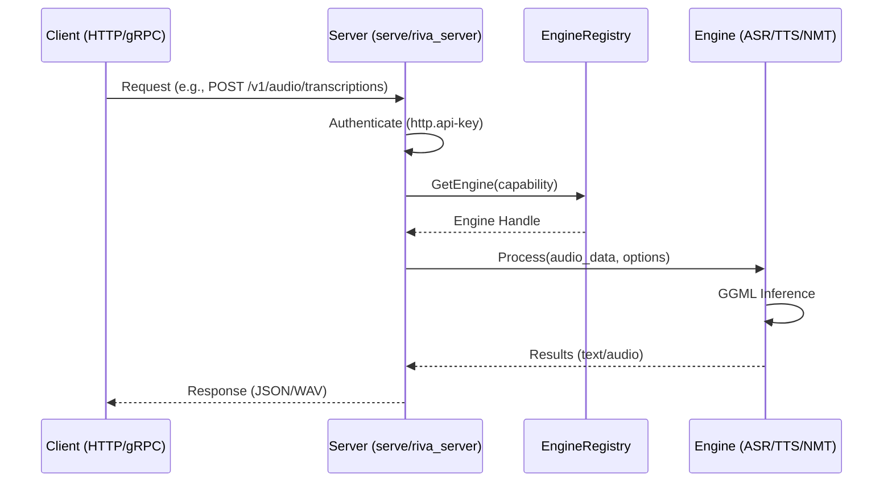

<!-- source: DeepWiki mcp.deepwiki.com · repo NVIDIA/NeMo-Speech.cpp · page 6 HTTP and gRPC Server · fetched 2026-10-26 -->

# HTTP and gRPC Server

<details>
<summary>Relevant source files</summary>

The following files were used as context for generating this wiki page:

- [app/serve.cpp](app/serve.cpp)
- [config/README.md](config/README.md)
- [config/asr.example.yaml](config/asr.example.yaml)
- [config/server.example.yaml](config/server.example.yaml)
- [config/tts.example.yaml](config/tts.example.yaml)
- [docs/api.md](docs/api.md)
- [docs/server.md](docs/server.md)
- [server/http/http_server.cpp](server/http/http_server.cpp)

</details>


NeMo-Speech.cpp provides a network serving layer that allows speech models to be accessed over standard protocols. It supports two primary serving interfaces: a modern **HTTP/WebSocket API** (including an OpenAI-compatible subset and a browser-based Playground) and a **Riva-compatible gRPC server**.

The network layer acts as a bridge between client requests and the underlying `EngineRegistry`, which manages the lifecycle and execution of ASR, TTS, NMT, and Diarization engines [docs/server.md:3-6]().

## Serving Architecture

The codebase separates the network listeners from the core inference logic. The `nemo-speech serve` command initializes the `http::Server` [app/serve.cpp:115-117](), while the `riva_server` binary implements the gRPC services [docs/server.md:7](). Both servers utilize the same unified configuration system to parameterize the underlying engines.

### Serving Components Mapping

The following diagram maps the networking concepts to their specific C++ implementations and configuration keys.

**Serving Layer to Code Entity Mapping**
```mermaid
graph TD
    subgraph "Network Space"
        ["HTTP/WS (Port 8080)"] --> ["nemo-speech serve"]
        ["gRPC (Port 50051)"] --> ["riva_server"]
    end

    subgraph "Code Entity Space"
        ["nemo-speech serve"] --> [app_serve["app/serve.cpp"]]
        ["riva_server"] --> [src_riva["src/server/riva_server.cc"]]
        
        [app_serve] --> [HttpServer["nemo_speech::http::Server"]]
        [src_riva] --> [GrpcAsr["nemo_speech::riva::GrpcAsrService"]]
        [src_riva] --> [GrpcTts["nemo_speech::riva::GrpcTtsService"]]
        
        [HttpServer] --> [EngineReg["nemo_speech::core::EngineRegistry"]]
        [GrpcAsr] --> [EngineReg]
    end

    subgraph "Configuration"
        [EngineReg] -.-> ["http.port"]
        [EngineReg] -.-> ["asr.model.path"]
        [EngineReg] -.-> ["tts.magpie-model"]
    end
```
**Sources:** [app/serve.cpp:115-145](), [docs/server.md:5-7](), [config/server.example.yaml:8-55]()

## Unified Configuration System

Both servers share a common configuration hierarchy. Settings are applied with the following precedence (lowest to highest): built-in defaults, YAML configuration files, environment variables, and finally CLI flags [docs/server.md:34-38]().

| Feature | YAML Key | Env Variable | CLI Flag |
| :--- | :--- | :--- | :--- |
| **HTTP Port** | `http.port` | `NEMO_SPEECH_HTTP_PORT` | `--port` |
| **ASR Model** | `asr.model.path` | `NEMO_SPEECH_ASR_MODEL_PATH` | `--asr-model` |
| **TTS Model** | `tts.magpie-model` | `NEMO_SPEECH_TTS_MAGPIE_MODEL` | `--tts-model` |
| **API Key** | `http.api-key` | `NEMO_SPEECH_HTTP_API_KEY` | `--api-key` |

**Sources:** [docs/server.md:32-88](), [config/server.example.yaml:8-107]()

## HTTP and REST/WebSocket API

The HTTP server, implemented in `server/http/`, provides a comprehensive suite of endpoints for speech tasks. It includes:
*   **REST Endpoints**: OpenAI-compatible routes for transcriptions (`/v1/audio/transcriptions`) and speech synthesis (`/v1/audio/speech`) [docs/api.md:25-96]().
*   **Realtime WebSocket**: A high-performance binary protocol for live ASR using PCM16 frames [docs/api.md:53-60]().
*   **Browser Playground**: An embedded UI that allows testing all capabilities directly from a web browser [server/http/http_server.cpp:30-46]().

For details, see **[HTTP Server and REST/WebSocket API](#6.1)**.

**Sources:** [server/http/http_server.cpp:30-46](), [docs/api.md:1-152]()

## Riva gRPC Server

The `riva_server` binary provides a gRPC interface that is wire-compatible with NVIDIA Riva. This allows NeMo-Speech.cpp to act as a drop-in replacement for Riva clients in environments where a lightweight, local-first deployment is preferred [docs/server.md:7]().

Key features include:
*   **Service Compatibility**: Implements `GrpcAsrService`, `GrpcTtsService`, and `GrpcNmtService` [docs/server.md:7]().
*   **Resource Management**: Supports CUDA graph eviction and memory optimization settings like "Skinny-Q8" for low-latency GEMM operations.
*   **Deployment**: Optimized for containerized environments where gRPC is the standard for microservice communication.

For details, see **[Riva gRPC Server](#6.2)**.

**Sources:** [docs/server.md:7-28](), [config/README.md:3-5]()

## Request Lifecycle

The following diagram illustrates how a network request flows through the serving layer to the inference engines.

**Request Processing Flow**

**Sources:** [docs/api.md:6-11](), [app/serve.cpp:147-200](), [docs/server.md:5-9]()

---

