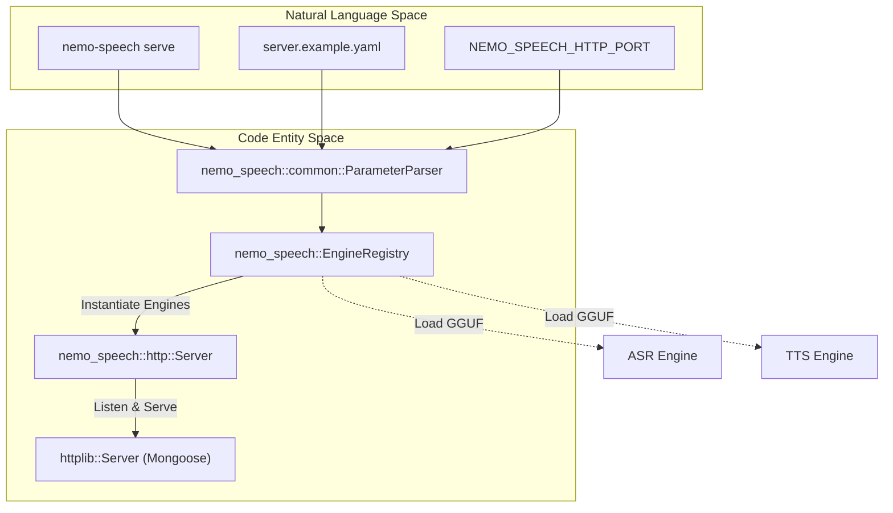
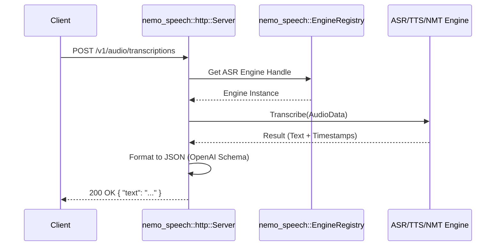

<!-- source: DeepWiki mcp.deepwiki.com · repo NVIDIA/NeMo-Speech.cpp · page 6.1 HTTP Server and REST/WebSocket API · fetched 2026-10-26 -->

# HTTP Server and REST/WebSocket API

Relevant source files

The following files were used as context for generating this wiki page:

- [app/serve.cpp](app/serve.cpp)
- [config/README.md](config/README.md)
- [config/asr.example.yaml](config/asr.example.yaml)
- [config/server.example.yaml](config/server.example.yaml)
- [config/tts.example.yaml](config/tts.example.yaml)
- [docs/api.md](docs/api.md)
- [docs/clients.md](docs/clients.md)
- [docs/server.md](docs/server.md)
- [scripts/asr/score_cpwer.py](scripts/asr/score_cpwer.py)
- [scripts/asr/score_diar_der.py](scripts/asr/score_diar_der.py)
- [scripts/tts/generate_mandarin_tokenizer_data.py](scripts/tts/generate_mandarin_tokenizer_data.py)
- [scripts/tts/tokenize-magpietts.py](scripts/tts/tokenize-magpietts.py)
- [server/http/CMakeLists.txt](server/http/CMakeLists.txt)
- [server/http/http_server.cpp](server/http/http_server.cpp)
- [src/asr/c_api.map](src/asr/c_api.map)
- [src/nmt/c_api.map](src/nmt/c_api.map)
- [src/tts/c_api.map](src/tts/c_api.map)
- [tests/integration/clients/openai_client.mjs](tests/integration/clients/openai_client.mjs)
- [tests/integration/http_conformance_test.py](tests/integration/http_conformance_test.py)

The NeMo-Speech.cpp HTTP server provides a high-performance, local inference gateway for ASR, TTS, NMT, and Diarization. It is designed for low-latency interactions and broad compatibility with existing ecosystems, such as the OpenAI API and browser-based applications.

## Server Entry Point and Lifecycle

The HTTP server is invoked via the `nemo-speech serve` command, implemented in `app/serve.cpp` [app/serve.cpp:115-115](). The server utilizes a bounded worker pool for handling concurrent requests and supports graceful shutdown via `SIGINT` and `SIGTERM` signals [app/serve.cpp:32-50]().

### Data Flow: Startup to Request Handling

The following diagram illustrates the initialization flow and how the `serve` command bridges configuration to the runtime `nemo_speech::http::Server`.

**Server Initialization and Execution Flow**

**Sources:** [app/serve.cpp:115-200](), [server/http/http_server.cpp:4-25](), [docs/server.md:30-38]()

## Configuration

Configuration follows a strict precedence: built-in defaults < YAML file < environment variables < CLI options [docs/server.md:37-38]().

### Listener Settings
These settings control the HTTP layer itself:
| Key | CLI Flag | Default | Description |
|---|---|---|---|
| `http.host` | `--host` | `127.0.0.1` | Bind address [app/serve.cpp:154-154]() |
| `http.port` | `--port` | `8080` | Bind port [app/serve.cpp:157-160]() |
| `http.api-key` | `--api-key` | None | Bearer token for auth [app/serve.cpp:198-198]() |
| `http.threads` | `--threads` | `4` | HTTP worker pool size [app/serve.cpp:162-166]() |
| `http.max-upload-mb`| `--max-upload-mb`| `512` | Max request body size [app/serve.cpp:168-173]() |

**Sources:** [app/serve.cpp:147-200](), [docs/server.md:74-89]()

## REST API Endpoints

The server exposes several OpenAI-compatible and extension endpoints. All non-2xx responses return a JSON error object [docs/api.md:8-9]().

### ASR: `/v1/audio/transcriptions`
Accepts `multipart/form-data` with a WAV file. It supports:
- **Punctuation/Capitalization**: Controlled by `automatic_punctuation` [docs/api.md:35-35]().
- **Diarization**: Tagging words with speakers via `diarization=true` (requires a diarizer model) [docs/api.md:38-38]().
- **Word Boosting**: Via `speech_contexts` array or `prompt` string [docs/api.md:40-41]().

### TTS: `/v1/audio/speech`
Accepts a JSON body for text synthesis.
- **Input**: The text to be spoken [docs/api.md:89-89]().
- **Format**: Returns `wav` or raw `pcm` bytes [docs/api.md:94-94]().

### NMT and Speech Translation
- **Text Translation**: `POST /v1/translations` [docs/api.md:98-98]().
- **Speech Translation**: `POST /v1/audio/translations` (ASR $\rightarrow$ NMT) [docs/api.md:110-110]().
- **Speech-to-Speech**: `POST /v1/audio/speech/translations` (ASR $\rightarrow$ NMT $\rightarrow$ TTS) [docs/api.md:126-126]().

**Sources:** [docs/api.md:25-141](), [server/http/http_server.cpp:26-45]()

## WebSocket Realtime ASR Protocol

The `/v1/realtime` endpoint provides a bidirectional WebSocket for live PCM16 audio streaming [docs/api.md:53-53]().

### Protocol Sequence
1.  **Connection**: Server sends `session.created`.
2.  **Configuration**: Client optionally sends `session.update` to set `sample_rate`, `language`, or `speech_contexts` [docs/api.md:62-76]().
3.  **Audio Streaming**: Client sends binary little-endian PCM16 frames.
4.  **Events**: Server emits `conversation.item.input_audio_transcription.delta` for partial results and `.completed` for final transcripts [docs/api.md:78-81]().

**Sources:** [docs/api.md:53-81](), [tests/integration/http_conformance_test.py:90-91]()

## Browser Playground

The server includes an embedded, zero-dependency Playground UI accessible at `GET /` [server/http/http_server.cpp:30-46](). It is implemented as a single-file HTML/JS asset within the binary to ensure it works in air-gapped environments without CDNs or Node.js [docs/server.md:154-158]().

**Playground Capabilities:**
- Drag-and-drop WAV transcription [server/http/http_server.cpp:41-41]().
- Live microphone input via WebSocket [server/http/http_server.cpp:41-41]().
- TTS voice and language selection [server/http/http_server.cpp:43-43]().
- Real-time speaker timeline visualization [server/http/http_server.cpp:42-42]().

**Sources:** [server/http/http_server.cpp:30-47](), [docs/server.md:154-160]()

## Implementation Details

The server is built on `cpp-httplib`. The `nemo_speech::http::Server` class manages the lifecycle of the `EngineRegistry`, ensuring that models are loaded once and shared across requests [docs/server.md:5-6]().

### Request Handling Diagram
This diagram maps the HTTP request lifecycle to the internal C++ classes.

**Request Routing and Engine Dispatch**

**Sources:** [server/http/http_server.cpp:26-47](), [app/serve.cpp:21-25]()

## Health and Readiness

The server provides endpoints for monitoring:
- `GET /health`: Returns engine status and version [docs/server.md:126-126]().
- `GET /ready`: Returns 200 only when all configured models are loaded and the engine is ready for inference; returns 503 Service Unavailable during warmup [docs/server.md:127-129]().

**Sources:** [docs/server.md:125-135](), [tests/integration/http_conformance_test.py:152-153]()

---

