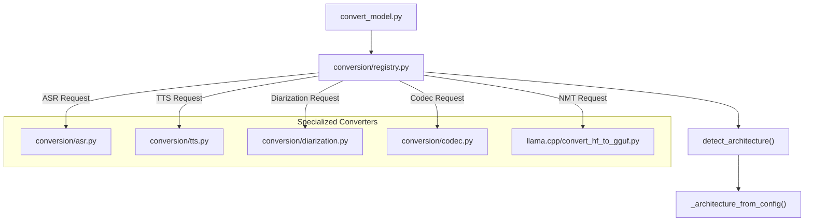
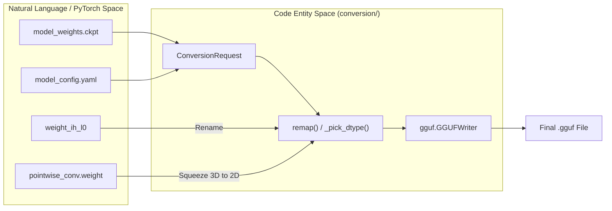

<!-- source: DeepWiki mcp.deepwiki.com · repo NVIDIA/NeMo-Speech.cpp · page 7 Model Conversion · fetched 2026-10-26 -->

# Model Conversion

<details>
<summary>Relevant source files</summary>

The following files were used as context for generating this wiki page:

- [conversion/__init__.py](conversion/__init__.py)
- [conversion/asr.py](conversion/asr.py)
- [conversion/codec.py](conversion/codec.py)
- [conversion/diarization.py](conversion/diarization.py)
- [conversion/registry.py](conversion/registry.py)
- [conversion/tts.py](conversion/tts.py)
- [docs/model-conversion.md](docs/model-conversion.md)
- [scripts/asr/dump_sortformer_reference.py](scripts/asr/dump_sortformer_reference.py)
- [src/tts/nanocodec/README.md](src/tts/nanocodec/README.md)
- [tests/conversion/converter_contract_test.py](tests/conversion/converter_contract_test.py)

</details>


The `convert_model.py` pipeline is the unified entry point for transforming NVIDIA NeMo checkpoints (`.nemo`) and Hugging Face models into GGUF files compatible with the NeMo-Speech.cpp runtime. It performs architecture detection, weight remapping, and quantization without requiring the full `nemo_toolkit` [docs/model-conversion.md:59-60]().

## Conversion Overview

The converter supports a variety of model families including ASR, TTS, Diarization, VAD, and NMT. While published models are available as GGUF on Hugging Face, the converter allows for custom checkpoints and alternate quantization types [docs/model-conversion.md:3-6]().

### Basic Usage
```bash
python3 convert_model.py SOURCE --outfile MODEL.gguf
```
The `SOURCE` can be a local `.nemo` archive, an extracted checkpoint directory, or a Hugging Face repository ID [docs/model-conversion.md:15-16]().

### Supported Architectures and Defaults
| Architecture | Default Type | Example Source |
| :--- | :--- | :--- |
| **ASR** | `q8_0` | `nvidia/nemotron-speech-streaming-en-0.6b` |
| **TTS** | `f16` | `nvidia/magpie_tts_multilingual_357m` |
| **Diarization** | `f32` | `nvidia/diar_streaming_sortformer_4spk-v2` |
| **Codec** | `f16` | `nvidia/nemo-nano-codec-22khz-1.89kbps` |
| **VAD** | `f32` | `silero` |
| **NMT** | `f16` | `nvidia/Riva-Translate-4B-Instruct-v2` |

*Table Source: [docs/model-conversion.md:21-29]()*

## Conversion Pipeline

The conversion process is orchestrated by `conversion/registry.py`, which manages the lifecycle of a `ConversionRequest` [conversion/registry.py:18-31]().

### Pipeline Logic Flow
The following diagram illustrates how the `convert_model.py` entry point interacts with the internal registry and specialized architecture converters.

**Model Conversion Architecture**

Sources: [conversion/registry.py:152-205](), [conversion/__init__.py:1-8]()

For details on the orchestrator, automatic architecture detection, and security checks, see **[Conversion Pipeline and Architecture Detection](#7.1)**.

## Architecture-Specific Details

Each model family requires specific tensor remapping and metadata injection to work with the GGML-based C++ engines.

### Weight Remapping and Quantization
Converters often rename tensors to match the expected C++ class structure. For example, RNNT LSTM tensors are renamed from PyTorch's `weight_ih_l0` to `ih_l0.weight` so they can be owned by the runtime's `Linear` module [conversion/asr.py:17-19]().

**Entity Mapping: PyTorch to GGUF Space**

Sources: [conversion/asr.py:10-22](), [conversion/asr.py:64-77](), [conversion/diarization.py:139-154]()

### Key Conversion Logic per Domain:
*   **ASR**: Supports FastConformer-CTC and RNNT. It analytically pre-computes positional encodings and supports a specialized "Planar Q8" layout for CUDA optimization [conversion/asr.py:7-22](), [conversion/asr.py:95-104]().
*   **TTS**: Targets MagpieTTS. It extracts autoregressive weights and metadata like `speaker_names` and `baked_context_length` [conversion/tts.py:82-122]().
*   **Diarization**: Converts Sortformer models. It remaps the NEST encoder and Sortformer-specific scoring constants (e.g., `spkcache_sil_frames_per_spk`) [conversion/diarization.py:4-18](), [conversion/diarization.py:115-123]().
*   **NMT**: Delegates to the `llama.cpp` conversion script to handle large transformer models [conversion/registry.py:127-150]().

For detailed remapping tables and architecture-specific flags, see **[Per-Architecture Conversion Details](#7.2)**.

## Related Components
*   **[Automatic Speech Recognition (ASR)](#3)**: Runtime details for converted ASR models.
*   **[Text-to-Speech (TTS)](#4)**: Runtime details for MagpieTTS and NanoCodec.
*   **[GGML Patches and GPU Optimization](#8)**: Details on the specialized kernels (like Skinny-Q8) that the converters target.

Sources: [docs/model-conversion.md:62-67](), [conversion/registry.py:14-16]()

---

