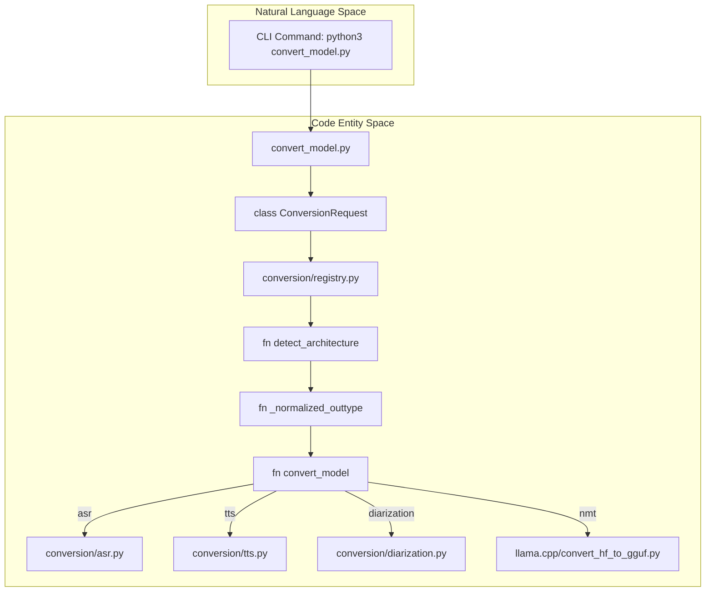
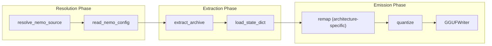

<!-- source: DeepWiki mcp.deepwiki.com · repo NVIDIA/NeMo-Speech.cpp · page 7.1 Conversion Pipeline and Architecture Detection · fetched 2026-10-26 -->

# Conversion Pipeline and Architecture Detection

Relevant source files

The following files were used as context for generating this wiki page:

- [conversion/__init__.py](conversion/__init__.py)
- [conversion/asr.py](conversion/asr.py)
- [conversion/codec.py](conversion/codec.py)
- [conversion/diarization.py](conversion/diarization.py)
- [conversion/registry.py](conversion/registry.py)
- [conversion/tts.py](conversion/tts.py)
- [docs/model-conversion.md](docs/model-conversion.md)
- [scripts/asr/dump_sortformer_reference.py](scripts/asr/dump_sortformer_reference.py)
- [src/tts/nanocodec/README.md](src/tts/nanocodec/README.md)
- [tests/conversion/converter_contract_test.py](tests/conversion/converter_contract_test.py)

The model conversion pipeline is a unified Python-based system designed to transform NVIDIA NeMo checkpoints (`.nemo` files) and Hugging Face models into GGUF format for use with the `ggml` runtime. The orchestrator for this process is `conversion/registry.py`, which handles source resolution, automatic architecture detection, and dispatching to specific conversion logic.

## Conversion Orchestration

The conversion process is driven by the `ConversionRequest` dataclass, which encapsulates all parameters required for the pipeline, including source paths, output file locations, and quantization preferences [conversion/registry.py:17-31]().

### Conversion Data Flow and Code Entities

The following diagram illustrates how the `convert_model` entry point interacts with the registry and specific conversion modules.

**Conversion Orchestration Flow**

Sources: [conversion/registry.py:152-205](), [docs/model-conversion.md:8-13]()

## Architecture Detection

The pipeline automatically identifies the model family by inspecting the `model_config.yaml` found within a NeMo archive or directory. The function `_architecture_from_config` parses the `target` or `_target_` keys to determine the model type [conversion/registry.py:34-48]().

| Detection Keyword | Detected Architecture |
| :--- | :--- |
| `sortformer` | `diarization` |
| `punctuationcapitalization` | `pnc` |
| `magpietts` | `tts` |
| `audiocodecmodel` | `codec` |
| `EncDecCTCModel` / `EncDecRNNTModel` | `asr` |

If the source is a directory containing a `config.json` or `.safetensors` files but no NeMo configuration, the system defaults to the `nmt` (Neural Machine Translation) architecture, which utilizes the `llama.cpp` conversion delegate [conversion/registry.py:65-67](), [conversion/registry.py:84-85]().

Sources: [conversion/registry.py:34-48](), [conversion/registry.py:81-86](), [tests/conversion/converter_contract_test.py:40-75]()

## Source Resolution and Security

The pipeline supports multiple source types through `_resolve_nemo_for_detection` [conversion/registry.py:51-68]():
1.  **Local Files**: `.nemo` archives or extracted directories.
2.  **Hugging Face**: Repository IDs (e.g., `nvidia/parakeet-ctc-1.1b`). The system uses `list_hugging_face_files` to locate `.nemo` files and downloads them via the standard HF cache [conversion/registry.py:62-64]().
3.  **Special Keywords**: Keywords like `silero` or `vad` trigger specific logic for Silero VAD conversion [conversion/registry.py:60-61]().

### Security Checks
To prevent ZipSlip and path traversal attacks during checkpoint extraction, the `extract_archive` utility implements strict validation. It rejects any archive member that contains parent directory references (`..`) or is a symbolic link [tests/conversion/converter_contract_test.py:83-102]().

Sources: [conversion/registry.py:51-68](), [conversion/source.py:38-38](), [tests/conversion/converter_contract_test.py:83-102]()

## Quantization and Output Types

The pipeline normalizes output types based on the architecture. Each architecture has a default quantization type and a set of supported formats defined in `_normalized_outtype` [conversion/registry.py:89-124]().

| Architecture | Default `outtype` | Supported Types |
| :--- | :--- | :--- |
| `asr` | `q8_0` | `f16`, `bf16`, `q8_0`, `q4_k`, `q5_k`, `q6_k`, `nvfp4`, `mxfp4` |
| `tts` | `f16` | `f16`, `f32` |
| `diarization`| `f32` | `f32`, `f16`, `bf16`, `q8_0`, `q4_k`, `q5_k`, `q6_k` |
| `vad` | `f32` | `f32` |
| `nmt` | `f16` | `f32`, `f16`, `bf16`, `q8_0` |

### Specialized Layouts
For ASR models, the converter supports a `planar` Q8 layout. This layout serializes all `int8` quantizers first, followed by all `FP16` block scales, which is the exact format consumed by optimized CUDA kernels [conversion/asr.py:95-104](), [conversion/asr.py:120-132]().

Sources: [conversion/registry.py:89-124](), [conversion/asr.py:95-104](), [docs/model-conversion.md:21-30]()

## Implementation Mapping

The following diagram maps the logical conversion steps to the specific Python functions and modules responsible for the data transformation.

**Code Entity Mapping: Resolution to Emission**

Sources: [conversion/registry.py:12-12](), [conversion/asr.py:39-47](), [conversion/tts.py:26-26](), [conversion/diarization.py:39-42]()

---

