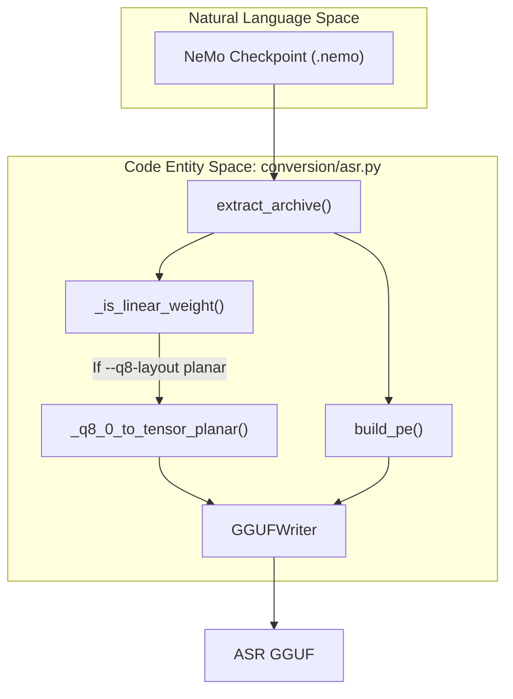
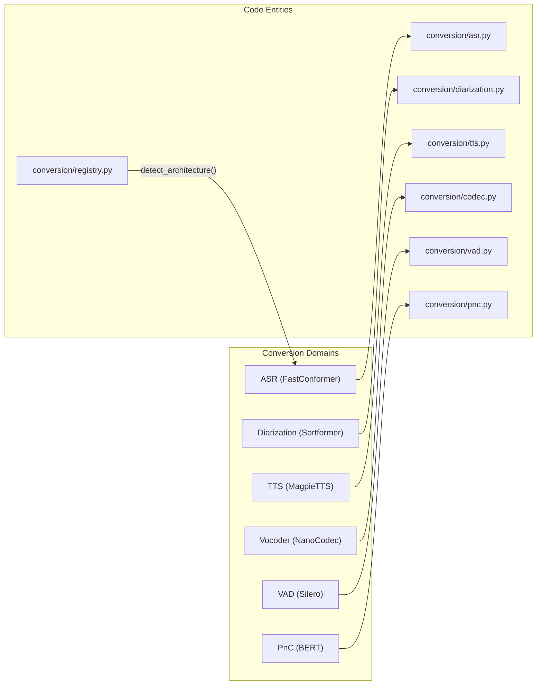

<!-- source: DeepWiki mcp.deepwiki.com · repo NVIDIA/NeMo-Speech.cpp · page 7.2 Per-Architecture Conversion Details · fetched 2026-10-26 -->

# Per-Architecture Conversion Details

Relevant source files

The following files were used as context for generating this wiki page:

- [conversion/__init__.py](conversion/__init__.py)
- [conversion/asr.py](conversion/asr.py)
- [conversion/codec.py](conversion/codec.py)
- [conversion/diarization.py](conversion/diarization.py)
- [conversion/pnc.py](conversion/pnc.py)
- [conversion/registry.py](conversion/registry.py)
- [conversion/tts.py](conversion/tts.py)
- [conversion/vad.py](conversion/vad.py)
- [docs/asr/models.md](docs/asr/models.md)
- [docs/model-conversion.md](docs/model-conversion.md)
- [scripts/asr/dump_sortformer_reference.py](scripts/asr/dump_sortformer_reference.py)
- [src/asr/pnc/pnc_model.cpp](src/asr/pnc/pnc_model.cpp)
- [src/asr/pnc/pnc_model.h](src/asr/pnc/pnc_model.h)
- [src/asr/vad/silero_vad.cpp](src/asr/vad/silero_vad.cpp)
- [src/tts/nanocodec/README.md](src/tts/nanocodec/README.md)
- [tests/conversion/converter_contract_test.py](tests/conversion/converter_contract_test.py)
- [tests/cpp/asr/test_oov_boost.cpp](tests/cpp/asr/test_oov_boost.cpp)
- [tests/cpp/asr/test_pnc.cpp](tests/cpp/asr/test_pnc.cpp)

This page provides a deep dive into the architecture-specific logic within the `convert_model.py` pipeline. The converter transforms NVIDIA NeMo checkpoints and third-party models into GGUF files compatible with the `nemo-speech.cpp` runtime.

The conversion process is orchestrated by `conversion/registry.py`, which performs automatic architecture detection based on the `model_config.yaml` found within `.nemo` archives or Hugging Face repositories [conversion/registry.py:34-49]().

## ASR Conversion (FastConformer)

The ASR converter handles both CTC and RNNT architectures, specifically targeting the FastConformer encoder family [conversion/asr.py:4-9]().

### Tensor Remapping and Normalization
To ensure compatibility with the C++ `Linear` and `Conv1D` modules, several transformations are applied:
*   **LSTM Normalization**: PyTorch's `weight_ih_l0` style names are remapped to `ih_l0.weight` so they can be loaded directly by the runtime's `Linear` abstraction [conversion/asr.py:17-19]().
*   **Analytical PE**: Positional encodings are pre-computed analytically during conversion rather than being copied from the checkpoint buffer [conversion/asr.py:20-21]().
*   **Pointwise Convolutions**: Pointwise (1x1) convolution weights are squeezed from 3D to 2D shapes. This allows the runtime to dispatch them through `ggml_mul_mat` for higher performance [conversion/asr.py:72-76]().

### Planar Q8 Layout
For CUDA backends, the converter supports a `--q8-layout planar` option [docs/asr/models.md:121-129](). 
*   **Standard Q8**: Block-interleaved (32 values followed by one FP16 scale).
*   **Planar Q8**: Serializes all `int8` quantizers first, followed by all `FP16` scales in a separate plane [conversion/asr.py:95-98](). This layout is required for the "skinny-Q8" CUDA kernels to avoid runtime repacking during batched inference.

### ASR Conversion Flow
The following diagram illustrates the transformation of a NeMo ASR checkpoint into a GGUF artifact.

**ASR Conversion Logic**

**Sources:** [conversion/asr.py:32-131](), [conversion/registry.py:157-167]().

---

## Diarization (Sortformer)

The Diarization converter targets the `SortformerEncLabelModel` [conversion/diarization.py:6](). It preserves the FastConformer encoder weights while remapping the transformer and scoring heads.

*   **Encoder Mapping**: `encoder.*` tensors are kept identical to ASR encoder names to allow the C++ `FastConformerEncoder` to load them unchanged [conversion/diarization.py:7-9]().
*   **Head Mapping**: `sortformer_modules.*` are remapped to `head.*`, and `transformer_encoder.*` becomes `transformer.*` [conversion/diarization.py:144-150]().
*   **AOSC Constants**: The converter embeds scoring constants (e.g., `spkcache_sil_frames_per_spk`, `pred_score_threshold`) into the GGUF metadata. These values are critical for the AOSC (Attentive Overlap-aware Speaker Clustering) algorithm parity [conversion/diarization.py:93-101]().

**Sources:** [conversion/diarization.py:6-26](), [conversion/diarization.py:139-154]().

---

## TTS and Codec (MagpieTTS & NanoCodec)

TTS conversion involves two distinct models: the MagpieTTS autoregressive generator and the NanoCodec neural vocoder.

### MagpieTTS
The converter extracts the autoregressive weights but excludes the vocoder, which is treated as a separate sidecar GGUF [conversion/tts.py:9-12](). Key metadata such as `audio_codebooks`, `frame_stacking_factor`, and `baked_context_length` are written to the `magpietts.*` namespace [conversion/tts.py:103-122]().

### NanoCodec
The NanoCodec converter targets the token-to-audio path. It extracts the **Group FSQ (Finite Scalar Quantization)** metadata and the HiFi-GAN decoder weights [conversion/codec.py:9-12]().
*   **FSQ Codebooks**: The converter analytically generates the FSQ codebooks based on `num_levels` and `num_groups` found in the config [conversion/codec.py:74-97]().
*   **HiFi-GAN**: Weights are mapped to a layout compatible with `ggml.conv1d` and `conv_transpose1d` [conversion/codec.py:134-140]().

**Sources:** [conversion/tts.py:82-122](), [conversion/codec.py:100-135]().

---

## Punctuation and Capitalization (PnC)

The PnC converter transforms BERT-based models into a GGUF format with an `arch="pnc"` [conversion/pnc.py:8]().

*   **Tensor Mapping**: Maps standard Hugging Face BERT names (e.g., `embeddings.word_embeddings`) to the internal `pnc.token_embd` naming convention [conversion/pnc.py:32-41]().
*   **Classification Heads**: Remaps `punct_classifier` and `capit_classifier` to `pnc.punct_head` and `pnc.capit_head` [conversion/pnc.py:68-71]().
*   **Vocab Integration**: The WordPiece `vocab.txt` and label sets (`punct_label_ids.csv`) are embedded directly into the GGUF as arrays [conversion/pnc.py:158-160]().

**Sources:** [conversion/pnc.py:32-72](), [conversion/pnc.py:146-165]().

---

## VAD (Silero) and NMT

### Silero VAD
The VAD converter produces a sidecar GGUF for the Silero-VAD model. It supports loading from the `silero-vad` pip package or existing `whisper.cpp` GGML binaries [conversion/vad.py:36-44]().
*   **Metadata**: Stores `stft_n_basis`, `lstm_hidden`, and `window_size` in the `vad.*` namespace [conversion/vad.py:57-77]().
*   **Parity**: Weights are emitted as `F32` to maintain strict probability parity with the original PyTorch implementation [conversion/vad.py:28-30]().

### NMT (llama.cpp Delegate)
For Neural Machine Translation models like `Riva-Translate-4B`, `nemo-speech.cpp` delegates conversion to the `llama.cpp` converter via a submodule call [conversion/registry.py:127-149]().

**Sources:** [conversion/vad.py:161-168](), [conversion/registry.py:127-150]().

---

## System Entity Mapping

The following diagram maps the logical conversion domains to the specific implementation files and classes within the `conversion/` directory.

**Conversion Implementation Map**

**Sources:** [conversion/registry.py:14-30](), [conversion/registry.py:152-205]().

---

