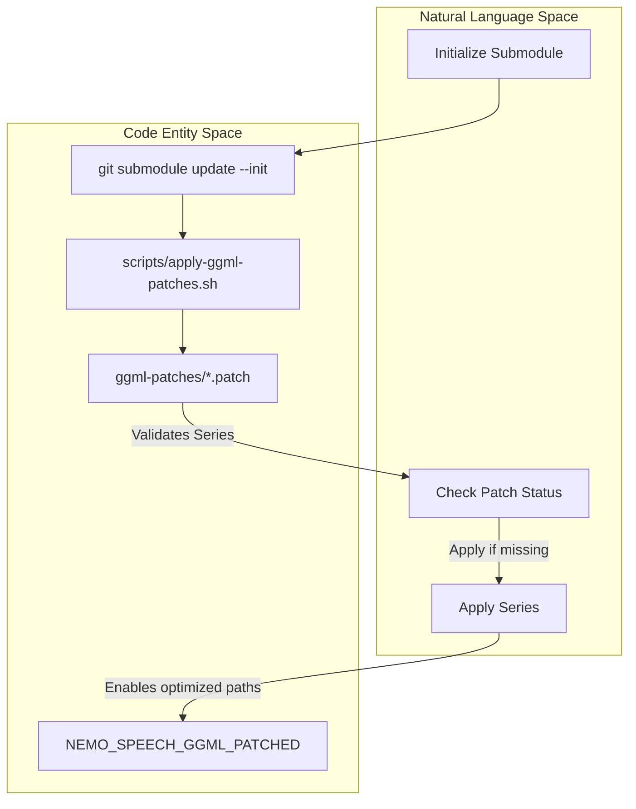
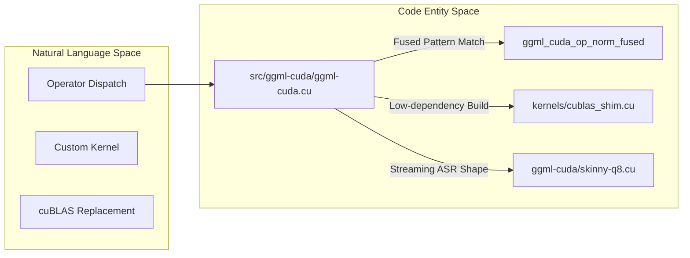

<!-- source: DeepWiki mcp.deepwiki.com · repo NVIDIA/NeMo-Speech.cpp · page 8 GGML Patches and GPU Optimization · fetched 2026-10-26 -->

# GGML Patches and GPU Optimization

Relevant source files

The following files were used as context for generating this wiki page:

- [CMakeLists.txt](CMakeLists.txt)
- [ggml-patches/0003-norm-mul-add-fusion.patch](ggml-patches/0003-norm-mul-add-fusion.patch)
- [ggml-patches/0009-fastconformer-cuda-fusions.patch](ggml-patches/0009-fastconformer-cuda-fusions.patch)
- [ggml-patches/0015-cuda-ctc-batch-fusions.patch](ggml-patches/0015-cuda-ctc-batch-fusions.patch)
- [ggml-patches/README.md](ggml-patches/README.md)
- [scripts/apply-ggml-patches.sh](scripts/apply-ggml-patches.sh)
- [scripts/windows/apply-ggml-patches.ps1](scripts/windows/apply-ggml-patches.ps1)

NeMo-Speech.cpp utilizes a series of targeted patches for the `ggml` submodule to achieve production-grade performance on NVIDIA GPUs. These patches introduce fused kernels, specialized quantizers, and graph-level optimizations specifically tuned for speech models like FastConformer and MagpieTTS.

### The Patch Series Architecture

The `ggml-patches/` directory contains a sequential series of `.patch` files that are applied to the vendored `ggml` submodule during the build process. These patches are primarily focused on the CUDA backend and are required for the optimized execution paths used by the ASR and TTS engines.

The build flag `NEMO_SPEECH_GGML_PATCHED` [ggml-patches/README.md:22-25]() controls whether the codebase expects these optimizations. It defaults to `ON` because critical components, such as the FastConformer encoder, rely on the fused relative-position attention operator introduced in the first patch.

#### Key Optimization Categories

| Category | Patches | Description |
| :--- | :--- | :--- |
| **Fused Operators** | 0001, 0003, 0009, 0015 | Fuses multiple ops (e.g., Attention, LayerNorm+Affine, BatchNorm+SiLU) into single CUDA kernels to reduce memory round-trips. |
| **Quantization** | 0002, 0005 | Specialized kernels for NVFP4 (Blackwell) and "Skinny-Q8" GEMM for streaming ASR shapes. |
| **Precision** | 0004, 0008, 0009 | Adds support for F16 depthwise convolution and BF16 projection fusions. |
| **Dispatch** | 0006 | Connects new operators to the `ggml-cuda` backend and enables `supports_op` logic. |

Sources: [ggml-patches/README.md:55-128](), [scripts/apply-ggml-patches.sh:4-11]()

### Patch Management and Build Integration

Patches are applied using `scripts/apply-ggml-patches.sh` (or `apply-ggml-patches.ps1` on Windows). The scripts perform a "reverse-apply" check to ensure patches are not applied twice and verify that the current state of the `ggml` submodule matches the expected pinned commit before proceeding.

#### Application Logic

Sources: [scripts/apply-ggml-patches.sh:18-81](), [scripts/windows/apply-ggml-patches.ps1:62-136]()

### CUDA Kernel Details

The core of the optimization effort lies in the custom CUDA kernels. For example, `0001-fused-relpos-attn.patch` adds `GGML_OP_FUSED_RELPOS_ATTN`, which implements a warp-cooperative score loop for `d_k=128` [ggml-patches/README.md:57-68](). Similarly, `0003-norm-mul-add-fusion.patch` implements `norm_mul_add_f32` to handle LayerNorm affine patterns in a single launch [ggml-patches/0003-norm-mul-add-fusion.patch:9-51]().

For a deep dive into each patch's implementation and the specific kernels they introduce, see **[CUDA Kernel Patches](#8.1)**.

### cuBLAS Shim and Custom Kernels

To support minimal deployment environments (such as Docker images without the full CUDA toolkit), NeMo-Speech.cpp includes a `cublas_shim.cu`. This provides a drop-in replacement for `libcublas.so` that uses custom WMMA tensor-core kernels for GEMM and GEMV operations.

This is controlled by the `NEMO_SPEECH_CUBLAS_SHIM` CMake option [CMakeLists.txt:139-140]().

#### Optimization Dispatch

Sources: [ggml-patches/0009-fastconformer-cuda-fusions.patch:39-66](), [ggml-patches/0003-norm-mul-add-fusion.patch:97-144](), [ggml-patches/README.md:100-112]()

For details on the shim and how it interacts with the backend coverage diagnostics, see **[cuBLAS Shim and Custom Kernels](#8.2)**.

***

**Child Pages:**
* **[CUDA Kernel Patches](#8.1)**: Technical breakdown of each patch from 0001 to 0016.
* **[cuBLAS Shim and Custom Kernels](#8.2)**: Deployment optimizations and minimal CUDA runtime support.

---

