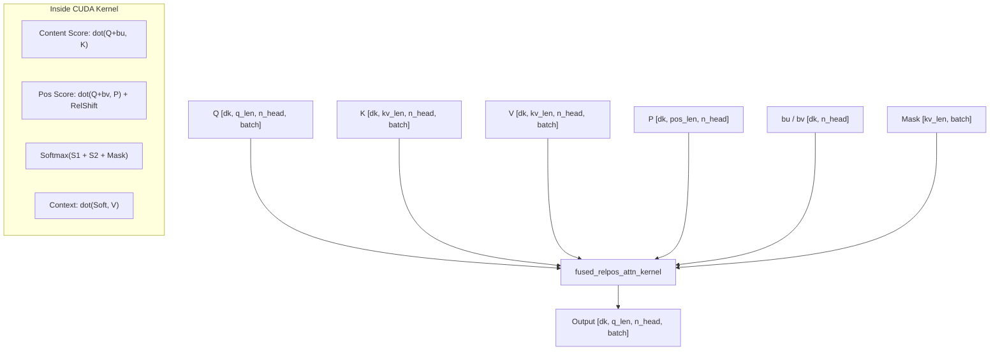
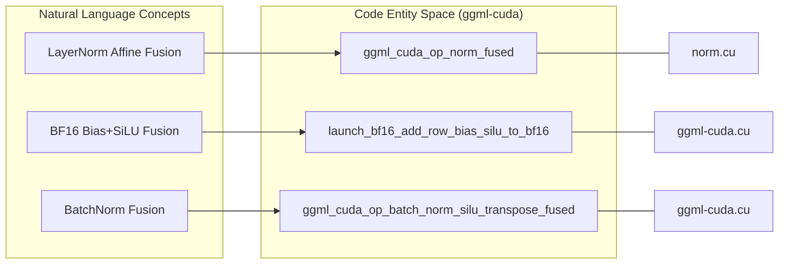

<!-- source: DeepWiki mcp.deepwiki.com · repo NVIDIA/NeMo-Speech.cpp · page 8.1 CUDA Kernel Patches · fetched 2026-10-26 -->

# CUDA Kernel Patches

Relevant source files

The following files were used as context for generating this wiki page:

- [ggml-patches/0001-fused-relpos-attn.patch](ggml-patches/0001-fused-relpos-attn.patch)
- [ggml-patches/0002-nvfp4-warp-quantizer.patch](ggml-patches/0002-nvfp4-warp-quantizer.patch)
- [ggml-patches/0003-norm-mul-add-fusion.patch](ggml-patches/0003-norm-mul-add-fusion.patch)
- [ggml-patches/0005-skinny-q8-gemm.patch](ggml-patches/0005-skinny-q8-gemm.patch)
- [ggml-patches/0006-cuda-dispatch-wiring.patch](ggml-patches/0006-cuda-dispatch-wiring.patch)
- [ggml-patches/0007-magpietts-nanocodec.patch](ggml-patches/0007-magpietts-nanocodec.patch)
- [ggml-patches/0008-cublas-bf16-projections.patch](ggml-patches/0008-cublas-bf16-projections.patch)
- [ggml-patches/0009-fastconformer-cuda-fusions.patch](ggml-patches/0009-fastconformer-cuda-fusions.patch)
- [ggml-patches/0011-cuda-graph-shape-key.patch](ggml-patches/0011-cuda-graph-shape-key.patch)
- [ggml-patches/0012-cuda-streaming-cache-copies.patch](ggml-patches/0012-cuda-streaming-cache-copies.patch)
- [ggml-patches/0014-cuda-relpos-extensions.patch](ggml-patches/0014-cuda-relpos-extensions.patch)
- [ggml-patches/0015-cuda-ctc-batch-fusions.patch](ggml-patches/0015-cuda-ctc-batch-fusions.patch)

NeMo-Speech.cpp utilizes a series of targeted patches to the underlying `ggml` runtime to enable high-performance speech processing. These patches implement fused operators, specialized quantization kernels, and optimized data movement strategies specifically tailored for FastConformer, MagpieTTS, and NanoCodec architectures.

## Overview of Patches

The patches are located in the `ggml-patches/` directory and are applied during the build process when `NEMO_SPEECH_GGML_PATCHED` is enabled. They primarily target the CUDA backend to maximize throughput for streaming ASR and TTS.

| Patch ID | Name | Primary Purpose |
| :--- | :--- | :--- |
| **0001/0014** | Fused RelPos Attention | Replaces multiple ops with a single kernel for FastConformer attention. |
| **0002** | NVFP4 Warp Quantizer | High-speed FP4 activation quantization for Blackwell (SM120) GPUs. |
| **0003/0009** | Norm-Mul-Add Fusion | Fuses LayerNorm with affine transformations (gamma/beta). |
| **0004** | F16 Depthwise Conv | Optimized kernel for FastConformer's depthwise convolution layers. |
| **0005** | Skinny-Q8 GEMM | Specialized int8 GEMM for narrow streaming ASR activations. |
| **0007** | MagpieTTS/NanoCodec Ops | Adds support for Jetson Thor (SM110) and CUDA graph eviction control. |
| **0008** | BF16 Projections | Fuses BF16 to F32 conversion with bias addition and SiLU. |
| **0015** | CTC Batch Fusions | Fuses BatchNorm, SiLU, and Transpose for ASR decoders. |

---

## Fused Relative-Position Attention (0001, 0014)

The FastConformer encoder relies on relative-position multi-head attention. In standard `ggml`, this requires a sequence of operations: content scores ($K \cdot Q_u$), position scores ($P \cdot Q_v$ with relative shift), softmax, and context accumulation ($Attn \cdot V$).

### Implementation
Patch `0001` introduces `GGML_OP_FUSED_RELPOS_ATTN`, which performs all these steps in a single CUDA kernel [ggml-patches/0001-fused-relpos-attn.patch:9-53](). This avoids materializing the large relative-shift matrix and score matrix in global memory.

Patch `0014` extends this for **streaming** by adding `ggml_fused_relpos_attn_cached` [ggml-patches/0014-cuda-relpos-extensions.patch:26-40](). This variant reads cached K/V pairs directly from a persistent circular buffer arena using slot IDs and ring heads [ggml-patches/0014-cuda-relpos-extensions.patch:128-135]().

### Data Flow: Fused Attention

**Sources:** [ggml-patches/0001-fused-relpos-attn.patch:18-53](), [ggml-patches/0014-cuda-relpos-extensions.patch:56-68]()

---

## Skinny-Q8 GEMM (0005, 0006)

Streaming ASR encoders often process very small chunks (e.g., 9 to 64 columns). Standard LLM-optimized GEMM kernels (like `mul_mat_q`) underperform at these "skinny" shapes due to tiling overhead.

### Skinny-Q8 Specialization
Patch `0005` implements a specialized `int8` tensor core GEMM for $9 \le N \le 64$ [ggml-patches/0005-skinny-q8-gemm.patch:9-12](). It uses a `cp.async` pipeline to stage weights and activations into shared memory, targeting `mma.sync.m16n8k32.s8` instructions [ggml-patches/0005-skinny-q8-gemm.patch:14-28]().

### Dispatch Logic
The dispatch wiring in `ggml-cuda.cu` ensures that if the input matrix is skinny and uses `Q8_0` weights, the specialized `ggml_cuda_mul_mat_skinny_q8` is preferred over standard cuBLAS or MMVQ paths [ggml-patches/0006-cuda-dispatch-wiring.patch:108-112]().

**Sources:** [ggml-patches/0005-skinny-q8-gemm.patch:6-34](), [ggml-patches/0006-cuda-dispatch-wiring.patch:59-81]()

---

## NVFP4 Warp Quantizer (0002)

For NVIDIA Blackwell GPUs, `ggml` supports `NVFP4` (4-bit floating point) activations. Patch `0002` introduces a warp-cooperative quantizer to accelerate this process.

### Implementation Details
*   **Warp-Cooperative:** A single warp processes 64 elements, performing `amax` reductions over 16-lane sub-blocks [ggml-patches/0002-nvfp4-warp-quantizer.patch:47-58]().
*   **Performance:** It is approximately 8x faster than the original scalar sub-block kernel by using `__shfl_xor_sync` for reductions [ggml-patches/0002-nvfp4-warp-quantizer.patch:78-85]().
*   **Search Width:** Adds a `search_width` parameter to `quantize_mmq_nvfp4` to allow trading off quantization error for speed [ggml-patches/0002-nvfp4-warp-quantizer.patch:29-32]().

**Sources:** [ggml-patches/0002-nvfp4-warp-quantizer.patch:15-108]()

---

## Norm-Mul-Add and BF16 Fusions (0003, 0008, 0009)

These patches reduce global memory round-trips by fusing activation normalization with subsequent operations.

### LayerNorm Fusions
Patch `0003` and `0009` implement `ggml_cuda_op_norm_fused`. This kernel combines `GGML_OP_NORM` (LayerNorm) with a row-vector scale ($\gamma$) and optional shift ($\beta$) [ggml-patches/0003-norm-mul-add-fusion.patch:9-17](). Patch `0009` further extends this to allow the result to be written directly in `BF16` precision if a cast follows the normalization [ggml-patches/0009-fastconformer-cuda-fusions.patch:75-102]().

### BF16 Projection Fusion
Patch `0008` optimizes the common pattern of a `BF16` projection followed by a bias and `SiLU` activation. It introduces `launch_bf16_add_row_bias_silu_to_bf16`, which performs the addition and activation during the F32-to-BF16 downcast [ggml-patches/0008-cublas-bf16-projections.patch:35-60]().

### System Entity Mapping
The following diagram maps high-level Fusion concepts to their implementation functions in the CUDA backend.

**Sources:** [ggml-patches/0003-norm-mul-add-fusion.patch:97-144](), [ggml-patches/0008-cublas-bf16-projections.patch:35-60](), [ggml-patches/0015-cuda-ctc-batch-fusions.patch:101-104]()

---

## MagpieTTS and Runtime Enhancements (0007, 0011, 0012)

### CUDA Graph Management
Patch `0007` adds environment variables to control CUDA graph lifecycle:
*   `GGML_CUDA_GRAPH_SWEEP_MS`: Interval for checking unused graphs (default 5s) [ggml-patches/0007-magpietts-nanocodec.patch:118-119]().
*   `GGML_CUDA_GRAPH_EVICT_AFTER_MS`: Idle time before a graph is evicted (default 10s) [ggml-patches/0007-magpietts-nanocodec.patch:120-121]().

Patch `0011` improves graph lookup safety by introducing a `ggml_cuda_graph_key` that includes a structural signature of the graph (nodes, types, shapes) rather than just the first node pointer [ggml-patches/0011-cuda-graph-shape-key.patch:9-38]().

### Streaming Cache Copies
Patch `0012` optimizes K/V cache updates for ASR. It uses `cudaMemcpy2DAsync` for pitched copies when moving time-rows in a `[C, T, B]` tensor [ggml-patches/0012-cuda-streaming-cache-copies.patch:15-26](). It also adds a `k_get_rows_contiguous_f32x4` kernel that uses `float4` vector loads to move large cache rows more efficiently than the standard scalar `get_rows` kernel [ggml-patches/0012-cuda-streaming-cache-copies.patch:43-59]().

**Sources:** [ggml-patches/0007-magpietts-nanocodec.patch:99-131](), [ggml-patches/0011-cuda-graph-shape-key.patch:114-132](), [ggml-patches/0012-cuda-streaming-cache-copies.patch:68-84]()

---

