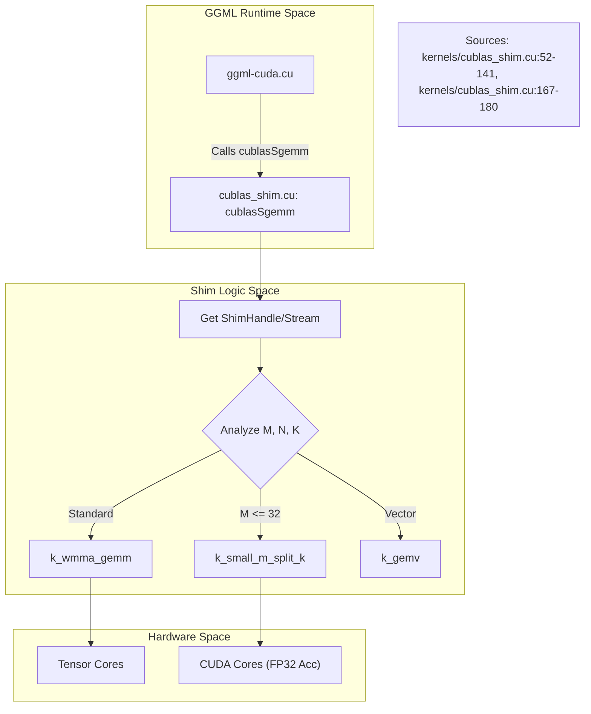
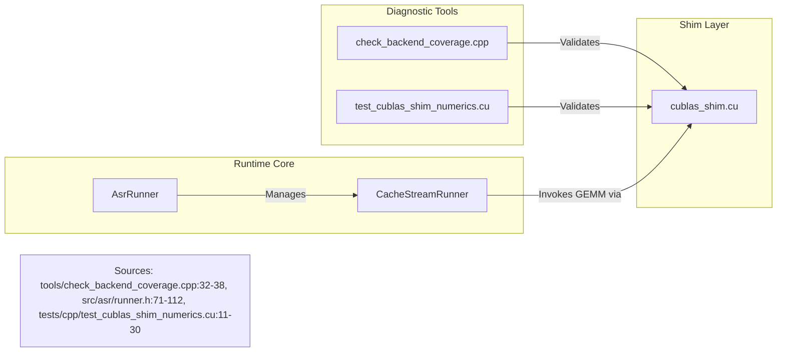

<!-- source: DeepWiki mcp.deepwiki.com · repo NVIDIA/NeMo-Speech.cpp · page 8.2 cuBLAS Shim and Custom Kernels · fetched 2026-10-26 -->

# cuBLAS Shim and Custom Kernels

<details>
<summary>Relevant source files</summary>

The following files were used as context for generating this wiki page:

- [docs/development/diagnostics.md](docs/development/diagnostics.md)
- [kernels/cublas_shim.cu](kernels/cublas_shim.cu)
- [src/asr/runner.h](src/asr/runner.h)
- [tests/cpp/asr/test_rnnt_concurrency.cpp](tests/cpp/asr/test_rnnt_concurrency.cpp)
- [tests/cpp/asr/test_rnnt_streaming.cpp](tests/cpp/asr/test_rnnt_streaming.cpp)
- [tests/cpp/asr/test_transducer_offline.cpp](tests/cpp/asr/test_transducer_offline.cpp)
- [tests/cpp/test_cublas_shim_numerics.cu](tests/cpp/test_cublas_shim_numerics.cu)
- [tools/check_backend_coverage.cpp](tools/check_backend_coverage.cpp)

</details>


The cuBLAS shim is an in-tree, drop-in replacement for the standard NVIDIA cuBLAS library (`libcublas.so.13`). It is designed to provide the minimal set of GEMM (General Matrix Multiplication) and GEMV (General Matrix-Vector Multiplication) entry points required by the `ggml-cuda` backend for unquantized operations in NeMo-Speech.cpp models.

## Purpose and Scope

In a standard CUDA environment, `ggml-cuda` utilizes cuBLAS for operations that are not quantized, such as FastConformer attention scores, context projections, subsampling convolutions, and the CTC head [kernels/cublas_shim.cu:5-7](). However, the full cuBLAS library typically requires `libcublasLt`, which exceeds 500 MB in size [kernels/cublas_shim.cu:7-10]().

The shim enables:
*   **Minimal Docker Images:** By replacing the full cuBLAS toolkit with a specialized ~1MB shim, deployment images can be significantly reduced in size.
*   **Zero-Dependency Runtime:** The shim implements exactly the symbols `ggml` imports, specialized for the specific tensor shapes used in speech models [kernels/cublas_shim.cu:8-10]().
*   **Tensor Core Optimization:** It includes custom WMMA (Warp Matrix Multiply-Accumulate) kernels to maintain high performance on modern NVIDIA GPUs without requiring the full cuBLASLt heuristic engine [kernels/cublas_shim.cu:9-10]().

### Build Configuration
The shim is enabled via the `NEMO_SPEECH_CUBLAS_SHIM` CMake option. When built, it produces a library named `libcublas.so.13` with versioned symbols, allowing the dynamic linker to load it instead of the system cuBLAS without modifying the `ggml` source code [kernels/cublas_shim.cu:12-13]().

**Sources:** [kernels/cublas_shim.cu:1-20]()

---

## Implementation Details

The shim provides a C-compatible ABI that matches `cublas_v2.h` semantics, specifically supporting Column-Major layout and standard `op(A)*op(B)` operations [kernels/cublas_shim.cu:15-20]().

### Memory Management and Workspaces
Certain high-performance kernels (like Split-K) require temporary workspace memory. The shim manages this via a `ShimHandle` that tracks per-stream workspaces [kernels/cublas_shim.cu:52-64]().

| Constant | Value | Description |
| :--- | :--- | :--- |
| `kMaxSplitKWorkspaces` | 8 | Maximum cached workspaces per handle [kernels/cublas_shim.cu:82]() |
| `kShimWorkspaceBytes` | ~12 MiB | Size of the per-stream FP32 workspace [kernels/cublas_shim.cu:83-91]() |

The shim uses `cudaMallocAsync` where available to minimize synchronization overhead when allocating these workspaces [kernels/cublas_shim.cu:125-135]().

### Kernel Architectures
The shim implements several specialized kernel paths based on the problem size:

1.  **WMMA Tensor Core Path:** Used for standard matrix sizes, utilizing 16x16x16 tiles [kernels/cublas_shim.cu:66-68]().
2.  **Small-M Split-K Path:** Specialized for cases where $M$ is very small (e.g., $M \le 32$), typical in streaming inference where batch sizes or sequence lengths are minimal [kernels/cublas_shim.cu:75-80]().
3.  **GEMV Warps:** Optimized vector-matrix paths for single-row operations [kernels/cublas_shim.cu:69]().

### Data Flow: Shim Dispatch
The following diagram illustrates how a call from the GGML runtime is dispatched through the shim to a custom CUDA kernel.

**cuBLAS Shim Dispatch Flow**


**Sources:** [kernels/cublas_shim.cu:51-141](), [kernels/cublas_shim.cu:149-180]()

---

## Backend Coverage Diagnostic

The `check_backend_coverage` tool is a critical diagnostic utility used to ensure that the custom kernels and shim are correctly utilized by the runtime [tools/check_backend_coverage.cpp:3-7]().

### Silent CPU Fallback Detection
In `ggml`, if a backend (like CUDA) cannot support a specific operation, the scheduler may silently fall back to the CPU. This is catastrophic for speech streaming latency because it introduces a GPU-CPU roundtrip for every audio chunk [tools/check_backend_coverage.cpp:5-7]().

The tool performs the following steps:
1.  Loads a GGUF model and initializes the `BackendManager` [tools/check_backend_coverage.cpp:95-100]().
2.  Forces a "warm-up" inference step for every `Session` in the pipeline (Encoder, RNNT Predictor, Joint) [tools/check_backend_coverage.cpp:116-166]().
3.  Captures the `ggml_backend_sched` assignment for every node [tools/check_backend_coverage.cpp:66-69]().
4.  Dumps the schedule and flags any node assigned to the CPU backend when a GPU was requested [tools/check_backend_coverage.cpp:42-49]().

### Usage and Exit Codes
```bash
# Example usage
check_backend_coverage model.gguf --gpu 0
```

| Exit Code | Meaning |
| :--- | :--- |
| 0 | Success: No CPU-fallback detected [tools/check_backend_coverage.cpp:15]() |
| 2 | Failure: At least one op was scheduled on CPU instead of GPU [tools/check_backend_coverage.cpp:17-18]() |

**Sources:** [tools/check_backend_coverage.cpp:1-30](), [tools/check_backend_coverage.cpp:63-113](), [docs/development/diagnostics.md:1-15]()

---

## Testing and Verification

The shim is verified through specialized numerical tests to ensure parity with the official cuBLAS library.

### Numeric Parity Testing
The test suite `test_cublas_shim_numerics.cu` validates:
*   **Cancellation Cases:** Ensures FP16/BF16 accumulation handles positive/negative cancellation correctly [tests/cpp/test_cublas_shim_numerics.cu:32-41]().
*   **Batched GEMM:** Validates `cublasGemmStridedBatchedEx` logic for multi-sequence processing [tests/cpp/test_cublas_shim_numerics.cu:98-105]().
*   **Stream Churn:** Stress tests the creation and destruction of CUDA streams to ensure the `ShimHandle` workspace cache does not leak memory [tests/cpp/test_cublas_shim_numerics.cu:171-185]().

### Integration in ASR Pipeline
The shim is implicitly tested during ASR concurrency and streaming tests. For example, `test_rnnt_concurrency.cpp` ensures that the custom encoder kernels do not cause crosstalk between parallel inference streams [tests/cpp/asr/test_rnnt_concurrency.cpp:3-9]().

**System Entity Mapping**


**Sources:** [tests/cpp/test_cublas_shim_numerics.cu:31-95](), [tests/cpp/asr/test_rnnt_concurrency.cpp:1-14](), [src/asr/runner.h:71-112]()

---

