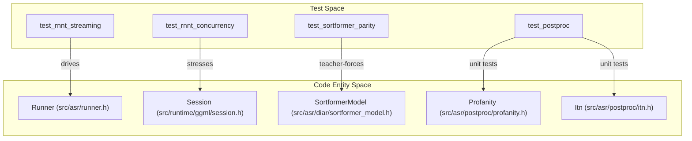
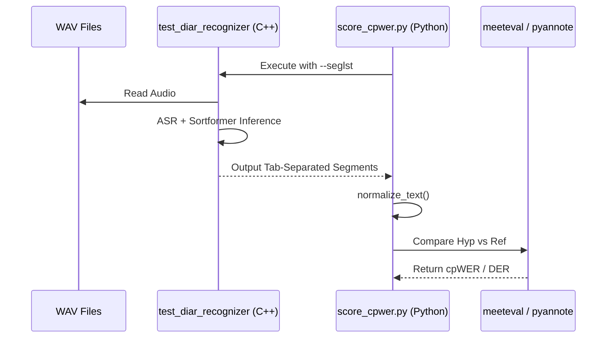

<!-- source: DeepWiki mcp.deepwiki.com · repo NVIDIA/NeMo-Speech.cpp · page 9.1 ASR Testing and Benchmarking · fetched 2026-10-26 -->

# ASR Testing and Benchmarking

Relevant source files

The following files were used as context for generating this wiki page:

- [docs/development/diagnostics.md](docs/development/diagnostics.md)
- [scripts/asr/score_cpwer.py](scripts/asr/score_cpwer.py)
- [scripts/asr/score_diar_der.py](scripts/asr/score_diar_der.py)
- [scripts/tts/generate_mandarin_tokenizer_data.py](scripts/tts/generate_mandarin_tokenizer_data.py)
- [scripts/tts/tokenize-magpietts.py](scripts/tts/tokenize-magpietts.py)
- [src/asr/diar/aosc_state.cpp](src/asr/diar/aosc_state.cpp)
- [src/asr/diar/aosc_state.h](src/asr/diar/aosc_state.h)
- [src/asr/features/fe.cpp](src/asr/features/fe.cpp)
- [src/asr/features/fe.h](src/asr/features/fe.h)
- [src/asr/postproc/itn_align.h](src/asr/postproc/itn_align.h)
- [src/asr/postproc/profanity.cpp](src/asr/postproc/profanity.cpp)
- [src/asr/postproc/profanity.h](src/asr/postproc/profanity.h)
- [src/asr/runner.h](src/asr/runner.h)
- [tests/c/asr_c_smoke.c](tests/c/asr_c_smoke.c)
- [tests/cpp/asr/CMakeLists.txt](tests/cpp/asr/CMakeLists.txt)
- [tests/cpp/asr/test_ctc_streaming.cpp](tests/cpp/asr/test_ctc_streaming.cpp)
- [tests/cpp/asr/test_endpointer.cpp](tests/cpp/asr/test_endpointer.cpp)
- [tests/cpp/asr/test_postproc.cpp](tests/cpp/asr/test_postproc.cpp)
- [tests/cpp/asr/test_rnnt_concurrency.cpp](tests/cpp/asr/test_rnnt_concurrency.cpp)
- [tests/cpp/asr/test_rnnt_streaming.cpp](tests/cpp/asr/test_rnnt_streaming.cpp)
- [tests/cpp/asr/test_sortformer_parity.cpp](tests/cpp/asr/test_sortformer_parity.cpp)
- [tests/cpp/asr/test_transducer_offline.cpp](tests/cpp/asr/test_transducer_offline.cpp)
- [tests/cpp/tts/CMakeLists.txt](tests/cpp/tts/CMakeLists.txt)
- [tests/integration/http_conformance_test.py](tests/integration/http_conformance_test.py)
- [tools/bench_asr_batching.cpp](tools/bench_asr_batching.cpp)
- [tools/check_backend_coverage.cpp](tools/check_backend_coverage.cpp)

NeMo-Speech.cpp includes a comprehensive test suite for Automatic Speech Recognition (ASR), ranging from low-level feature extraction unit tests to high-level diarization parity and accuracy evaluation scripts. The infrastructure supports both functional correctness (unit/integration tests) and performance characterization (benchmarking).

## Test Suite Architecture

The ASR test suite is primarily located in `tests/cpp/asr/` and is integrated into the CMake build system.

### ASR Component Testing
| Test Target | File | Description |
| :--- | :--- | :--- |
| `test_ctc_streaming` | [tests/cpp/asr/test_ctc_streaming.cpp:6-7]() | Validates streaming CTC models (e.g., Parakeet) with paced audio input. |
| `test_rnnt_streaming` | [tests/cpp/asr/test_rnnt_streaming.cpp:9-10]() | Validates streaming RNNT/TDT models using the cache-aware encoder. |
| `test_rnnt_concurrency` | [tests/cpp/asr/test_rnnt_concurrency.cpp:17-18]() | Stress tests the shared encoder `Session` with multiple `SessionState` instances to detect crosstalk. |
| `test_vad` | [tests/cpp/asr/test_vad.cpp:20-21]() | Unit tests for the Silero VAD implementation and frame-level masking. |
| `test_decoders` | [tests/cpp/asr/test_decoders.cpp:35-36]() | Tests Greedy CTC, RNNT, and TDT decoder implementations. |
| `test_postproc` | [tests/cpp/asr/test_postproc.cpp:3-5]() | Tests profanity filtering, punctuation spacing, and ITN alignment remapping. |

### Audio and Feature Extraction
The feature extraction (FE) pipeline is validated for parity against NeMo's Python implementation. The `FeModule` [src/asr/features/fe.cpp:79-109]() uses a GPU-accelerated DFT matrix approach to match `torch.stft` behavior.

| Test Target | File | Description |
| :--- | :--- | :--- |
| `test_audio_resampler` | [tests/cpp/asr/test_audio_resampler.cpp:29-30]() | Validates the polyphase sinc filter for 16kHz conversion. |
| `test_audio_decoder` | [tests/cpp/asr/test_audio_decoder.cpp:32-33]() | Tests WAV/FLAC/MP3 decoding via `dr_wav` and `minimp3`. |

### Code Mapping: Test Infrastructure
This diagram maps the testing entities to the core ASR classes they exercise.

**Sources:** [tests/cpp/asr/CMakeLists.txt:1-71](), [tests/cpp/asr/test_postproc.cpp:1-160]()

## Endpointer and VAD Testing

The `test_endpointer` executable validates the `VadEndpointer` logic, which manages End-of-Utterance (EOU) detection based on either token-level silence or VAD model output.

*   **Policy Unit Test**: Exercises `VadEndpointer::poll` [tests/cpp/asr/test_endpointer.cpp:57-108]() with synthetic timelines to ensure EOU fires exactly at the `stop_history_eou_ms` threshold and re-arms correctly.
*   **Integration Test**: Streams a multi-utterance clip through the `Runner` [tests/cpp/asr/test_endpointer.cpp:114-161]() to verify that the pipeline correctly splits results into multiple final transcripts.

**Sources:** [tests/cpp/asr/test_endpointer.cpp:1-161](), [src/asr/diar/aosc_state.h:1-50]()

## Diarization Parity Testing

Diarization is tested using `test_sortformer_parity`, which performs a "teacher-forced" comparison against NeMo reference dumps.

1.  **Reference Generation**: NeMo states are exported using `scripts/asr/dump_sortformer_reference.py` [tests/cpp/asr/test_sortformer_parity.cpp:10-12]().
2.  **Teacher Forcing**: The C++ test loads reference `spkcache` and `fifo` buffers for every chunk [tests/cpp/asr/test_sortformer_parity.cpp:143-154](), ensuring that divergence is limited to the GGML graph implementation rather than accumulated state drift.
3.  **Validation**: It compares `pre_encode` embeddings and final speaker `preds` [tests/cpp/asr/test_sortformer_parity.cpp:163-178](), typically requiring a maximum absolute difference $< 1e-2$.

**Sources:** [tests/cpp/asr/test_sortformer_parity.cpp:1-187]()

## Benchmarking with `bench_asr_batching`

The `bench_asr_batching` tool is a diagnostic utility for measuring throughput and latency across various ASR workloads.

### Execution Modes
*   **Stream**: Simulates real-time PCM arrivals. Latency is calculated as `completion_time - scheduled_arrival_time`, making processing backlogs visible [tools/bench_asr_batching.cpp:5-9]().
*   **Offline**: Processes in-memory utterances as fast as possible to measure maximum RTFX (Real-Time Factor) [tools/bench_asr_batching.cpp:10]().

### Key Metrics
The tool reports metrics per concurrency level:
*   **RTFX**: Throughput relative to real-time.
*   **P50/P95 Latency**: Milliseconds from chunk arrival to result.
*   **Batch Statistics**: Mean batch size and singleton percentage to evaluate the efficiency of the dynamic batcher [tools/bench_asr_batching.cpp:84-109]().

**Sources:** [tools/bench_asr_batching.cpp:1-220]()

## Evaluation Scripts

Accuracy evaluation is performed using Python scripts that wrap the C++ CLI binaries.

### cpWER (Concatenated minimum-Permutation Word Error Rate)
`scripts/asr/score_cpwer.py` evaluates the joint ASR+Diarization pipeline:
1.  Runs `test_diar_recognizer --seglst` [scripts/asr/score_cpwer.py:66-69]().
2.  Normalizes text (lowercase, strip punctuation) [scripts/asr/score_cpwer.py:32-38]().
3.  Uses the `meeteval` library to calculate cpWER against a reference `seglst.json` [scripts/asr/score_cpwer.py:95-106]().

### DER (Diarization Error Rate)
`scripts/asr/score_diar_der.py` evaluates diarization accuracy:
1.  Drives `test_diar_streaming --rttm` [scripts/asr/score_diar_der.py:177-182]().
2.  Applies onset/offset hysteresis and padding logic mirroring `DiarStream::segments()` [scripts/asr/score_diar_der.py:93-125]().
3.  Calculates DER using `pyannote.metrics`, optionally comparing against a NeMo baseline [scripts/asr/score_diar_der.py:128-186]().

### ASR/Diarization Evaluation Data Flow

**Sources:** [scripts/asr/score_cpwer.py:1-112](), [scripts/asr/score_diar_der.py:1-186]()

---

