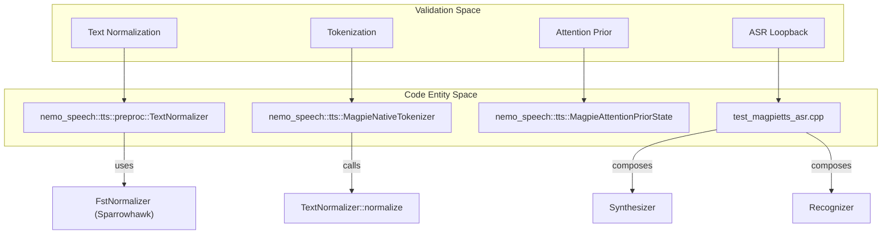
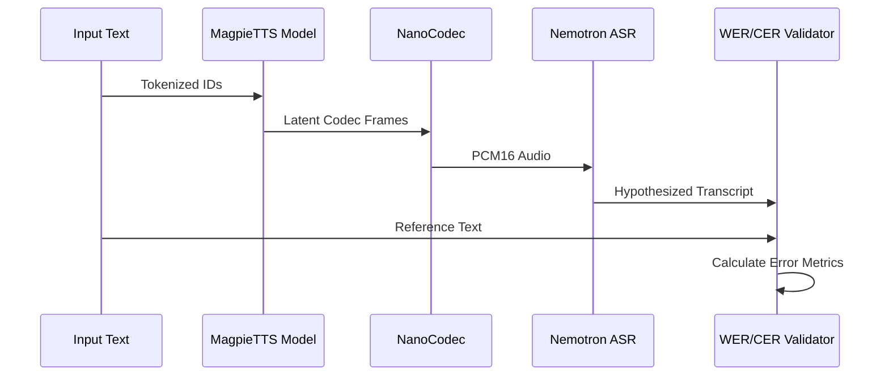

<!-- source: DeepWiki mcp.deepwiki.com · repo NVIDIA/NeMo-Speech.cpp · page 9.2 TTS Testing and Validation · fetched 2026-10-26 -->

# TTS Testing and Validation

Relevant source files

The following files were used as context for generating this wiki page:

- [app/synthesize.cpp](app/synthesize.cpp)
- [src/server/riva_server.cc](src/server/riva_server.cc)
- [src/tts/preproc/text_normalizer.cpp](src/tts/preproc/text_normalizer.cpp)
- [tests/cpp/tts/test_magpietts_asr.cpp](tests/cpp/tts/test_magpietts_asr.cpp)
- [tests/cpp/tts/test_magpietts_attention_prior.cpp](tests/cpp/tts/test_magpietts_attention_prior.cpp)
- [tests/cpp/tts/test_magpietts_file.cpp](tests/cpp/tts/test_magpietts_file.cpp)
- [tests/cpp/tts/test_text_normalizer.cpp](tests/cpp/tts/test_text_normalizer.cpp)
- [tests/cpp/tts/test_tokenizer_single_chars.cpp](tests/cpp/tts/test_tokenizer_single_chars.cpp)
- [tools/nanocodec.cpp](tools/nanocodec.cpp)

NeMo-Speech.cpp includes a comprehensive test suite for Text-to-Speech (TTS) components, ranging from low-level tokenizer unit tests to end-to-end ASR loopback validation. The suite ensures the stability of the MagpieTTS architecture, NanoCodec neural vocoder, and the text normalization pipeline.

## TTS Testing Architecture

The TTS validation infrastructure is divided into three primary layers:
1.  **Unit Tests**: Focused on `MagpieNativeTokenizer`, `TextNormalizer`, and `MagpieAttentionPriorState`.
2.  **Synthesis Tests**: Validating audio generation from token IDs or text strings into WAV files.
3.  **Loopback Validation**: Using an ASR model to transcribe synthesized audio and calculating Word Error Rate (WER) to verify intelligibility.

### Entity Relationship Diagram

This diagram bridges the natural language testing concepts to the specific C++ classes and files used in the validation suite.

**Sources:** [src/tts/preproc/text_normalizer.cpp:25-26](), [tests/cpp/tts/test_magpietts_asr.cpp:21-27](), [tests/cpp/tts/test_magpietts_attention_prior.cpp:7-9](), [tests/cpp/tts/test_tokenizer_single_chars.cpp:9-11]()

---

## ASR Loopback Validation

The most rigorous test for TTS quality is the ASR loopback test implemented in `test_magpietts_asr.cpp`. It verifies the entire pipeline by synthesizing audio from text and immediately transcribing it back to text using a Nemotron RNNT ASR model.

### Implementation Details
- **Data Flow**: Text → Tokenizer → MagpieTTS → NanoCodec → Nemotron ASR → WER/CER calculation.
- **Configurability**: Supports overriding sampling parameters like `temperature`, `top-k`, and `cfg-scale` [tests/cpp/tts/test_magpietts_asr.cpp:35-69]().
- **Validation**: Reports lowercase Word Error Rate (WER) and Character Error Rate (CER) [tests/cpp/tts/test_magpietts_asr.cpp:6-7]().

### Loopback Data Flow

**Sources:** [tests/cpp/tts/test_magpietts_asr.cpp:5-7](), [tests/cpp/tts/test_magpietts_asr.cpp:71-115]()

---

## Attention Prior Tests

Longform synthesis in MagpieTTS relies on an "attention prior" to maintain stability across many frames. The `test_magpietts_attention_prior.cpp` suite validates the `MagpieAttentionPriorState` and `MagpieLongformAttentionPriorState` classes.

### Key Test Cases
- **Clamping**: Ensures the lookahead argmax is clamped correctly to prevent skipping text [tests/cpp/tts/test_magpietts_attention_prior.cpp:63-70]().
- **Thresholds**: Validates that attention advances only after the `attention_prior_advance_threshold` (measured in audio frames) is met [tests/cpp/tts/test_magpietts_attention_prior.cpp:82-91]().
- **Decay**: Tests that focus on the final token remains active for a set period before decaying [tests/cpp/tts/test_magpietts_attention_prior.cpp:112-123]().
- **Longform Chunks**: Validates `MagpieLongformAttentionPriorState::beginChunk`, ensuring the absolute attended position is tracked across chunk boundaries [tests/cpp/tts/test_magpietts_attention_prior.cpp:145-163]().

**Sources:** [tests/cpp/tts/test_magpietts_attention_prior.cpp:55-77](), [tests/cpp/tts/test_magpietts_attention_prior.cpp:145-182]()

---

## Tokenizer and Text Normalizer Validation

### Tokenizer Testing
`test_tokenizer_single_chars.cpp` verifies the `MagpieNativeTokenizer` across multiple languages and chunking configurations.
- **Single Character Mapping**: Validates that specific characters (e.g., 'A', 'T', 'S') map to the correct IPA/phoneme token IDs [tests/cpp/tts/test_tokenizer_single_chars.cpp:135-139]().
- **Sentence Chunking**: Verifies the `sentence_limit` logic, ensuring long text is split into manageable chunks for the model [tests/cpp/tts/test_tokenizer_single_chars.cpp:150-160]().
- **Transformation Callbacks**: Tests the ability to modify text chunks via lambda functions during tokenization [tests/cpp/tts/test_tokenizer_single_chars.cpp:175-185]().

### Text Normalizer Testing
The `TextNormalizer` validation (`test_text_normalizer.cpp`) ensures written-form text (e.g., "$10") is correctly verbalized (e.g., "ten dollars") before reaching the tokenizer.
- **Numeral Detection**: Detects native numerals in Hindi (Devanagari), Mandarin, and Japanese [src/tts/preproc/text_normalizer.cpp:75-127]().
- **Language Routing**: Ensures that a request for French (`fr-FR`) uses the French TN grammar rather than defaulting to English [tests/cpp/tts/test_text_normalizer.cpp:100-110]().
- **Currency and Punctuation**: Specifically tests German TN verbalization of sentence-final currency symbols [tests/cpp/tts/test_text_normalizer.cpp:112-126]().

**Sources:** [tests/cpp/tts/test_tokenizer_single_chars.cpp:132-160](), [src/tts/preproc/text_normalizer.cpp:180-215](), [tests/cpp/tts/test_text_normalizer.cpp:78-95]()

---

## NanoCodec Standalone Tool

The `nanocodec` tool (`tools/nanocodec.cpp`) serves as a standalone utility for testing the neural vocoder in isolation. It takes a file containing MagpieTTS codec tokens (8 integers per frame) and generates a WAV file.

### Key Features
- **Codebook Validation**: Currently expects 8 codebooks per frame [tools/nanocodec.cpp:76-79]().
- **Execution Modes**: Supports both standard offline decoding and stateful streaming decoding via the `--stream` flag [tools/nanocodec.cpp:159-160]().
- **WAV Generation**: Implements a manual RIFF WAV header writer to ensure the output is standard PCM16 [tools/nanocodec.cpp:110-146]().

### Parameters
| Flag | Description | Code Reference |
| :--- | :--- | :--- |
| `--codes` | Path to text file with 8 integers per frame | [tools/nanocodec.cpp:179]() |
| `--chunk-frames` | Size of internal streaming chunks | [tools/nanocodec.cpp:187]() |
| `--cpu` | Force NanoCodec onto CPU backend | [tools/nanocodec.cpp:189]() |

**Sources:** [tools/nanocodec.cpp:19-30](), [tools/nanocodec.cpp:75-94](), [tools/nanocodec.cpp:149-163]()

---

## gRPC TTS Configuration Testing

The `riva_server` includes logic to validate TTS service readiness. The `tts_configured` function in `src/server/riva_server.cc` checks for the presence of three critical paths:
1.  MagpieTTS GGUF model path.
2.  NanoCodec GGUF model path.
3.  Tokenizer model directory.

If any are missing, the TTS service is automatically disabled unless explicitly forced on via `--tts.enabled true`.

**Sources:** [src/server/riva_server.cc:131-135](), [src/server/riva_server.cc:144-155]()

---

