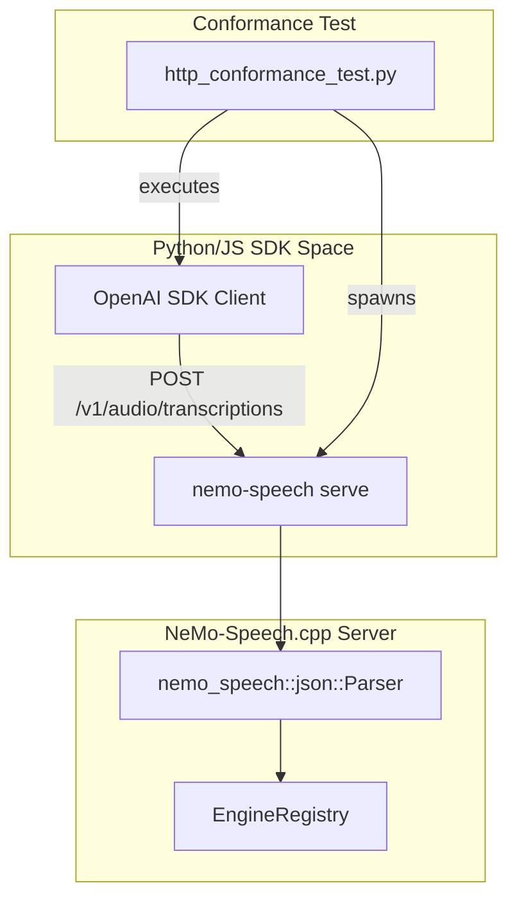
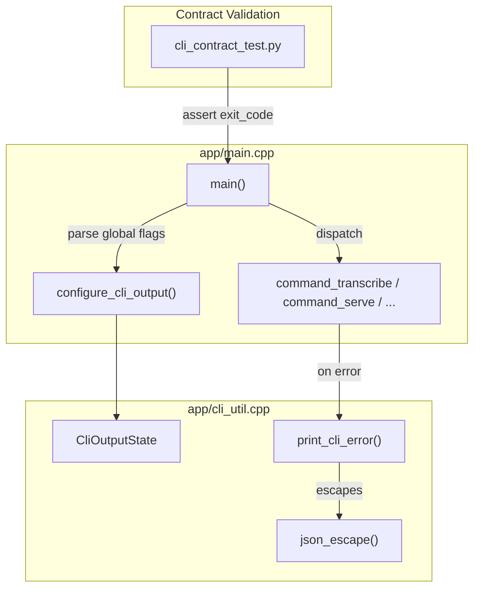

<!-- source: DeepWiki mcp.deepwiki.com · repo NVIDIA/NeMo-Speech.cpp · page 9.3 Integration and Conformance Testing · fetched 2026-10-26 -->

# Integration and Conformance Testing

Relevant source files

The following files were used as context for generating this wiki page:

- [app/cli_util.cpp](app/cli_util.cpp)
- [app/cli_util.h](app/cli_util.h)
- [app/main.cpp](app/main.cpp)
- [docs/clients.md](docs/clients.md)
- [scripts/asr/score_cpwer.py](scripts/asr/score_cpwer.py)
- [scripts/asr/score_diar_der.py](scripts/asr/score_diar_der.py)
- [scripts/tts/generate_mandarin_tokenizer_data.py](scripts/tts/generate_mandarin_tokenizer_data.py)
- [scripts/tts/tokenize-magpietts.py](scripts/tts/tokenize-magpietts.py)
- [src/common/json.cpp](src/common/json.cpp)
- [src/common/json.h](src/common/json.h)
- [tests/cli/cli_contract_test.py](tests/cli/cli_contract_test.py)
- [tests/integration/clients/openai_client.mjs](tests/integration/clients/openai_client.mjs)
- [tests/integration/http_conformance_test.py](tests/integration/http_conformance_test.py)

NeMo-Speech.cpp utilizes a comprehensive integration testing strategy to ensure the stability of its unified CLI, HTTP/WebSocket server, and compatibility with third-party SDKs. This layer of testing sits above unit tests to validate end-to-end data flow, network protocol adherence, and CLI contract stability.

## HTTP Conformance Test Suite

The primary tool for validating the serving layer is the HTTP conformance test suite located at `tests/integration/http_conformance_test.py` [tests/integration/http_conformance_test.py:1-4](). This suite automates the lifecycle of the `nemo-speech serve` command and executes a battery of tests against its REST and WebSocket endpoints.

### Server Lifecycle and Endpoint Validation
The test suite dynamically allocates a free port [tests/integration/http_conformance_test.py:21-25]() and spawns the `nemo-speech serve` process with a temporary API key [tests/integration/http_conformance_test.py:98-139](). It polls the `/ready` endpoint until the server reports successful model loading and backend initialization [tests/integration/http_conformance_test.py:142-158]().

Key validation areas include:
*   **Security Headers**: Ensures the browser playground and API responses include mandatory security headers such as `Content-Security-Policy` (CSP) and `X-Content-Type-Options: nosniff` [tests/integration/http_conformance_test.py:166-173]().
*   **Playground Integrity**: Validates that the built-in playground does not load remote assets (preventing data leakage) and contains necessary UI elements like speaker-tagged ASR controls and voice selectors [tests/integration/http_conformance_test.py:175-194]().
*   **Request Tracing**: Verifies that every response includes a unique `X-Request-Id` for observability [tests/integration/http_conformance_test.py:174]().

### OpenAI SDK Compatibility
NeMo-Speech.cpp implements a subset of the OpenAI Audio API [docs/clients.md:9-10](). The conformance suite validates this by driving the official `openai` Python and JavaScript SDKs against the local server [tests/integration/http_conformance_test.py:52-84]().

**Data Flow: OpenAI SDK Integration**

The following diagram illustrates how the conformance test bridges the Python/JS SDK space to the internal C++ server entities.

| Natural Language Concept | Code Entity / Symbol |
| :--- | :--- |
| **Transcription Request** | `client.audio.transcriptions.create` [docs/clients.md:21]() |
| **API Base URL** | `OPENAI_BASE_URL` [tests/integration/http_conformance_test.py:72]() |
| **Internal JSON Parser** | `nemo_speech::json::Parser` [src/common/json.cpp:41]() |
| **Serving Command** | `command_serve` [app/main.cpp:211]() |

Sources: [tests/integration/http_conformance_test.py:52-84](), [docs/clients.md:14-40](), [src/common/json.cpp:41](), [app/main.cpp:211]()

## CLI Contract Testing

The CLI contract test suite (`tests/cli/cli_contract_test.py`) ensures that the `nemo-speech` binary adheres to its interface definitions, exit code standards, and JSON output schema [tests/cli/cli_contract_test.py:1-13]().

### Error Handling and Exit Codes
The suite validates that the CLI emits structured JSON errors to `stderr` when the `--json` flag is provided, and that these errors contain the correct `exit_code` and `type` [tests/cli/cli_contract_test.py:25-32]().

| Exit Code | Constant | Meaning |
| :--- | :--- | :--- |
| 0 | `kCliExitSuccess` | Successful execution [app/cli_util.h:9]() |
| 1 | `kCliExitRuntime` | General runtime failure [app/cli_util.h:10]() |
| 2 | `kCliExitInvalidArgument` | Parameter validation failure [app/cli_util.h:11]() |
| 3 | `kCliExitMissingModel` | GGUF file not found or inaccessible [app/cli_util.h:12]() |
| 4 | `kCliExitUnsupportedFeature` | Command requires a feature not compiled in [app/cli_util.h:13]() |

### Command Availability
The `main.cpp` entry point uses preprocessor definitions (e.g., `NEMO_SPEECH_CLI_ASR`) to conditionally enable subcommands [app/main.cpp:29-52](). The contract test verifies that attempting to use a disabled feature returns a `kCliExitUnsupportedFeature` error with a helpful rebuild message [app/main.cpp:178-181](), [tests/cli/cli_contract_test.py:72]().

**CLI Entity Relationship Diagram**

Sources: [app/main.cpp:94-215](), [app/cli_util.cpp:20-26](), [app/cli_util.cpp:113-148](), [app/cli_util.h:9-13](), [tests/cli/cli_contract_test.py:25-32]()

## Evaluation and Scoring Scripts

Beyond protocol conformance, the repository includes scripts for scoring model accuracy and performance against reference datasets.

### ASR and Diarization Scoring
*   **DER (Diarization Error Rate)**: `scripts/asr/score_diar_der.py` calculates DER by comparing the RTTM output of `test_diar_streaming` against reference RTTMs using `pyannote.metrics` [scripts/asr/score_diar_der.py:22-28](). It supports different geometry presets (e.g., "streaming" vs "offline") to match the C++ engine's internal `DiarGeometry` [scripts/asr/score_diar_der.py:32-40]().
*   **cpWER (Concatenated minimum-Permutation WER)**: `scripts/asr/score_cpwer.py` evaluates multi-speaker ASR sessions. It drives `test_diar_recognizer` to produce SegLST (Segment List) files and scores them using the `meeteval` library [scripts/asr/score_cpwer.py:28-30](), [scripts/asr/score_cpwer.py:95-106]().

### TTS Tokenizer Validation
`scripts/tts/generate_mandarin_tokenizer_data.py` generates the HMM and Pinyin tables required for the native Mandarin tokenizer [scripts/tts/generate_mandarin_tokenizer_data.py:61-91](). It includes a "golden" output generator that uses `jieba` and `pypinyin` to create reference token sequences used to verify the C++ tokenizer's parity with the original Python implementation [scripts/tts/generate_mandarin_tokenizer_data.py:151-165]().

Sources: [scripts/asr/score_diar_der.py:4-18](), [scripts/asr/score_cpwer.py:4-17](), [scripts/tts/generate_mandarin_tokenizer_data.py:1-41]()

---

