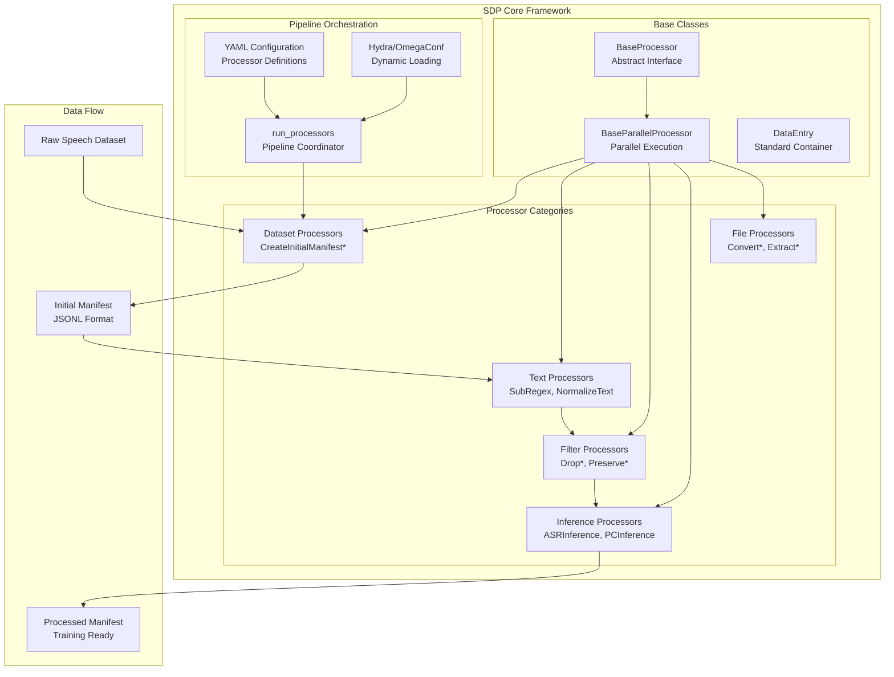
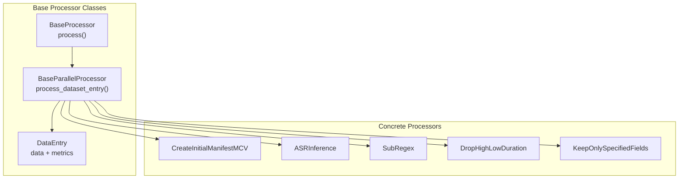
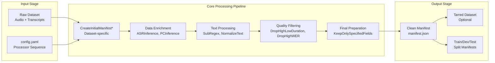

<!-- source: DeepWiki mcp.deepwiki.com · repo NVIDIA/NeMo-speech-data-processor · page 1 Overview · fetched 2026-10-26 -->

# Overview

<details>
<summary>Relevant source files</summary>

The following files were used as context for generating this wiki page:

- [README.md](README.md)
- [docs/src/sdp/api.rst](docs/src/sdp/api.rst)
- [sdp/processors/__init__.py](sdp/processors/__init__.py)
- [sdp/processors/modify_manifest/data_to_data.py](sdp/processors/modify_manifest/data_to_data.py)

</details>


The NeMo Speech Data Processor (SDP) is a toolkit designed to standardize and streamline the preparation of speech datasets for machine learning training. SDP transforms raw speech datasets into training-ready manifests through configurable processing pipelines, minimizing boilerplate code and enabling reproducible dataset preparation workflows.

For detailed information about specific processor implementations, see [Data Processing and Transformation](#5). For testing methodologies, see [Testing and Quality Assurance](#7). For deployment considerations, see [Deployment and Infrastructure](#8).

## Core Concepts

SDP operates on three fundamental concepts:

**Processors**: Self-contained processing units that inherit from `BaseProcessor` or `BaseParallelProcessor` classes. Each processor performs a specific transformation on dataset entries, such as creating initial manifests, applying text normalization, or filtering based on quality metrics.

**Manifests**: JSONL (JSON Lines) files where each line represents a single dataset entry containing fields like `audio_filepath`, `text`, `duration`, and additional metadata. Manifests serve as the primary data interchange format between processors.

**Pipelines**: Sequences of processors defined in YAML configuration files that transform datasets from raw format to training-ready state. Pipelines are orchestrated by the `run_processors` system which handles manifest file chaining and configuration loading.

## System Architecture



Sources: [sdp/processors/__init__.py:1-177](), [README.md:1-94](), [docs/src/sdp/api.rst:1-517]()

## Processor Framework

The processor framework provides a standardized interface for all dataset transformations through two main base classes:



The `BaseParallelProcessor` class handles the core processing logic including parallel execution, input/output manifest management, and runtime testing through the `test()` method. Individual processors implement `process_dataset_entry()` to define their specific transformation logic.

Sources: [sdp/processors/base_processor.py](), [docs/src/sdp/api.rst:463-517]()

## Supported Datasets and Processors

SDP provides specialized processors for major speech datasets:

| Dataset Category | Processors | Description |
|------------------|------------|-------------|
| **Multilingual** | `CreateInitialManifestMCV`, `CreateInitialManifestMLS`, `CreateInitialManifestVoxpopuli` | Mozilla Common Voice, Multilingual LibriSpeech, VoxPopuli |
| **English** | `CreateInitialManifestLibrispeech`, `CreateInitialManifestSLR83`, `CreateInitialManifestCORAAL` | LibriSpeech, SLR83 British Isles, CORAAL African American English |
| **TTS Datasets** | `CreateInitialManifestYTC`, `DownloadHiFiTTS2` | YouTube Commons, HiFiTTS-2 |
| **Specialized** | `CreateInitialManifestFleurs`, `CreateInitialManifestEarnings21` | FLEURS cross-lingual, Earnings call datasets |

Sources: [sdp/processors/__init__.py:17-83](), [docs/src/sdp/api.rst:17-156]()

## Processing Pipeline Flow



Each processing stage reads from an input manifest file and writes to an output manifest file, with the `run_processors` orchestrator chaining these files automatically based on the YAML configuration sequence.

Sources: [README.md:43-85](), [sdp/processors/modify_manifest/data_to_data.py:1-1497]()

## Configuration System

SDP uses YAML configuration files with Hydra/OmegaConf for dynamic processor instantiation:

```yaml
processors:
  - _target_: sdp.processors.CreateInitialManifestMCV
    output_manifest_file: "${data_split}_initial_manifest.json"
    language_id: es
  - _target_: sdp.processors.ASRInference
    pretrained_model: "stt_es_quartznet15x5"
  - _target_: sdp.processors.SubRegex
    regex_params_list:
      - {"pattern": "¡", "repl": "."}
    test_cases:
      - {input: {text: "hey!"}, output: {text: "hey."}}
```

The `_target_` field specifies the processor class, while remaining fields provide processor-specific parameters. Runtime tests can be embedded directly in the configuration through `test_cases` to validate processor behavior before execution.

Sources: [README.md:43-72](), [docs/src/sdp/api.rst:509-517]()

## Data Entry Structure

The `DataEntry` class provides a standardized container for manifest entries:

```python
# Example DataEntry structure
{
    "audio_filepath": "/path/to/audio.wav",
    "text": "transcript text",
    "duration": 3.45,
    "pred_text": "ASR prediction",  # Added by ASRInference
    "wer": 0.05                   # Added by GetWER
}
```

Processors can add, modify, or remove fields from `DataEntry` objects, with the framework automatically handling serialization to JSONL format for manifest files.

Sources: [sdp/processors/base_processor.py](), [sdp/processors/modify_manifest/data_to_data.py:829-854]()

---

