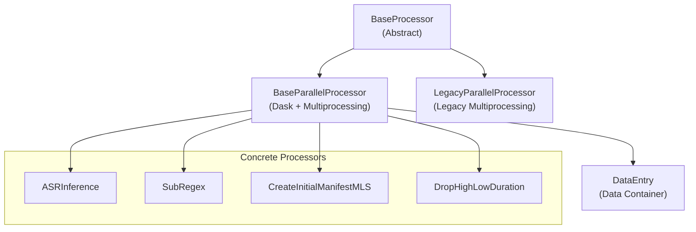
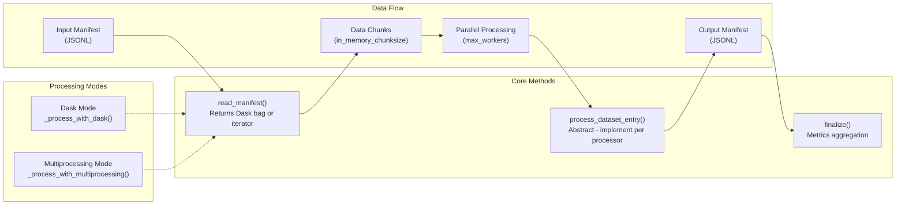
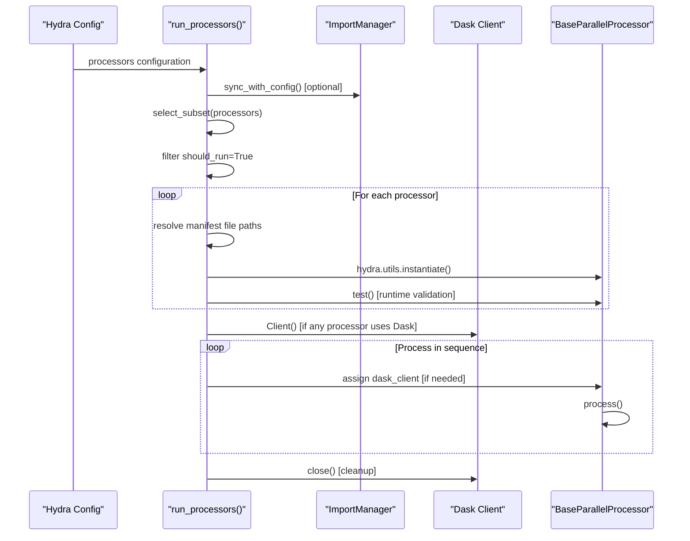
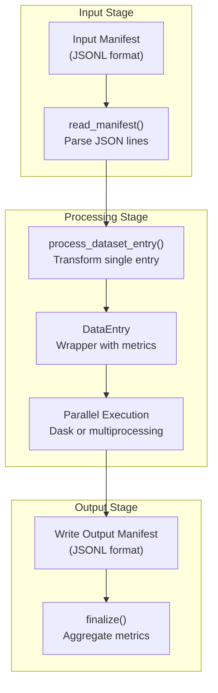
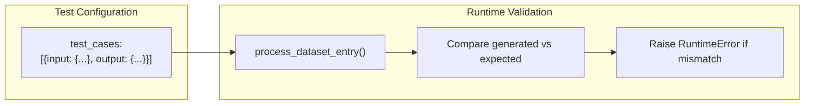

<!-- source: DeepWiki mcp.deepwiki.com · repo NVIDIA/NeMo-speech-data-processor · page 2 Core Architecture · fetched 2026-10-26 -->

# Core Architecture

<details>
<summary>Relevant source files</summary>

The following files were used as context for generating this wiki page:

- [docs/src/sdp/api.rst](docs/src/sdp/api.rst)
- [sdp/processors/__init__.py](sdp/processors/__init__.py)
- [sdp/processors/base_processor.py](sdp/processors/base_processor.py)
- [sdp/processors/modify_manifest/common.py](sdp/processors/modify_manifest/common.py)
- [sdp/processors/modify_manifest/data_to_data.py](sdp/processors/modify_manifest/data_to_data.py)
- [sdp/run_processors.py](sdp/run_processors.py)

</details>


The Core Architecture encompasses the fundamental framework that underlies the NeMo Speech Data Processor (SDP) system. This document covers the base processor classes, pipeline orchestration mechanisms, and data flow patterns that enable scalable speech dataset processing. For specific processor implementations, see [Processor Categories](#2.3). For configuration details, see [Configuration System](#3).

## Overview

The SDP core architecture is built around three primary components:

1. **Base Processor Framework** - Abstract classes defining processor interfaces and parallel execution capabilities
2. **Pipeline Orchestration** - Runtime coordination and execution of processor sequences  
3. **Data Flow System** - Standardized data entry handling and manifest file chaining

## Base Processor Framework

### Class Hierarchy



Sources: [sdp/processors/base_processor.py:39-498]()

### BaseProcessor Interface

The `BaseProcessor` class defines the fundamental interface that all SDP processors must implement:

| Method | Purpose | Implementation |
|--------|---------|----------------|
| `process()` | Main data processing logic | Abstract - must be overridden |
| `test()` | Runtime validation of processor behavior | Optional - default implementation available |
| `__init__()` | Constructor with manifest file paths | Validates input/output file constraints |

Key constraints enforced by `BaseProcessor`:
- `input_manifest_file` and `output_manifest_file` cannot be identical
- Processors can create initial manifests (no input required) or transform existing ones

Sources: [sdp/processors/base_processor.py:39-85]()

### BaseParallelProcessor Implementation

The `BaseParallelProcessor` extends `BaseProcessor` with parallel execution capabilities:



Key parameters controlling parallel execution:
- `max_workers`: Number of parallel workers (default: CPU count)
- `chunksize`: Chunk size for parallel routines (default: 100)
- `in_memory_chunksize`: Maximum entries loaded simultaneously (default: 100,000)
- `use_dask`: Enable Dask vs multiprocessing (default: True)

Sources: [sdp/processors/base_processor.py:86-294]()

### DataEntry Container

The `DataEntry` class serves as a standardized wrapper for processed data:

```python
@dataclass
class DataEntry:
    data: Optional[Dict]  # can be None to drop the entry
    metrics: Any = None
```

This design enables:
- **Data filtering**: Setting `data=None` drops entries from output
- **Metrics collection**: Arbitrary metrics attached to each entry
- **One-to-many mapping**: Single input can produce multiple outputs

Sources: [sdp/processors/base_processor.py:31-37]()

## Pipeline Orchestration

### Execution Flow

The `run_processors()` function coordinates the entire pipeline execution:



Sources: [sdp/run_processors.py:116-251]()

### Manifest File Chaining

The orchestrator automatically chains processors by linking output manifests to input manifests:

1. **Temporary Files**: Missing `output_manifest_file` gets temporary path in `tmp_dir`
2. **Automatic Linking**: Current processor's output becomes next processor's input
3. **Subset Execution**: When starting mid-pipeline, infers input from previous processor's output

This enables flexible pipeline execution without explicit manifest path management.

Sources: [sdp/run_processors.py:176-208]()

### Configuration Resolvers

SDP extends OmegaConf with custom resolvers for dynamic configuration:

```python
OmegaConf.register_new_resolver("subfield", lambda node, field: node[field])
OmegaConf.register_new_resolver("not", lambda x: not x)
OmegaConf.register_new_resolver("equal", lambda field, value: field == value)
```

These enable conditional logic and field references within YAML configurations.

Sources: [sdp/run_processors.py:30-33]()

## Data Flow Architecture

### Manifest Processing Pattern

All processors follow a consistent data flow pattern:



### Entry Transformation Types

Processors can implement different transformation patterns:

| Pattern | Input → Output | Example Use Case |
|---------|----------------|------------------|
| **One-to-One** | 1 entry → 1 entry | Text normalization, field addition |
| **One-to-Many** | 1 entry → N entries | Audio segmentation, sentence splitting |
| **One-to-Zero** | 1 entry → 0 entries (filtered) | Quality filtering, duplicate removal |

Sources: [sdp/processors/base_processor.py:224-267](), [sdp/processors/modify_manifest/data_to_data.py:164-204]()

## Runtime Testing Framework

### Test Case Validation

The processor framework includes built-in runtime testing through the `test()` method:



Test cases are defined directly in processor configurations, enabling:
- **Regression testing**: Ensure processor behavior remains consistent
- **Documentation**: Test cases serve as usage examples
- **Early failure**: Runtime tests execute before data processing begins

Sources: [sdp/processors/base_processor.py:280-293](), [docs/src/sdp/api.rst:489-517]()

This architecture provides a robust foundation for scalable, testable, and maintainable speech data processing pipelines while maintaining flexibility for diverse dataset requirements and processing workflows.

---

