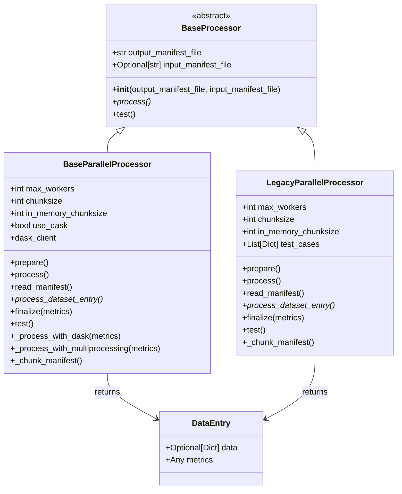
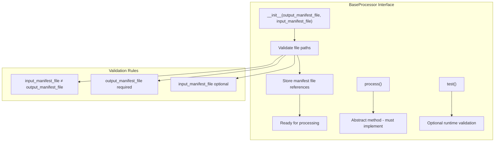
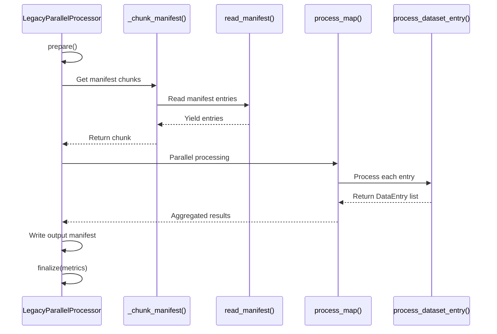
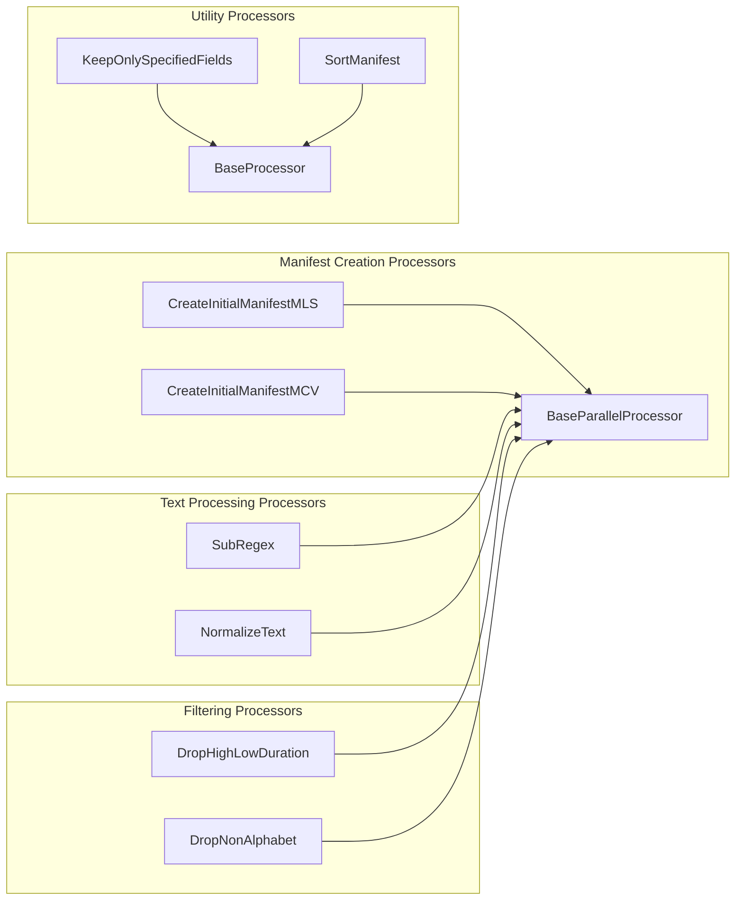
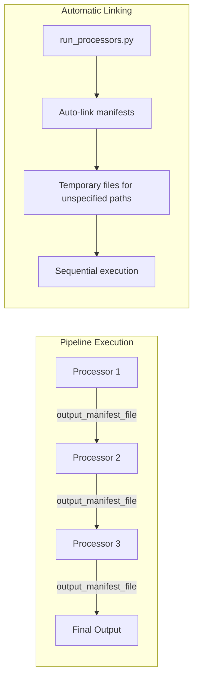

<!-- source: DeepWiki mcp.deepwiki.com · repo NVIDIA/NeMo-speech-data-processor · page 2.1 Base Processor Classes · fetched 2026-10-26 -->

# Base Processor Classes

<details>
<summary>Relevant source files</summary>

The following files were used as context for generating this wiki page:

- [sdp/processors/base_processor.py](sdp/processors/base_processor.py)
- [sdp/processors/modify_manifest/common.py](sdp/processors/modify_manifest/common.py)
- [sdp/run_processors.py](sdp/run_processors.py)

</details>


This page covers the fundamental base classes that form the foundation of the NeMo Speech Data Processor (SDP) framework. These classes define the core interfaces and processing patterns used by all data processors in the system.

For information about specific processor implementations and categories, see [Processor Categories](#2.3). For details on how processors are orchestrated and executed in pipelines, see [Pipeline Orchestration](#2.2).

## Overview

The SDP framework is built around a hierarchy of base processor classes that provide standardized interfaces for data processing operations. All processors inherit from these base classes, ensuring consistent behavior across the entire system. The architecture supports both sequential and parallel processing modes, with automatic manifest file chaining and standardized error handling.

### Base Class Hierarchy



**Sources:** [sdp/processors/base_processor.py:31-498]()

## DataEntry Class

The `DataEntry` class serves as a standardized container for processed data and associated metrics throughout the SDP pipeline.

```python
@dataclass
class DataEntry:
    data: Optional[Dict]  # can be None to drop the entry
    metrics: Any = None
```

### Key Characteristics

| Property | Description |
|----------|-------------|
| `data` | Contains the actual processed manifest entry as a dictionary, or `None` to drop the entry |
| `metrics` | Stores any additional metrics or metadata for statistics reporting |
| **Purpose** | Provides a uniform return type for all processor operations |

The `data` field being `Optional[Dict]` allows processors to filter out entries by returning `DataEntry(data=None)`, which the framework automatically handles by excluding these entries from the output manifest.

**Sources:** [sdp/processors/base_processor.py:31-37]()

## BaseProcessor Abstract Class

`BaseProcessor` defines the fundamental interface that all SDP processors must implement. It establishes the basic contract for data processing operations and runtime testing.

### Core Interface



### Constructor Parameters

| Parameter | Type | Required | Description |
|-----------|------|----------|-------------|
| `output_manifest_file` | `str` | Yes | Path where processed manifest will be written |
| `input_manifest_file` | `Optional[str]` | No | Path to input manifest (optional for initial manifest creators) |

### Abstract Methods

- **`process()`**: Must be implemented by all concrete processors to perform the actual data processing
- **`test()`**: Optional method for runtime validation and self-consistency checks

**Sources:** [sdp/processors/base_processor.py:39-85]()

## BaseParallelProcessor Class

`BaseParallelProcessor` extends `BaseProcessor` to provide sophisticated parallel processing capabilities using either Dask distributed computing or multiprocessing backends.

### Parallel Processing Architecture

```mermaid
graph TB
    subgraph "BaseParallelProcessor Execution Flow"
        A["process()"] --> B["prepare()"]
        B --> C{"use_dask?"}
        
        C -->|True| D["_process_with_dask()"]
        C -->|False| E["_process_with_multiprocessing()"]
        
        D --> F["Create Dask bag from manifest"]
        F --> G["bag.map(process_dataset_entry)"]
        G --> H["Compute results"]
        
        E --> I["_chunk_manifest()"]
        I --> J["Parallel() with joblib"]
        J --> K["Process chunks"]
        
        H --> L["Write output manifest"]
        K --> L
        L --> M["finalize(metrics)"]
    end
    
    subgraph "Data Flow"
        N["read_manifest()"] --> O{"Dask mode?"}
        O -->|True| P["db.read_text() -> Dask bag"]
        O -->|False| Q["Line-by-line generator"]
        
        P --> R["process_dataset_entry()"]
        Q --> R
        R --> S["List[DataEntry]"]
    end
```



### Configuration Parameters

| Parameter | Type | Default | Description |
|-----------|------|---------|-------------|
| `max_workers` | `int` | `-1` (auto-detect) | Maximum number of parallel workers |
| `chunksize` | `int` | `100` | Chunk size for parallel processing |
| `in_memory_chunksize` | `int` | `100000` | Maximum entries to load at once |
| `use_dask` | `bool` | `True` | Enable Dask vs multiprocessing |
| `dask_client` | Optional | `None` | Existing Dask client instance |
| `test_cases` | `Optional[List[Dict]]` | `None` | Runtime test cases |

### Processing Modes

#### Dask Mode (`use_dask=True`)
- Uses `dask.bag` for distributed processing
- Automatically chunks data into 256KB blocks
- Provides dashboard for monitoring
- Better for large-scale distributed processing

#### Multiprocessing Mode (`use_dask=False`)
- Uses `joblib.Parallel` with multiprocessing backend
- Processes data in configurable chunks
- More suitable for single-machine processing
- Lower overhead for smaller datasets

### Abstract Methods

Concrete implementations must provide:

```python
@abstractmethod
def process_dataset_entry(self, data_entry) -> List[DataEntry]:
    """Process a single data entry and return list of results."""
    pass
```

### Lifecycle Methods

| Method | Purpose | When Called |
|--------|---------|-------------|
| `prepare()` | Setup before processing starts | Before manifest processing |
| `read_manifest()` | Read and yield manifest entries | During processing |
| `process_dataset_entry()` | Process individual entries | For each manifest entry |
| `finalize()` | Cleanup and metrics reporting | After processing completes |

**Sources:** [sdp/processors/base_processor.py:86-293]()

## LegacyParallelProcessor Class

`LegacyParallelProcessor` provides backward compatibility with the original multiprocessing-based implementation, using `tqdm.contrib.concurrent.process_map` for parallel execution.

### Key Differences from BaseParallelProcessor

| Aspect | BaseParallelProcessor | LegacyParallelProcessor |
|--------|----------------------|------------------------|
| **Backend** | Dask or joblib | process_map only |
| **Memory Management** | Streaming with chunks | Load chunks into memory |
| **Progress Tracking** | Dask dashboard or basic logging | tqdm progress bars |
| **Scalability** | Distributed computing capable | Single machine only |

### Processing Flow



**Sources:** [sdp/processors/base_processor.py:296-498]()

## Implementation Patterns

### Concrete Processor Examples

The base classes are implemented by hundreds of concrete processors. Here are common patterns:



### Runtime Testing Pattern

All processors support runtime testing through the `test()` method:

```python
def test(self):
    for test_case in self.test_cases:
        input_data = test_case["input"].copy()
        generated_outputs = self.process_dataset_entry(input_data)
        expected_outputs = [test_case["output"]] if not isinstance(test_case["output"], list) else test_case["output"]
        # Validation logic...
```

**Sources:** [sdp/processors/base_processor.py:280-293](), [sdp/processors/modify_manifest/common.py:25-30]()

## Integration with Pipeline Orchestration

The base processor classes integrate seamlessly with the pipeline orchestration system through standardized manifest file handling:

### Manifest File Chaining



### Dask Client Management

The orchestration system manages Dask clients globally:

- Detects which processors require Dask
- Creates shared client for all Dask-enabled processors
- Handles graceful shutdown after processing completes

**Sources:** [sdp/run_processors.py:224-250]()

---

