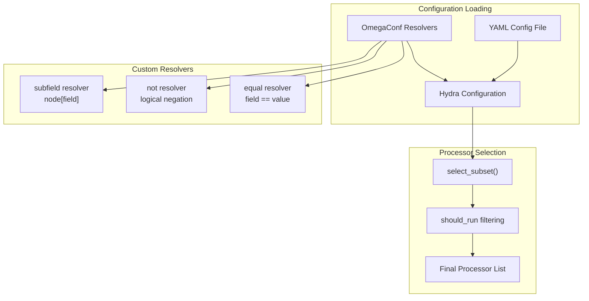
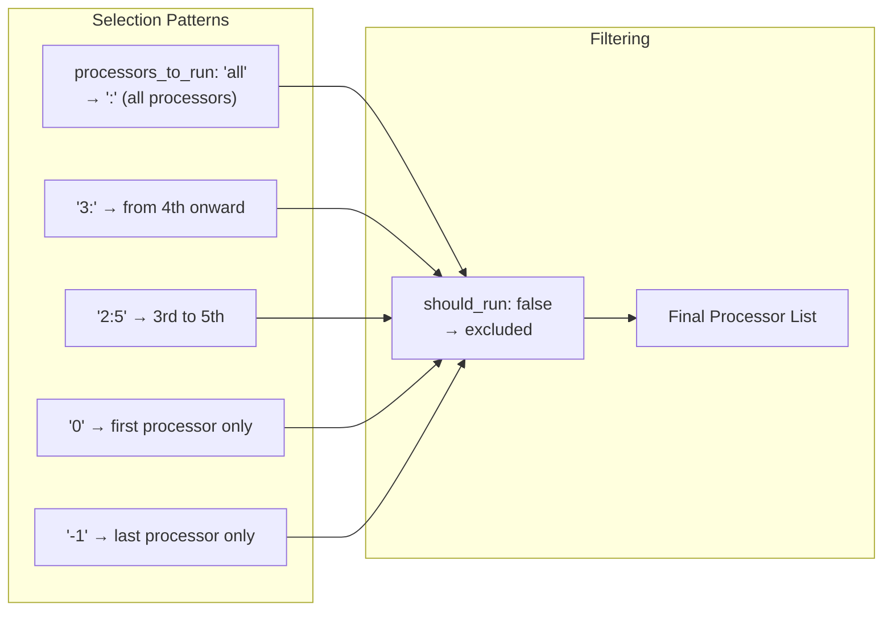
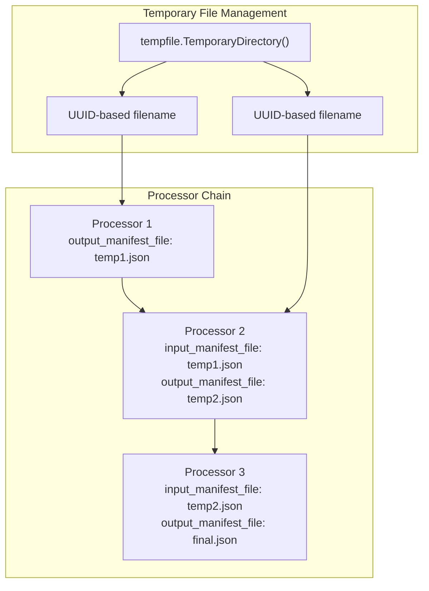
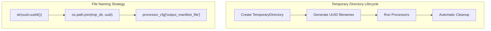
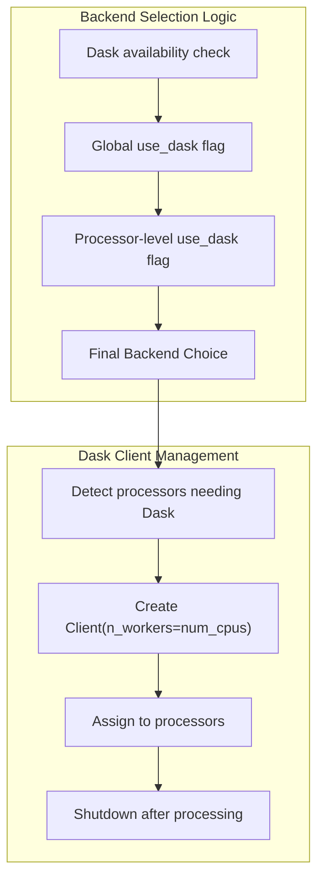
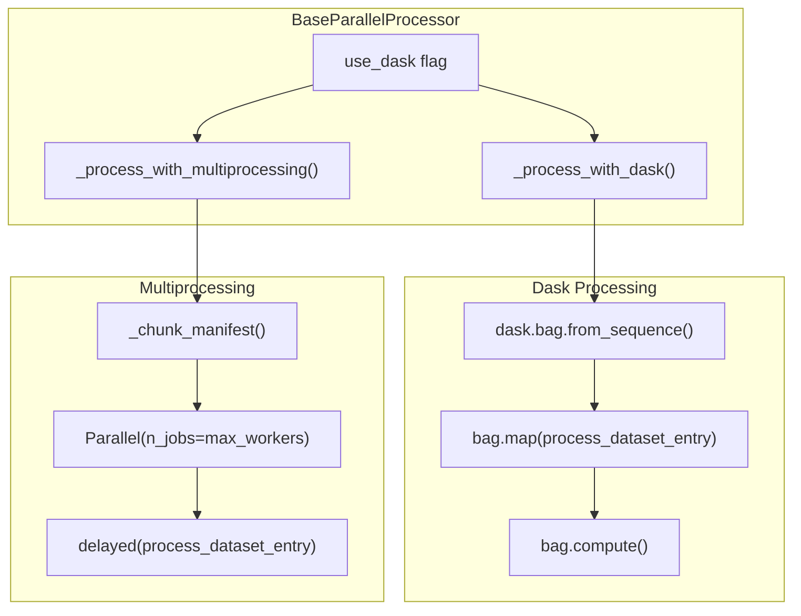
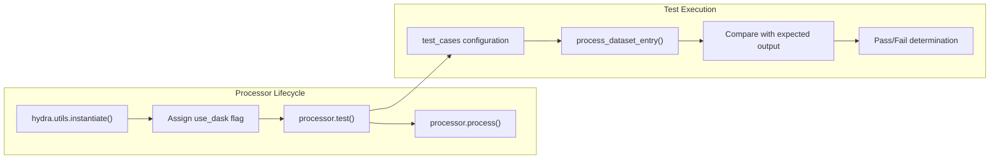
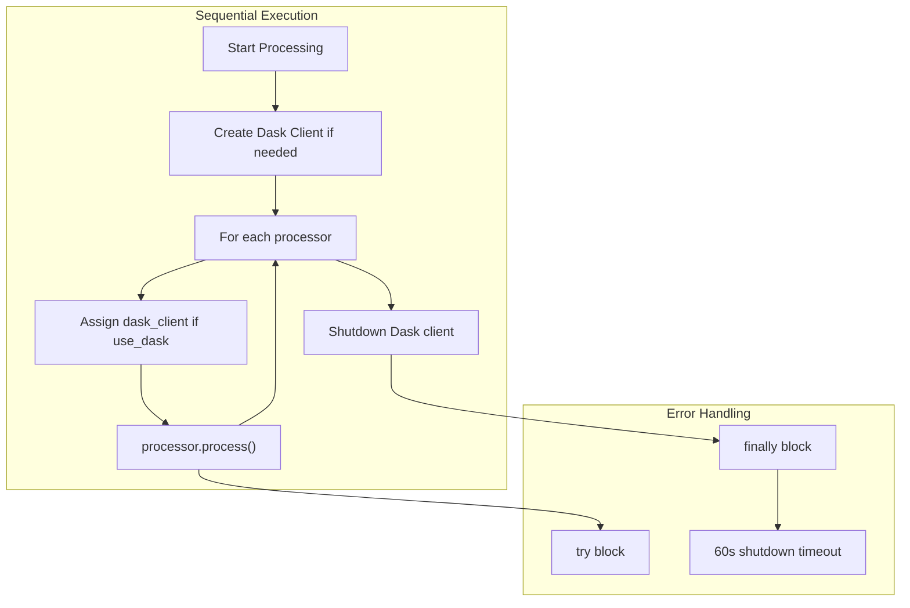
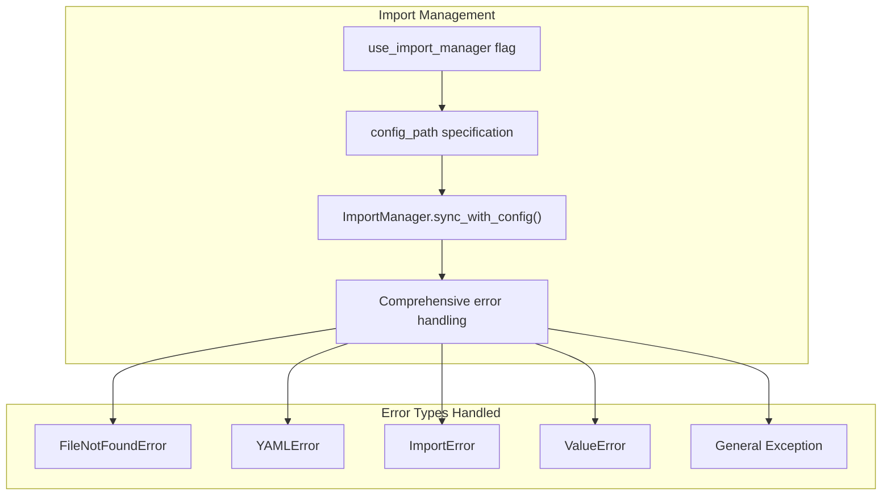

<!-- source: DeepWiki mcp.deepwiki.com · repo NVIDIA/NeMo-speech-data-processor · page 2.2 Pipeline Orchestration · fetched 2026-10-26 -->

# Pipeline Orchestration

Relevant source files

The following files were used as context for generating this wiki page:

- [README.md](README.md)
- [sdp/processors/base_processor.py](sdp/processors/base_processor.py)
- [sdp/processors/modify_manifest/common.py](sdp/processors/modify_manifest/common.py)
- [sdp/run_processors.py](sdp/run_processors.py)

This document explains how the SDP system coordinates the execution of processor sequences, including configuration loading, manifest file chaining, processor instantiation, and parallel processing management. It covers the central orchestration logic that transforms YAML configurations into executable processing pipelines.

For information about individual processor implementations, see [Processor Categories](#2.3). For details about the configuration system structure, see [Configuration System](#3).

## Overview

Pipeline orchestration in SDP is handled by the `run_processors` function in [sdp/run_processors.py](), which serves as the central coordinator for all data processing operations. This function transforms declarative YAML configurations into executable processor sequences, manages manifest file chaining between processors, and coordinates parallel execution using either Dask or multiprocessing.

The orchestration system handles several critical responsibilities:
- Loading and validating processor configurations
- Managing manifest file dependencies between processors
- Coordinating parallel processing backends
- Running runtime tests before processing
- Managing temporary files for intermediate results

Sources: [sdp/run_processors.py:116-252]()

## Configuration Loading and Processor Selection

### Hydra Configuration Management

The orchestration system uses Hydra for configuration management, with custom OmegaConf resolvers to enable dynamic configuration features:

The system registers custom resolvers to simplify configuration files:

| Resolver | Function | Usage Example |
|----------|----------|---------------|
| `subfield` | Extract nested field | `${subfield:node,field}` |
| `not` | Logical negation | `${not:${some_condition}}` |
| `equal` | Equality comparison | `${equal:${field},value}` |

Sources: [sdp/run_processors.py:30-33](), [sdp/run_processors.py:116-118]()

### Processor Selection Logic

The `select_subset` function enables flexible processor selection using Python slice notation:

Sources: [sdp/run_processors.py:74-113](), [sdp/run_processors.py:155-166]()

## Manifest File Chaining

### Automatic Manifest Linking

The orchestration system automatically chains processors by linking output manifests to input manifests:

The chaining logic handles several scenarios:

1. **Automatic Output File Generation**: If `output_manifest_file` is not specified, creates a temporary UUID-based filename
2. **Automatic Input File Linking**: Links the current processor's output to the next processor's input if not specified
3. **Partial Pipeline Execution**: When starting from a non-first processor, infers input from the previous processor's output

Sources: [sdp/run_processors.py:176-207]()

### Temporary File Management

The system uses Python's `tempfile.TemporaryDirectory()` to manage intermediate manifest files:

Sources: [sdp/run_processors.py:177](), [sdp/run_processors.py:198-201]()

## Parallel Processing Coordination

### Dask vs Multiprocessing Backend Selection

The orchestration system manages two parallel processing backends with flexible configuration:

The backend selection follows this priority:
1. Processor-specific `use_dask` flag (highest priority)
2. Global `use_dask` configuration
3. Dask availability check (fallback to multiprocessing if unavailable)

Sources: [sdp/run_processors.py:144-153](), [sdp/run_processors.py:209-218](), [sdp/run_processors.py:224-236]()

### Processing Backend Architecture

Sources: [sdp/processors/base_processor.py:140-156](), [sdp/processors/base_processor.py:158-191](), [sdp/processors/base_processor.py:192-209]()

## Processor Instantiation and Execution

### Runtime Testing and Validation

Before processing, the orchestration system runs runtime tests on each processor:

Sources: [sdp/run_processors.py:217-222](), [sdp/processors/base_processor.py:280-292]()

### Execution Flow Control

The execution flow ensures proper resource management:
1. Single Dask client shared across all processors needing it
2. Client assignment per processor based on `use_dask` flag
3. Graceful shutdown with timeout handling
4. Exception safety through try/finally blocks

Sources: [sdp/run_processors.py:237-252]()

## Import Management Integration

### Dynamic Import Resolution

The orchestration system includes optional import management for resolving processor dependencies:

Sources: [sdp/run_processors.py:119-142]()

## Configuration Integration Points

The orchestration system integrates with several configuration mechanisms:

| Integration Point | Purpose | Implementation |
|------------------|---------|----------------|
| Hydra instantiation | Create processor objects | `hydra.utils.instantiate(processor_cfg)` |
| OmegaConf resolvers | Dynamic configuration | Custom resolver registration |
| open_dict context | Runtime config modification | Temporary config unlocking |
| Processor selection | Subset execution | Slice notation parsing |
| Backend assignment | Processing mode control | Flag propagation |

The orchestration ensures that all configuration elements work together seamlessly, from high-level pipeline definitions down to individual processor parameters.

Sources: [sdp/run_processors.py:30-33](), [sdp/run_processors.py:163-164](), [sdp/run_processors.py:200-207](), [sdp/run_processors.py:217-218]()

---

