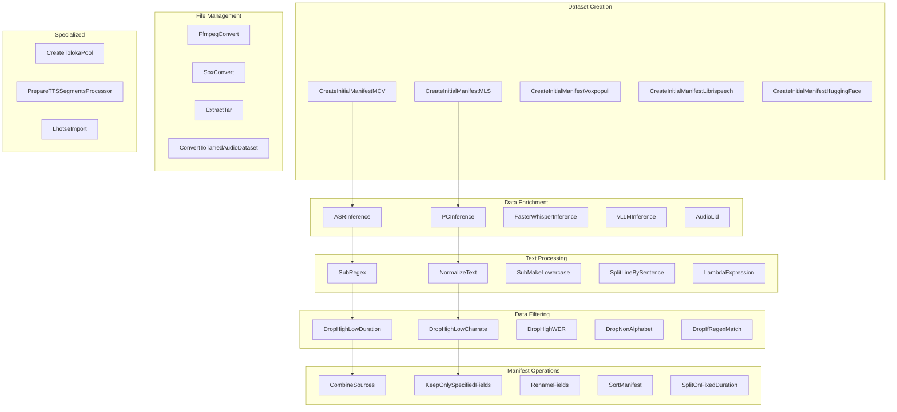
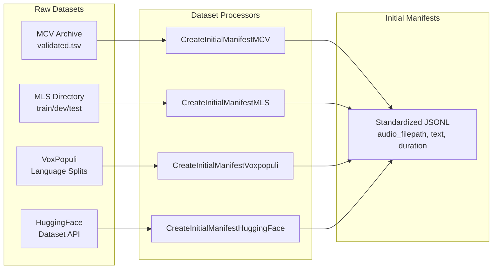
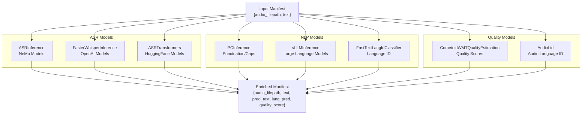
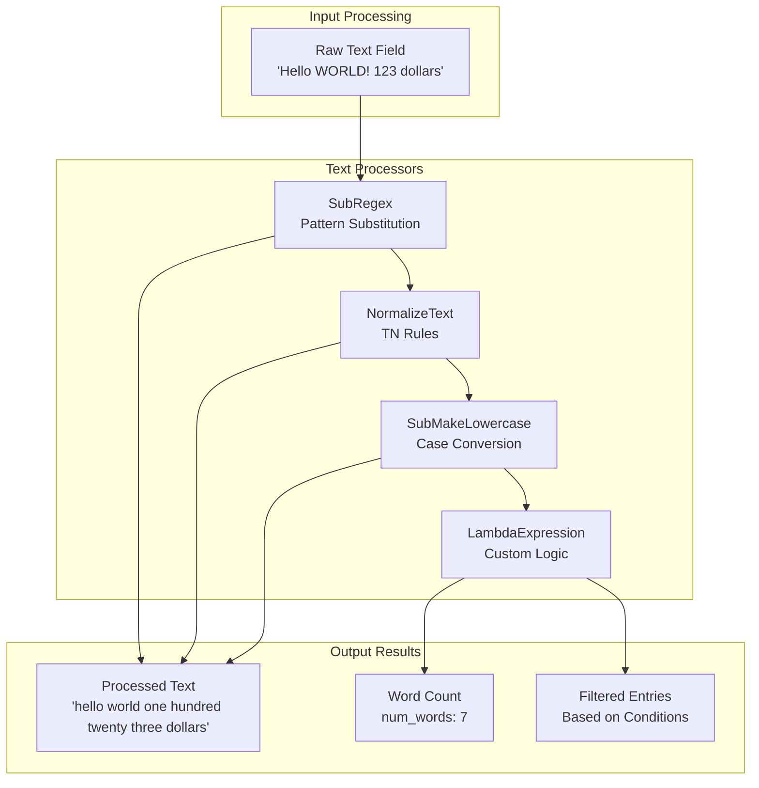
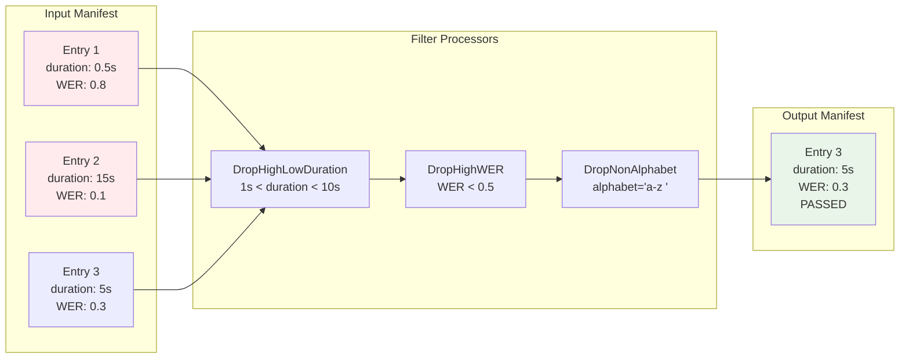
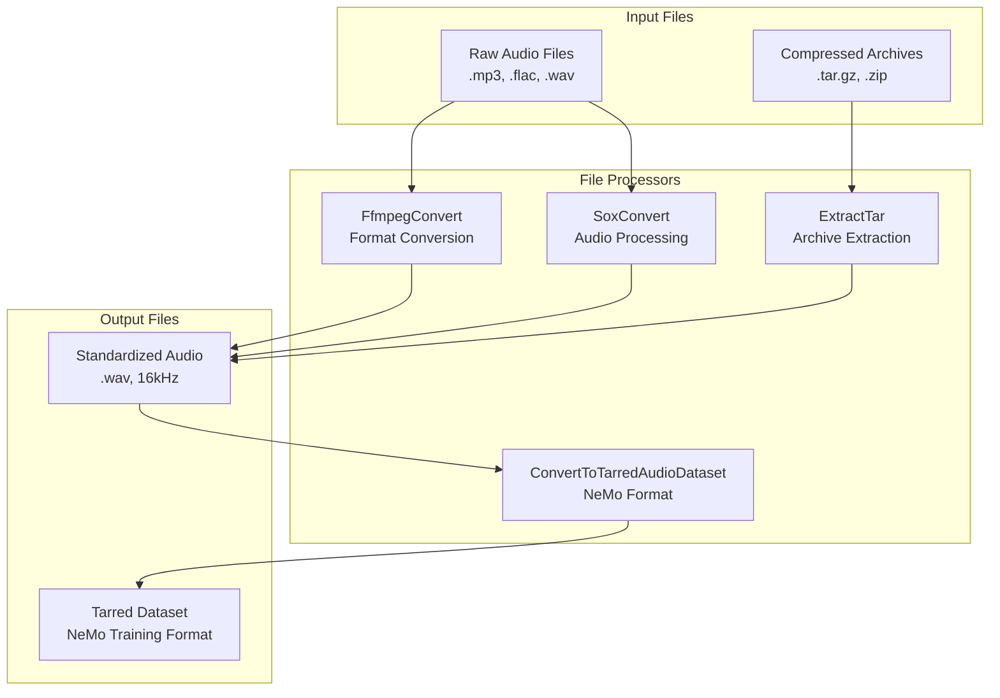
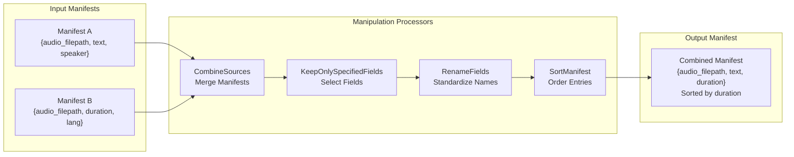
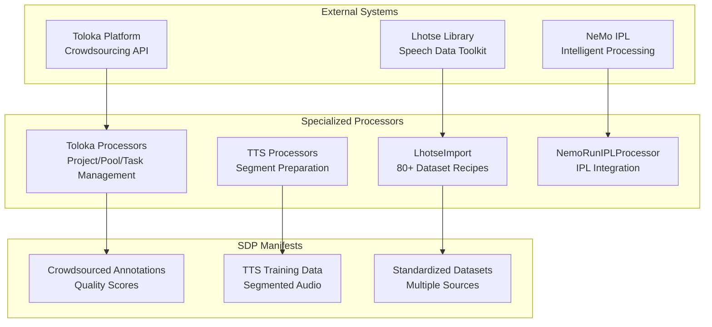

<!-- source: DeepWiki mcp.deepwiki.com · repo NVIDIA/NeMo-speech-data-processor · page 2.3 Processor Categories · fetched 2026-10-26 -->

# Processor Categories

Relevant source files

The following files were used as context for generating this wiki page:

- [docs/src/sdp/api.rst](docs/src/sdp/api.rst)
- [sdp/processors/__init__.py](sdp/processors/__init__.py)
- [sdp/processors/modify_manifest/create_manifest.py](sdp/processors/modify_manifest/create_manifest.py)
- [sdp/processors/modify_manifest/data_to_data.py](sdp/processors/modify_manifest/data_to_data.py)
- [sdp/processors/modify_manifest/data_to_dropbool.py](sdp/processors/modify_manifest/data_to_dropbool.py)

This document provides a comprehensive overview of the different categories of processors available in the NeMo Speech Data Processor system. Processors are organized into functional categories based on their primary purpose, ranging from dataset ingestion to data filtering and transformation. Understanding these categories helps users select the appropriate processors for their speech data processing pipelines.

For information about implementing custom processors, see [Base Processor Classes](#2.1). For details on how processors are orchestrated in pipelines, see [Pipeline Orchestration](#2.2).

## Overview of Processor Categories

The SDP system contains over 200 processors organized into seven main functional categories. Each category serves a specific role in the speech data processing pipeline, from initial data ingestion to final quality filtering.

### Processor Category Architecture

Sources: [sdp/processors/__init__.py:15-177](), [docs/src/sdp/api.rst:17-462]()

## Dataset-Specific Processors

Dataset-specific processors create initial manifests from raw speech datasets. Each processor handles the unique file structure and metadata format of a particular dataset.

### Major Dataset Processors

| Dataset | Processor Class | Purpose |
|---------|----------------|---------|
| Mozilla Common Voice | `CreateInitialManifestMCV` | Process MCV archives with validated/invalidated splits |
| Multilingual LibriSpeech | `CreateInitialManifestMLS` | Handle MLS language-specific directories |
| VoxPopuli | `CreateInitialManifestVoxpopuli` | Process European Parliament recordings |
| LibriSpeech | `CreateInitialManifestLibrispeech` | Standard English ASR corpus |
| CORAAL | `CreateInitialManifestCORAAL` | African American English dialect corpus |
| FLEURS | `CreateInitialManifestFleurs` | Cross-lingual speech corpus |
| SLR83 | `CreateInitialManifestSLR83` | British Isles accent corpus |

Sources: [sdp/processors/__init__.py:17-83](), [docs/src/sdp/api.rst:17-156]()

## Data Enrichment Processors

Data enrichment processors add new fields to manifest entries by running inference with pre-trained models. These processors typically add predictions, quality scores, or metadata that can be used for downstream filtering or processing.

### Inference Categories

**ASR Inference**
- `ASRInference`: NeMo ASR model predictions
- `FasterWhisperInference`: OpenAI Whisper variants
- `ASRTransformers`: HuggingFace Transformers ASR models

**NLP Processing**
- `PCInference`: Punctuation and capitalization restoration
- `vLLMInference`: Large language model inference
- `FastTextLangIdClassifier`: Language identification

**Quality Estimation**
- `CometoidWMTQualityEstimation`: Translation quality scores
- `AudioLid`: Audio-based language identification

Sources: [sdp/processors/__init__.py:145-156](), [docs/src/sdp/api.rst:171-216]()

## Text Processing Processors

Text processing processors modify the content of text fields in manifest entries. These processors are essential for standardizing text format, applying normalization rules, and preparing text for model training.

### Core Text Transformations

**Pattern-Based Processing**
- `SubRegex`: Apply regex substitutions with configurable patterns
- `SubMakeLowercase`: Convert text to lowercase
- `SplitLineBySentence`: Split text into sentence-level entries

**Normalization**
- `NormalizeText`: Apply text normalization (TN) rules
- `InverseNormalizeText`: Apply inverse text normalization (ITN)
- `MakeLettersUppercaseAfterPeriod`: Sentence capitalization

**Advanced Processing**
- `LambdaExpression`: Dynamic field computation with custom expressions
- `CountNumWords`: Word count calculation with alphabet filtering
- `ExtractFromBrackets`: Extract text within bracket patterns

Sources: [sdp/processors/modify_manifest/data_to_data.py:429-541](), [sdp/processors/modify_manifest/data_to_data.py:1163-1257]()

## Data Filtering Processors

Data filtering processors remove manifest entries that don't meet specified quality criteria. These processors are crucial for maintaining dataset quality and removing problematic samples.

### Filtering Categories

**Duration-Based Filtering**
- `DropHighLowDuration`: Remove entries outside duration thresholds
- `DropHighLowCharrate`: Filter by character rate (chars/second)
- `DropHighLowWordrate`: Filter by word rate (words/second)

**Quality-Based Filtering**
- `DropHighWER`: Remove entries with high Word Error Rate
- `DropHighCER`: Remove entries with high Character Error Rate
- `DropLowWordMatchRate`: Filter by word match rate

**Content-Based Filtering**
- `DropIfRegexMatch`: Remove entries matching regex patterns
- `DropNonAlphabet`: Filter entries with non-alphabet characters
- `DropASRError`: Remove entries with ASR inconsistencies

Sources: [sdp/processors/modify_manifest/data_to_dropbool.py:87-909](), [docs/src/sdp/api.rst:267-387]()

## File Management Processors

File management processors handle audio file operations, format conversions, and dataset packaging. These processors manage the physical files referenced in manifests.

### Audio Processing Operations

**Format Conversion**
- `FfmpegConvert`: Audio format conversion using FFmpeg
- `SoxConvert`: Audio processing using SoX toolkit

**Archive Operations**
- `ExtractTar`: Extract tar archives
- `ConvertToTarredAudioDataset`: Create NeMo tarred datasets

**File Operations**
- `RemoveFiles`: Delete files based on manifest entries
- `CopyManifestData`: Copy files to consolidated locations

Sources: [sdp/processors/__init__.py:157-169](), [docs/src/sdp/api.rst:308-325]()

## Manifest Manipulation Processors

Manifest manipulation processors restructure, combine, or transform manifest files without necessarily processing the underlying audio or text content.

### Structural Operations

**Field Operations**
- `KeepOnlySpecifiedFields`: Retain only specified fields
- `DropSpecifiedFields`: Remove specified fields
- `RenameFields`: Change field names
- `DuplicateFields`: Copy field values to new fields
- `AddConstantFields`: Add fields with constant values

**Manifest Combination**
- `CombineSources`: Merge multiple manifests
- `CreateCombinedManifests`: Combine manifest files
- `ApplyInnerJoin`: Join manifests on common fields

**Entry Manipulation**
- `SortManifest`: Sort entries by field values
- `SplitOnFixedDuration`: Split long audio into segments
- `ListToEntries`: Expand list fields into separate entries

Sources: [sdp/processors/__init__.py:84-97](), [sdp/processors/modify_manifest/create_manifest.py:23-89]()

## Specialized Processors

Specialized processors serve specific use cases or integrate with external systems and services.

### Integration Categories

**Crowdsourcing (Toloka)**
- `CreateTolokaProject`: Set up crowdsourcing projects
- `CreateTolokaPool`: Create worker pools
- `CreateTolokaTaskSet`: Generate annotation tasks
- `GetTolokaResults`: Retrieve crowdsourced annotations

**Text-to-Speech (TTS)**
- `PrepareTTSSegmentsProcessor`: Prepare TTS training segments
- `SplitLongAudio`: Split audio for TTS processing
- `MergeAlignmentDiarization`: Merge alignment and diarization

**External Libraries**
- `LhotseImport`: Import from Lhotse speech library
- `NemoRunIPLProcessor`: Integration with NeMo IPL

Sources: [sdp/processors/__init__.py:170-177](), [docs/src/sdp/api.rst:158-169](), [docs/src/sdp/api.rst:370-459]()

---

