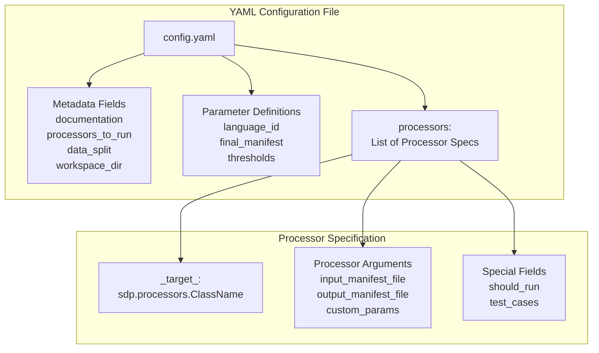
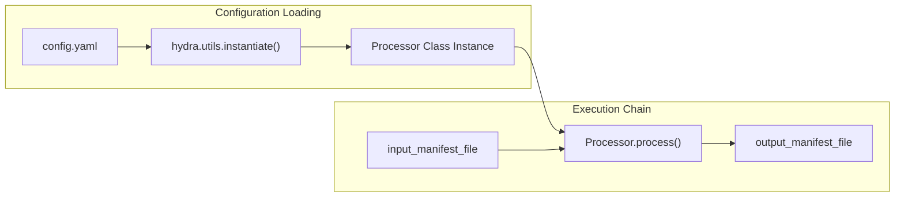
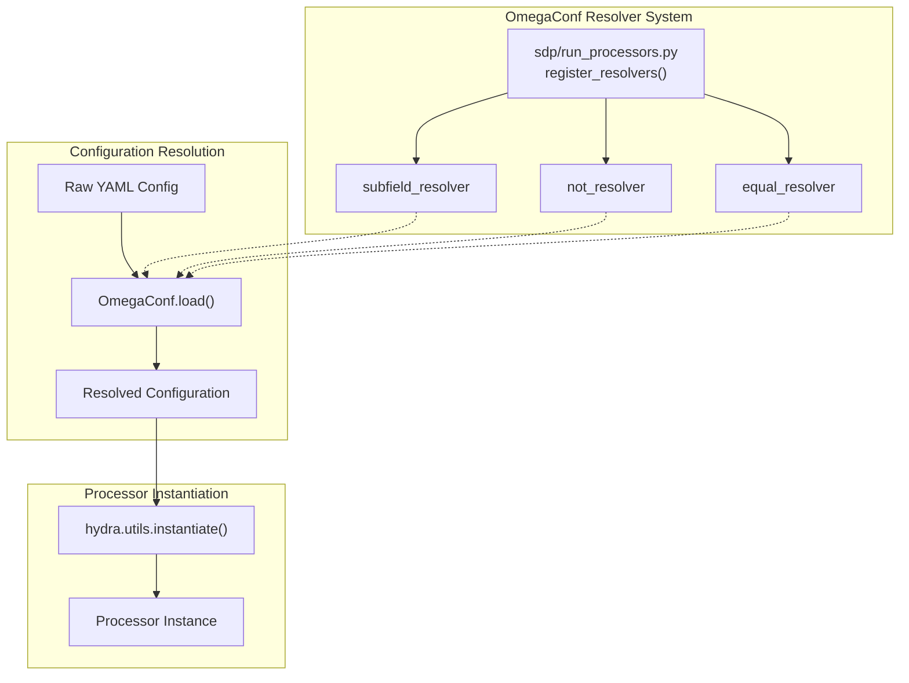
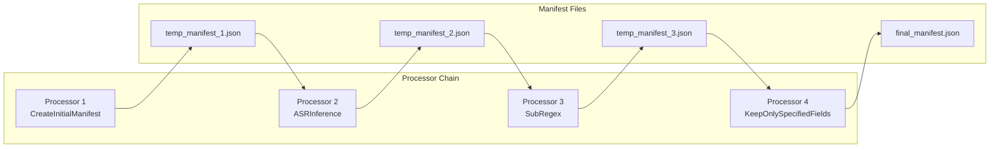
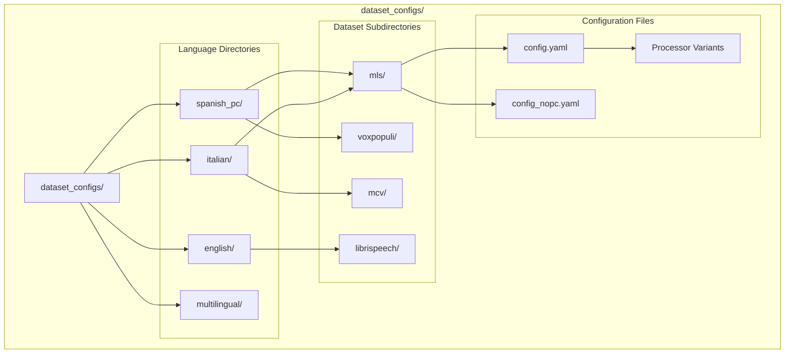
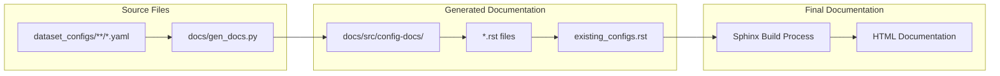

<!-- source: DeepWiki mcp.deepwiki.com · repo NVIDIA/NeMo-speech-data-processor · page 3 Configuration System · fetched 2026-10-26 -->

# Configuration System

<details>
<summary>Relevant source files</summary>

The following files were used as context for generating this wiki page:

- [dataset_configs/spanish/mls/config.yaml](dataset_configs/spanish/mls/config.yaml)
- [dataset_configs/spanish_pc/mls/config.yaml](dataset_configs/spanish_pc/mls/config.yaml)
- [dataset_configs/spanish_pc/voxpopuli/config.yaml](dataset_configs/spanish_pc/voxpopuli/config.yaml)
- [docs/src/sdp/config_structure.rst](docs/src/sdp/config_structure.rst)
- [docs/src/sdp/existing_configs.rst](docs/src/sdp/existing_configs.rst)

</details>


The Configuration System in NeMo Speech Data Processor (SDP) provides a YAML-based framework for defining, managing, and executing data processing pipelines. This system uses Hydra/OmegaConf for dynamic configuration loading and includes custom resolvers for conditional logic and parameter substitution.

For information about the actual processor classes that these configurations instantiate, see [Core Architecture](#2). For details on specific dataset processing workflows, see [Dataset Processing](#4).

## Configuration File Structure

SDP configuration files are YAML documents that define processing pipelines through a list of processor specifications. Each configuration must contain a `processors` key with a list of processor definitions.

**Basic Configuration Structure**


Sources: [docs/src/sdp/config_structure.rst:1-19](), [dataset_configs/spanish_pc/mls/config.yaml:1-30]()

## Processor Definition Format

Each processor in the configuration is defined using Hydra's instantiation format with the `_target_` key specifying the processor class path.

| Field | Type | Purpose | Required |
|-------|------|---------|----------|
| `_target_` | string | Full path to processor class | Yes |
| `input_manifest_file` | string | Path to input manifest | No* |
| `output_manifest_file` | string | Path to output manifest | No* |
| `should_run` | bool | Whether to execute processor | No |
| `test_cases` | list | Runtime validation tests | No |

*Automatically managed by SDP if not specified

**Processor Configuration Flow**


Sources: [docs/src/sdp/config_structure.rst:4-8](), [dataset_configs/spanish_pc/mls/config.yaml:24-30]()

## Dynamic Configuration Features

SDP provides custom OmegaConf resolvers for dynamic configuration management, enabling conditional logic and parameter substitution within YAML files.

### Custom Resolvers

**subfield Resolver**
```yaml
# Usage: ${subfield:<dictionary>,<field_to_select>}
high_duration_thresholds:
  train: 20
  dev: 25
  test: 30

processors:
  - _target_: sdp.processors.DropHighLowDuration
    high_duration_threshold: ${subfield:${high_duration_thresholds},${data_split}}
```

**not Resolver**
```yaml
# Usage: ${not:<parameter_to_negate>}
restore_pc: True

processors:
  - _target_: sdp.processors.SubMakeLowercase
    should_run: ${not:${restore_pc}}
```

**equal Resolver**
```yaml
# Usage: ${equal:<argument_to_compare>,<value_for_comparison>}
processors:
  - _target_: sdp.processors.SomeProcessor
    should_run: ${equal:${data_split},train}
```

**Resolver Registration and Usage**


Sources: [docs/src/sdp/config_structure.rst:79-141](), [dataset_configs/spanish_pc/voxpopuli/config.yaml:19-23](), [dataset_configs/spanish_pc/voxpopuli/config.yaml:141]()

## Special Configuration Fields

### Processor Execution Control

**processors_to_run**
Controls which processors execute from the configuration list:
```yaml
processors_to_run: all        # Run all processors
processors_to_run: ":3"       # Run first 3 processors
processors_to_run: "2:5"      # Run processors 2-4
processors_to_run: ":-1"      # Run all but last
processors_to_run: "0"        # Run only first processor
```

**should_run**
Individual processor execution control:
```yaml
processors:
  - _target_: sdp.processors.SomeProcessor
    should_run: ${equal:${data_split},train}  # Only run for train split
```

### Runtime Testing

**test_cases**
Inline validation for processor behavior:
```yaml
processors:
  - _target_: sdp.processors.SubRegex
    regex_params_list:
      - {"pattern": "!", "repl": "."}
    test_cases:
      - {input: {text: "hey!"}, output: {text: "hey."}}
      - {input: {text: "abc"}, output: {text: "abc"}}
```

Sources: [docs/src/sdp/config_structure.rst:10-14](), [docs/src/sdp/config_structure.rst:46-77](), [dataset_configs/spanish_pc/mls/config.yaml:7-14]()

## Manifest File Management

SDP automatically manages manifest file chains between processors when `input_manifest_file` and `output_manifest_file` are not explicitly specified.

**Automatic Manifest Chaining**


**Explicit Manifest File Specification**
```yaml
processors:
  - _target_: sdp.processors.CreateInitialManifestMLS
    output_manifest_file: "${workspace_dir}/initial_manifest.json"
    
  - _target_: sdp.processors.ASRInference
    output_manifest_file: "${workspace_dir}/transcribed_manifest.json"
    
  - _target_: sdp.processors.KeepOnlySpecifiedFields
    output_manifest_file: "${final_manifest}"
```

Sources: [docs/src/sdp/config_structure.rst:29-42](), [dataset_configs/spanish_pc/mls/config.yaml:22](), [dataset_configs/spanish_pc/mls/config.yaml:396]()

## Configuration Examples

### Basic Dataset Processing Configuration

```yaml
# MLS Spanish Processing Configuration
processors_to_run: all
data_split: ???
workspace_dir: ???
language_long: "spanish"
final_manifest: ${workspace_dir}/mls_spanish_processed/${data_split}_final.json

processors:
  - _target_: sdp.processors.CreateInitialManifestMLS
    raw_data_dir: ${workspace_dir}
    output_manifest_file: "${workspace_dir}/initial_manifest.json"
    language: ${language_long}
    data_split: "${data_split}"

  - _target_: sdp.processors.ASRInference
    pretrained_model: "stt_es_quartznet15x5"

  - _target_: sdp.processors.KeepOnlySpecifiedFields
    output_manifest_file: "${final_manifest}"
    fields_to_keep:
      - "audio_filepath"
      - "text" 
      - "duration"
```

### Advanced Configuration with Conditions

```yaml
# VoxPopuli Configuration with Data Split Conditions
data_split: ???
workspace_dir: ???

high_duration_thresholds:
  train: 20
  dev: 30
  test: 30

processors:
  - _target_: sdp.processors.CreateInitialManifestVoxpopuli
    output_manifest_file: "${workspace_dir}/manifests/${data_split}_initial.json"
    
  - _target_: sdp.processors.DropHighLowDuration
    high_duration_threshold: ${subfield:${high_duration_thresholds},${data_split}}
    low_duration_threshold: 1
    test_cases:
      - {input: {duration: 0.1}, output: null}
      - {input: {duration: 5}, output: {duration: 5}}
```

Sources: [dataset_configs/spanish_pc/mls/config.yaml:1-30](), [dataset_configs/spanish_pc/voxpopuli/config.yaml:19-23](), [dataset_configs/spanish_pc/voxpopuli/config.yaml:137-146]()

## Dataset Configuration Organization

Configuration files are organized hierarchically by language and dataset in the `dataset_configs/` directory structure.

**Configuration Directory Structure**


**Supported Configuration Categories**

| Language Family | Datasets | Configuration Variants |
|----------------|----------|----------------------|
| Spanish | MLS, MCV, VoxPopuli, Fisher | `_pc` (with punctuation/caps), `_nopc` (without) |
| Italian | MLS, MCV, VoxPopuli | Standard and no-punctuation variants |
| English | LibriSpeech, SLR83, CORAAL, HiFiTTS-2 | Processing complexity variants |
| Multilingual | FLEURS, Granary | Language-specific parameter sets |

Sources: [docs/src/sdp/existing_configs.rst:14-465]()

## Automatic Documentation Generation

SDP automatically generates documentation from configuration files using the `docs/gen_docs.py` script, which creates reStructuredText documentation for each configuration.

**Documentation Generation Process**


Sources: [docs/src/sdp/existing_configs.rst:1-3](), [docs/src/sdp/existing_configs.rst:47-56]()

---

