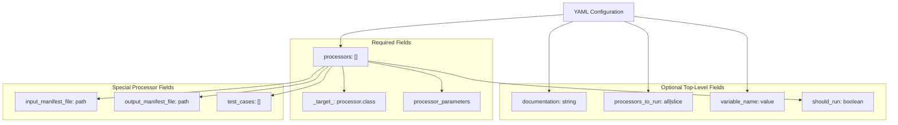
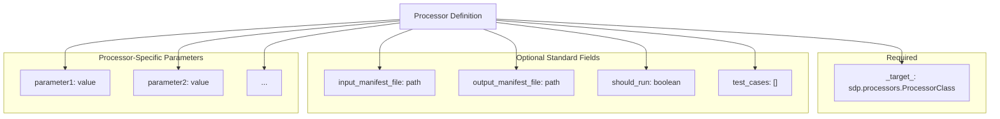
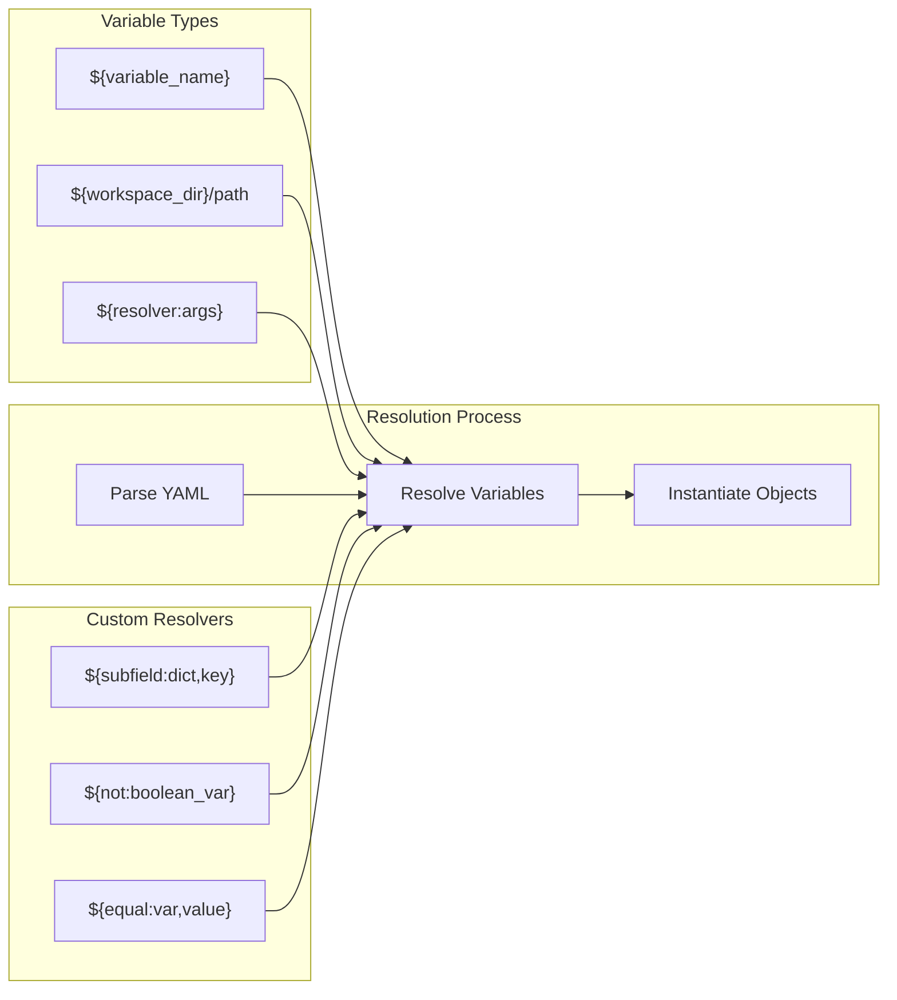
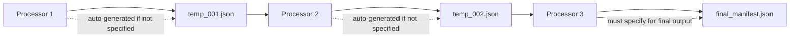

<!-- source: DeepWiki mcp.deepwiki.com · repo NVIDIA/NeMo-speech-data-processor · page 3.1 YAML Configuration Structure · fetched 2026-10-26 -->

# YAML Configuration Structure

<details>
<summary>Relevant source files</summary>

The following files were used as context for generating this wiki page:

- [dataset_configs/spanish/mls/config.yaml](dataset_configs/spanish/mls/config.yaml)
- [dataset_configs/spanish_pc/fisher/config.yaml](dataset_configs/spanish_pc/fisher/config.yaml)
- [dataset_configs/spanish_pc/mcv12/config.yaml](dataset_configs/spanish_pc/mcv12/config.yaml)
- [dataset_configs/spanish_pc/mls/config.yaml](dataset_configs/spanish_pc/mls/config.yaml)
- [dataset_configs/spanish_pc/voxpopuli/config.yaml](dataset_configs/spanish_pc/voxpopuli/config.yaml)
- [docs/src/sdp/config_structure.rst](docs/src/sdp/config_structure.rst)
- [tests/README.md](tests/README.md)

</details>


This page covers the detailed structure and format of YAML configuration files used to define speech data processing pipelines in the NeMo Speech Data Processor (SDP). For information about available datasets and their specific configurations, see [Available Datasets and Configurations](#3.2).

## Overview

YAML configuration files in SDP define complete data processing pipelines by specifying a sequence of processors and their parameters. These configurations use Hydra/OmegaConf for dynamic loading and provide features like variable interpolation, custom resolvers, and runtime testing capabilities.

## Basic Configuration Structure

Every SDP configuration file follows a standard hierarchical structure with required and optional top-level fields:



Sources: [docs/src/sdp/config_structure.rst:1-195](), [dataset_configs/spanish_pc/mls/config.yaml:1-401]()

## Top-Level Configuration Fields

### Required Fields

| Field | Type | Description |
|-------|------|-------------|
| `processors` | List | Ordered list of processor definitions that define the processing pipeline |

### Common Optional Fields

| Field | Type | Description | Example |
|-------|------|-------------|---------|
| `documentation` | String | Multi-line description of the configuration purpose | [dataset_configs/spanish_pc/mls/config.yaml:1-6]() |
| `processors_to_run` | String/Slice | Controls which processors execute (`"all"`, `":3"`, `"2:5"`, etc.) | [dataset_configs/spanish_pc/mls/config.yaml:14]() |
| `data_split` | String | Placeholder for train/dev/test split specification | [dataset_configs/spanish_pc/mls/config.yaml:15]() |
| `workspace_dir` | String | Placeholder for workspace directory path | [dataset_configs/spanish_pc/mls/config.yaml:16]() |
| `final_manifest` | String | Path to the final output manifest file | [dataset_configs/spanish_pc/mls/config.yaml:22]() |

### Configuration Variables

Configuration files can define custom variables that are referenced throughout the file using OmegaConf interpolation syntax:

```yaml
language_long: "spanish"
language_short: "es"
pc_model_path: ???

processors:
  - _target_: sdp.processors.CreateInitialManifestMLS
    language: ${language_long}
```

Sources: [dataset_configs/spanish_pc/mls/config.yaml:17-28](), [dataset_configs/spanish_pc/mcv12/config.yaml:10-20]()

## Processor Definitions

Each processor in the `processors` list follows a standard structure with required and optional fields:



### Core Processor Fields

| Field | Required | Description |
|-------|----------|-------------|
| `_target_` | Yes | Full Python path to the processor class (e.g., `sdp.processors.SubRegex`) |
| `input_manifest_file` | No | Path to input manifest (auto-generated if omitted) |
| `output_manifest_file` | No | Path to output manifest (auto-generated if omitted) |
| `should_run` | No | Boolean controlling whether processor executes |
| `test_cases` | No | List of test case dictionaries for runtime validation |

Sources: [docs/src/sdp/config_structure.rst:29-48](), [dataset_configs/spanish_pc/mls/config.yaml:25-31]()

### Example Processor Definition

```yaml
- _target_: sdp.processors.SubRegex
  text_key: "text_pc_pred"
  regex_params_list:
    - {"pattern": ' (\w+)¿ ', "repl": ' ¿\1 '}
  test_cases:
    - {input: {text_pc_pred: "cómo¿ estás? def."}, output: {text_pc_pred: "¿cómo estás? def."}}
```

Sources: [dataset_configs/spanish_pc/mls/config.yaml:51-57]()

## Variable Interpolation and Custom Resolvers

SDP extends OmegaConf with custom resolvers for advanced configuration patterns:



### Subfield Resolver

Enables conditional parameter selection based on configuration variables:

```yaml
high_duration_thresholds:
  train: 20
  dev: 25
  test: 30

processors:
  - _target_: sdp.processors.DropHighLowDuration
    high_duration_threshold: ${subfield:${high_duration_thresholds},${data_split}}
```

Sources: [docs/src/sdp/config_structure.rst:87-108](), [dataset_configs/spanish_pc/voxpopuli/config.yaml:19-23](), [dataset_configs/spanish_pc/voxpopuli/config.yaml:141]()

### Boolean Resolvers

The `not` resolver inverts boolean values, while `equal` compares values:

```yaml
restore_pc: True

processors:
  - _target_: sdp.processors.NormalizeFromNonPCTextVoxpopuli
    should_run: ${restore_pc}
  - _target_: sdp.processors.SubMakeLowercase
    should_run: ${not:${restore_pc}}
```

Sources: [docs/src/sdp/config_structure.rst:110-142]()

## Special Processor Fields

### Test Cases

Runtime validation through `test_cases` ensures processors behave as expected:

```yaml
- _target_: sdp.processors.DropIfRegexMatch
  regex_patterns:
    - "(\\D ){5,20}"
  test_cases:
    - {input: {text: "some s p a c e d out letters"}, output: null}
    - {input: {text: "normal words only"}, output: {text: "normal words only"}}
```

Test cases specify input data and expected output data. If output is `null`, the processor should drop the input.

Sources: [docs/src/sdp/config_structure.rst:50-77](), [dataset_configs/spanish_pc/mls/config.yaml:262-267]()

### Manifest File Chaining

SDP automatically chains processors by linking output manifests to input manifests:



Sources: [docs/src/sdp/config_structure.rst:29-42]()

### Conditional Execution

Use `should_run` field to conditionally execute processors:

```yaml
- _target_: sdp.processors.RestorePCForMLS
  should_run: ${equal:${data_split},train}
  # processor parameters...
```

Sources: [docs/src/sdp/config_structure.rst:46-48]()

## Configuration Patterns and Best Practices

### Dataset-Specific Variables

Define reusable variables at the top level for maintainability:

```yaml
language_long: "spanish"
language_short: "es"
language_id: "es"
workspace_dir: ???
data_split: ???

processors:
  - _target_: sdp.processors.CreateInitialManifestMLS
    language: ${language_long}
    data_split: ${data_split}
```

Sources: [dataset_configs/spanish_pc/mls/config.yaml:17-30](), [dataset_configs/spanish_pc/mcv12/config.yaml:8-20]()

### Custom Processor Integration

Reference custom processors using full module paths:

```yaml
- _target_: dataset_configs.spanish_pc.fisher.unique_processors.create_initial_manifest_fisher_spanish.CreateInitialManifestFisherSpanish
  output_manifest_file: "${processed_manifest_dir}/all_initial_manifest.json"
  raw_data_dir: ${workspace_dir}
```

Sources: [dataset_configs/spanish_pc/fisher/config.yaml:21-24](), [docs/src/sdp/config_structure.rst:183-189]()

### Complex Processing Pipelines

Large configurations can include dozens of processors with sophisticated parameter handling:

```yaml
processors:
  # Initial manifest creation
  - _target_: sdp.processors.CreateInitialManifestMLS
    # ... parameters
  
  # Text processing and normalization
  - _target_: sdp.processors.RestorePCForMLS
    # ... parameters
    
  # Inference and quality filtering
  - _target_: sdp.processors.ASRInference
    # ... parameters
    
  # Multiple regex cleaning stages
  - _target_: sdp.processors.SubRegex
    regex_params_list:
      - {"pattern": "pattern1", "repl": "replacement1"}
      - {"pattern": "pattern2", "repl": "replacement2"}
    # ... more patterns
```

Sources: [dataset_configs/spanish_pc/mls/config.yaml:24-401]()

---

