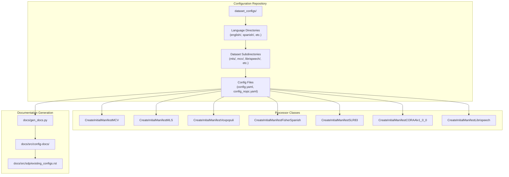
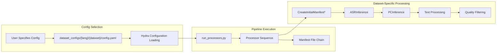

<!-- source: DeepWiki mcp.deepwiki.com · repo NVIDIA/NeMo-speech-data-processor · page 3.2 Available Datasets and Configurations · fetched 2026-10-26 -->

# Available Datasets and Configurations

<details>
<summary>Relevant source files</summary>

The following files were used as context for generating this wiki page:

- [docs/src/sdp/existing_configs.rst](docs/src/sdp/existing_configs.rst)

</details>


This page provides a comprehensive catalog of all supported datasets in the NeMo Speech Data Processor (SDP), along with their configuration files and processing requirements. Each dataset entry includes links to both the configuration files and auto-generated documentation that details the specific processors and parameters used.

For information about the overall configuration system structure and YAML format, see [YAML Configuration Structure](#3.1). For details about how these configurations are executed in processing pipelines, see [Pipeline Orchestration](#2.2).

## Dataset Configuration Architecture

The following diagram shows how dataset configurations are organized within the SDP system:

**Dataset Configuration Structure and Code Mapping**



Sources: [docs/src/sdp/existing_configs.rst:1-465]()

## ASR Dataset Categories

### Multilingual Datasets

**Mozilla Common Voice (MCV)**
- **Processor Class**: `CreateInitialManifestMCV`
- **Manual Steps Required**: Download data archive manually due to license agreement
- **Supported Languages**: Italian, Spanish, Portuguese, Kazakh, Georgian, Uzbek, Arabic
- **Config Pattern**: `dataset_configs/{language}/mcv/config.yaml`

**Multilingual LibriSpeech (MLS)**
- **Processor Class**: `CreateInitialManifestMLS`
- **Supported Languages**: Italian, Spanish, Portuguese
- **Config Variants**: 
  - Standard: `config.yaml` (with punctuation/capitalization)
  - No PC: `config_nopc.yaml` (without punctuation/capitalization)

**VoxPopuli**
- **Processor Class**: `CreateInitialManifestVoxpopuli` 
- **Supported Languages**: Italian, Spanish
- **Focus**: European Parliament speeches

**FLEURS (Few-shot Learning Evaluation)**
- **Dataset Source**: HuggingFace `google/fleurs`
- **Supported Languages**: Armenian, Uzbek, Arabic
- **Purpose**: Cross-lingual evaluation

### English-Specific Datasets

**LibriSpeech**
- **Processor Class**: `CreateInitialManifestLibrispeech`
- **Config Variants**:
  - `config.yaml`: Process single subset
  - `mini.yaml`: Mini LibriSpeech variant
  - `all.yaml`: All subsets in one pipeline

**UK and Ireland English Dialect (SLR83)**
- **Processor Class**: `CreateInitialManifestSLR83`
- **Focus**: Regional accent variations

**CORAAL (Corpus of Regional African American Language)**
- **Processor Class**: `CreateInitialManifestCORAAlv1_0_0`
- **Focus**: African American English varieties

**Earnings21/22**
- **Focus**: Financial earnings call transcriptions
- **Domain**: Business/financial speech

### Language-Specific Datasets

The following diagram shows the relationship between languages and their available datasets:

**Language-Dataset Mapping**

```mermaid
graph TB
    subgraph "Romance Languages"
        SPANISH["Spanish"]
        PORTUGUESE["Portuguese"] 
        ITALIAN["Italian"]
    end
    
    subgraph "Turkic Languages"
        KAZAKH["Kazakh"]
        UZBEK["Uzbek"]
    end
    
    subgraph "Other Languages"
        ARABIC["Arabic"]
        ARMENIAN["Armenian"]
        GEORGIAN["Georgian"]
        ENGLISH["English"]
    end
    
    subgraph "Dataset Sources"
        MCV_DS["Mozilla Common Voice"]
        MLS_DS["Multilingual LibriSpeech"]
        VP_DS["VoxPopuli"]
        FISHER_DS["Fisher Spanish"]
        FLEURS_DS["FLEURS"]
        SPECIALTY["Language-Specific Sources"]
    end
    
    SPANISH --> MCV_DS
    SPANISH --> MLS_DS
    SPANISH --> VP_DS
    SPANISH --> FISHER_DS
    
    PORTUGUESE --> MCV_DS
    PORTUGUESE --> MLS_DS
    PORTUGUESE --> "CORAA (Brazilian)"
    PORTUGUESE --> "MTEDx"
    
    ITALIAN --> MCV_DS
    ITALIAN --> MLS_DS
    ITALIAN --> VP_DS
    
    KAZAKH --> MCV_DS
    KAZAKH --> "SLR140"
    KAZAKH --> "SLR102" 
    KAZAKH --> "KSC2"
    
    UZBEK --> MCV_DS
    UZBEK --> FLEURS_DS
    UZBEK --> "UzbekVoice"
    
    ARABIC --> MCV_DS
    ARABIC --> FLEURS_DS
    ARABIC --> "MASC"
    ARABIC --> "MediaSpeech"
    ARABIC --> "EveryAyah"
    
    ARMENIAN --> FLEURS_DS
    ARMENIAN --> "Text MCV"
    ARMENIAN --> "Audio Books"
    ARMENIAN --> "Toloka Pipeline"
    
    ENGLISH --> "LibriSpeech"
    ENGLISH --> "SLR83"
    ENGLISH --> "CORAAL"
    ENGLISH --> "Earnings21/22"
    ENGLISH --> "HiFiTTS-2"
```

Sources: [docs/src/sdp/existing_configs.rst:14-465]()

## TTS (Text-to-Speech) Datasets

**YouTube Commons (YTC)**
- **Config Path**: `dataset_configs/tts/ytc/config.yaml`
- **Source**: HuggingFace `PleIAs/YouTube-Commons`
- **Purpose**: Large-scale TTS training data

**HiFiTTS-2**
- **Config Variants**:
  - `config_22khz.yaml`: 22kHz sampling rate
  - `config_44khz.yaml`: 44kHz sampling rate  
  - `config_bandwidth.yaml`: Bandwidth estimation variant
- **Source**: HuggingFace `nvidia/hifitts-2`
- **Quality**: High-fidelity TTS dataset

Sources: [docs/src/sdp/existing_configs.rst:376-409]()

## Configuration Variants and Processing Options

### Punctuation and Capitalization Variants

Many datasets support dual processing modes:

| Variant | Suffix | Description | Use Case |
|---------|--------|-------------|----------|
| Standard | None | Includes punctuation and capitalization | Production ASR systems |
| No PC | `_nopc` | Removes punctuation and capitalization | Research, comparison studies |

**Example Configurations:**
- `dataset_configs/italian/mls/config.yaml` (with PC)
- `dataset_configs/italian/mls/config_nopc.yaml` (without PC)
- `dataset_configs/spanish_pc/mls/config.yaml` vs `dataset_configs/spanish/mls/config.yaml`

### Manual Download Requirements

Some datasets require manual steps due to licensing or access restrictions:

**Manual Download Required:**
- Mozilla Common Voice (license agreement)
- Fisher Spanish (LDC dataset)
- Kazakh Speech Corpus 2 (KSC2) (approval process)
- UzbekVoice (Google Drive download)
- Granary (manual download)

**Automatic Download:**
- LibriSpeech variants
- VoxPopuli
- SLR datasets (OpenSLR)
- HuggingFace hosted datasets

Sources: [docs/src/sdp/existing_configs.rst:19-21](), [docs/src/sdp/existing_configs.rst:115-116](), [docs/src/sdp/existing_configs.rst:289-290]()

## Integration with Processing Pipeline

The following diagram shows how dataset configurations integrate with the broader SDP processing pipeline:

**Dataset Config to Pipeline Integration**



Sources: [docs/src/sdp/existing_configs.rst:1-465]()

## Specialized and Research Datasets

### Crowdsourcing Pipelines

**Armenian Toloka**
- **Pipeline Stages**:
  - `pipeline_start.yaml`: Initialize crowdsourcing tasks
  - `pipeline_validate_answers.yaml`: Validate crowd responses  
  - `pipeline_get_final_res.yaml`: Extract final results
- **Purpose**: Crowdsourced speech data collection and validation

### Domain-Specific Datasets

**Earnings21/22**
- **Domain**: Financial earnings calls
- **Characteristics**: Business terminology, multi-speaker

**MediaSpeech (Arabic)**
- **Domain**: Media/broadcast speech
- **Language**: Arabic

**EveryAyah (Arabic)**
- **Domain**: Religious text (Quranic recitation)
- **Source**: Tarteel AI via HuggingFace

### Research and Evaluation

**IPL (Instruction Processing Language)**
- **Config Variants**:
  - `config.yaml`: Standard processing
  - `nemo_run_config.yaml`: NeMo framework integration
- **Purpose**: Instruction-following evaluation

**Granary**
- **Scope**: Multilingual dataset
- **Config Path**: `dataset_configs/multilingual/granary/config.yaml`

Sources: [docs/src/sdp/existing_configs.rst:356-374](), [docs/src/sdp/existing_configs.rst:423-465]()

## Documentation and Discovery

All dataset configurations include automatically generated documentation accessible through:

1. **Direct Config Links**: GitHub links to raw YAML files
2. **Generated Documentation**: Sphinx-generated docs with parameter details
3. **Central Index**: [docs/src/sdp/existing_configs.rst:1-465]() serves as the master catalog

The documentation generation process uses [docs/gen_docs.py]() to automatically create RST files from YAML configurations, ensuring documentation stays synchronized with actual config files.

Sources: [docs/src/sdp/existing_configs.rst:1-3]()

---

