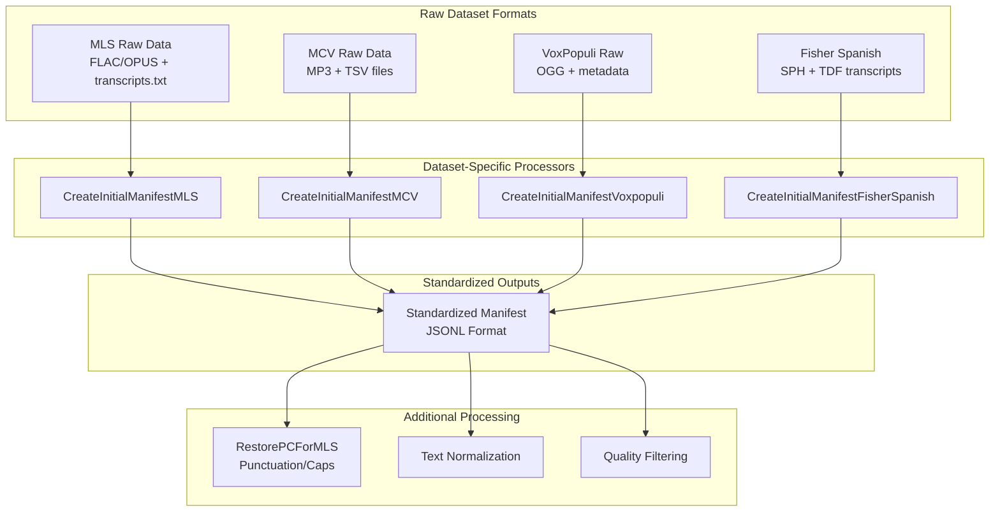
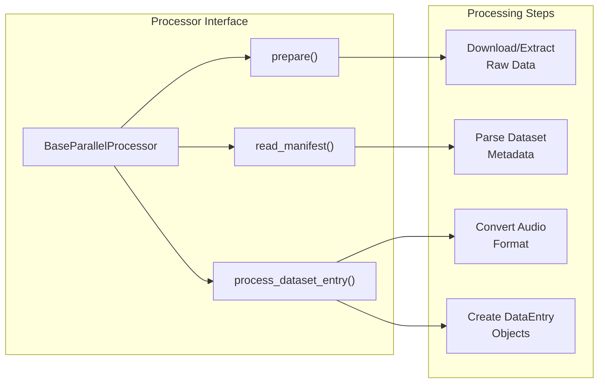
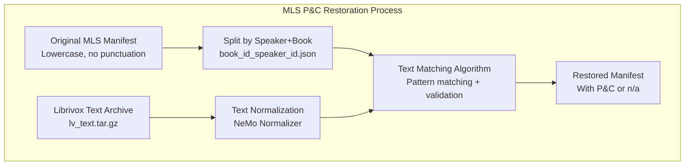

<!-- source: DeepWiki mcp.deepwiki.com · repo NVIDIA/NeMo-speech-data-processor · page 4 Dataset Processing · fetched 2026-10-26 -->

# Dataset Processing

<details>
<summary>Relevant source files</summary>

The following files were used as context for generating this wiki page:

- [dataset_configs/spanish_pc/fisher/unique_processors/create_initial_manifest_fisher_spanish.py](dataset_configs/spanish_pc/fisher/unique_processors/create_initial_manifest_fisher_spanish.py)
- [sdp/processors/datasets/mcv/create_initial_manifest.py](sdp/processors/datasets/mcv/create_initial_manifest.py)
- [sdp/processors/datasets/mls/create_initial_manifest.py](sdp/processors/datasets/mls/create_initial_manifest.py)
- [sdp/processors/datasets/mls/restore_pc.py](sdp/processors/datasets/mls/restore_pc.py)
- [sdp/processors/datasets/voxpopuli/create_initial_manifest.py](sdp/processors/datasets/voxpopuli/create_initial_manifest.py)
- [sdp/utils/get_diff.py](sdp/utils/get_diff.py)
- [tests/prepare_test_data/prepare_mcv_data.py](tests/prepare_test_data/prepare_mcv_data.py)

</details>


This document explains how the NeMo Speech Data Processor (SDP) ingests, processes, and standardizes various speech datasets using dataset-specific processors. This covers the transformation of raw dataset formats into standardized manifest files that can be used for speech model training.

For information about the overall system architecture and pipeline orchestration, see [Core Architecture](#2). For details about specific datasets, see [Multilingual LibriSpeech (MLS)](#4.1), [Mozilla Common Voice and Other Public Datasets](#4.2), and [TTS and Specialized Datasets](#4.3).

## Dataset Processing Overview

The SDP system transforms heterogeneous speech datasets into a standardized format through a multi-stage pipeline. Each dataset has unique characteristics requiring specialized initial processing, but all datasets converge to a common manifest format.



**Dataset Processing Flow**

Sources: [sdp/processors/datasets/mls/create_initial_manifest.py:30-70](), [sdp/processors/datasets/mcv/create_initial_manifest.py:32-62](), [sdp/processors/datasets/voxpopuli/create_initial_manifest.py:28-68](), [dataset_configs/spanish_pc/fisher/unique_processors/create_initial_manifest_fisher_spanish.py:59-69]()

## Initial Manifest Creation

All dataset processors inherit from `BaseParallelProcessor` and follow a common pattern for creating initial manifests. The standardized output format includes these core fields:

| Field | Description | Required |
|-------|-------------|----------|
| `audio_filepath` | Path to the audio file | Yes |
| `duration` | Duration in seconds | Yes |
| `text` | Transcription text | Yes |

Additional fields may be included based on dataset-specific metadata.



**Common Processor Interface Pattern**

Sources: [sdp/processors/base_processor.py](), [sdp/processors/datasets/mls/create_initial_manifest.py:112-181](), [sdp/processors/datasets/mcv/create_initial_manifest.py:86-142]()

## Dataset-Specific Processing Requirements

### Audio Format Handling

Different datasets require specialized audio processing:

| Dataset | Input Format | Conversion Tool | Output Format |
|---------|--------------|-----------------|---------------|
| MLS | FLAC/OPUS | `sox.Transformer` | WAV |
| MCV | MP3 | `sox.Transformer` | WAV |
| VoxPopuli | OGG | `sox.Transformer` | WAV |
| Fisher Spanish | SPH | `sph2pipe` | WAV |

### Transcript Format Processing

Each dataset has unique transcript formats requiring specialized parsing:

```mermaid
graph TD
    subgraph "MLS Processing"
        MLS_TRANS["transcripts.txt<br/>utt_id TAB text"]
        MLS_PARSE["Parse tab-delimited<br/>Create audio paths"]
    end
    
    subgraph "MCV Processing"
        MCV_TRANS["train/dev/test.tsv<br/>CSV with headers"]
        MCV_PARSE["csv.DictReader<br/>Extract path + sentence"]
    end
    
    subgraph "VoxPopuli Processing"
        VP_TRANS["asr_train.tsv<br/>Rich metadata format"]
        VP_PARSE["Parse 8-column format<br/>Include speaker info"]
    end
    
    subgraph "Fisher Spanish Processing"
        FISHER_TRANS["*.tdf files<br/>Timing + metadata"]
        FISHER_PARSE["Parse timing info<br/>Segment audio"]
    end
    
    MLS_TRANS --> MLS_PARSE
    MCV_TRANS --> MCV_PARSE
    VP_TRANS --> VP_PARSE
    FISHER_TRANS --> FISHER_PARSE
```



**Dataset Transcript Processing Patterns**

Sources: [sdp/processors/datasets/mls/create_initial_manifest.py:131-180](), [sdp/processors/datasets/mcv/create_initial_manifest.py:112-142](), [sdp/processors/datasets/voxpopuli/create_initial_manifest.py:117-155](), [dataset_configs/spanish_pc/fisher/unique_processors/create_initial_manifest_fisher_spanish.py:109-204]()

### Download and Extraction Strategies

Datasets use different acquisition methods:

- **MLS**: Automatic download from Facebook URLs using `download_file()` and `extract_archive()`
- **MCV**: Manual download required from Mozilla website, then extraction
- **VoxPopuli**: Git clone repository, install dependencies, run dataset scripts
- **Fisher Spanish**: Manual download of LDC archives, extraction with specialized processing

## Audio Processing and Resampling

Most dataset processors support audio resampling using the `sox.Transformer` class:

```python
# Common resampling pattern
tfm = Transformer()
tfm.rate(samplerate=self.target_samplerate)  # Usually 16000 Hz
tfm.channels(n_channels=self.target_nchannels)  # Usually 1 (mono)
tfm.build(input_filepath=src_path, output_filepath=tgt_path)
```

### Special Audio Processing Cases

**Fisher Spanish Audio Segmentation**:
- Uses timing information from TDF files to segment long recordings
- Applies channel separation for speaker isolation using `transformer.remix()`
- Validates segment duration and excludes segments shorter than 0.2 seconds

Sources: [dataset_configs/spanish_pc/fisher/unique_processors/create_initial_manifest_fisher_spanish.py:169-188]()

**MLS OPUS Support**:
- Supports both FLAC and OPUS formats via `use_opus_archive` parameter
- OPUS files cannot be resampled (format limitation)
- Automatically selects appropriate URL and file extensions

Sources: [sdp/processors/datasets/mls/create_initial_manifest.py:90-105](), [sdp/processors/datasets/mls/create_initial_manifest.py:154-172]()

## Punctuation and Capitalization Restoration

For datasets like MLS that lack punctuation and capitalization, the `RestorePCForMLS` processor can restore this information using original Librivox texts:



**MLS Punctuation/Capitalization Restoration Pipeline**

The restoration process uses sophisticated text matching algorithms and can optionally apply NeMo text normalization for better alignment.

Sources: [sdp/processors/datasets/mls/restore_pc.py:402-607](), [sdp/processors/datasets/mls/restore_pc.py:193-279]()

## Quality Validation and Metadata

Dataset processors perform various validation steps:

- **Duration validation**: Check audio file duration using `librosa.get_duration()` or `sox.file_info.duration()`
- **Text validation**: Ensure non-empty transcriptions
- **File existence**: Verify audio files exist before creating manifest entries
- **Format validation**: Validate expected transcript format (tab-delimited, CSV, etc.)

### Rich Metadata Support

Some processors capture extensive metadata:

**VoxPopuli Metadata**:
- Speaker ID, gender, age
- Transcript quality indicators (`is_gold_transcript`)
- Accent information
- Raw vs. normalized text versions

**Fisher Spanish Metadata**:
- Channel, speaker type, dialect
- Conversation section, turn, segment information
- Timing information (start/end times)

Sources: [sdp/processors/datasets/voxpopuli/create_initial_manifest.py:145-155](), [dataset_configs/spanish_pc/fisher/unique_processors/create_initial_manifest_fisher_spanish.py:174-203]()

---

