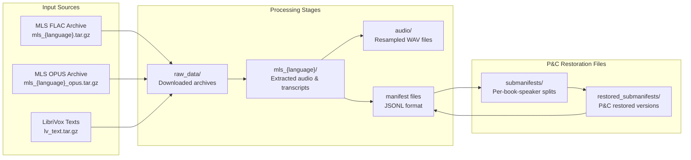
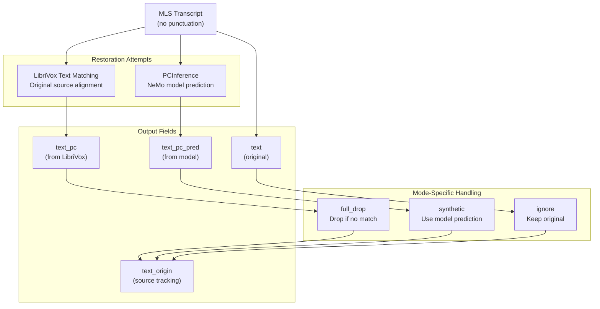

<!-- source: DeepWiki mcp.deepwiki.com · repo NVIDIA/NeMo-speech-data-processor · page 4.1 Multilingual LibriSpeech (MLS) · fetched 2026-10-26 -->

# Multilingual LibriSpeech (MLS)

<details>
<summary>Relevant source files</summary>

The following files were used as context for generating this wiki page:

- [dataset_configs/english/slr83/config.yaml](dataset_configs/english/slr83/config.yaml)
- [dataset_configs/italian/mcv/config.yaml](dataset_configs/italian/mcv/config.yaml)
- [dataset_configs/italian/mls/config.yaml](dataset_configs/italian/mls/config.yaml)
- [dataset_configs/italian/mls/config_nopc.yaml](dataset_configs/italian/mls/config_nopc.yaml)
- [dataset_configs/italian/voxpopuli/config.yaml](dataset_configs/italian/voxpopuli/config.yaml)
- [sdp/processors/datasets/mcv/create_initial_manifest.py](sdp/processors/datasets/mcv/create_initial_manifest.py)
- [sdp/processors/datasets/mls/create_initial_manifest.py](sdp/processors/datasets/mls/create_initial_manifest.py)
- [sdp/processors/datasets/mls/restore_pc.py](sdp/processors/datasets/mls/restore_pc.py)
- [sdp/processors/datasets/voxpopuli/create_initial_manifest.py](sdp/processors/datasets/voxpopuli/create_initial_manifest.py)
- [sdp/utils/get_diff.py](sdp/utils/get_diff.py)

</details>


This page covers the processing pipeline for the Multilingual LibriSpeech (MLS) dataset, including data download, audio conversion, manifest creation, and optional punctuation and capitalization restoration. The MLS system supports 8 languages and provides two main processing variants: with and without punctuation and capitalization (P&C).

For information about other speech datasets, see [Mozilla Common Voice and Other Public Datasets](#4.2).

## Overview

The MLS processing system handles the complete pipeline from raw dataset download to training-ready manifests. The key distinguishing feature of MLS processing is the optional punctuation and capitalization restoration, which uses alignment with original LibriVox source texts to recover formatting that was removed in the original dataset preparation.

## Core Processing Components

### MLS Processing Architecture

```mermaid
graph TB
    subgraph "MLS Processing Pipeline"
        Download["CreateInitialManifestMLS<br/>Download & Extract"]
        Convert["Audio Conversion<br/>FLAC/OPUS → WAV"]
        InitManifest["Initial Manifest Creation<br/>audio_filepath, duration, text"]
        
        subgraph "P&C Restoration (Optional)"
            RestorePC["RestorePCForMLS<br/>Match with LibriVox texts"]
            PCInference["PCInference<br/>Synthetic P&C generation"]
            Combine["CombineSources<br/>Merge text variants"]
        end
        
        subgraph "Text Processing"
            Regex["SubRegex<br/>Character normalization"]
            Filter["DropNonAlphabet<br/>Alphabet filtering"]
            Lower["SubMakeLowercase<br/>(no P&C variant)"]
        end
        
        subgraph "Quality Control"
            ASRCheck["ASRInference<br/>Quality validation"]
            ErrorDrop["DropASRError<br/>Filter bad transcripts"]
        end
        
        Final["KeepOnlySpecifiedFields<br/>Final manifest"]
    end
    
    Download --> Convert
    Convert --> InitManifest
    InitManifest --> RestorePC
    RestorePC --> PCInference
    PCInference --> Combine
    Combine --> Regex
    InitManifest --> Lower
    Lower --> Regex
    Regex --> Filter
    Filter --> ASRCheck
    ASRCheck --> ErrorDrop
    ErrorDrop --> Final
```



Sources: [sdp/processors/datasets/mls/create_initial_manifest.py:1-181](), [dataset_configs/italian/mls/config.yaml:69-250](), [dataset_configs/italian/mls/config_nopc.yaml:55-165]()

### Data Flow and File Organization



Sources: [sdp/processors/datasets/mls/create_initial_manifest.py:126-130](), [sdp/processors/datasets/mls/restore_pc.py:476-534]()

## Configuration Variants

The MLS system provides two main configuration variants that handle different use cases:

### With Punctuation & Capitalization (P&C)

| Configuration | Purpose | P&C Restoration Method |
|---------------|---------|----------------------|
| `config.yaml` | Training with punctuation and capitalization | LibriVox text matching + synthetic generation |
| P&C Mode Options | `full_drop` (default) | Drop utterances if P&C cannot be restored |
| | `synthetic` | Generate P&C using pretrained models |
| | `ignore` | Use original text without P&C matching |

### Without Punctuation & Capitalization

| Configuration | Purpose | Text Processing |
|---------------|---------|----------------|
| `config_nopc.yaml` | Training without punctuation | Lowercase + punctuation removal |
| Filtering | Alphabet-based | Keep only supported character sets |
| Quality Control | ASR validation | Remove transcription errors |

Sources: [dataset_configs/italian/mls/config.yaml:10-24](), [dataset_configs/italian/mls/config_nopc.yaml:1-38]()

## Primary Processors

### CreateInitialManifestMLS

The `CreateInitialManifestMLS` processor handles the foundational data preparation:

**Key Parameters:**
- `language`: Target language (e.g., "english", "italian", "spanish")
- `data_split`: One of "train", "dev", "test"
- `use_opus_archive`: Choose between FLAC (higher quality) or OPUS (smaller size)
- `resampled_audio_dir`: Output directory for converted WAV files
- `target_samplerate`: Default 16000 Hz
- `target_nchannels`: Default 1 (mono)

**Processing Steps:**
1. Download archive from `https://dl.fbaipublicfiles.com/mls/mls_{language}.tar.gz`
2. Extract to specified directory structure
3. Convert FLAC/OPUS files to WAV using sox
4. Calculate audio durations using librosa
5. Generate manifest with `audio_filepath`, `duration`, `text` fields

**Output Format:**
```json
{
    "audio_filepath": "/path/to/audio.wav",
    "duration": 4.32,
    "text": "transcript text without punctuation"
}
```

Sources: [sdp/processors/datasets/mls/create_initial_manifest.py:30-181]()

### RestorePCForMLS

The `RestorePCForMLS` processor implements sophisticated text alignment to restore punctuation and capitalization:

**Core Algorithm:**
1. **Submanifest Creation**: Split data by book and speaker combinations
2. **Text Preprocessing**: Normalize LibriVox source texts using pattern matching
3. **Alignment Process**: Use regex-based fuzzy matching to align MLS transcripts with source texts
4. **Validation**: Verify matches by comparing character-level content without punctuation
5. **Recovery Statistics**: Track success rates per book-speaker combination

**Text Normalization Pipeline:**
- Abbreviation expansion (e.g., "Cap'n" → "Captain")
- Character replacement (quotes, dashes, Unicode normalization)
- Sentence segmentation using regex patterns
- Optional NeMo text normalization for supported languages

**Validation Logic:**
```python
def is_valid(line, recovered_line):
    line_no_punc = remove_punctuation(line, remove_spaces=True, do_lower=True)
    recovered_line_no_punc = remove_punctuation(recovered_line, remove_spaces=True, do_lower=True)
    return line_no_punc == recovered_line_no_punc
```

Sources: [sdp/processors/datasets/mls/restore_pc.py:402-607](), [sdp/processors/datasets/mls/restore_pc.py:358-366]()

## Processing Modes and Strategies

### P&C Restoration Modes



Sources: [dataset_configs/italian/mls/config.yaml:104-121](), [dataset_configs/italian/mls/config.yaml:58-61]()

### Text Processing Pipeline

The text processing follows language-specific patterns but maintains consistent structure:

**Character Normalization:**
- Unicode character replacement (dashes, quotes, special symbols)
- Language-specific character handling (e.g., Italian î→i, ó→o)
- Google Books artifact removal

**Alphabet Filtering:**
- Define allowed character sets per language
- Drop utterances with unsupported characters
- Preserve language-specific diacritics

**Quality Filtering (Training Only):**
- ASR inference using pretrained models
- Drop utterances with high error rates
- Remove spaced-out letter patterns
- Filter specific transcription errors

Sources: [dataset_configs/italian/mls/config.yaml:123-152](), [dataset_configs/italian/mls/config_nopc.yaml:66-115]()

## Integration with Processing Framework

### Processor Chain Configuration

The MLS processors integrate with the broader SDP framework through YAML configuration:

```yaml
processors:
  - _target_: sdp.processors.CreateInitialManifestMLS
    language: ${language}
    data_split: "${data_split}"
    raw_data_dir: ${workspace_dir}/raw_data
    resampled_audio_dir: "${workspace_dir}/${data_split}/audio/"

  - _target_: sdp.processors.RestorePCForMLS
    language_long: ${language}
    language_short: ${language_id}
    lv_text_dir: "${workspace_dir}/librivox_text"
    restored_text_field: "text_pc"
```

**Configuration Parameters:**
- Dynamic field resolution using OmegaConf resolvers
- Conditional processor execution based on `pc_mode`
- Language-specific customization through parameter override

Sources: [dataset_configs/italian/mls/config.yaml:69-85](), [dataset_configs/italian/mls/config_nopc.yaml:55-61]()

### Error Handling and Validation

The MLS system includes comprehensive error handling:

**Audio Processing Validation:**
- OPUS resampling restriction (not supported)
- Audio duration calculation verification
- File existence checks before processing

**Text Restoration Validation:**
- Character-level content matching
- Success rate tracking and reporting
- Fallback strategies for failed matches

**Configuration Validation:**
- Parameter compatibility checks
- Required argument validation
- Language support verification

Sources: [sdp/processors/datasets/mls/create_initial_manifest.py:92-105](), [sdp/processors/datasets/mls/restore_pc.py:573-593]()

---

