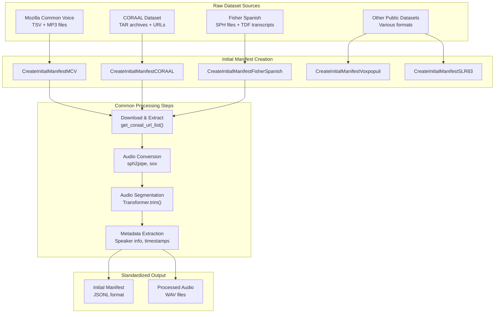
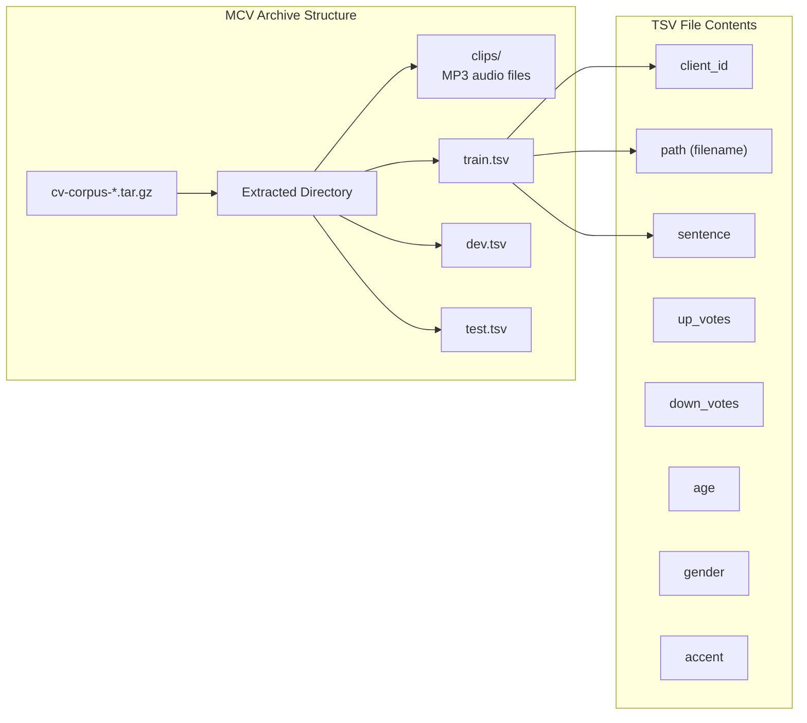
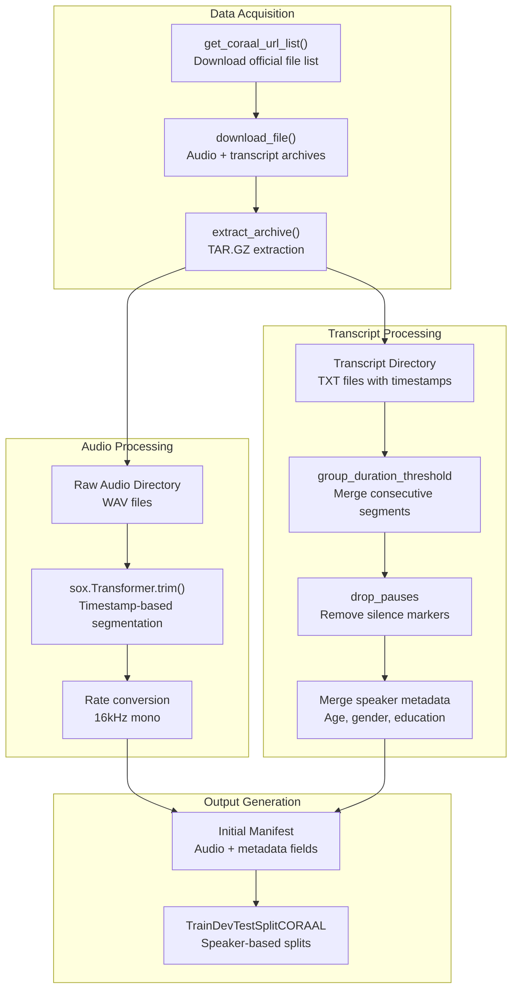
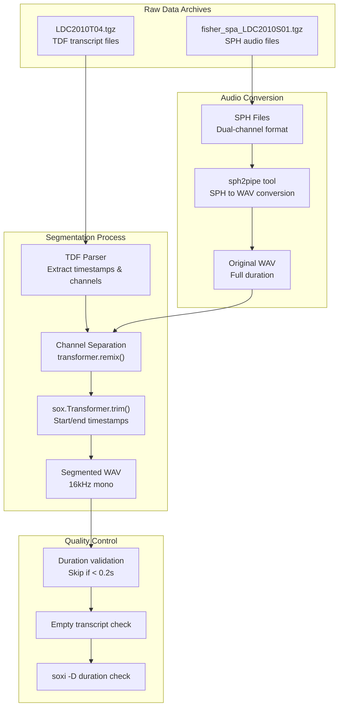
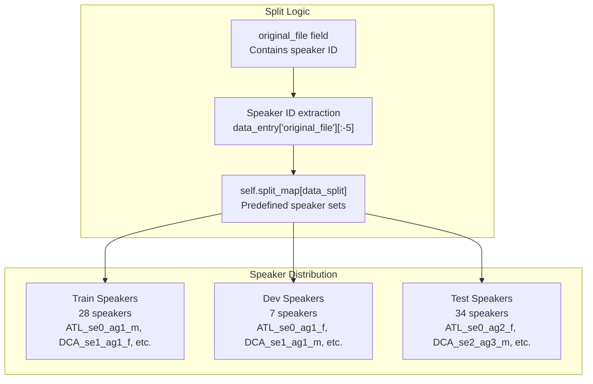

<!-- source: DeepWiki mcp.deepwiki.com · repo NVIDIA/NeMo-speech-data-processor · page 4.2 Mozilla Common Voice and Other Public Datasets · fetched 2026-10-26 -->

# Mozilla Common Voice and Other Public Datasets

<details>
<summary>Relevant source files</summary>

The following files were used as context for generating this wiki page:

- [dataset_configs/english/coraal/config.yaml](dataset_configs/english/coraal/config.yaml)
- [dataset_configs/spanish_pc/fisher/unique_processors/create_initial_manifest_fisher_spanish.py](dataset_configs/spanish_pc/fisher/unique_processors/create_initial_manifest_fisher_spanish.py)
- [pytest.ini](pytest.ini)
- [sdp/processors/datasets/coraal/__init__.py](sdp/processors/datasets/coraal/__init__.py)
- [sdp/processors/datasets/coraal/create_initial_manifest.py](sdp/processors/datasets/coraal/create_initial_manifest.py)
- [sdp/processors/datasets/coraal/data_splits.py](sdp/processors/datasets/coraal/data_splits.py)
- [tests/prepare_test_data/prepare_mcv_data.py](tests/prepare_test_data/prepare_mcv_data.py)

</details>


This page covers the processing of Mozilla Common Voice (MCV) and other publicly available speech datasets using the NeMo Speech Data Processor (SDP). These datasets require specialized processors to handle their unique formats, metadata structures, and audio characteristics.

For information about multilingual datasets like MLS, see [Multilingual LibriSpeech (MLS)](#4.1). For TTS-specific datasets, see [TTS and Specialized Datasets](#4.3).

## Overview of Supported Public Datasets

The SDP framework supports numerous public speech datasets, each with dedicated processors that handle format-specific requirements. These processors follow a common pattern of downloading, extracting, converting, and segmenting the raw data into standardized manifest format.

### Supported Public Datasets

| Dataset | Processor Class | Primary Use Case | Audio Format | Transcript Format |
|---------|----------------|------------------|--------------|-------------------|
| Mozilla Common Voice | `CreateInitialManifestMCV` | ASR/TTS | MP3 | TSV |
| CORAAL | `CreateInitialManifestCORAAL` | Dialect/ASR | WAV | TXT with timestamps |
| Fisher Spanish | `CreateInitialManifestFisherSpanish` | Conversational ASR | SPH (dual-channel) | TDF |
| VoxPopuli | `CreateInitialManifestVoxpopuli` | Multilingual ASR | WAV | Custom format |
| SLR83 | `CreateInitialManifestSLR83` | Accent variation | WAV | Text files |

Sources: [tests/prepare_test_data/prepare_mcv_data.py:24-58](), [sdp/processors/datasets/coraal/create_initial_manifest.py:47-84](), [dataset_configs/spanish_pc/fisher/unique_processors/create_initial_manifest_fisher_spanish.py:59-70]()

## Dataset Processing Architecture

The following diagram shows the common architecture for public dataset processors and their data flow:



Sources: [sdp/processors/datasets/coraal/create_initial_manifest.py:104-122](), [dataset_configs/spanish_pc/fisher/unique_processors/create_initial_manifest_fisher_spanish.py:79-107]()

## Mozilla Common Voice Processing

Mozilla Common Voice datasets come in a standardized format with train/dev/test splits in TSV files and corresponding MP3 audio clips. The test data preparation shows the typical structure.

### MCV Data Structure



The test preparation script demonstrates the typical processing pattern by reading TSV files line by line and copying corresponding audio files.

Sources: [tests/prepare_test_data/prepare_mcv_data.py:39-52]()

## CORAAL Dataset Processing

The Corpus of Regional African American Language (CORAAL) requires specialized handling due to its complex structure with multiple archives, timestamp-based transcripts, and speaker metadata.

### CORAAL Processing Pipeline



The CORAAL processor implements sophisticated utterance grouping logic that merges consecutive segments from the same speaker until a duration threshold is reached:

```python
# Speaker grouping logic from CreateInitialManifestCORAAL
speaker_bins = (~df['Spkr'].eq(df['Spkr'].shift())).cumsum()
df['ThresholdMult'] = df.groupby(speaker_bins)['Duration'].transform(
    lambda x: pd.Series.cumsum(x) // self.group_duration_threshold
)
```

Sources: [sdp/processors/datasets/coraal/create_initial_manifest.py:47-84](), [sdp/processors/datasets/coraal/create_initial_manifest.py:133-156](), [dataset_configs/english/coraal/config.yaml:63-76]()

## Fisher Spanish Dataset Processing

Fisher Spanish presents unique challenges with dual-channel SPH audio files that require specialized conversion tools and channel-specific processing.

### Fisher Spanish Audio Pipeline



The Fisher Spanish processor uses `sox.Transformer` for sophisticated audio processing including channel remixing:

```python
# Channel separation logic
transformer.remix({1: [int(channel) + 1]}, num_output_channels=1)
```

Sources: [dataset_configs/spanish_pc/fisher/unique_processors/create_initial_manifest_fisher_spanish.py:93-107](), [dataset_configs/spanish_pc/fisher/unique_processors/create_initial_manifest_fisher_spanish.py:169-177]()

## Configuration Patterns for Public Datasets

Public dataset configurations follow consistent patterns for processing pipelines, with common stages for filtering, text normalization, and quality control.

### Common Configuration Structure

```mermaid
graph LR
    subgraph "Configuration Components"
        INITIAL["CreateInitialManifest*<br/>Dataset-specific processor"]
        DURATION["DropHighLowDuration<br/>Length filtering"]
        REGEX["SubRegex<br/>Text cleaning"]
        LOWERCASE["SubMakeLowercase<br/>Case normalization"]
        ALPHABET["DropNonAlphabet<br/>Character filtering"]
        RELATIVE["ChangeToRelativePath<br/>Path adjustment"]
    end
    
    subgraph "Dataset-Specific Steps"
        CORAAL_DROP["DropOnAttribute<br/>Remove interviewers"]
        CORAAL_SPLIT["TrainDevTestSplitCORAAL<br/>Speaker-based splits"]
    end
    
    INITIAL --> DURATION
    DURATION --> REGEX
    REGEX --> LOWERCASE
    LOWERCASE --> ALPHABET
    ALPHABET --> RELATIVE
    
    RELATIVE --> CORAAL_DROP
    CORAAL_DROP --> CORAAL_SPLIT
```



The CORAAL configuration demonstrates sophisticated regex patterns for cleaning African American English transcripts:

| Pattern | Replacement | Purpose |
|---------|-------------|---------|
| `\bbusses\b` | `"buses"` | Common spelling correction |
| `\baks\b` | `"ask"` | Dialect-specific correction |
| `(?i)unintelligible/` | `""` | Remove unintelligible markers |
| `/RD(.*?)/` | `""` | Remove redacted content |
| `<[^>]+>` | `""` | Remove non-linguistic markers |

Sources: [dataset_configs/english/coraal/config.yaml:88-110](), [dataset_configs/english/coraal/config.yaml:141-154](), [sdp/processors/datasets/coraal/data_splits.py:19-31]()

## Custom Data Splits and Metadata

Public datasets often require custom splitting strategies that preserve important characteristics like speaker identity or dialectal variation.

### CORAAL Speaker-Based Splitting

The CORAAL dataset uses a predefined speaker-based split to ensure that the same speakers don't appear across different data splits. This is implemented in `TrainDevTestSplitCORAAL` with hardcoded speaker lists:



Sources: [sdp/processors/datasets/coraal/data_splits.py:43-125](), [sdp/processors/datasets/coraal/data_splits.py:127-130]()

---

