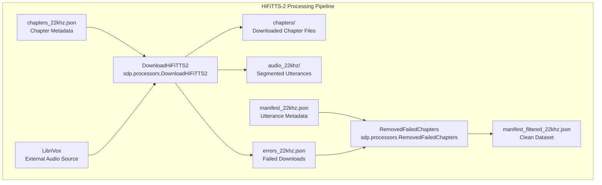
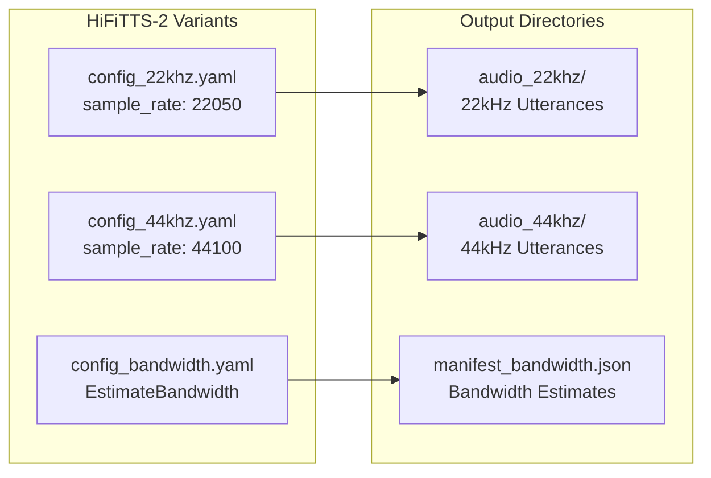
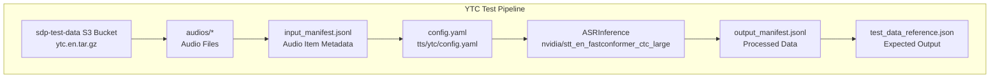
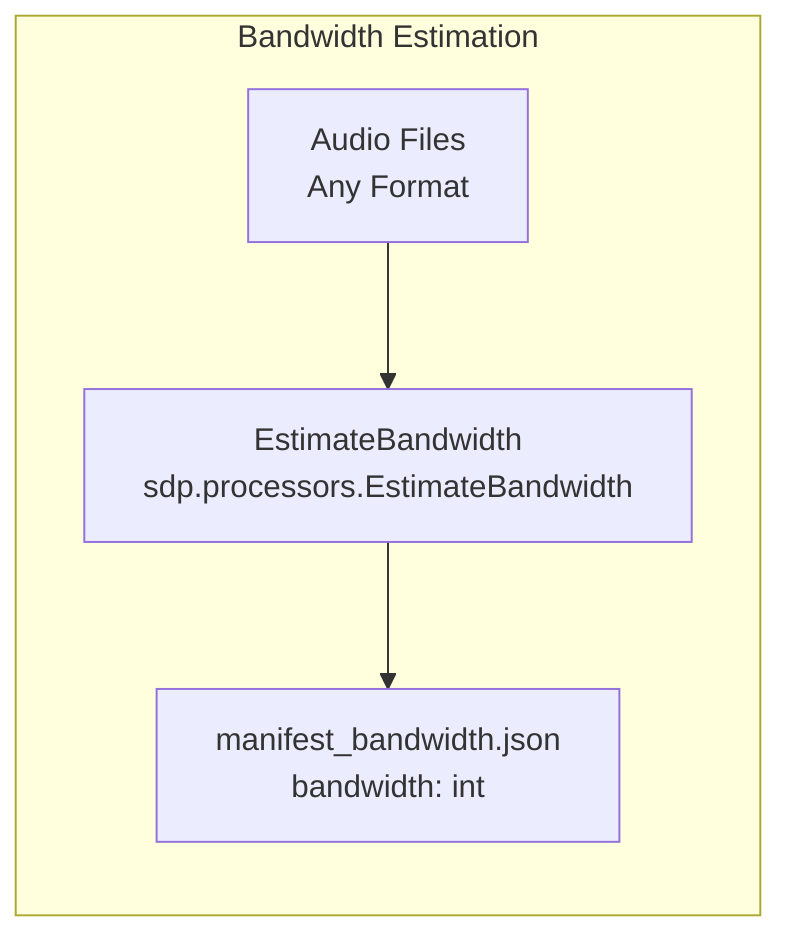

<!-- source: DeepWiki mcp.deepwiki.com · repo NVIDIA/NeMo-speech-data-processor · page 4.3 TTS and Specialized Datasets · fetched 2026-10-26 -->

# TTS and Specialized Datasets

<details>
<summary>Relevant source files</summary>

The following files were used as context for generating this wiki page:

- [dataset_configs/english/hifitts2/config_22khz.yaml](dataset_configs/english/hifitts2/config_22khz.yaml)
- [dataset_configs/english/hifitts2/config_44khz.yaml](dataset_configs/english/hifitts2/config_44khz.yaml)
- [dataset_configs/english/hifitts2/config_bandwidth.yaml](dataset_configs/english/hifitts2/config_bandwidth.yaml)
- [docs/src/conf.py](docs/src/conf.py)
- [requirements/tts.txt](requirements/tts.txt)
- [sdp/processors/datasets/hifitts2/__init__.py](sdp/processors/datasets/hifitts2/__init__.py)
- [sdp/processors/datasets/hifitts2/download_dataset.py](sdp/processors/datasets/hifitts2/download_dataset.py)
- [sdp/processors/datasets/hifitts2/remove_failed_chapters.py](sdp/processors/datasets/hifitts2/remove_failed_chapters.py)
- [tests/prepare_test_data/prepare_hifitts2_data.py](tests/prepare_test_data/prepare_hifitts2_data.py)
- [tests/test_tts_sdp_end_to_end.py](tests/test_tts_sdp_end_to_end.py)

</details>


This document covers the processing of Text-to-Speech (TTS) datasets and other specialized speech datasets that require unique handling beyond standard ASR datasets. The focus is on high-quality TTS data preparation, including audiobook segmentation, specialized audio requirements, and dataset-specific processors.

For general dataset processing patterns, see [Dataset Processing](#4). For ASR-focused datasets like LibriSpeech and Common Voice, see [Mozilla Common Voice and Other Public Datasets](#4.2).

## Overview and Scope

TTS datasets typically require different processing considerations compared to ASR datasets:
- Higher audio quality requirements (22kHz, 44kHz sample rates)
- Longer-form audio that needs segmentation
- Specialized metadata handling for prosodic features
- Quality estimation and bandwidth analysis
- Integration with external content sources (LibriVox, YouTube)

The SDP system provides specialized processors for TTS dataset preparation, with primary support for HiFiTTS-2 and emerging support for YouTube Commons datasets.

Sources: [dataset_configs/english/hifitts2/config_22khz.yaml:1-64](), [dataset_configs/english/hifitts2/config_44khz.yaml:1-64](), [tests/test_tts_sdp_end_to_end.py:1-83]()

## HiFiTTS-2 Dataset Processing

HiFiTTS-2 is a high-quality TTS dataset sourced from LibriVox audiobooks. The processing pipeline involves downloading audiobook chapters and segmenting them into individual utterances based on precomputed timing information.

### Core HiFiTTS-2 Processors



Sources: [sdp/processors/datasets/hifitts2/download_dataset.py:28-169](), [sdp/processors/datasets/hifitts2/remove_failed_chapters.py:24-66]()

### DownloadHiFiTTS2 Processor

The `DownloadHiFiTTS2` class handles the core download and segmentation logic:

| Parameter | Purpose | Default |
|-----------|---------|---------|
| `audio_dir` | Root directory for utterance files | Required |
| `chapter_dir` | Root directory for chapter files | Required |
| `sample_rate` | Target sample rate for utterances | 22050 |
| `delete_chapter_files` | Remove chapters after segmentation | true |
| `exit_on_error` | Terminate on download failures | false |
| `num_retries` | Retry attempts for failed downloads | 5 |

The processor implements robust error handling with exponential backoff and tracks failed downloads for later retry attempts.

Sources: [sdp/processors/datasets/hifitts2/download_dataset.py:64-80](), [sdp/processors/datasets/hifitts2/download_dataset.py:100-169]()

### Sample Rate Configurations

HiFiTTS-2 supports multiple sample rate configurations for different use cases:



Sources: [dataset_configs/english/hifitts2/config_22khz.yaml:33-34](), [dataset_configs/english/hifitts2/config_44khz.yaml:34-35](), [dataset_configs/english/hifitts2/config_bandwidth.yaml:37-44]()

### Error Handling and Recovery

The HiFiTTS-2 pipeline includes sophisticated error handling:

1. **Download Retries**: Network failures trigger automatic retries with backoff
2. **Duration Validation**: Downloaded chapters are validated against expected durations
3. **Error Tracking**: Failed downloads are logged to `errors_22khz.json` for analysis
4. **Manifest Cleanup**: `RemovedFailedChapters` removes utterances from failed chapters

Sources: [sdp/processors/datasets/hifitts2/download_dataset.py:106-133](), [sdp/processors/datasets/hifitts2/download_dataset.py:138-154](), [sdp/processors/datasets/hifitts2/remove_failed_chapters.py:52-66]()

## YouTube Commons and TTS Testing

The system includes support for YouTube Commons (YTC) TTS data processing, primarily used in the testing framework.

### YTC Processing Pipeline



Sources: [tests/test_tts_sdp_end_to_end.py:13-46](), [tests/test_tts_sdp_end_to_end.py:48-83]()

### TTS-Specific Requirements

TTS processing requires additional dependencies beyond standard SDP requirements:

| Package | Purpose |
|---------|---------|
| `transformers` | Transformer model support |
| `accelerate` | Model acceleration |
| `torchaudio` | Audio processing |
| `pyannote-audio` | Speaker diarization |
| `ffmpeg-python` | Audio conversion |
| `whisperx==3.3.1` | Whisper ASR integration |

Sources: [requirements/tts.txt:1-7]()

## Bandwidth Estimation

The system includes specialized bandwidth estimation capabilities for audio quality assessment:

### EstimateBandwidth Processor

The bandwidth estimation processor analyzes audio files to determine their frequency bandwidth, which is crucial for TTS quality assessment:



The processor can be applied to any audio dataset but was specifically designed for HiFiTTS-2 quality analysis using the first 30 seconds of each audiobook chapter.

Sources: [dataset_configs/english/hifitts2/config_bandwidth.yaml:1-44]()

## Testing and Validation

TTS dataset processing includes comprehensive testing infrastructure:

### End-to-End Testing

The `test_tts_sdp_end_to_end.py` test validates the complete TTS processing pipeline:

1. Downloads test data from S3 (`sdp-test-data` bucket)
2. Extracts audio files and creates input manifests
3. Runs the YTC configuration with CPU-based ASR inference
4. Validates output against reference data

### Test Data Preparation

The `prepare_hifitts2_data.py` script creates smaller test datasets from full HiFiTTS-2 downloads:
- Copies subset of manifest entries
- Copies corresponding audio files
- Maintains directory structure for testing

Sources: [tests/test_tts_sdp_end_to_end.py:48-83](), [tests/prepare_test_data/prepare_hifitts2_data.py:23-72]()

## Implementation Details

### Directory Structure

TTS datasets follow a specific directory organization:

```
workspace_dir/
├── manifest_22khz.json          # Utterance metadata
├── chapters_22khz.json          # Chapter metadata  
├── errors_22khz.json           # Failed downloads
├── audio_22khz/                # Segmented utterances
│   └── speaker_id/
│       └── book_id/
│           └── utterance.wav
├── chapters/                   # Downloaded chapters
│   └── speaker_id/
│       └── book_id/
│           └── chapter.wav
└── manifest_filtered_22khz.json # Final clean dataset
```

### Parallel Processing

TTS processors inherit from `BaseParallelProcessor` and support configurable parallelism:
- `use_dask`: Enable Dask-based distributed processing
- `max_workers`: Number of parallel workers
- `chunksize`: Batch size for parallel operations

Sources: [dataset_configs/english/hifitts2/config_22khz.yaml:36-38](), [sdp/processors/datasets/hifitts2/download_dataset.py:28]()

---

